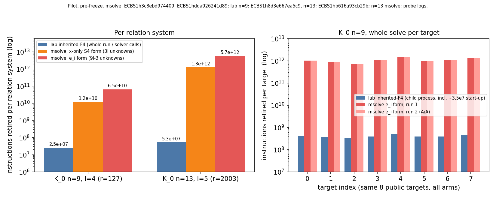
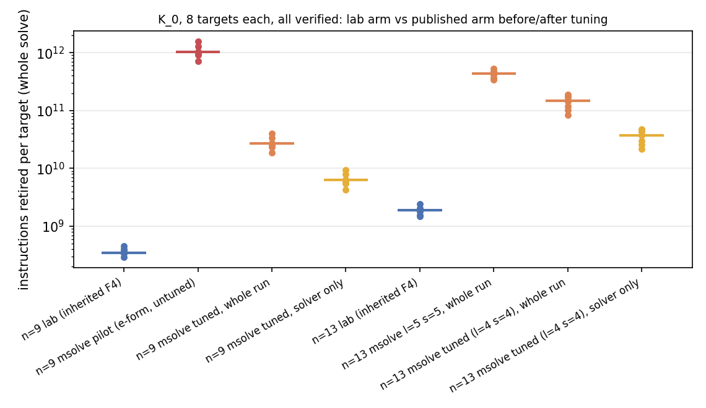
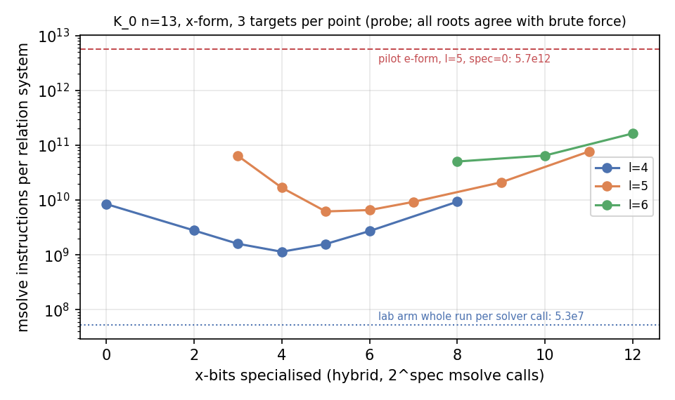

**Card** `XP-20261024-published-ic-reference-arm`. **Status: pre-freeze pilot.** `PROTOCOL.md` is still a DRAFT and
says no cell is timed before freeze, so **nothing here is a Register-E row** and nothing here supports a
"vs published index calculus" claim. Labels: *measured* (a recorded value), *derived* (arithmetic shown),
*projection* (derived from fewer measurements than the cell it names).

**Correction to commit `cfea7e5c44`.** That commit's report priced instructions at 604.6 per GAE and bounded the lab arm by a
"harness noise floor". Both were wrong: `/usr/bin/time -l` on the `ecbench` parent excludes the per-run child processes
in which every arm runs. This version replaces them with per-run child measurements (section 3).

**Follow-up A (2026-10-30, section 9) supersedes parts of this report:** the published arm now has tuning (x-only form,
hybrid specialisation, `l` sweep), the n = 13 cell ran (8/8 verified), the cross-unit control failure is diagnosed, and two
statements below are corrected there (labelled *Correction* in section 9). Read section 9 first.

## 1. Answer

A published-method cell ran. On Koblitz K_0 n = 9 (r = 127, m = 3, standard x-base of dimension 4), whole solve, 8 public
targets, 8/8 verified `[d]G = Q`:

- msolve arm: about 1.0 x 10^12 instructions retired per target (*measured*, repeat within 0.08 %).
- lab arm (inherited F4, same session law, same targets): about 3.9 x 10^8 per target, the whole run including about
  3.5 x 10^7 of process start-up (*measured*).
- Ratio per target, same unit, same host: **median 2.6 x 10^3** (range 2.2 x 10^3 to 3.1 x 10^3).
- Priced in GAE at 3265 instructions per GAE (*derived*): published arm S about 2.8 x 10^7, lab arm S about 9.5 x 10^3,
  matched rho 5.90. With the solver left uncharged, as `ecbench` does for this base, the two IC arms tie at 36.0.

K_0 n = 13 did **not** complete as a cell: one msolve system takes 5.70 x 10^12 instructions (544 s wall under load), and
the lab arm's recorded stream needs about 36 per target. The lab arm itself costs 1.9 x 10^9 instructions per target there
(*measured*), so the projected ratio is 1 x 10^5 (e_i form) or 2 x 10^4 (x-only form).

The protocol's cross-unit control, run on the lab arm at K13, **fails**: native-count pricing gives S = 631, instruction
pricing gives 1.28 x 10^4 (a factor 20; the tolerance proposed in PROTOCOL section 4 is 1.5). By the protocol's own
rule every arm is then priced in instructions, which is what this report does.

This says what *untuned, generic msolve F4 on the unspecialised Weil-descended system* costs. It does not say what the best
published pipeline costs: no hybrid (variable specialisation) sweep, no `l` sweep, no `T` invariants, no
Galbraith-Gebregiyorgis subspace, no WDSat were run (section 2). The lab's inherited-F4 solver splits on variables and is
itself close to a published hybrid approach, so the ratio is as much a statement about msolve's default on these systems as
about the lab. The distance to the *tuned* published arm is unmeasured.

## 2. Arm as run (and where it deviates from `PROTOCOL.md`)

- Instance: `icv1-f2m9-t5-81e744be` (Koblitz K_0, `KoblitzCurve::new(0, 9)`, #E = 508, r = 127, cofactor 4), base
  `binary-standard-subspace:dimension=4` (x in span(1, z, z^2, z^3)), m = 3; the 8 public targets of ecbench's
  `target_seed 202610111901` law. **n = 9 is not a size in PROTOCOL section 2** (the ladder starts at 13); it is used because n = 13
  cannot be afforded (section 5). The msolve arm (session `ECBS1h3c8ebd974409`) shares instance, targets and query stream
  with the lab and rho arms of that session; their counted values are identical to the later per-run-timed sessions
  `B9r`/`A9r` (checked: same S per target), which are the source of the lab arm's instructions.
- Binaries (`host.json` `build.binary_sha256`): `cf26250a...` for `ECBS1h3c8ebd974409` and `ECBS1hdda926241d89` (built from a `git archive` of
  `143ea46578` plus the engine in this commit); `6cf96928...` for the per-run-timed sessions, the same plus a **measurement shim**
  that runs each child under `/usr/bin/time -l` (`pilot_20261030/ecbench_child_time_shim.patch`, **not committed to `runner.rs`**).
  The shim changes no counted value.
- Published arm = `pdp3-binary:m=3,engine=msolve-s4` (new, `src/bin/ecbench/msolve_s4.rs`): the `e_i`-symmetrised Weil-descended
  Semaev `S_4` of `binary_semaev_s4` (descended `S_4`, quadratic in `e_1,e_2,e_3`, plus the cubic correspondence
  `e_i = sigma_i(x)`), 9l - 3 = 33 unknowns at l = 4, field equations appended, solved by `/opt/homebrew/bin/msolve` 0.9.5,
  `-g 2 -t 1`, one process per system. Roots from the reduced basis (section 4), lifted through the framework's
  `lift_abscissae`, relation sign-resolved and re-added in the group, then the pipeline's rank, linear algebra and
  `[d]G = Q` verification. A tuning-probe form `MSOLVE_S4_FORM=x` substitutes `e_i = sigma_i(x)` and solves over the 3l x-bits
  only; it ran in the probe, not in a session.
- Deviations from `PROTOCOL.md`, recorded rather than silent:
  1. `S_3`-symmetrisation only; **no 2-torsion `T` invariants** (`binary_semaev_s4.rs` has none; PROTOCOL section 2's
     "T-symmetrised" and section 1's "`e_i`-symmetrised" disagree, defect D6).
  2. msolve **0.9.5** (sha256 `eb640c7a472d894a...`), not the pinned 0.6.5; no version A/A.
  3. **No tuning sweep** (`l`, `LP`, `K`, specialisation); **no Galbraith-Gebregiyorgis subspace**; **no WDSat**; m = 3 only.
  4. Pricing is **not** the protocol's Callgrind `Ir`: no Valgrind on this host. Instructions retired from `/usr/bin/time -l` (Apple
     M4 Pro, aarch64) stand in. Instruction counts are not comparable with the leaderboard's x86 hosts, only within this pilot.
  5. Isolation: macOS, `ecbench --cpus none`, every record is L0 (PROTOCOL asks L1). Counted metrics are unaffected; host load
     was 10-50, so wall times in the records are not claims and are not used.

## 3. Pricing and the cross-unit control

- **Instructions per run.** `ecbench` runs every arm in a child (`ecbench exec`); `/usr/bin/time -l` on the parent reports only
  the parent (2.8 x 10^9, about the same for rho-only and lab-only sessions). The shim wraps each child instead. Measured on
  this host: rho-only child about 3.5 x 10^7 per run (start-up, 55-81 GAE of work), lab child at n = 9 about 3.9 x 10^8 (3.3 x 10^8 to
  4.9 x 10^8), at K13 about 1.9 x 10^9 (1.5 x 10^9 to 2.4 x 10^9). msolve's own instructions come from `/usr/bin/time -l` around each
  call, recorded as `solver.extra.msolve_ir`; repeat run on the same targets: total 8.5403 x 10^12 against 8.5366 x 10^12, each
  target within 0.08 %.
- **Instructions per GAE** (*derived*): rho-negation runs on K_0 n = 41, 4 targets, per-run child instructions less the 3.51 x 10^7
  start-up over the run's GAE: 3265, 3264, 3260, 3281 (GAE 4.8 x 10^5, 7.3 x 10^5, 1.4 x 10^6, 1.4 x 10^5);
  n = 37 gives 3.2 x 10^3 to 3.4 x 10^3. Use **3265**. It was measured at n = 41, where an addition is dearer than at n = 9 or 13,
  and includes walk overhead, so it is probably high for the small instances: S figures in instructions-priced GAE
  are then under-statements for both arms; the Ir-to-Ir ratio is unaffected by it.
- **Cross-unit control, lab arm, K13** (`B13r`, 8 targets, inherited F4): this tree prices the lab's word XORs through the pinned
  calibration for `icv1-f2m13-t181-515ee569` (record `unpriced` is empty), S = 631 (492 to 806). Priced by measured instructions:
  S = (child Ir - 3.51 x 10^7) / 3265 / sqrt(2003) = 1.28 x 10^4. Ratio 20 against a proposed 1.5 tolerance: **control fails**, so
  every arm is priced in instructions here. Caveats: the calibration was pinned on an x86 Xeon, this is aarch64; the instruction
  figure contains Groebner work that is not word XORs; the 3265 was measured at n = 41. None explains a factor 20 by itself, and
  the control was not repeated on the same host as the calibration.
- The committed leaderboard K13 figure (inherited-F4 S = 16.29, `SPEC-K13`, 2026-10-11) is the unpriced lower bound; the same arm
  priced through the calibration in this tree is 631 (defect D3).

## 4. Root extraction (instrument built for this pilot)

msolve 0.9.5 at characteristic 2: plain `solve` runs its FGLM step but writes an **empty** output file, and `-P 1|2` writes nothing
either (checked on a toy system). Roots are therefore read from the `-g 2` reduced basis: the standard monomials give the
quotient algebra A (dimension = number of F_2 points; the ideal is radical because the field equations are in it), the
multiplication matrices of the x-bits are built by normal forms and A is split into joint eigenspaces (an FGLM-type step,
`msolve_s4.rs`). Its native work is counted (`extraction_native_ops`, at most 4.8 x 10^3 per target, negligible) and uncharged in S.
Checked against brute force over V^3 (every ordered triple with `S_4 = 0`): **14/14** targets at n = 9 in each form (6 non-unit
ideals, largest 46 points), **3/3** at n = 13 (`probes/`). The unit-ideal verdicts (no relation) agree with brute force too.

## 5. Cells

`S` = GAE per sqrt(r), one target, cold, priced in measured instructions at 3265 per GAE unless marked "uncharged".

| cell | published-arm S | lab-arm S | ratio | verified | status |
|:--|:--|:--|:--|:--|:--|
| K_0 n=9, r=127, m=3, l=4, 8 targets | 2.8e7 (1.9e7 to 4.2e7) | 9.5e3 (8.0e3 to 1.2e4) | 2.6e3 in instructions (2.2e3 to 3.1e3) | 8/8 | measured |
| (same cell), solver uncharged | 36.0 | 36.0 | tie (same query stream) | | |
| (same cell) vs matched rho | 4.8e6 times rho | 1.6e3 times rho (rho S 5.90) | | | |
| K_0 n=13, r=2003, m=3, l=5 | not run; projection 1.4e9 (e_i), 3.1e8 (x-only) | 1.28e4 (instructions); 631 (native, pinned calibration); 16.29 (leaderboard, unpriced) | 1.1e5 (e_i) and 2.4e4 (x-only), projection | one system checked | did not complete |
| other binary, Koblitz 41-61, m=4, prime n=4,5 | not run | | | | not run |

Notes.

- **n = 9.** Instance `icv1-f2m9-t5-81e744be`. Published-arm S = (group GAE + msolve Ir / 3265) / sqrt(127) per target; lab S =
  (child Ir - 3.51 x 10^7) / 3265 / sqrt(127); median and range over the 8 targets. No pinned calibration exists for n = 9, so
  native-count pricing of the lab arm is not available there; `ecbench` leaves the solvers uncharged and both IC arms report
  S = 36.0. All three arms verified 8/8; the msolve arm repeated gave identical S.
- **AGENTS.md section 5a band** (unpriced native work at 0, 0.1, 1 GAE per op; lab ops = word XORs, msolve ops = instructions retired):
  S at 0: lab 36.0, msolve 36.0 (**tie**); at 0.1: 5.5e3 and 9.2e9; at 1: 5.5e4 and 9.2e10. The order, msolve above lab, holds at 0.1 and
  1 and ties at 0; the instruction measurement (ratio 2.6e3) is the primary comparison. The other uncharged counters
  (`as_solves`, `row_ops`, `frobenius_maps`, `target_guard_probes`) are equal on both IC arms and rho has none that were not swept.
- **n = 13 projection.** 36 systems per target (median solver calls of the committed K13 inherited-F4 records) x Ir per system
  (5.70e12 e_i form, one system; 1.27e12 x-only, two systems) / 3265 / sqrt(2003), and the same product over the measured lab child Ir
  (1.91e9). An `ecbench` attempt at this cell was stopped at 5 min CPU and 4.5 GB RSS with the first system unfinished
  (`runs/C1_k13_aborted_process_time.txt`).
- **Not run.** Random binary: the symmetrised `S_4` is specialised to b = 1 (D6). Other sizes: the first system is already 1e12 to
  1e13 Ir at n = 13.

Tuning probe (not a cell, per relation system, K_0): x-only form against `e_i` form, n = 9, l = 4 (14 targets): mean 1.21 x 10^10 against
6.49 x 10^10 Ir (5.4x); n = 13, l = 5: 1.27 x 10^12 against 5.70 x 10^12 (4.5x). Lab arm, whole run per solver call: 2.5 x 10^7 (n = 9),
5.3 x 10^7 (n = 13). The cheaper form is still 5 x 10^2 (n = 9) to 2 x 10^4 (n = 13) times the lab per system.

## 6. Instrument defects found

- **D1. Worktrees share inodes.** `src/cryptanalysis/inherited_f4.rs` has 6 hard links across worktrees and `src/bin/ecbench/pdp3_koblitz.rs` 13.
  An in-place edit in one worktree appears in the others: this worktree showed another session's uncommitted `inherited_f4.rs`
  change (adds `mod profile;` with no `profile.rs`, so the tree would not build). *Effect:* an in-place edit here would have altered 12 other
  worktrees. I replaced my `pdp3_koblitz.rs` by a new inode before editing and **left `inherited_f4.rs` untouched and uncommitted** (not my change).
- **D2. A sparse worktree cannot build.** `Cargo.toml` names 40+ `[[bin]]/[[example]]` paths outside the sparse set, and `include_str!` reads
  `docs/` and `research/` files. Built from a `git archive` subset in a separate directory; cold build 5.4 min.
- **D3. `ecbench` S is blind to an unrecognised solver unit, and the leaderboard K13 figure is stale.** At n = 9 the msolve and lab arms carry the same S
  (36.0), and the framework's pre-removal figure treated msolve's wall nanoseconds as GAE (`framework_total_gae_before_solver_removal`
  1.03e11). At K13 the lab arm is priced through a pinned calibration in this tree (S 631), against the leaderboard's 16.29 (unpriced,
  2026-10-11): a 39-fold difference in the headline IC number for the same arm.
- **D4.** `ecbench` holds one global lock `/tmp/crypto-bench.lock`; a second session exits at once unless `--wait` is given.
  `isolation_required` must be `L0` here (`"none"` is rejected; `L1` cannot be earned).
- **D5.** msolve 0.9.5 returns no solutions at p = 2 (section 4). `instructions retired` needs the sandbox off (a sysctl). The `ecbench` parent's
  figure excludes **every** per-run child (all arms), and identical sessions differ in the parent by about 1 %; per-run figures need the shim.
- **D6. Protocol defects.** (a) PROTOCOL section 1 says the reference is `e_i`-symmetrised, section 2 says "T-symmetrised"; the code has no `T`
  invariants. (b) B3/B4 list random binary curves, but `weil_descend_s4` asserts `b = 1`, so no random binary cell is runnable (needs M1). (c)
  Section 4's Callgrind control cannot run on this host, and the instruction-based substitute failed the proposed tolerance (section 3).
- **D7.** The conductor control plane at 127.0.0.1:8491 refused connections; no scope claim was made (hooks let edits through). `gh` and AWS
  credentials were not used; the checkpoint token worked.

## 7. What is needed to go further

- **WDSat**: `github.com/mtrimoska/WDSat` at `61c6ff3f49445af2729274819edb27b85a89efc1` (GPL-3.0, external process, build from `src/` with
  `make`, per-cell `config.h` constants); not fetched, size not checked, absent from this host. Needs an instance emitter (M3).
- **A Linux host with Valgrind** for the protocol's Callgrind `Ir`, and to repeat the cross-unit control on the host that pinned the calibration.
- **msolve 0.6.5 built from source** (`research/dreg_closure_m4l6_20261018/pod/boot.sh`) for the version A/A against 0.9.5.
- **M1**: general-b `S_4` (random binary), the `T`-invariants, and `m = 4`; **tuning sweeps** (specialisation/hybrid, `l`, `LP`) so the reference gets
  the tuning parity of PROTOCOL section 6. Without them the n >= 13 cells are not affordable (about 2 x 10^14 Ir per target projected, e_i form).
- The `benchmarks/<date>-<slug>/` copy of the graphs and PDF is deferred to whoever opens a PR (that path is outside this sparse checkout).

## 8. Files

All under `pilot_20261030/`: `specs/` (the specs run), `runs/` (records, session, host and process time of every session; `*.tm` are the per-child
`time -l` files of the shim runs; the aborted K13 attempt's process time), `probes/` (extraction check, n = 13 systems), `graphs/` (SVG, PDF, 150 dpi PNG,
data), `ecbench_child_time_shim.patch`. Code: `src/bin/ecbench/msolve_s4.rs`, `examples/msolve_s4_probe.rs`, and the `msolve-s4` engine in
`src/bin/ecbench/pdp3_koblitz.rs`. Derived values in section 5 are arithmetic on the recorded values, shown in the notes; they were computed with
a throwaway script, not committed as research code.

## 9. Follow-up A: tuning parity, the n = 13 cell, and the cross-unit control (2026-10-30)

Still **pre-freeze**: nothing here is a Register-E row. Same instances, targets (`target_seed 202610111901`, 8 public targets),
session law (`ecbench run --cpus none --wait`, 1 round, `alternate`, L0) and host as sections 1-5. Binary `bdb30b896019...`
(`T9`, `T13`; `T13b` and the lab arm in it ran on `31da10791fa0`, the same plus the general-b change of 9.4, which at
b = 1 is neutral: the lab arm's counted S in `T13b` equals `T13`'s on every target), built from a `git archive` of `f1945d0b9a` plus this commit's engine changes and the child-time shim. Evidence:
`tuned_20261030/` (specs, runs with per-child `time -l` files, probes, checks, graphs, `price.py`).

### 9.1 Result

| cell | lab arm (inherited F4), Ir per target | tuned published arm, Ir per target | ratio, whole run | ratio, msolve start-up removed | lower bound: msolve solving only vs lab whole run | verified |
|:--|:--|:--|:--|:--|:--|:--|
| K_0 n=9, r=127 (`T9`) | 3.5e8 | 2.7e10 (x-form, l=4, spec=4) | **74** (63 to 88) | 47 (41 to 56) | **17** (15 to 21) | 8/8 and 8/8 |
| K_0 n=13, r=2003 (`T13b`) | 1.9e9 | 1.5e11 (x-form, l=4, spec=4) | **76** (44 to 121) | 54 (31 to 86) | **19** (11.5 to 31) | 8/8 and 8/8 |
| K_0 n=13, second sweep point (`T13`) | 1.9e9 | 4.4e11 (x-form, l=5, spec=5) | 230 (221 to 245) | 207 (199 to 220) | 94 (91 to 101) | 8/8 and 8/8 |

*Measured* (per target: ecbench child instructions retired minus the 3.51e7 child start-up, plus the instructions of every msolve
process of that run; median and range of the 8 paired per-target ratios). The lower bound charges the published arm **only** msolve's
own solving (msolve Ir less 3.8e7 start-up per process): system construction, substitution, root extraction, group work and linear algebra
at 0. It is the figure most favourable to the published arm. Before tuning (section 1, same unit on the solver side): 2.6e3 at n = 9;
n = 13 did not complete (projection 2e4 to 1e5).

So tuning closed most of the gap the pilot reported, and the lab arm stays ahead: **the best tuned published arm costs at least
17 times (n = 9) and 19 times (n = 13) the lab arm, 74 and 76 times on the whole run**; on these two sizes the gap does not
shrink with n. The lab arm was not swept over `l` (it ran at the pilot's base only), so the sweep asymmetry favours the published arm
and these ratios are conservative. In GAE at 3265 Ir/GAE (whole run): n = 9 lab S 9.6e3 against published 7.3e5; n = 13 lab S 1.29e4
against published 1.0e6. Rho priced the same way: S 12.3 (n = 9, range 2.5 to 45) and 11.3 (n = 13, range 2.3 to 25), dominated by
start-up noise (rho does about 1.6e6 instructions of work at n = 13 against a 3.5e7 start-up), so the distance to rho in instructions is not
reliably measured at these sizes (counted rho S: 5.9 and 2.3).

The published arm's whole run includes this harness's own Rust work (ANF expansion of the x-form, 2^spec substitutions, rendering, parsing,
extraction): about 1.1e10 per target at n = 9 and 2.1e11 at n = 13, comparable to msolve itself. That is an implementation cost of this harness,
not necessarily of the published method, which is why the msolve-only lower bound is given as the headline. At n = 13, l = 4 needs
71 relation systems per target (median; l = 5: 36) at 1.1e9 msolve instructions each (l = 5: 6.2e9).

### 9.2 Tuning (PROTOCOL section 6)

New spec parameters of the `msolve-s4` engine (in the method id; absent = the pilot's arm, so its id is unchanged):
`form=e|x` (x: substitute `e_i = sigma_i(x)`, solve over the 3l x-bits) and `spec=k` (hybrid, Bettale-Faugere-Perret style:
fix the last k x-bits, run msolve on each of the 2^k specialised systems; subsystems refuted by the substitution alone skip msolve).
Roots are recombined with the fixed bits; extraction now splits on all free variables.

- **Correctness** (probe, roots against brute force over V^3): n = 9, l = 4, both forms, spec 0 to 8: 60/60 targets; l = 3, 5: 24/24;
  n = 13, l in {4, 5, 6}, spec 3 to 12: 39/39 (`tuned_20261030/probes/`).
- **Sweep, n = 13** (probe, mean msolve Ir per relation system, 3 targets; x-form): l = 5: spec 3 6.4e10, 4 1.7e10, **5 6.2e9**, 6 6.6e9,
  7 9.3e9, 9 2.1e10, 11 7.7e10 (pilot: spec 0 1.27e12 x-form, 5.70e12 e-form); l = 4: spec 4 1.1e9, 6 2.7e9, 8 9.3e9; l = 6: spec 8 5.0e10,
  10 6.5e10, 12 1.6e11. Systems per target scale against relation yield, which falls with l: l = 4 is 5x cheaper per system than l = 5 but its 16 x-values
  give fewer relations per trial (at n = 9 the analogous small base, l = 3, found none); l = 6 costs 8x more per system. l = 4: spec 0 8.5e9, 2 2.8e9, 3 1.6e9, **4 1.1e9**, 5 1.6e9 (minimum at 4).
  *Correction within this section:* l = 5, spec = 5 was first chosen by projection and run (`T13`); the l = 4, spec = 4 whole solve (`T13b`)
  then measured 71 systems per target, not the larger number the projection assumed, and is 3x cheaper per target than l = 5. **Best measured
  point: l = 4, spec = 4.** l = 6 was not run as a whole solve (per-system cost 8x l = 5's).
- **Sweep, n = 9** (whole solves, session `T9`): l = 3 (spec 0) **failed**: the dimension-3 base has 3 points and found 0 relations in 200 000
  trials (`exhausted`, 8/8); l = 4 spec 4: ratio 74 (above); l = 5 spec 7: ratio 625 (603 to 789), lower bound 101. Best: l = 4.
- msolve start-up: 3.74e7 to 4.02e7 instructions on a one-variable system (3 runs); taken as 3.8e7. At spec = k every system pays it 2^k times.
- **Not tuned**: `LP` (large primes), factor-base size beyond `l`, m = 2 or 4, msolve linear-algebra variants (`-l`), e-form with hybrid at
  n = 13 (at n = 9 it was 4x the x-form at spec 4), msolve 0.6.5 (A/A against 0.9.5 still not run), WDSat. The reference is therefore
  *more tuned*, not *fully tuned*.

### 9.3 The cross-unit control: diagnosis and the corrected rule

The x20 at K13 is **the native counter's coverage**, not the instruction pricing and not the host.

- Per record of the pilot's `B13r` (8 targets): child instructions per counted word XOR = **154 to 160** (stable); the pinned calibration
  implies 0.002304 GAE x 3265 Ir/GAE = 7.5. The whole x20 sits in this quotient (non-solver phases are about 730 GAE per target).
  At n = 9 (`B9r`) the same quotient is 474 to 756: it changes with n, so no single calibration constant can repair it.
- The host is excluded: the calibration's own loop (`calibrate_word_xor`, `ic_boundary.rs`, replicated in
  `tuned_20261030/checks/word_xor_instructions.rs`) retires **7.9 instructions per XOR** on this host, matching the 7.5 implied.
- The record states the counter's scope: `op_unit` "word XORs (elimination, specialisation and linear elimination only)". About 95 % of the
  solver's instructions at K13 (98 % at n = 9) are outside it: per-target Weil descent and system construction, symbolic preprocessing,
  monomial bookkeeping, propagation and splitting, allocation. The record nevertheless reports `unpriced: []` at K13.
- `T13` repeats `B13r` on the lab arm: same counted S (631) and child instructions within 0.5 % per target (A/A).

**Corrected rule (proposed for PROTOCOL section 4; this card applies it now).** A native counter may price a phase only if a
same-host instruction check shows it captures that phase within the stated tolerance; a counter that does not (or that is labelled as
partial) is a lower bound and enters only the section 5a band, never a point price. In this card every arm is priced as
(ecbench child instructions + every external solver process's instructions - start-up, identically on all arms) / Ir-per-GAE.
Ir-per-GAE should be measured at the cell's own n; this report still uses 3265 (n = 41), which affects S against rho, not the ratios between IC arms.

**AGENTS.md section 5a band** (median S; per the corrected rule the lab's word-XOR counter is partial, so its XORs are unpriced at
both sizes, as msolve's instructions are; `tuned_20261030/band_5a.py`, `runs/band_5a.txt`), at w = 0 / 0.1 / 1:
n = 9: lab 36.1 / 5.5e3 / 5.5e4, tuned msolve 36.8 / 1.4e8 / 1.4e9: msolve above lab across the band.
n = 13 (`T13b`): lab 16.3 / 2.7e4 / 2.7e5, tuned msolve 15.6 / 1.8e8 / 1.8e9 (`T13`, l = 5: 16.7 / 5.0e8 / 5.0e9): **the order flips** at w = 0,
where only the query and group work is left and the l = 4 base's is a few percent cheaper, so the two arms are not rankable under section 5a at
n = 13; the instruction measurement (9.1) is the comparison. Rho (counted 5.9, 2.3) is below both at every w.

### 9.4 Symmetry: D6a resolved, general b

- **D6a.** On `y^2 + xy = x^3 + a x^2 + b` the 2-torsion point acts on abscissae by `x -> sqrt(b)/x` (checked: all 507 affine points of K_0,
  n = 9); an F_2-subspace `V ∋ 1` is not stable (n = 9, `V = <1, z, z^2, z^3>`: 1 of 15 nonzero elements maps into V;
  `tuned_20261030/checks/two_torsion_action.py`). T-invariants therefore cannot act on the x-base; PROTOCOL is amended (section 2, D6a note)
  to `e_i` (`S_m`) symmetrisation for B3/B4/K3/K4, with a characteristic-2 T-variant on a binary Edwards model as a separate arm, not implemented.
- **General-b S_4** (milestone M1 part): derived as `Res_X(S_3(x1,x2,X), S_3(x3,x_R,X))` mod 2 and symmetrised (sympy,
  `tuned_20261030/general_b_s4_derivation.py`): f = b^2 e1^4 + b^2 x_R^4 + b e1^2 e3 x_R + b e2^2 x_R^2 + b e3^2 + b e3 x_R^3 + e1^2 e3^2 x_R^2
  + e2^4 x_R^4 + e2^2 e3 x_R^3 + e3^4 + e3^3 x_R + e3^2 x_R^4; at b = 1 it equals the shipped form term for term. Checked: vanishes on all 1794 planted
  sums P1 + P2 + P3 over six random-b curves (a in {0, 1}), random x_R vanishes at 0 to 1.7 % (negative control); the descended system solved by
  msolve agrees with brute force on 40/40 targets over b in {1, 320, 168, 77}, a in {0, 1} (`probes/n9_a*_b*.jsonl`). `binary_semaev_s4.rs` now
  takes any b (outputs at b = 1 unchanged; its `general_b_is_rejected` test is replaced by a general-b descent test; the module's 23 tests pass,
  `cargo test --release --lib binary_semaev_s4`). The `msolve-s4` ecbench engine still refuses b != 1 until a random binary cell is validated; no random binary cell ran.

### 9.5 Corrections to sections 1-8

- *Correction (shim).* The shim comment says each child's figure includes its children. It does not: in `T9`, the msolve arm's child retires
  fewer instructions than its own msolve calls (l = 4: 1.1e10 against 1.6e10). Sections 1-5 are unaffected (the pilot priced the msolve arm from
  msolve's own counts plus group GAE, and the lab arm has no grandchildren), but the published-arm instructions there exclude the harness's own Rust work.
- *Correction (n = 13).* Section 1's "n = 13 did not complete" holds for the untuned arm only; the tuned arm completed (9.1).
- *Correction (D3 scope).* The K13 counted S in section 3 (631) is not the "native price" of the lab arm's solver: the counter covers about 5 % of it (9.3);
  under the corrected rule the lab arm's counted S at K13 is 16.3 with the XORs in the band, the leaderboard's 16.29.

### 9.6 What still blocks freezing PROTOCOL

1. **Pricing host**: no Callgrind/Valgrind here; rho's instruction-priced S at these sizes is start-up noise, so the rho reference needs larger n or a
   start-up-free measurement; the corrected rule above must be adopted into section 4 (with a tolerance) and Ir-per-GAE
   measured at each cell's n. The ecbench counted S is not usable for an external solver (D3: unrecognised unit uncharged), so a reference row needs the
   instruction pricing in the harness, not a side script.
2. **Tuning not complete**: `LP`, m = 2/4, msolve `-l` variants, e-form hybrid at n = 13; whole-solve sweep points beyond (l, spec) = (4, 4) and (5, 5) at n = 13.
3. **WDSat** (pin `61c6ff3f...`): not fetched; needs the owner's go-ahead and an instance emitter (M3). The SAT arm is the likeliest published competitor
   at n >= 19 (PROTOCOL P-b) and is unmeasured.
4. **Literature-calibration control** (section 7) not done; msolve 0.6.5 A/A not run.
5. **Random binary cells**: general-b S_4 exists and is checked by probe; ecbench engine gate, workloads and a lab-arm run are missing. m = 4 (S_5) not started.
6. The section 2 ladder still starts at n = 13; n = 9 is outside it. The cost of the next ladder cell (n = 15) with the tuned arm is not projected here.
7. Conductor control plane refused connections again (no scope claim). The `benchmarks/<date>-<slug>/` copy is still deferred (outside this sparse checkout).
