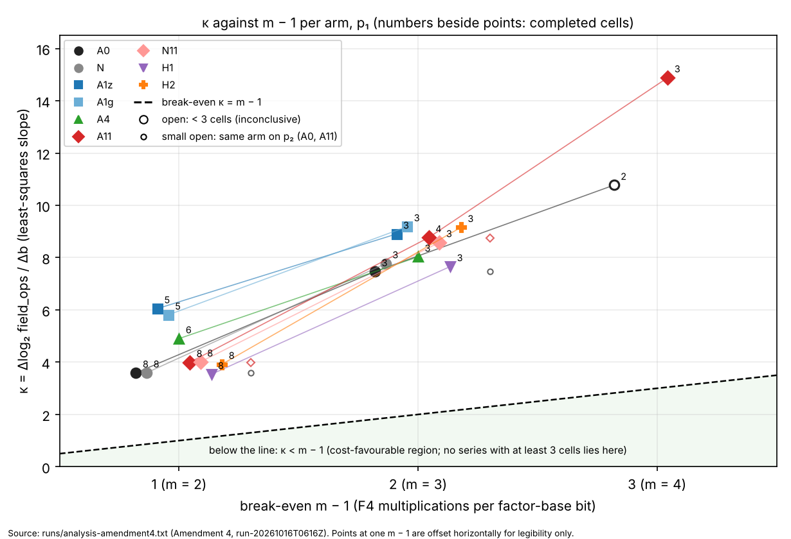
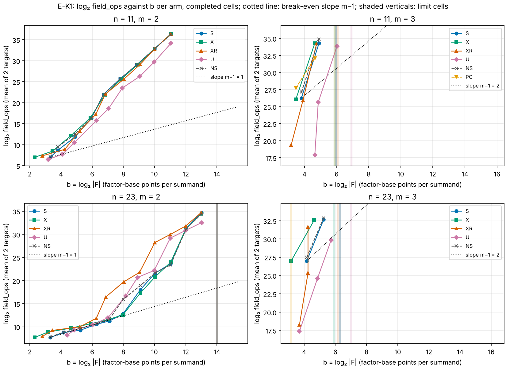

# Factor-base design close-out and E-K1

This entry makes the measured stage diagnostics easier to browse. The research
folders remain the source of truth for raw records, protocols, code, and
analysis. Graphs and reports are linked from those source folders.

**Scope:** field-operation counts for factor-base design and solver-stage
experiments. These are stage diagnostics: no pipeline cost (S), end-to-end
comparison, or speedup is reported. The recorded wall times are descriptive
and are not admitted performance evidence.

## Prime-field slope close-out

The close-out review adds no run; it re-scores committed results using
(kappa = Deltalog_2(	ext{field_ops})/Delta b) against the
(m-1) break-even. Every measured series with at least three completed cells
is cost-unfavourable at the measured sizes. A0 at (m=4) remains inconclusive
with two cells. No result is extrapolated beyond the measured cells.

- [Research source and raw records](../../research/factor_base_designs_20261015/README.md)
- [Review report PDF](../../research/factor_base_designs_20261015/reports/review-20261019T1632Z/REVIEW.pdf)
- [κ versus break-even graph (SVG)](../../research/factor_base_designs_20261015/reports/review-20261019T1632Z/kappa_vs_breakeven.svg) · [PNG](../../research/factor_base_designs_20261015/reports/review-20261019T1632Z/kappa_vs_breakeven.png)

## E-K1 Koblitz analogue stage run

The registered E-K1 run records 306 rows; 250 of 250 completed systems
reproduced their traces. All 14 series with at least three completed cells
are cost-unfavourable under the registered (kappa) score. The (S) arm at
(m=3) is inconclusive at both sizes (two cells); the positive control is
detected and the shape null reads mixed. Twenty-two rows are no-plant
placeholders, not completed systems. The result is limited to (nin{11,23})
and (min{2,3}).

- [Run report PDF](../../research/factor_base_designs_20261015/reports/run-20261019T1712Z/REPORT.pdf)
- [Raw rows and exact replay analysis](../../research/factor_base_designs_20261015/runs/)
- [Field operations versus base size (SVG)](../../research/factor_base_designs_20261015/reports/run-20261019T1712Z/ek1-field-ops-vs-b.svg) · [PNG](../../research/factor_base_designs_20261015/reports/run-20261019T1712Z/ek1-field-ops-vs-b.png)
- [Solving degree versus base size (SVG)](../../research/factor_base_designs_20261015/reports/run-20261019T1712Z/ek1-D-vs-b.svg) · [PNG](../../research/factor_base_designs_20261015/reports/run-20261019T1712Z/ek1-D-vs-b.png)

## A11 pipeline-pricing feasibility

No measurement was made. The feasibility note concludes that the existing
prime-curve ecbench oracles cannot consume the A11 tower systems, so neither
arm has an ecbench (S) result.

- [Feasibility report](../../research/a11_pipeline_pricing_20261019/FEASIBILITY.md)
- [Source graph (SVG)](../../research/a11_pipeline_pricing_20261019/reports/run-20261019T1634Z/graph.svg) · [PNG](../../research/a11_pipeline_pricing_20261019/reports/run-20261019T1634Z/graph.png)
- [Run report PDF](../../research/a11_pipeline_pricing_20261019/reports/run-20261019T1634Z/REPORT.pdf)

The report and plot assets are linked to their canonical research copies;
this entry does not duplicate those binaries.
