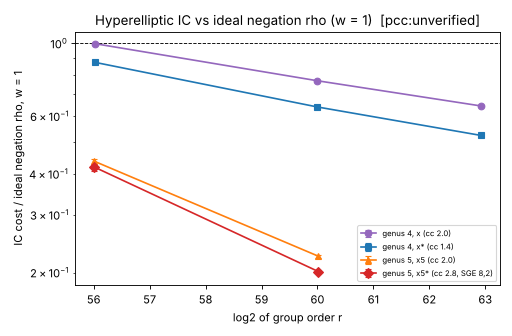

# Genus ladder scaling: genus-4 third prime and genus 5 at matched group size (lead C)

Study: [`research/genus_ladder_scaling_20261119`](../../research/genus_ladder_scaling_20261119/)
(`RESULTS.md`, with `ERRATA.md` taking precedence). Validation:
[`VALIDATION.json`](VALIDATION.json), [`validator-report.md`](validator-report.md)
(disposition validated-with-errata), [`replay-certificate.json`](replay-certificate.json).
Every number is `[pcc:unverified]`: no pcc claim records this study.

Hyperelliptic genus-4 and genus-5 Jacobians of prime order over F_p, not an elliptic-curve result.
Metric: Jacobian group operations plus w GAE per counted native F_p / mod-r operation (§5a), mean
over 3 curves × 6 targets × 2 seeds, against the ideal negation-rho bound sqrt(πr/4).

IC / ideal negation rho at w = 1 (below the bound at w = 0, 0.1 and 1 in every cell):

| genus | p | #J ≈ | arm | w = 1 |
|---|---|---|---|---|
| 4 | 54293 | 2^63 | x (double large prime, cc 2.0) | 0.645 [0.643, 0.647] |
| 4 | 54293 | 2^63 | x\* (double large prime, cc 1.4) | 0.524 [0.523, 0.526] |
| 5 | 2357 | 2^56 | **x5 (double large prime, cc 2.0)** | 0.437 [0.427, 0.445] |
| 5 | 4099 | 2^60 | **x5 (double large prime)** | 0.224 [0.222, 0.227] |
| 5 | 2357 | 2^56 | x5\* (full-factor-base IC, cc 2.8; ERRATA E1) | 0.419 [0.407, 0.430] |
| 5 | 4099 | 2^60 | x5\* (full-factor-base IC; ERRATA E1) | 0.201 [0.199, 0.204] |

- **ERRATA E1.** At cc 2.8 every degree-1 place is in the factor base and no large prime is used,
  so x5\* is full-factor-base IC. The genus-5 double-large-prime arm is x5. On it, genus 5 against
  genus 4 at the same group size is x5 / x\* = 0.499 [0.487, 0.508] at N ≈ 2^56 and
  0.351 [0.347, 0.354] at N ≈ 2^60.
- **ERRATA E2.** The genus-4 three-point fit for x\* (exponent 1.568) is curved. The middle residual
  −0.0114 excludes 0.
- **ERRATA E3.** The genus-5 slopes are two-point fits and should not be extrapolated.
- **ERRATA E4–E5.** The per-step hash and the table bookkeeping are uncounted (at most 0.3%). Each
  genus is compared with its own Jacobian's rho.
- **The §5a band in `VALIDATION.json`** is the binding cell, g4 p = 54293 arm x.

Host: local shared 4-core VM, single-threaded. The counts are deterministic.
