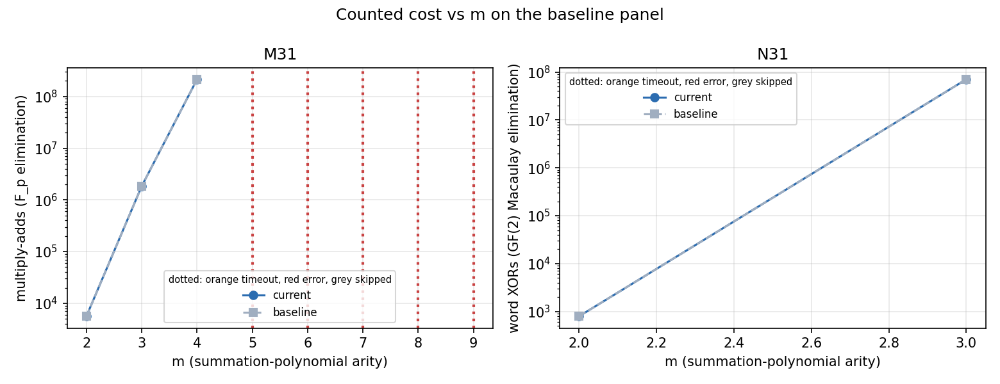
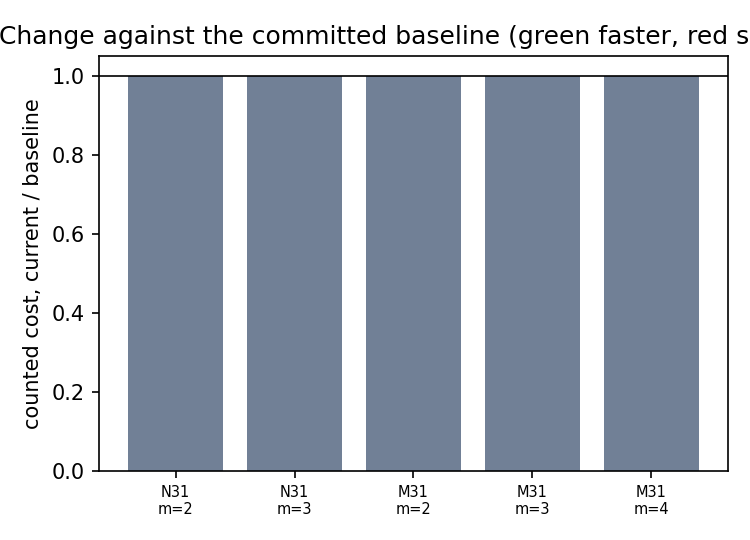
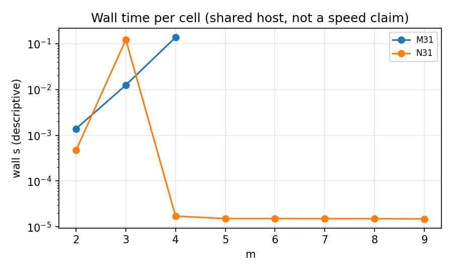

# Gröbner engine baseline panel

Regenerated automatically by `.github/workflows/gb-baseline-rebench.yml` (`tools/gb_baseline.py`) whenever the F4 / Gröbner engine code, the harnesses or `panel.json` change. Do not edit by hand.

- Commit: `e09024b2e8ec3b30f4f16d5d87b4d94dd4bb9d40`  
- Run: https://github.com/isogeny-labs/crypto/actions/runs/45080384094  
- Host: AMD EPYC 9V45 96-Core Processor (4 CPUs), rustc 1.100.0 (0ef1bc386 2026-11-09)  
- Generated: 2026-11-22T23:57:39Z; per-cell timeout 600 s
- Commit: `43b3270e6f6be286994872aaa38b0945f9d5ece5`  
- Run: https://github.com/isogeny-labs/crypto/actions/runs/44836588931  
- Generated: 2026-11-21T00:24:43Z; per-cell timeout 600 s
- Commit: `aa7cb9c186269ec3b3e0e2b9170f2ea358c98bb8`  
- Run: https://github.com/isogeny-labs/crypto/actions/runs/44788401623  
- Host: AMD EPYC 9V74 80-Core Processor (4 CPUs), rustc 1.100.0 (0ef1bc386 2026-11-09)  
- Generated: 2026-11-20T19:02:34Z; per-cell timeout 600 s
- Commit: `c5ccdcfd2c315c8d2ee2fbd87872a61e198c7ea1`  
- Run: https://github.com/isogeny-labs/crypto/actions/runs/44253513714  
- Generated: 2026-11-18T07:48:23Z; per-cell timeout 600 s

## Panel

- **N31** — Koblitz K_0/2^31 (binary, Frobenius-invariant factor base 0); harness `examples/groebner_stage_bench.rs`, engine koblitz_groebner (matrix-F4 over GF(2), Weil-restricted Semaev)
- **M31** — p = 2^31 - 1 (Mersenne prime), Dickson torus tower (2^t | p + 1); harness `examples/pkm_tower_pilot.rs`, engine f4_tower_generic (F4 over F_p)
- m values: [2, 3, 4, 5, 6, 7, 8, 9]

## Cells

| curve | m | status | counted cost | unit | answer digest | wall s | vs baseline |
|:--|--:|:--|--:|:--|:--|--:|:--|
| M31 | 2 | ok | 5620 | multiply-adds (F_p elimination) | `7695ff52fe1defda` | 0.00139 | unchanged |
| M31 | 3 | ok | 1.845e+06 | multiply-adds (F_p elimination) | `8d038345ea40a3fa` | 0.0125 | unchanged |
| M31 | 4 | ok | 2.143e+08 | multiply-adds (F_p elimination) | `f7d48b0b09178c89` | 0.139 | unchanged |
| M31 | 2 | ok | 5620 | multiply-adds (F_p elimination) | `7695ff52fe1defda` | 0.00138 | unchanged |
| M31 | 3 | ok | 1.845e+06 | multiply-adds (F_p elimination) | `8d038345ea40a3fa` | 0.0116 | unchanged |
| M31 | 4 | ok | 2.143e+08 | multiply-adds (F_p elimination) | `f7d48b0b09178c89` | 0.135 | unchanged |
| M31 | 2 | ok | 5620 | multiply-adds (F_p elimination) | `7695ff52fe1defda` | 0.00169 | unchanged |
| M31 | 3 | ok | 1.845e+06 | multiply-adds (F_p elimination) | `8d038345ea40a3fa` | 0.0153 | unchanged |
| M31 | 4 | ok | 2.143e+08 | multiply-adds (F_p elimination) | `f7d48b0b09178c89` | 0.178 | unchanged |
| M31 | 2 | ok | 5620 | multiply-adds (F_p elimination) | `7695ff52fe1defda` | 0.00161 | unchanged |
| M31 | 3 | ok | 1.845e+06 | multiply-adds (F_p elimination) | `8d038345ea40a3fa` | 0.0152 | unchanged |
| M31 | 4 | ok | 2.143e+08 | multiply-adds (F_p elimination) | `f7d48b0b09178c89` | 0.176 | unchanged |
| M31 | 5 | timeout | — | — | `—` | — | still timeout |
| M31 | 6 | timeout | — | — | `—` | — | still timeout |
| M31 | 7 | timeout | — | — | `—` | — | still timeout |
| M31 | 8 | timeout | — | — | `—` | — | still timeout |
| M31 | 9 | timeout | — | — | `—` | — | still timeout |
| N31 | 2 | ok | 796 | word XORs (GF(2) Macaulay elimination) | `10055e840b7b42c7` | 0.000474 | unchanged |
| N31 | 3 | ok | 7.039e+07 | word XORs (GF(2) Macaulay elimination) | `10055e840b7b42c7` | 0.123 | unchanged |
| N31 | 4 | ok | 0 | word XORs (GF(2) Macaulay elimination) | `20b0fa11cd19564e` | 1.71e-05 | cost unit changed |
| N31 | 5 | ok | 0 | word XORs (GF(2) Macaulay elimination) | `20b0fa11cd19564e` | 1.51e-05 | cost unit changed |
| N31 | 6 | ok | 0 | word XORs (GF(2) Macaulay elimination) | `20b0fa11cd19564e` | 1.51e-05 | cost unit changed |
| N31 | 7 | ok | 0 | word XORs (GF(2) Macaulay elimination) | `20b0fa11cd19564e` | 1.5e-05 | cost unit changed |
| N31 | 8 | ok | 0 | word XORs (GF(2) Macaulay elimination) | `20b0fa11cd19564e` | 1.5e-05 | cost unit changed |
| N31 | 9 | ok | 0 | word XORs (GF(2) Macaulay elimination) | `20b0fa11cd19564e` | 1.49e-05 | cost unit changed |
| N31 | 2 | ok | 796 | word XORs (GF(2) Macaulay elimination) | `10055e840b7b42c7` | 0.000445 | unchanged |
| N31 | 3 | ok | 7.039e+07 | word XORs (GF(2) Macaulay elimination) | `10055e840b7b42c7` | 0.113 | unchanged |
| N31 | 4 | ok | 0 | word XORs (GF(2) Macaulay elimination) | `20b0fa11cd19564e` | 1.86e-05 | cost unit changed |
| N31 | 5 | ok | 0 | word XORs (GF(2) Macaulay elimination) | `20b0fa11cd19564e` | 2.08e-05 | cost unit changed |
| N31 | 6 | ok | 0 | word XORs (GF(2) Macaulay elimination) | `20b0fa11cd19564e` | 1.62e-05 | cost unit changed |
| N31 | 7 | ok | 0 | word XORs (GF(2) Macaulay elimination) | `20b0fa11cd19564e` | 1.55e-05 | cost unit changed |
| N31 | 8 | ok | 0 | word XORs (GF(2) Macaulay elimination) | `20b0fa11cd19564e` | 1.54e-05 | cost unit changed |
| N31 | 9 | ok | 0 | word XORs (GF(2) Macaulay elimination) | `20b0fa11cd19564e` | 1.6e-05 | cost unit changed |
| N31 | 2 | ok | 796 | word XORs (GF(2) Macaulay elimination) | `10055e840b7b42c7` | 0.000497 | unchanged |
| N31 | 3 | ok | 7.039e+07 | word XORs (GF(2) Macaulay elimination) | `10055e840b7b42c7` | 0.159 | unchanged |
| N31 | 4 | ok | 0 | word XORs (GF(2) Macaulay elimination) | `20b0fa11cd19564e` | 2.33e-05 | cost unit changed |
| N31 | 5 | ok | 0 | word XORs (GF(2) Macaulay elimination) | `20b0fa11cd19564e` | 1.84e-05 | cost unit changed |
| N31 | 6 | ok | 0 | word XORs (GF(2) Macaulay elimination) | `20b0fa11cd19564e` | 1.57e-05 | cost unit changed |
| N31 | 7 | ok | 0 | word XORs (GF(2) Macaulay elimination) | `20b0fa11cd19564e` | 1.61e-05 | cost unit changed |
| N31 | 8 | ok | 0 | word XORs (GF(2) Macaulay elimination) | `20b0fa11cd19564e` | 1.88e-05 | cost unit changed |
| N31 | 9 | ok | 0 | word XORs (GF(2) Macaulay elimination) | `20b0fa11cd19564e` | 1.58e-05 | cost unit changed |
| N31 | 2 | ok | 796 | word XORs (GF(2) Macaulay elimination) | `10055e840b7b42c7` | 0.000596 | unchanged |
| N31 | 3 | ok | 7.039e+07 | word XORs (GF(2) Macaulay elimination) | `10055e840b7b42c7` | 0.16 | unchanged |
| N31 | 4 | ok | 0 | word XORs (GF(2) Macaulay elimination) | `20b0fa11cd19564e` | 2.29e-05 | cost unit changed |
| N31 | 5 | ok | 0 | word XORs (GF(2) Macaulay elimination) | `20b0fa11cd19564e` | 1.94e-05 | cost unit changed |
| N31 | 6 | ok | 0 | word XORs (GF(2) Macaulay elimination) | `20b0fa11cd19564e` | 2.06e-05 | cost unit changed |
| N31 | 7 | ok | 0 | word XORs (GF(2) Macaulay elimination) | `20b0fa11cd19564e` | 1.86e-05 | cost unit changed |
| N31 | 8 | ok | 0 | word XORs (GF(2) Macaulay elimination) | `20b0fa11cd19564e` | 1.76e-05 | cost unit changed |
| N31 | 9 | ok | 0 | word XORs (GF(2) Macaulay elimination) | `20b0fa11cd19564e` | 1.74e-05 | cost unit changed |

## Reading this

Counted cost is the harness's own unit and is what decides faster/slower; wall time is descriptive (shared host). `ANSWER CHANGED` means the solver decided a target differently from the baseline — a correctness question before any speed one. `timeout` cells are censored, `skipped` cells are inadmissible for that m. Stage diagnostics of the solver axis only: no end-to-end ECDLP cost, no `S`, no leaderboard row; every number is `[pcc:unverified]`.
