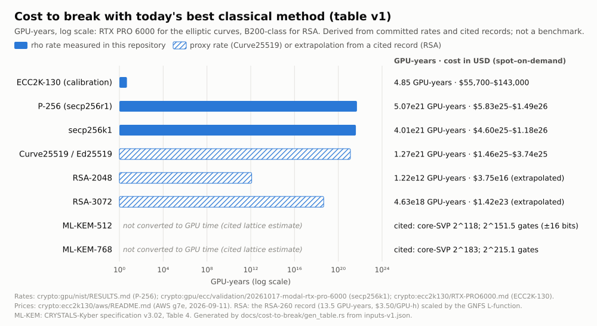

# Cost to break, table v1

What it would cost today, with the best known classical method, to break
one key of each of P-256, secp256k1, Curve25519/Ed25519, RSA-2048, RSA-3072,
ML-KEM-512 and ML-KEM-768, with ECC2K-130 as the calibration row (action plan
2026-11-21, row R2; workspace `docs/strategy/2026-11-21-action-plan.md`).

**Status: version 1, drafted 2026-11-22, for the Principal Cryptographer's
review.** This is a derived table. It is **not** a benchmark, **not** an IC
leaderboard row and **not** a validated result: no new measurement was run
for it, none of its inputs is an ecbench session with a replay certificate,
and no number here has a pcc claim, so every figure is an unverified
assertion until reviewed [pcc:unverified]. It is kept out of
`benchmarks/README.md` and the leaderboard on purpose (validation gate,
`docs/VALIDATION_GATE.md`).

Files:

| File | What it is |
|:--|:--|
| [`inputs-v1.json`](inputs-v1.json) | Every input number with its source (hand-edited) |
| [`gen_table.rs`](gen_table.rs) | Std-only Rust generator: derives every other number |
| [`table-v1.json`](table-v1.json) | Generated: derived rows, checks, and the inputs verbatim |
| [`chart-v1.svg`](chart-v1.svg) | Generated chart. No PNG is committed: the artifact policy sends a PNG over 64 KiB to the store; render one locally with the command below if needed |
| [`report.typ`](report.typ), [`report.pdf`](report.pdf) | One-page report with the chart, for people who will not read JSON |

## The table

<!-- table:begin (generated by gen_table.rs from inputs-v1.json; do not edit by hand) -->
Table version 1, as of 2026-11-22.

| Target | Best known classical method | Expected work | Throughput used | $/GPU-hour | GPU-years | Cost, USD | Quantum-vulnerable |
|:--|:--|:--|:--|:--|--:|--:|:--|
| ECC2K-130 (calibration) | parallel Pollard rho with distinguished points on classes under negation and Frobenius | `1.069*sqrt(pi*n/(2*262))` = 2^60.91 group operations (n ≈ 2^129.00) | 14.1 G/s, measured here (RTX PRO 6000, on Modal) | 1.31–3.36 (AWS g7e, spot–on-demand) | 4.85 | 55,700–143,000 | yes |
| P-256 (secp256r1) | parallel Pollard rho with distinguished points and the negation map | `sqrt(pi*n/(2*2))` = 2^127.83 group operations (n ≈ 2^256.00) | 1.88 G/s, measured here (RTX PRO 6000, on Modal) | 1.31–3.36 (AWS g7e, spot–on-demand) | 5.07e21 | 5.83e25–1.49e26 | yes |
| secp256k1 | parallel Pollard rho with distinguished points, walk on classes under Aut(E) = Z/6 (negation and the GLV endomorphism) | `sqrt(pi*n/(2*6))` = 2^127.03 group operations (n ≈ 2^256.00) | 1.38 G/s, measured here (RTX PRO 6000, on Modal) | 1.31–3.36 (AWS g7e, spot–on-demand) | 4.01e21 | 4.60e25–1.18e26 | yes |
| Curve25519 / Ed25519 | parallel Pollard rho with distinguished points and the negation map, in the prime-order subgroup | `sqrt(pi*n/(2*2))` = 2^125.83 group operations (n ≈ 2^252.00) | 1.88 G/s, proxy: P-256 rate (RTX PRO 6000, on Modal) | 1.31–3.36 (AWS g7e, spot–on-demand) | 1.27e21 (proxy rate) | 1.46e25–3.74e25 | yes |
| RSA-2048 | general number field sieve (GNFS) | NIST strength 112 bits; GNFS L-ratio to the 862-bit RSA-260 record = 2^36.4 | RSA-260 record: 13.5 GPU-years on B200-class GPUs (cited) | 3.50 (the record's own assumption) | 1.22e12 (extrapolated) | 3.75e16 | yes |
| RSA-3072 | general number field sieve (GNFS) | NIST strength 128 bits; GNFS L-ratio to the 862-bit RSA-260 record = 2^58.2 | RSA-260 record: 13.5 GPU-years on B200-class GPUs (cited) | 3.50 (the record's own assumption) | 4.63e18 (extrapolated) | 1.42e23 | yes |
| ML-KEM-512 | primal lattice attack with BKZ and sieving (core-SVP model and the specification's refined gate count) | core-SVP 2^118 classical, 2^107 quantum; refined 2^151.5 gates (±16 bits) (cited) | not converted (no GPU rate for lattice sieving here) | — | — | — | not known |
| ML-KEM-768 | primal lattice attack with BKZ and sieving (core-SVP model and the specification's refined gate count) | core-SVP 2^183 classical, 2^166 quantum; refined 2^215.1 gates (cited) | not converted (no GPU rate for lattice sieving here) | — | — | — | not known |

Checks the generator recomputes on every run:

- `ecc2k130-published-work`: formula gives 2^60.905 against the published 2^60.900 (difference 0.005 bits).
- `ecc2k130-repository-cost`: derived/repository ratios 1.003 (GPU-hours), 0.995 (spot dollars), 1.006 (on-demand dollars).
- `gnfs-rsa260-to-rsa896`: predicted 35.0 GPU-years against a reported 30.0 (ratio 1.166); different software and unnamed GPUs.
<!-- table:end -->



## Method

**Elliptic curves.** The best known classical attack on a prime-order
subgroup of these curves is parallel Pollard rho with distinguished points
(van Oorschot–Wiener 1999). With group order `n` and a walk on classes under
`A` automorphisms (the negation map gives `A = 2`), the expected number of
steps is

    E = c · sqrt(π n / (2A))

so `sqrt(π n / 4)` with the negation map alone, `sqrt(π n / 12)` on
secp256k1 (`Aut(E) = Z/6`), and `sqrt(π l / (4·131))` on ECC2K-130
(negation times Frobenius). `c` is the walk constant: 1.0 for an idealised
random walk, about 1.07–1.08 for the measured ECC2K-130 walk. The table uses
`c = 1.0` for the prime-field rows, which slightly favours the attacker.
Time is `E` divided by a rho rate measured in this repository on one GPU
type, the RTX PRO 6000 Blackwell Server Edition:

| Field | Rate | Where it was measured |
|:--|:--|:--|
| P-256 prime field | 1.883 G steps/s, negation-map walk | `crypto:gpu/nist/RESULTS.md`, round 3; raw `gpu/nist/sweep3.log`; Modal run `ap-UfeieuzyETwurk5q75ZnHC` |
| secp256k1 prime field | 1.377 G steps/s, Z/6 walk | `crypto:gpu/ecc/validation/20261017-modal-rtx-pro-6000/` (`tune.log`) |
| 2^255 − 19 (Curve25519) | **not measured** | the P-256 rate is used as a labelled proxy: same field type and size, different prime |
| GF(2^131) binary field (ECC2K-130) | 14.107 G iterations/s with DP34 collection | `crypto:ecc2k130/RTX-PRO6000.md`, `crypto:ecc2k130/README.md` |

No rate is carried across field types: the binary-field rate is used only
for ECC2K-130, and the prime-field rates only for prime fields.

**Price.** $1.31 per GPU-hour (AWS spot, g7e.2xlarge, one RTX PRO 6000,
us-west-2) to $3.36 (on-demand, same instance), both observed on 2026-09-11
and recorded in `crypto:ecc2k130/aws/README.md`. Cross-checks in the
repository: the AWS Pricing API gave $3.36312/h on-demand
(`gpu/certicom131/RESULT.md`), RunPod charged $2.49/h
(`gpu/explicit-relations/VALIDATION.md`).

**Calibration.** The ECC2K-130 row reproduces the figures the campaign
already uses: the formula gives `2^60.905` iterations against Bailey et
al.'s published `2^60.9` (IACR ePrint 2009/541), and the GPU-hours and
dollars match `crypto:ecc2k130/aws/README.md` (42,400 GPU-hours, $56k spot,
$142k on-demand) within rounding. The generator recomputes these checks on
every run (listed under the table).

**RSA.** The best known classical method is the general number field sieve.
NIST SP 800-57 Part 1 Rev. 5 (Table 2) rates RSA-2048 at 112 and RSA-3072 at
128 bits of security strength. For GPU time the table scales the most
recent record with a published cost, RSA-260 (862 bits; about 13.5
GPU-years on B200-class GPUs, $414k at the record's own $3.50 per
GPU-hour; Cognition, 2026-09-09), by the ratio of the GNFS heuristic
`L_N[1/3, (64/9)^(1/3)]` with its `o(1)` term set to 0. That is a standard
order-of-magnitude extrapolation, not a cost estimate anyone has
published for these sizes; it ignores memory, the linear-algebra share and
hardware change. As a sanity check, the same ratio predicts about 35
GPU-years for RSA-896 against the roughly 30 reported in September 2026 (a
secondary report, unnamed GPUs). The CPU record RSA-250 (2,700 core-years)
gives a core-year cross-check in `table-v1.json`.

**ML-KEM.** The figures are those of the CRYSTALS-Kyber specification
v3.02 (2021), Table 4, whose parameter sets ML-KEM (FIPS 203) keeps:
core-SVP hardness 2^118 (ML-KEM-512) and 2^183 (ML-KEM-768) classical, 2^107
and 2^166 quantum, and the refined gate counts 2^151.5 and 2^215.1, the
first with a stated uncertainty of up to 2^16 either way. They count
operations in a cost model, not GPU work at a measured rate, so the table
does not convert them to GPU-years or dollars. The lab's own `mlwe margins`
estimator is deliberately **not** used until its outside review (action
plan R5).

**Quantum-vulnerable.** RSA and every elliptic curve here fall to Shor's
algorithm on a large fault-tolerant quantum computer, which does not exist
today (resource estimates: Roetteler, Naehrig, Svore and Lauter,
ASIACRYPT 2017, for elliptic curves; Gidney, arXiv:2505.15917, 2025, for
RSA-2048). No known quantum algorithm defeats ML-KEM at these
parameters beyond the quantum core-SVP figure. The cost columns are
classical costs only.

## Limits

- The prime-field rates are single sweeps on rented GPUs with no isolation
  level recorded (one sample per configuration for secp256k1; 8,192
  iterations per cell for P-256). They are throughput readings, not ecbench
  sessions with replay certificates; the action plan's R2 row asks for the
  latter, and getting them is follow-up work (an experiment the owners have
  to authorise).
- `gpu/ecc/README.md` still says its kernels have never run on a GPU; the
  validation directory cited above records device runs after it was
  written.
- Curve25519 has no measured rate (proxy above).
- GPU-years and dollars for 256-bit curves are about 10^21 and 10^26: the
  point of those rows is the size of the gap, not the precision of the
  figure. Neither moves by more than a small factor with a better kernel or
  a cheaper GPU.
- The RSA rows rest on one self-reported record and a heuristic with its
  `o(1)` dropped; read them as orders of magnitude.
- Prices are spot and on-demand list prices on one date and one provider,
  not billing receipts.
- The elliptic-curve and RSA rows use different methods and different GPU
  classes (RTX PRO 6000 against B200-class), so compare them across
  families as orders of magnitude only.

## How to update

1. Edit only [`inputs-v1.json`](inputs-v1.json): a new measured rate (with
   the file, session or run id where it was measured), a new price (with
   date and source), a new record, or a new row. Every number needs a
   `source` or `where` next to it.
2. Regenerate and check, from the repository root:

   ```sh
   rustc -O --edition 2021 docs/cost-to-break/gen_table.rs -o /tmp/gen_table
   /tmp/gen_table docs/cost-to-break            # rewrites table-v1.json, chart-v1.svg, the block above
   /tmp/gen_table docs/cost-to-break --check    # exit 0 only if every output is current
   ```

3. Re-render the report (and, if wanted, a local PNG; do not commit a PNG
   over 64 KiB, which the artifact policy sends to the store). This is
   document rendering only:
   Typst from a scratch virtualenv, as the `research-visuals` skill
   describes (`python3 -m venv /tmp/rv && /tmp/rv/bin/pip install typst`).
   From this directory:

   ```sh
   H=$(grep -o 'height="[0-9.]*"' chart-v1.svg | head -1 | grep -o '[0-9.]*')
   printf '#set page(width: 750pt, height: %spt, margin: 0pt)\n#image("/chart-v1.svg", width: 100%%)\n' \
     "$(echo "$H * 0.75" | bc)" > /tmp/png.typ && cp /tmp/png.typ _png.typ
   /tmp/rv/bin/python -c "import typst; typst.compile('_png.typ', output='chart-v1.png', format='png', ppi=150, root='.')"
   rm _png.typ
   /tmp/rv/bin/python -c "import typst; typst.compile('report.typ', output='report.pdf', root='.')"
   ```

   Then open the PDF and read every page. `report.typ` only lays out
   `table-v1.json` and the SVG; it computes nothing.
4. A change to a published number is a new version: copy the inputs to
   `inputs-v2.json`, bump `table_version`, keep v1 as it is, and say what
   changed and why.

Consumers (action plan P9, the report template's cost-to-break column) cite
a number as "cost-to-break table v1, row `<id>`".
