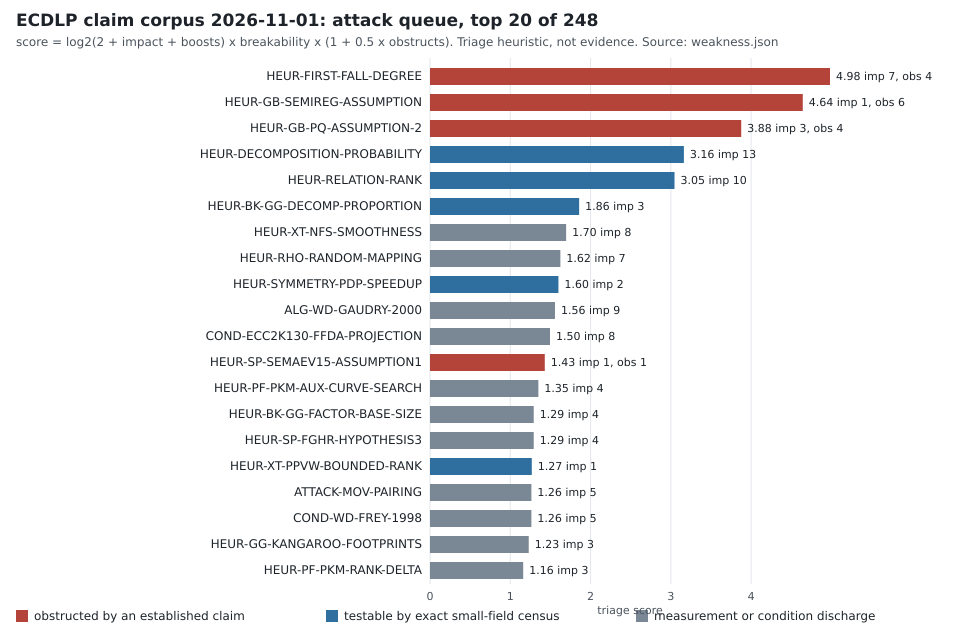

# Weak points in the ECDLP hardness corpus: triage, 2026-11-03

**Question.** Where is the claim graph that supports ECDLP hardness weakest, and which
weak points can be broken cheaply enough to attack first? [pcc:unverified]

**Scope.** The assembled corpus (version 2026-11-01: 583 claims, 950 edges, 236 sources,
including the protocol-layer port of W7 and the Lean results of 2026-11-04),
read through `weakness.mjs`, plus the repository sources the corpus cites. W1–W7 change no
existing claim's status; proposed edits are listed as actions. The Lean round of
2026-11-04 adds kernel-checked nodes, refutes one inference
(`CLAIM-MARGINAL-IMPLIES-HAZARD`) and moves the xedni waiting-time edge onto the
weaker per-trial marginal assumption. The
generated companion is [`WEAKNESSES.md`](WEAKNESSES.md) (all rows) with
[`weakness.json`](weakness.json) and [`weakness-queue.svg`](weakness-queue.svg).

**Method.** `attack-graph.mjs` already ranks unestablished claims by impact (how much
rests on them) and propagates taint from refuted claims. `weakness.mjs` adds what that
pass does not see:

| check | what it finds | count |
|---|---|---|
| status inflation | proved / algorithm / measured claims whose support closure reaches an open, heuristic or assumed claim | 17 |
| unwired dependence | a claim's own assumption text invokes a heuristic node with no edge to it | 11 |
| live obstruction | an established claim `obstructs` / `qualifies` / `does_not_cover` a claim that still supports others | 49 (17 `obstructs`) |
| route closure on weak support | an `obstructs` edge (a closed attack route) whose obstruction rests on an assumed, heuristic or open claim | 16 |
| hidden shared assumption | the same assumption text on 3+ nodes, never a node itself | 18 clusters |
| source contagion | a primary source with a refuted claim and other live claims | 21 sources |
| model-scope leap | generic-model or measured claim supporting a broader one without `model_bridge` | 9 |

It then ranks the 246 attackable claims by impact × breakability, where breakability is
the expected cost of a decisive result: a heuristic with a stated formula in an
algebraic model can be checked exactly on small fields; an open literature conjecture
cannot. Established `obstructs` edges multiply the score. Reading a primary text or
auditing a kernel-checked statement goes in a separate hygiene queue (100 claims): cheap,
but it rarely overturns anything. **The scores are a triage heuristic, not evidence.**



Evidence labels below: **exact** = a count or graph fact over the corpus files;
**read** = taken from a cited repository source, quoted path given; **derived** = an
argument written here, not yet reviewed or kernel-checked; **scratch** = a toy check run
in this session's scratch space, not committed and not evidence for the corpus.

## W1. The first-fall-degree pillar is obstructed and still load-bearing

**Exact.** `HEUR-FIRST-FALL-DEGREE` has four incoming `obstructs` edges from established
claims (CG21 incomparability, Kosters–Yeo's first fall degree 2 on descended S₃ at every
n, and two Caminata–Gorla summation measurements), and it still conditions seven claims:
`COND-ECC2K130-FFDA-PROJECTION` (the 2^86 projection), `COND-NAGAO-2015-COMPLEXITY`,
`COND-PKM-PRIME-ALGEBRAIC`, `COND-BINARY-WEIL-DESCENT`,
`COND-GB-HFE-FIRST-FALL-ESTIMATES`, `COND-SP-HPST-SYMMETRIZED-PRIME-DEGREE`,
`COND-SP-KARABINA-PDP`. Its siblings are in the same state:
`HEUR-GB-SEMIREG-ASSUMPTION` has six `obstructs` edges, `HEUR-GB-PQ-ASSUMPTION-2` four.
These three take the top of the attack queue. `HEUR-GB-PQ-ASSUMPTION-2` also states the
first-fall assumption in its own text with no edge to `HEUR-FIRST-FALL-DEGREE`.

**Judgment.** As a general principle the first-fall-degree assumption is already dead in
the corpus's own terms. What survives is a family-specific version for each estimate
that uses it. The graph keeps it at `heuristic`, so the seven conditional estimates read
as one discharged condition away from usable, which overstates them.

**Attack.** Petit–Quisquater Assumption 2 is asymptotic (`D_reg = D_ff + o(1)`), so no
finite table refutes it; the repository's measurements (D_ff = 2, degree 4→5 at n = 36→37,
5 at n = 45) only obstruct it. A **lower-bound proof** settles it: show that the solving
degree of the descended S₃ system at m = 2 is ≥ 3 for all n ≥ n₀. Degrees are integers,
so `+ o(1)` means eventual equality, and a uniform lower bound of 3 with D_ff = 2 refutes
the assumption for that family. Candidate route: exhibit, for every n, a degree-2
Macaulay span that provably misses a polynomial the reduced Gröbner basis needs. A
census of the degree-2 Macaulay rank against n over F₂ would show whether the gap is
uniform before the proof is attempted.

**Lean (2026-11-04): `THM-SD-DEGREE2-CRITERION`.** The lower-bound step is now
kernel-checked as a general criterion. Suppose a Gröbner basis lies in the span of
degree-2 generators (solving degree ≤ 2). Then the degree-2 span must already contain
as many independent linear polynomials (`r₂`) as the ideal has linear consequences
(`k`). So any m = 2 instance with `r₂ < k` has solving degree ≥ 3 = D_ff + 1, and
infinitely many such `n` refute the literal reading. Kosters–Yeo give `r₂ ≥ 1`,
generically 1.

The remaining step is a finite rank census per instance (`GAP-PQ2-M2-RANK-CENSUS`),
not a proof. Kousidis–Wiemers' reading (3 + o(1) at m = 2) needs solving degree ≥ 4
and is not addressed.

**Effect on the baseline.** None directly. This retracts projected IC costs that were
never the measured baseline. It matters because it removes a whole family of
"conditional subexponential" rows from the menu of routes worth funding.

## W2. The relation-rank heuristic is load-bearing only by a modelling choice

**Exact.** `HEUR-RELATION-RANK` conditions `ALG-SPARSE-LINEAR-ALGEBRA`, and through it the
corpus marks `THM-WD-GTTD-THM1`, `THM-WD-DIEM-SMALL-GENUS` and `ATTACK-GHS-WEIL-DESCENT`
(all `proved_external`) as resting on a heuristic: 4 of the 17 status-inflation rows.
Five more claims invoke rank in their assumption text with no edge (W5).

**Read.** `HEUR-BK-GG-RIGHT-KERNEL-RANK` (Galbraith–Gaudry 2016, §6.2) already records
that left-kernel (target-dependent) relations "are much easier to analyze rigorously",
while right-kernel relations need rank #F − 1. No node carries the left-kernel argument
and no edge discharges the rank heuristic with it.

**Derived (needs review and a Lean statement).** Let r be prime and Q = xP. Draw (aᵢ, bᵢ)
uniformly, set Rᵢ = aᵢP + bᵢQ, and keep the Rᵢ that decompose over the factor base F, giving
rows Mᵢ ∈ (Z/r)^F. Take B = |F| + 1 rows. Some nonzero λ satisfies λM = 0, whatever the
rank of M, and then Σλᵢaᵢ + x·Σλᵢbᵢ ≡ 0 (mod r). Fix the points Rᵢ: the decomposition, and
so M and λ, depend only on the Rᵢ. Given Rᵢ, bᵢ is still uniform on Z/r (the r pairs with
aᵢ + bᵢx = log Rᵢ are equally likely). So Pr[Σλᵢbᵢ ≡ 0] = 1/r and x is recovered with
probability 1 − 1/r. Signed/automorphism-folded columns change nothing. **No rank
condition is used.** That is why GTTD and Diem can be rigorous, and the four inflation
rows are edge errors, not fragile theorems.

**Scratch.** Toy check (p = 10007, prime-order curves, factor base x < 60, two-term
decompositions, |F| + 1 relations, 12 seeds): every matrix was rank-deficient (2–7 short
of |F|), so the right-kernel formulation fails on every one, and the left-kernel recovery
returned the correct log in 12/12. Illustration only.

**Where the heuristic is truly load-bearing.** Only where relations are reused across
targets (right-kernel amortisation): multi-target batches such as the
`ic.residual_batch` vs `rho.multitarget_pooled` parity work, and PKM's Δ = 10 surplus
(`HEUR-PF-PKM-RANK-DELTA`). There the measurable question is the rank deficit as a
function of |F| and the column-folding convention, which a native census can answer
exactly.

**Actions.** (a) Add a `THM-LEFT-KERNEL-RELATIONS` node (derived above; formalise the
finite core in Lean: uniformity of bᵢ given Rᵢ and the 1/r bound). (b) Re-wire the
rigorous Weil-descent chain to it, which removes 4 inflation rows. (c) Narrow
`HEUR-RELATION-RANK` to the multi-target / right-kernel regime and add the missing edges
from W5. (d) Measure rank deficit on the multi-target factor bases the repository
already uses.

## W3. The decomposition-yield heuristic conflates two regimes

**Exact.** `HEUR-DECOMPOSITION-PROBABILITY` has the largest impact on the frontier (13),
and four more claims invoke it in text without an edge (W5). Its statement already says
the mean B^m/r "follows by counting": only the distribution shape (Poisson, variance,
independence, rationality, solver visibility) is heuristic.

**Judgment.** Two different claims share this node. Over F_{q^n} with n fixed, Diem's
rigorous results (`THM-WD-DIEM-SMALL-GENUS`; its scope records the rigorous
q^(2−2/n) ECDLP bound cited by KMPS) bypass the heuristic. Over prime fields it is
genuinely heuristic, and that is where this repository's programme lives. Under the
left-kernel formulation (W2), the only quantity an index-calculus cost needs is
Pr[a uniform point decomposes] = |{R : R decomposes}| / r, which is a **set size, not a
heuristic**, and exact on small fields.

**Attack.** Split the node into an extension-field version (cite Diem; status follows the
read) and a prime-field version. For the prime-field one, run an exact census over every
target on a scaling family of small p. Record the full histogram of representation counts,
not just the mean, and report the observed decomposable fraction against 1 − exp(−μ) with
its trend in p. A systematic deviation is a correction to every prime-field yield estimate;
agreement is a measured bound. Either outcome is decisive at the measured scale.

## W4. The Lemma 4 refutation rests on a reading choice, and two internal papers disagree

**Exact.** Eleven nodes in the Nagao Lemma 4 family carry the free-text assumption
"Equality reading of Definitions 5 and 6", the largest hidden-assumption cluster.
`CLAIM-NAGAO-LEMMA4` is `refuted`, and its scope says the refutation is reading-specific.

**Read.** `papers/ecdlp-boundaries-20261018/sections/fall-degree.tex` tabulates all four
(reading × placement) cells. The equality reading is refuted both outside and inside;
literal `≥` outside is refuted (d_F = 3, d'_F = 2); literal `≥` inside gives d_F = d'_F = 2.
It also states that the wording "the literal reading always voids the counterexample is too
broad". But `papers/ic-negative-results/ic_negative_results.tex` (≈ line 470), the
repository source for the refutation (`S-IC-NEGATIVE`), still says "under that literal
reading the lemma holds only vacuously". The boundaries section also notes that a final
publication "still owes a fresh PDF-level transcription of both definitions".

**Actions.** (a) Correct the ic-negative wording to the boundaries table (done
2026-11-04). (b) Record the reading as a parameter of `CLAIM-NAGAO-LEMMA4` instead of a
footnote. (c) Settle the open cell (literal `≥`, field equations inside): **done
2026-11-04, and it is a theorem, not a counterexample** (`THM-NAGAO-LEMMA4-LITERAL-INSIDE`,
Lean). A fake fall lifts to a true fall at the same degree once its sum is replaced by a
least-degree representative modulo the field equations, which are generators in this
placement. The reading axis is now complete: refuted in 3 cells, proved in the 4th. (d) Do
the PDF transcription, because which cell Nagao meant decides which verdict applies. [pcc:unverified]

## W5. Eleven unwired dependences understate the top frontier nodes

**Exact.** These claims name a heuristic in their own assumptions but have no support path
to its node, so refuting the heuristic would not reach them:

- decomposition yield → `ALG-GAUDRY-FIXED-EXTENSION`, `COND-BINARY-WEIL-DESCENT`,
  `COND-GB-PQ-SUBEXP-BINARY-ECDLP`, `COND-SP-KARABINA-PDP`
- relation rank → `COND-PF-PKM-COST-THRESHOLD`, `ALG-GAUDRY-FIXED-EXTENSION`,
  `COND-BINARY-WEIL-DESCENT`, `COND-GB-PQ-SUBEXP-BINARY-ECDLP`,
  `COND-PKM-PRIME-ALGEBRAIC`, `HEUR-XT-NFS-SMOOTHNESS` (NFS rank is the same
  phenomenon in a finite-field setting; wire it or record why not)
- first fall degree → `HEUR-GB-PQ-ASSUMPTION-2`

**Action.** Add the `conditions` edges, then re-run `attack-graph.mjs`. `weakness.mjs`
now reports any new occurrence.

## W6. Smaller structural findings

- **Conditional obstruction labelled proved (exact).** `OBSTRUCTION-XEDNI-HEIGHT` is
  `proved_external`, but it rests on Lang's height conjecture (`CONJ-XT-LANG-HEIGHT`,
  open) and six more hypotheses its own scope lists. The xedni line is closed only
  conditionally. Relabel it `conditional`. As an attack route it is still poor (it needs a
  uniform failure of Lang's conjecture on the selected lifts).
- **In-model theorems resting on an assumption (exact).** Five rho theorems (KMPT, KMT,
  MV mixing and nondegeneracy, three-partition) are `proved_external` given
  `ASM-GG-RANDOM-PARTITION`. That is correct inside the model, but implemented r-adding
  walks are not random partitions. This affects the **rho reference**, not IC: the
  repository already matches rho empirically, which is the right control.
- **Source contagion (exact).** Among primary sources, Semaev 2015 has 2 of its claims
  refuted while `HEUR-SP-SEMAEV15-ASSUMPTION1` (d_F4 ≤ 4) is still live and already
  obstructed once (Kosters–Yeo: degree 5 at n = 45). `RT-SP-SEMAEV-A1-N45` is the
  decisive test and is cheap. Kosters–Yeo, Euler–Petit/HKPYY and BGJT each have one
  refuted claim and live siblings (listed in `WEAKNESSES.md` §4).
- **Model-scope leaps (exact).** All nine are generic-model rho heuristics feeding
  standards or the concrete rho algorithm. That is the honest, well-known generic-to-concrete
  step, and the repository's matched-rho measurements control it. [pcc:unverified]

## W7. The protocol-layer corpus, ported and cross-linked

**What.** `protocol-attack-corpus.json` ports the sibling repository's cryptographic
assumption attack corpus (crypto-autoresearcher
`research/cryptographic_assumption_attack_corpus_20261101/`, pinned at commit `00435557`)
into this schema: 37 nodes, 34 edges, 2 research targets.

- **The finished five.** Each becomes a refuted overbroad claim plus the counterexample or
  repair that refutes it, carrying the sibling's Lean theorem names (all five passed the
  sibling's semantic review). Their Lean files live in the sibling, so no `formal` block is
  recorded here, and their status stays `proved_internal_unreviewed` for this corpus.
- **The queue.** The Priority 0–2 queue becomes 23 open obligations.

**Read (cross-links).** The sibling's Lean results now attach to the ECDLP claims whose own
assumption text they discharge or qualify:

- `RED-SCHNORR-ROM` lists "Correct subgroup validation" and "Reduction obtains two
  related accepting transcripts"; the SUBGROUP countermodel qualifies the first and the
  Schnorr special-soundness theorem enables the second.
- SUBGROUP also qualifies `BOUNDARY-INVALID-CURVE` and `THEOREM-RANDOM-SELF-REDUCTION`.
- The queue items qualify `LB-SHOUP-DLP` (transparent encodings), the AGM transfer claims,
  `HEUR-RHO-RANDOM-MAPPING`, `STANDARD-CURVE-EXCLUSIONS`, the cofactor and CDH nodes.
- POLY-FUNCTION qualifies `CLAIM-NAGAO-LEMMA4`. The true/fake fall-degree gap is the
  formal-versus-function gap: Xⱼ² + Xⱼ vanishes as a function on F₂ but not formally,
  which is exactly why reducing modulo the field equations changes the degree.

**Promoted assumption.** `OBSTRUCTION-XEDNI-HEIGHT` listed "a history-uniform
conditional-hazard recurrence for adaptive trials" as free text. It is now the node
`ASM-XEDNI-HAZARD-RECURRENCE` (assumed), conditioning the obstruction. The protocol
corpus's ONE-SHOT-REPEAT item qualifies it: a one-shot bound alone does not give a
geometric waiting time under correlated or adaptive trials. `RT-PA-XEDNI-HAZARD` asks for
either the recurrence for the JKSST selected-lift process or an adaptive countermodel.

**Exact (new lens: route closures on weak support).** Impact counts what *rests on* a
claim, so it cannot see the value of breaking an obstruction, which usually supports
nothing downstream. Breaking an obstruction's support **reopens an attack route**, which
is the direction that matters for beating rho. `weakness.mjs` now lists every `obstructs`
edge whose obstruction rests on an assumed, heuristic or open claim: 16. Read by route:

- **Xedni is closed twice, both times softly.** `HEUR-XT-EASY-LIFT-DEPENDENCE`
  (heuristic, Silverman's Masser-based argument), and `OBSTRUCTION-XEDNI-HEIGHT`, which
  rests on Lang's conjecture and the hazard recurrence.
- **Lifted index calculus is closed by three heuristics.** Miller's height argument, PPVW
  bounded rank, and the Silverman–Suzuki analysis.
- **The naive prime-field Semaev method is closed** by YYTK's lower bound, conditional on
  their statistical Conjecture 10, which was validated only up to about 25-bit primes. The
  closure's scope already excludes PKM towers, APS partitions and non-Gröbner solvers.
- **Quasi-subfield-polynomial routes are closed** by "no gain" results resting on
  `HEUR-DECOMPOSITION-PROBABILITY`, the yield heuristic of W3.
- **The prime-field relation search** (`GAP-PF-PRIME-RELATION-SEARCH`) is closed by
  `HEUR-PF-NO-SUBFIELD-OBSTRUCTION`, labelled heuristic.
- **Rank-only closures are not reopenings.** The GHS (KMPS) and two-summand closures rest
  on `HEUR-RELATION-RANK`; per W2, removing that heuristic *strengthens* them.

**Withdrawn 2026-11-04 (was "derived"): the trace pull-back is not ruled out.** An earlier
version said one escape from `HEUR-PF-NO-SUBFIELD-OBSTRUCTION` fails by a dimension count.
The escape: base-change E/F_p to F_{p^n}, decompose a target R ∈ E(F_p) over the points F'
whose x-coordinates lie in an F_p-subspace V, and pull back with the trace (nR = Σ Tr(Pᵢ)).

The count gives |F'| ≈ p^{dim V} ≥ p. But the factor base used over F_p is Tr(F'), and
the trace on points is many-to-one, so the count says nothing about |Tr(F')|. Generic V
is expected to give |Tr(F')| near #E(F_p), and then the route fails. No argument here
excludes a special V with a small trace image and plentiful decompositions.

The question is now the open lead `GAP-PF-TRACE-PULLBACK-FACTOR-BASE`.

**Attack.** Order the reopenings by how cheaply each support can be tested:

1. YYTK Conjecture 10, an exact statistic on summation polynomials, re-measured well past
   25 bits.
2. The hazard recurrence for adaptive lift selection: a Lean separation first, then the
   JKSST process.
3. The easy-lift dependence probability: an exact count on small families against the
   claimed below-1/p rate.

The three lifting heuristics over Q are deep (height and rank conjectures) and are not
cheap targets.

## Lean results, 2026-11-04

Lean project [`research/ecdlp_weakness_lean_20261104/lean`](../../research/ecdlp_weakness_lean_20261104/README.md)
(Lean v4.34.1, Mathlib v4.34.1). Every theorem in the project (35 audited after round 3) depends only on `propext`,
`Classical.choice` and `Quot.sound` (`AxiomAudit.lean`). The repository proof gate
re-checks them in CI.

**W2 is kernel-checked: `THM-LEFT-KERNEL-RELATIONS`.**

- **Existence (`exists_left_kernel`).** More relations than factor-base columns give a
  nonzero left-kernel vector for *every* relation matrix. No rank hypothesis is used.
- **Recovery (`left_kernel_recovers`).** That vector recovers the logarithm whenever its
  b-weight is nonzero.
- **Exact failure count (`card_bad_pairs`).** If the vector is any nonzero-valued function
  of the relation points alone, exactly q^(2n−1) of the q^(2n) hidden pairs (a, b) fail:
  density exactly 1/q.

`HEUR-RELATION-RANK`, `HEUR-BK-GG-RIGHT-KERNEL-RANK` and the "enough independent
relations" assumption of `ALG-SPARSE-LINEAR-ALGEBRA` are now qualified by it. The
corpus still lists the old support edge from the rank heuristic into
`ALG-SPARSE-LINEAR-ALGEBRA`. Re-wiring the rigorous Weil-descent chain (removing 4
inflation rows) is a separate, reviewable edit.

**W7 is kernel-checked: the xedni hazard recurrence is unnecessary.**

- **Repair (`THM-HAZARD-MARGINAL-SUFFICES`).** If each trial succeeds with marginal
  probability at most ε, then E[min τ N] ≥ N/2 whenever Nε ≤ ½. This is the JKSST
  audit's waiting-time conclusion without its conditional-hazard recurrence.
- **Separation (`CEX-HAZARD-SEPARATION`).** A three-outcome model has every marginal
  ≤ 1/3, yet the recurrence fails (4/9 > 1/3), so `CLAIM-MARGINAL-IMPLIES-HAZARD` is
  refuted.
- **Rewiring.** `OBSTRUCTION-XEDNI-HEIGHT` now rests on the weaker
  `ASM-XEDNI-TRIAL-MARGINAL`: each adaptive trial, as actually run, succeeds with
  marginal probability O(1/p).

This **strengthens** the xedni closure rather than reopening it. The remaining bridge
is whether adaptive lift selection can raise a single trial's marginal above the
one-shot bound.

**Round 3 (same day): protocol-layer countermodels.** `ProtocolCountermodels.lean`
refutes five of the overbroad claims the ported protocol corpus lists as open:

- "special soundness ⇒ Fiat–Shamir security": a constant-zero challenge accepts
  (sP, 0, s) for every key;
- unconditional Pedersen binding: a known H = tG gives a second opening;
- cofactor clearing as a bijection on the subgroup: 3 annihilates the order-3 subgroup
  of Z/9, and coprime cofactors are bijective;
- ambient blinding in random self-reduction: it leaves the subgroup, while subgroup
  blinding is a bijection;
- "complete + zero knowledge ⇒ sound": the always-accept protocol.

It also proves that a nondegenerate pairing decides DDH with one evaluation. [pcc:unverified]

## Round 4 (2026-11-04): censuses and four more theorems

Native exact censuses in
[`research/ecdlp_weakness_census_20261104/`](../../research/ecdlp_weakness_census_20261104/README.md)
and four Lean modules. Census numbers are unverified assertions (no signed validator
report) [pcc:unverified]; the Lean results have pcc claim records pending CI signing.

- **W1, Petit–Quisquater Assumption 2 (`pq2_rank`).** PQ2_TRIAGE_PLACEHOLDER
  The criterion behind it is `THM-SD-SUBSPACE-CRITERION` (Lean): a Gröbner basis
  inside the degree-d Macaulay row space supplies at most dim(rowspace ∩ P₁) linear
  leading monomials, so `d_lin ≤ sd`. The `|Z| = 1` case of the bridge `k = N` is
  `THM-BOOLEAN-NSS-UNIQUE` (Lean).
- **W2, relation rank in the right-kernel regime (`rank_deficit`).** With negation
  pairs merged, Δ = 10 surplus relations gave full rank in all five samples on 2 of 10
  curves (p ≤ 16001); deficits of 1–3 persist at Δ = 10 and up to 2 at Δ = 40. PKM's
  "Δ = 10 suffices" is contradicted at these sizes (`MEAS-RANK-DEFICIT-CENSUS`
  obstructs `HEUR-PF-PKM-RANK-DELTA`).
- **W3, decomposition yield (`pf_yield`).** The mean is now a theorem
  (`THM-MEAN-COUNT-IDENTITY`). With unordered pairs the zero class matches
  1 − exp(−μ/2) within about 1%; the variance is 1.45× Poisson for every base closed
  under negation and 0.97–0.99× for a base that is not. The heuristic's shape is
  right for the zero class and wrong for the variance, for the bases index calculus
  uses.
- **W7, trace pull-back (`trace_pullback`).** Over F_{p²}, no one-dimensional
  subspace gives a trace image below 0.32·#E(F_p); the lead
  `GAP-PF-TRACE-PULLBACK-FACTOR-BASE` is narrowed to higher degrees and dimensions.
- **Extension-field 1/n! (`ext_decomp`).** 0.70–0.99 of 1/n! at n = 2, 3 for curves
  with F_{qⁿ} coefficients; for curves defined over F_q the premise fails (factor base
  = E(F_q)), a hypothesis the survey node should carry.
- **Shoup's bound (`TransparentEncoding`).** `CLAIM-SHOUP-ALL-ALGORITHMS` ("every
  algorithm needs Ω(√r)") is refuted by the identity encoding of Z/r; `LB-SHOUP-DLP`
  and "BSGS is optimal by Shoup" are qualified as generic-model statements.

## Recommended order of attack

| # | target | kind of result | cost | what changes if it lands |
|---|---|---|---|---|
| 1 | W2: re-wire the rigorous Weil-descent chain to `THM-LEFT-KERNEL-RELATIONS` (Lean core done 2026-11-04) | corpus edit | low | 4 inflation rows resolved; rank heuristic confined to the multi-target regime |
| 2 | W5: add the 11 missing edges | corpus fix | trivial | true impact of the top frontier nodes becomes visible |
| 3 | W4: transcribe Nagao's Definitions 5–6 from the PDF (wording fixed and open cell proved 2026-11-04) | source reading | low | decides which of the four now-settled cells is Nagao's |
| 4 | W3: prime-field yield census, full histogram, scaling in p | exact measurement | low–medium | every prime-field yield estimate is checked or corrected |
| 5 | W1: `r₂` vs `k` rank census on m = 2 descended S₃ instances (criterion kernel-checked 2026-11-04) | exact census | low | literal PQ Assumption 2 refuted for m = 2 if `r₂ < k` persists; the FFDA rows retire |
| 6 | `RT-SP-SEMAEV-A1-N45` | exact F4 run | low | Semaev 2015 Assumption 1 settled at the measured scale |
| 7 | W7: YYTK Conjecture 10 past 25 bits | exact census | low–medium | the naive prime-field Semaev closure is confirmed, or the route reopens |
| 8 | W7: per-trial marginal bound for adaptive xedni lift selection (`ASM-XEDNI-TRIAL-MARGINAL`; the separation and repair are done in Lean) | proof or countermodel | medium | the xedni waiting-time step is closed, or adaptive selection reopens the route |
| 9 | W7: `GAP-PF-TRACE-PULLBACK-FACTOR-BASE`: trace-image size of subspace factor bases on small p | exact census | low | the withdrawn closure is restored, or a prime-field lead opens |

Items 1, 2, 3 and 8 are corpus and proof work, not experiment runs. Items 4–7 are runs and go
through the repository's experiment route (protocol, resume checkpoint, native code,
validation gate) before any number enters the corpus.

## Reproduce

```sh
node docs/ecdlp-hardness-corpus/weakness.mjs          # writes WEAKNESSES.md, weakness.json, weakness-queue.svg
node docs/ecdlp-hardness-corpus/weakness.mjs --check  # fails if they are stale
```
