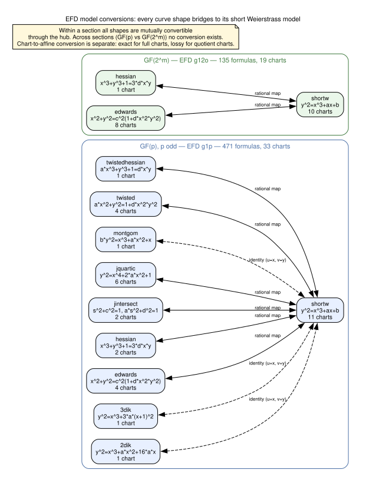

# EFD model and chart conversions

Generated by `docs/efd/generate-conversions.py` from the two pinned
catalogues. Regenerate after any catalogue change:

```sh
python3 docs/efd/generate-conversions.py
dot -Tsvg docs/efd/conversions.dot -o docs/efd/conversions.svg
```



## What can be converted

- **Within one section, every curve shape converts to and from short
  Weierstrass.** Each model record carries `toweierstrass` and
  `fromweierstrass` lines; therefore any two shapes in the same section
  are mutually convertible by composing through the hub. The maps are
  rational and can have exceptional points (denominators that vanish at
  the identity, 2-torsion, or chart boundaries).
- **`shortw` is the identity hub.** `montgom`, `2dik`, and `3dik` are
  already Weierstrass equations with the same `x, y` coordinates (only
  the parameter names differ), so their bridge is the identity.
- **`edwards`, `twisted`, `twistedhessian`, `hessian`, `jintersect`,
  and `jquartic` need a non-trivial rational map.**
- **No conversion across characteristic.** `g1p` is for odd prime
  fields; `g12o` is for GF(2^m). Nothing bridges the two hubs.

## Chart-level conversions

Every chart converts to its model's affine coordinates with
`Representation::encode_affine` (or `encode_jintersection`) and back with
`Representation::project`. Full charts round-trip exactly at any nonzero
projective scale. Quotient charts are one-way: they keep only the listed
projection, and no affine reconstruction is provided.

### GF(p) — g1p

| Chart | Variables | Affine map | `project` returns |
| --- | --- | --- | --- |
| `2dik/standard` | X, Y, Z, ZZ | x = X/Z; y = Y/ZZ | (x,y) |
| `3dik/standard` | X, Y, Z, ZZ | x = X/Z^2; y = Y/Z^3 | (x,y) |
| `edwards/inverted` | X, Y, Z | x = Z/X; y = Z/Y | (x,y) |
| `edwards/projective` | X, Y, Z | x = X/Z; y = Y/Z | (x,y) |
| `edwards/yz` | Y, Z | r*y = Y/Z | y |
| `edwards/yzsquared` | Y, Z | r*y^2 = Y/Z | y^2 |
| `hessian/extended` | X, Y, Z, XX, YY, ZZ, XY, YZ, XZ | x = X/Z; y = Y/Z | (x,y) |
| `hessian/standard` | X, Y, Z | x = X/Z; y = Y/Z | (x,y) |
| `jintersect/extended` | S, C, D, Z, SC, DZ | s = S/Z; c = C/Z; d = D/Z | (s,c,d) |
| `jintersect/standard` | S, C, D, Z | s = S/Z; c = C/Z; d = D/Z | (s,c,d) |
| `jquartic/2xxyzz` | X, XX, Y, Z, ZZ | x = X/Z; y = Y/ZZ | (x,y) |
| `jquartic/2xxyzzr` | X, XX, Y, Z, ZZ, R | x = X/Z; y = Y/ZZ | (x,y) |
| `jquartic/2xyz` | X, Y, Z | x = X/Z; y = Y/Z^2 | (x,y) |
| `jquartic/xxyzz` | X, XX, Y, Z, ZZ | x = X/Z; y = Y/ZZ | (x,y) |
| `jquartic/xxyzzr` | X, XX, Y, Z, ZZ, R | x = X/Z; y = Y/ZZ | (x,y) |
| `jquartic/xyz` | X, Y, Z | x = X/Z; y = Y/Z^2 | (x,y) |
| `montgom/xz` | X, Z | x = X/Z | x |
| `shortw/jacobian-0` | X, Y, Z | x = X/Z^2; y = Y/Z^3 | (x,y) |
| `shortw/jacobian-3` | X, Y, Z | x = X/Z^2; y = Y/Z^3 | (x,y) |
| `shortw/jacobian` | X, Y, Z | x = X/Z^2; y = Y/Z^3 | (x,y) |
| `shortw/modified` | X, Y, Z, T | x = X/Z^2; y = Y/Z^3 | (x,y) |
| `shortw/projective-1` | X, Y, Z | x = X/Z; y = Y/Z | (x,y) |
| `shortw/projective-3` | X, Y, Z | x = X/Z; y = Y/Z | (x,y) |
| `shortw/projective` | X, Y, Z | x = X/Z; y = Y/Z | (x,y) |
| `shortw/w12-0` | X, Y, Z | x = X/Z; y = Y/Z^2 | (x,y) |
| `shortw/xyzz-3` | X, Y, ZZ, ZZZ | x = X/ZZ; y = Y/ZZZ | (x,y) |
| `shortw/xyzz` | X, Y, ZZ, ZZZ | x = X/ZZ; y = Y/ZZZ | (x,y) |
| `shortw/xz` | X, Z | x = X/Z | x |
| `twisted/extended-1` | X, Y, Z, T | x = X/Z; y = Y/Z | (x,y) |
| `twisted/extended` | X, Y, Z, T | x = X/Z; y = Y/Z | (x,y) |
| `twisted/inverted` | X, Y, Z | x = Z/X; y = Z/Y | (x,y) |
| `twisted/projective` | X, Y, Z | x = X/Z; y = Y/Z | (x,y) |
| `twistedhessian/projective` | X, Y, Z | x = X/Z; y = Y/Z | (x,y) |

### GF(2^m) — g12o

| Chart | Variables | `project` returns |
| --- | --- | --- |
| `edwards/w-1` | w | w = x+y |
| `edwards/w` | w | w = x+y |
| `edwards/wz-1` | W, Z | W |
| `edwards/wz` | W, Z | W |
| `edwards/xy-1` | X, Y | (x,y) |
| `edwards/xy` | X, Y | (x,y) |
| `edwards/xyz-1` | X, Y, Z | (x,y) |
| `edwards/xyz` | X, Y, Z | (x,y) |
| `hessian/standard` | X, Y, Z | (x,y) |
| `shortw/affine` | X, Y | (x,y) |
| `shortw/extended-0` | X, Y, Z, ZZ, XZ | (x,y) |
| `shortw/extended-1` | X, Y, Z, ZZ | (x,y) |
| `shortw/jacobian` | X, Y, Z | (x,y) |
| `shortw/lambda` | X, L, Z | (x,y) |
| `shortw/lopezdahab-0` | X, Y, Z | (x,y) |
| `shortw/lopezdahab-1` | X, Y, Z | (x,y) |
| `shortw/lopezdahab` | X, Y, Z | (x,y) |
| `shortw/projective` | X, Y, Z | (x,y) |
| `shortw/xz` | X, Z | x |

## Totals

| Section | Models | Charts | Formulas |
| --- | ---: | ---: | ---: |
| `g1p` | 10 | 33 | 471 |
| `g12o` | 3 | 19 | 135 |
| **EFD total** | **13** | **52** | **606** |

