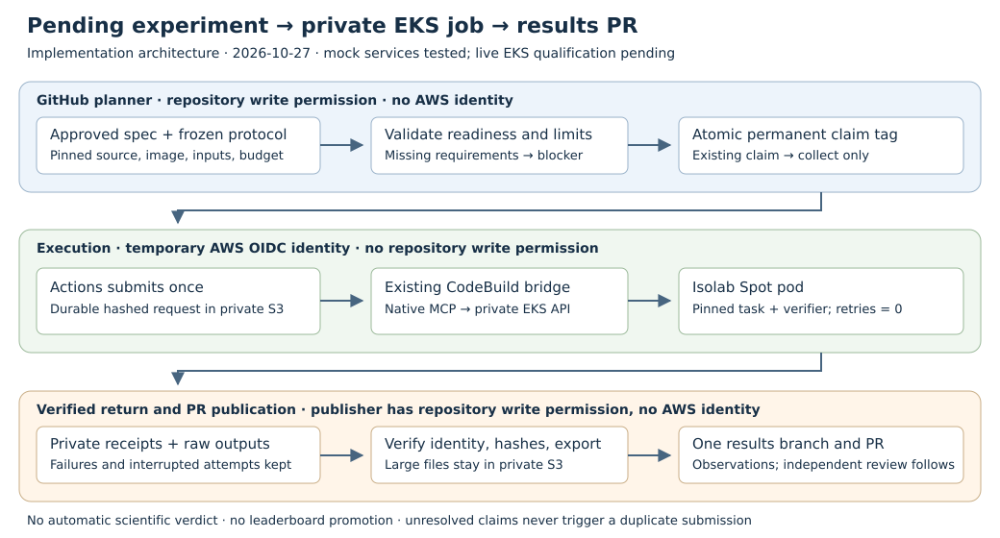

# Run pending experiments on Isolab EKS

[Run pending Isolab experiments](../../.github/workflows/experiment-queue.yml)
discovers eligible experiments on `main`, launches each execution at most once
through Isolab's existing private EKS bridge, and commits terminal observations
to a branch with a regular results PR. It runs hourly at minute 17, on changes
to its queue/spec/tool paths on `main`, and by manual dispatch. It must land on
`main` before its schedule can operate.

The first implementation is tested with fake GitHub, AWS, and native MCP
services. No live AWS submission was performed during development. This session
has no AWS identity configured. The accompanying NIST registration is explicitly
blocked; this change does not fabricate its missing image, input publication,
prospective EKS amendment, or approval.



The [implementation report](report.pdf) summarizes validation and remaining
deployment checks. This is an engineering feature, with no new cryptographic
result or performance measurement.

## Registration and eligibility

Create `experiments/queue/<ID>.json` in a reviewed PR. Existing experiment YAML
and backlog cards without a registration are inventoried in the workflow's step
summary; arbitrary text or an old card cannot become an executable command.
Start with `status: "blocked"` while assembling the following:

| Field | Requirement for `status: "ready"` |
| --- | --- |
| `schema`, `id`, `trial` | `crypto.isolab-queue/v1`; filename matches ID; explicit reviewed trial identifier. |
| `record` | Approved `experiments/specs/<ID>.yaml`, including committed decision and frozen sources, accepted by native `expspec validate`. |
| Spec autonomy/budget | Paid execution allowed, positive maximum cost within the unattended allowance, no unanswered human gates. |
| `protocol` | Path and canonical SHA-256 of the prospectively frozen `experiment.protocol/v1`, excluding its `freeze` block. |
| `source_commit` | Full commit already merged into the selected `main` revision; must match the approved spec and image source. |
| `image` | Digest-pinned ECR `isolab/tasks` image and matching source revision. Command jobs also list absolute runtime file paths and hashes. |
| `kind` | `command` for untimed research/counting jobs, or `benchmark` for the existing native L2 ecbench path. |
| `command`, `verify` | Command jobs: literal argv arrays, with separate verification; both executable paths must have runtime hashes. |
| `inputs` | Optional private S3 URI, relative local path, and SHA-256 for every input. |
| `outputs` | Up to 16 declared relative JSON, Markdown, PDF, or SVG files, including `export.json`. |
| `workload_spec` | Benchmark jobs: repository path to `ecbench.spec/v1` at the tested source commit. Also set `image.ecbench_sha256`. |
| `cpu`, `memory`, `seconds` | Even 2–28 CPUs, integer GiB up to 128, and 1–3600 seconds; benchmark jobs use 4 CPUs. Must fit the frozen protocol. |

The protocol must select Isolab EKS Spot, declare the matching CPU placement,
fit the requested memory and deadline, use at most the current 8 GiB working
volume, and have `execution.checkpoint.policy: "none"`. A protocol forbidding
Spot or requiring checkpoint/CRIU restoration is blocked, rather than converted
to another backend. Resumable execution remains on the separate
`isolab.eks.resumable/v1` path; this queue does not yet adapt that path.

Command images need Bash, jq, AWS CLI, sha256sum, and the registered program and
verifier. Isolab runs as UID 1000 with a read-only root and writable `/work` and
`/tmp`; inputs and outputs must fit the pod's existing storage limits. Runtime
file and input hashes are checked before invocation. Arguments are passed
literally, with only `{out}` and `{inputs}` replaced by the assigned directories.
The program receives `EXPERIMENT_OUT` and `EXPERIMENT_INPUTS`. Stdout/stderr and
verification logs remain in the private raw result prefix. The verifier runs
once after a zero-exit command. Failures retain their actual exit status.

A command job must write `export.json` conforming to `experiment.export/v1`,
with the registered source/protocol identity and all declared arms, instances,
replicates, and warmups covered for successful completion. Command jobs cannot
claim admitted wall time. Benchmark jobs retain native build hash, exact input
spec, L2, replay/audit, and A/A admission checks; only admitted observations can
carry valid clocks. Interruption or resumption never earns a valid clock.

The [NIST registration](../../experiments/queue/EXP-NIST-FILTER-001.json) records
the unresolved prerequisites for that workload. Its existing local protocol and
frozen evidence are preserved. A new prospective amendment and approval must
precede promotion; changing a readiness flag alone is insufficient.

## Deployment

Reuse the deployed `isolab` cluster, native MCP bundle, and CodeBuild project in
AWS account `104186811093`, region `us-east-2`. The caller does not need network
access to the private Kubernetes API. CodeBuild executes the trusted controller
using `StartBuild.buildspecOverride` and calls `isolab_k8s_run` or
`isolab_k8s_benchmark`. There is no deployed launcher replacement or new cluster.

Configure these repository variables:

| Variable | Purpose |
| --- | --- |
| `ISOLAB_AWS_REGION` | `us-east-2`. |
| `ISOLAB_RESULTS_BUCKET` | Existing private Isolab results bucket. |
| `ISOLAB_CODEBUILD_PROJECT` | Existing private-EKS bridge project with the native MCP bundle and readiness/build verifier. |
| `ISOLAB_TRIGGER_ROLE_ARN` | Existing GitHub OIDC trigger role; trust must cover this repository's `main` branch. |
| `ISOLAB_BUILD_RUNNER` | Optional Linux x86 runner label; otherwise `ubuntu-24.04`. |

The OIDC role needs its existing StartBuild permissions, PutObject under
`inputs/requests/*`, and GetObject under `runs/*/launcher/*`. Raw pod access is
not required on Actions: the CodeBuild service role verifies/copies registered
results into the launcher prefix. Its service role and task-pod role must retain
their existing private S3/EKS permissions. No AWS access key is stored in GitHub.
Each serial matrix job requests a fresh two-hour OIDC session. The existing
cluster pool and account quota limits remain in force.

Set the repository secret `EXPERIMENT_PROTOCOL_READ_TOKEN` to a token with
contents-read access to the private `isogeny-labs/crypto-autoresearcher`
repository. The workflow checks out its pinned canonical schemas and test
fixture with that token and does not persist checkout credentials. The default
`GITHUB_TOKEN` cannot read a different private repository; the contract job
reports a specific configuration error when this secret is absent.

Enable Actions to create PRs in the repository settings. Optionally configure
`EXPERIMENT_RESULTS_PUSH_TOKEN` with a fine-grained token or GitHub App token
allowed to write contents and PRs. With the default `GITHUB_TOKEN`, GitHub
suppresses follow-on workflow events from the generated result commit/PR, so
required result-PR checks may need an explicit run; a dedicated token enables
the usual PR CI. The publisher requests auto-merge under the owner's policy;
branch protection and scientific review requirements remain authoritative.

The planner refuses new claims when the role, bucket, or project variable is
missing. Verify the OIDC trust after repository moves. GitHub-hosted execution
also requires account billing/spending readiness; an ARC runner may be selected
through the existing runner variable.

Manual inventory without claims, AWS credentials, or spending:

```sh
gh workflow run experiment-queue.yml --repo isogeny-labs/crypto --ref main \
  -f dry_run=true -f max_jobs=1
```

Normal dispatch uses `dry_run=false`. Default maximum is one new job or existing
claim collection per invocation; manual dispatch can select 1–4. The matrix is
serial, and workflow concurrency disables cancellation of an active queue run.
The pod deadline is capped at one hour, bridge execution at 80 minutes with a
15-minute queued limit, and the new-execution collector waits up to 75 minutes.
Late terminal receipts are collected on a later invocation.

Spec dollar approval is checked, and CPU/memory/time limits bound requested
resources. This is not a new AWS billing enforcement service: Spot pricing,
CodeBuild/controller overhead, and account-level dollar controls remain the
deployment's responsibility. Do not interpret a spec allowance as a provider
spending cap.

## Claims, recovery, and publication

The execution key hashes the registered workload, tested source, image, protocol,
inputs, resource envelope, and trial. Descriptive notes and readiness do not
change it. The planner atomically creates a permanent lightweight tag
`isolab-queue/<ID>/<key>` pointing to the controller's selected `main` commit.
Two planners cannot both obtain a new execution. Claims are never deleted by the
controller and survive Kubernetes Job cleanup and CodeBuild's short token window.

The first runner stores the complete hashed request before making exactly one
StartBuild call. An existing claim only collects its original request and receipt;
it never submits again, including after controller upgrades or removal of the
registration. Ambiguous submission errors and interrupted Actions jobs therefore
cannot automatically duplicate paid work. If a controller dies before submission,
the claim remains unresolved. Inspect the private receipts/CodeBuild history, then
authorize a new reviewed trial if another attempt is needed; deleting the claim
is not the recovery procedure. New work receives selection slots first; existing
claims rotate hourly so an unresolved claim cannot indefinitely starve later
receipt collection. A manual limit up to four can speed up collection.

Terminal receipt verification binds the request hash, Job/Pod identities, actual
image digest, source/protocol identity, and SHA-256 output manifest. Missing or
changed outputs become verification failures. Successful exports must cover the
frozen execution cells. Failure, timeout, and invalid observations are retained
without promoting an experiment decision or leaderboard row.

The collector returns only registered JSON/Markdown/SVG up to 64 KiB and PDFs up
to 10 MiB to Git; declared outputs up to 16 MiB can be checked and retained in
private S3 with hashes and URIs. Larger archives/checkpoints are not copied into
Git or the Actions transfer. Native benchmark payloads are bounded and verified
before download. Declare compact summaries when raw exports exceed these bounds.

The publisher writes only
`research/experiment_queue/results/<ID>/<key>/{README.md,receipt.json,outputs/...}`
on `automation/isolab-results-<key>` and opens one regular PR per execution. It
does not push to `main`, edit source/protocols, answer human gates, or generate a
scientific verdict. Existing result PRs, including closed ones, are not reopened.
Pending and ambiguous submissions do not produce a completion PR. An interrupted
publication can finish on a later collection without relaunching the experiment.

## Validation and sources

[validation.json](validation.json) records local native tests, fixture scope, and
live qualification gaps. The suite exercises concurrent claims, ambiguous AWS
submission, changed identities, controller recovery, literal arguments, verifier
failures, canonical export compatibility, and scoped/idempotent PR publication.

| Requested behavior | Evidence and current status |
| --- | --- |
| Find eligible unrun experiments | Verified with native spec/protocol fixtures and a real repository dry-run inventory; the NIST entry is blocked. |
| Launch on EKS through Isolab | Implemented; fake AWS/MCP submission path verified. Live cluster/IAM qualification remains open. |
| Avoid repeated paid submissions | Concurrent claims, ambiguous StartBuild, and restart collection verified with fake services. |
| Commit observations and open a PR | Scoped commit and idempotent PR creation verified with fake GitHub; live publisher qualification remains open. |
| Use the existing experiment protocol | Canonical protocol/export schema and native expspec checks verified; private schema checkout requires the documented reader token. |

The actual cluster, IAM/OIDC trust, ECR image availability, and hosted workflow
have not been qualified by these mocks. First deploy with dry-run inventory, then
a separately approved small experiment with its real image and frozen inputs.

Queue additions pass the changed-file artifact policy. Broader repository checks
remain non-green: the existing PR has two R12 data files above the Git policy
limits ([diagnostics](full-pr-artifact-diagnostics.txt)); the root Rust run was
stopped after unrelated ecbench failures, with three cases reproduced
([diagnostics](root-validation-diagnostics.txt)). Rust sources and Cargo inputs
are unchanged from the queue's parent commit. A full artifact-wiring inspection
was not completed after sparse manifest fetches; none of these checks is claimed
as passing in the validation record.

The implementation reuses the repository's
[queue protocol](../../.agents/skills/queue-experiment/SKILL.md),
[native Isolab route](../../.agents/skills/isolab-eks/SKILL.md),
[expspec](../../tools/expspec/README.md), and canonical
[experiment schemas](https://github.com/isogeny-labs/crypto-autoresearcher/tree/6a69b2d02ecd53f1649bcf56e23e4ffe91d953ad/schemas).
The latest Isolab skill and remote launcher/verifier were checked at
`origin/main` during development; this feature preserves their admission rules.
Relevant primary API contracts checked were AWS
[StartBuild](https://docs.aws.amazon.com/codebuild/latest/APIReference/API_StartBuild.html)
(trusted buildspec overrides and short-lived idempotency), GitHub
[Git references](https://docs.github.com/en/rest/git/refs#create-a-reference)
(atomic claim creation), and
[workflow token event rules](https://docs.github.com/en/actions/security-for-github-actions/security-guides/automatic-token-authentication#using-the-github_token-in-a-workflow).
