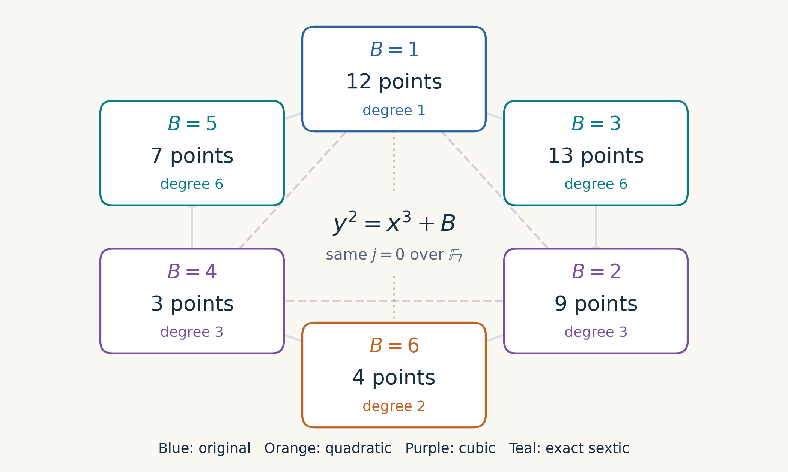

# Elliptic curve twists and discrete logarithm research

An illustrated introduction to quadratic, cubic, quartic and sextic twists,
with a research register for their connections to finite-field ECDLP and
index-calculus relation generation. The main mathematical setting is
characteristic greater than three; the guide records the small-characteristic
exceptions separately.

- [Read the 16-page visual guide](Elliptic_Curve_Twists_Visual_Guide.pdf).
- [Browse all 14 diagrams](diagrams/README.md), available as PNG and vector SVG.
- [Read the research tracker](research-tracker.md): established results,
  conditional reductions, open experiments and primary sources.



## What is established

Twisting preserves the geometric curve and point order under an isomorphism.
It can change rational-point groups and make efficient Frobenius-derived maps
useful. A weak companion twist does not automatically solve a static ECDLP on
the original curve. Orbit images of a relation must be checked for independence
after known scalar actions have been accounted for.

The proposed factor-base experiments are a research plan. The documented
GLS-assisted GHS attack concerns binary extension fields; its demonstrated
speedup is not a general large-prime quadratic-extension attack.

## Verify the arithmetic

The verifier requires a C11 compiler and has no library dependencies. From
this directory, regenerate the checked fixture and compare it with the
committed copy:

```sh
mkdir -p .build
cc -std=c11 -O2 -Wall -Wextra -Werror tools/verify_examples.c -o .build/verify_examples
.build/verify_examples > .build/verified_examples.json
cmp tools/verified_examples.json .build/verified_examples.json
```

It enumerates the small finite-field point groups, checks the six twist classes
over the field with seven elements, and verifies the transported GLS map on
all 101 points of the example twist over the field with 121 elements. Its square
is negation, its subgroup eigenvalue is 91 modulo 101, and each nonidentity
point has an orbit of size four.

## Rebuild the guide and diagrams

Use Python 3.12 or later in a virtual environment:

```sh
python -m venv .venv
. .venv/bin/activate
python -m pip install -r requirements.txt
python tools/build_guide.py
python tools/check_guide.py
```

Python handles document layout and rendering only; finite-field arithmetic
and the fixture checks are implemented in C. The builder reads the committed
native-generated fixture and uses Matplotlib's bundled DejaVu fonts. It writes the PDF and
PNG/SVG diagrams beside this README and creates an optional diagram ZIP.
Intermediate vector pages, verifier executables and rendered page previews
are written under `.build/` and ignored by Git.

The PDF check verifies the 16 pages, bookmarks, source links, text boundaries
and vector figures. It renders a contact sheet for visual review; numerical
checks do not replace that review.

## Research evaluation criteria

For any proposed improvement, record the actual curve, field, target subgroup,
map and factor base. Compare independent relations per unit of work, memory,
solution lifting and final linear algebra against a matched baseline.
Keep implementation attacks requiring an input or fault oracle separate from
attacks on a static public discrete-log instance.
