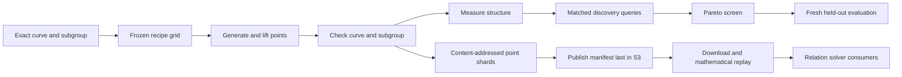

# Factor-base generation and reusable precomputation

The deliverable is a native generator and evaluator with an immutable object
store. The research objective is to retain bases that combine natural relation
yield, manageable algebraic systems, and affordable total construction and use.
High yield and low degree are measured objectives, not properties assigned to a
recipe by its name.

## Curve-family requirements

| Family | Required structure and identity | Applicable base designs | Restrictions |
|---|---|---|---|
| Koblitz / anomalous binary | `y^2+xy=x^3+a*x^2+1`, a in F2; exact binary modulus, n, r, h, G | Linear and affine x-spaces, trace kernels, seeded controls, signed Frobenius orbits | A quotient additionally needs a certified subgroup Frobenius eigenvalue and coefficient transport; this release materializes orbits |
| General ordinary binary | `y^2+xy=x^3+a*x^2+b`, b nonzero, over a specified F2^n representation | Linear and affine x-spaces, trace-constrained and geometric spaces, seeded controls | Squaring coordinates maps to the Frobenius-twisted coefficient model unless the coefficients are fixed; do not assume Koblitz orbits |
| Binary field of prime extension degree | Same exact model and polynomial, with prime n | Arbitrary linear subspaces and affine spaces still exist; Koblitz Frobenius still applies when coefficients permit | There is no proper intermediate field over F2; do not request a nontrivial proper subfield base. Frobenius-invariant subspace dimensions depend on the factorization of T^n-1 |
| Prime field | p>3, nonsingular short Weierstrass model, N, r, h, G | Intervals, arithmetic progressions, seeded x-subsets; explicit externally certified orbit or fiber designs can be added later | No binary Weil-descent encoding is implied. Carry/bit constraints or a different native polynomial solver must be specified before reporting regularity |
| Prime-field anomalous order | `#E(F_p)=p` verified independently | Construction is supported as a distinct classification | This order condition is different from the historical name anomalous binary; record it separately and select a suitable algorithmic baseline |

The historical Koblitz/anomalous-binary terminology and its Frobenius arithmetic
are described in [Faster Scalar Multiplication on Koblitz Curves](https://www.iacr.org/archive/pkc2004/29470028/29470028.pdf).
Curve-domain parameters and the distinction between binary and prime models are
specified in [Standards for Efficient Cryptography 2 (SEC 2)](https://www.secg.org/sec2-v2.pdf).
The manifest records full arithmetic inputs even when a familiar name is available.

For odd prime n, the nontrivial irreducible blocks of T^n-1 over F2 have degree
ord_n(2). When that order is n-1, there is no intermediate invariant linear
dimension inside that block. This restricts Frobenius-invariant linear bases;
it does not prevent arbitrary low-dimensional x-subspaces or sets formed by
unions of complete point orbits. The requirements command records the extension
degree, intermediate subfield degrees, and ord_n(2) separately.

## Construction and screening algorithm

1. Normalize and validate the full curve representation. Keep the exact point
   set distinct from recipes and solver encodings. Reject invalid family-specific
   optimizations before generating data.
2. Freeze a finite candidate grid: shape, dimension or x-count, seed, offsets,
   subgroup policy, optional orbit expansion, and resource caps. Include coordinate
   and random controls. Count both x candidates and retained subgroup points;
   equal x-space dimension does not guarantee equal usable base size.
3. Generate x candidates from the recipe, lift to rational points, check each
   point, and apply the subgroup filter. Keep both signs. Reject an empty base,
   retaining the failed row in the grid report.
4. Measure cheap structure: product-span dimensions, Frobenius intersection,
   trace constraints, subgroup retention, and orbit closure. Use these to allocate
   measurement budget, not as substitutes for relation or regularity evidence.
5. Evaluate the same recipe-independent discovery targets at fixed arity and
   caps. Retain witnesses and failures. Measure exact regularity for a frozen
   target panel where the algebraic encoding and caps permit it. Record every
   unsupported or censored combination explicitly.
6. Retain the Pareto frontier in yield, actual base size, regularity, and eventually
   useful relation rank and complete charged cost. The current CLI implements the
   first three dimensions; it cannot choose on unmeasured cost or rank.
7. Freeze finalists before evaluating a separately seeded held-out panel. Re-run
   construction, lifting, subgroup tests, and relation replay on another
   implementation/host before research promotion. A changed candidate requires
   a fresh confirmation panel rather than repeated tuning on the holdout.
8. Persist verified target-independent data in S3. Keep target-specific query
   receipts separate. Retrieve by manifest digest, verify bytes, and replay the
   mathematical checks before use in a solver.

The use of summation polynomials follows
[Semaev's original construction](https://eprint.iacr.org/2004/031.pdf), while
binary point decomposition and Boolean encodings are discussed in
[A SAT-Based Approach for Index Calculus on Binary Elliptic Curves](https://pmc.ncbi.nlm.nih.gov/articles/PMC7334981/).
Polynomial roots, rational group relations, and useful relation rank remain
separate observations throughout this implementation.

## Why these designs may change the work

Subspace and trace restrictions can reduce the variable support and eliminate
some unproductive x-coordinates. Geometric spaces can have small multiplicative
span. Affine shifts can change rational/subgroup retention and cover different
targets. Frobenius orbit sets can expose symmetry to a suitably certified solver.
Each is a hypothesis to test: improving one property can lower yield, expand the
base, add selector variables, or increase relation dependencies.

Prime-field intervals and progressions offer compact membership and repeatable
generation. Their integer/bit encoding can introduce carries and higher-degree
constraints. A sparse input polynomial is not a measurement of solving degree.
This release therefore leaves prime-field regularity unmeasured.

For the binary algebraic engine, the ANF and leading-form rank are exact within
the cap. The leading-form quotient is the associated homogeneous square-zero
algebra, not the affine Boolean quotient. The metric must remain separate from
first-fall degree, affine solving degree, and solver runtime. The limitations
of inferring point-decomposition behavior directly from summation-polynomial
zeros are relevant here; see [Notes on summation polynomials](https://arxiv.org/abs/1503.08001).

## Reusable artifacts and accounting

Reusable now: normalized curve identity, generator specification, factor-base
recipe, ordered point shards, structural metadata, and construction source
digest. Reusable in subsequent extensions: membership indexes, signed/Frobenius
orbit maps, polynomial templates, validated relation matrices, and certified
factor-base logarithms. These later artifacts require their own schemas and
proof/replay obligations and are not produced by this release.

Before selecting by total cost, account for recipe search, generation, validation,
index building, storage PUT/GET and bytes, downloads, decompression, natural
relation collection, failed solver attempts, useful rank, linear algebra,
target-specific decomposition, recovery, and verification. Record cold cost and
the explicit number of targets amortizing setup separately. A cheap cached
lookup does not remove the original precomputation from cold accounting.

The first campaign should use matched controls at the same retained-point budget,
paired fixed public targets, a frozen discovery/confirmation split, and exact
source/configuration hashes. Numeric promotion thresholds and compute budgets
must be fixed in that campaign's protocol. The tool itself is ready for bounded
construction and diagnostics; this implementation task does not launch an
unbounded search or select an end-to-end winner.

## Delivery status

| Requirement | Status | Evidence or remaining work |
|---|---|---|
| Curve-family requirements | Implemented | Typed input, requirements command, this document |
| Multiple deterministic base recipes | Implemented and tested | Native generator, example grid, subgroup checks |
| Reusable point archives | Implemented and tested | SHA-256 manifests, immutable writes, deterministic replay |
| S3 upload/download | Implemented | Native controller commands; actual live status in VALIDATION.md |
| Natural relation yield | Bounded implementation | Arity 2..8 enumeration, independent target seed, witness replay |
| Binary degree of regularity | Bounded implementation | Exact S3-chain ANF and homogeneous rank, at most 14 variables |
| Prime-field regularity | Partial | Generation works; algebraic encoding and solver remain unimplemented |
| Useful rank and total-cost selection | Not implemented | Null metrics and no selected total-runtime candidate |
| Measured improvement in yield/regularity | Not established by acceptance tests | Requires the matched frozen campaign described above |

The canonical IC scoreboards and graphs remain unchanged: acceptance tests do
not introduce a new measured IC/rho comparison, registry identity, or performance
claim. The diagram above documents the implemented data flow and planned
confirmation stage.
