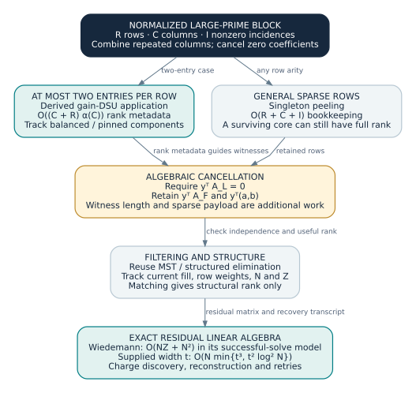

# Graph algorithms and asymptotic costs for ECDLP index calculus

Research reference, 22 November 2026.

**Graph bookkeeping is often nearly linear in the relation graph.** The larger costs can be producing enough independent relations, expanding their algebraic payloads, controlling fill, and solving the remaining matrix. This catalog identifies algorithms for those stages, states their asymptotic runtimes and assumptions, and proposes an evaluation order for the Rust pipeline.

Companion artifacts: [PDF report](./report.pdf), [editable pipeline diagram](./pipeline.svg), and [repository grounding and integration ownership](./SOURCES.md). The PDF is rendered from this Markdown catalog together with `SOURCES.md`.



## Scope and evidence status

This is a documentation and mathematical complexity audit for the ordinary prime-field ECDLP research program. It includes techniques established in related index-calculus systems while preserving their original applicability conditions. Complete-solver performance remains an empirical question.

| Status | Meaning in this catalog |
| --- | --- |
| **Literature** | A bound attributed to a primary paper or official software documentation, under the stated model and hypotheses. A citation is not an independent formal verification. |
| **Derived [pcc:unverified]** | An operation count, algebraic argument, or combination of published results explained here. It requires the repository's applicable review and proof process before being treated as certified. |
| **Proposed** | An experiment or integration candidate. The catalog supplies neither a new Rust implementation nor measurements of its performance. |

The proposed queue must reuse existing arithmetic, relation, filtering, and solver implementations where available. The repository already contains `large_prime_filter_mst`, the `gaudry_cubic_graph::GraphEliminator` wrapper around `pencil_symbolic_graph::SymbolicGraph`, and the conservative unweighted `jv_large_prime_rank_bound::StructuralRankBound`. The latter is not an exact gain-aware DSU and does not use path compression. [PR #4905](https://github.com/isogeny-labs/crypto/pull/4905) owns gain-forest/MITM integration; this catalog does not duplicate or supersede that implementation work. See [SOURCES.md](./SOURCES.md) for repository-specific grounding and source links.

## Notation and runtime units

| Symbol | Meaning |
| --- | --- |
| $v,e$ | Vertices and edges of an ordinary graph. In a double-large-prime graph, edges represent partial relations. |
| $R,C,I$ | Relation rows, large-prime columns, and nonzero row-column incidences. The bipartite support graph has $R+C$ vertices and $I$ edges. |
| $N,Z$ | Dimension of a square residual matrix and its number of nonzeros. Rectangular results use $R+C$ explicitly. |
| $L$ | Total edge appearances in all explicitly emitted cycles. |
| $k,S$ | Rows participating in one merge, and their total sparse support before the merge. |
| $b$ | Krylov block width. |
| $t$ | Width of a supplied decomposition of the relevant graph; use at least $1$ in runtime formulas for degenerate edgeless cases. |
| $\ell$ | Prime subgroup order. Relation linear algebra takes place over $\mathbb F_\ell$, regardless of the curve's base-field characteristic. |
| $\alpha$ | Inverse Ackermann function. |
| $\omega$ | Any admissible dense matrix multiplication exponent greater than $2$. |
| $\widetilde O$ | Suppresses logarithmic factors. |
| $O^*$ | Suppresses factors polynomial in input size, as in parameterized SAT. |

Graph bounds count graph or pointer operations. Algebra bounds count scalar field operations unless explicitly labeled as machine-word operations. An inversion is a field operation in this model; its bit cost must be charged separately. Input normalization, witness expansion, relation payload arithmetic, randomization failures, reconstruction, communication, and output size must be included in a complete solver estimate.

The existing LP-filter API checks for an odd modulus in the range $3\le m<2^{63}$. That check alone does not establish primality. The prime-$\ell$ field hypothesis used in this catalog remains a caller precondition; composite odd moduli do not justify the field-rank and division arguments below. Repository contracts are documented in [SOURCES.md](./SOURCES.md).

These are bounds for named algorithms, rather than a claim that every entry is the latest theoretical record or the fastest practical implementation.

## 1. Connectivity and cycle handling

| Algorithm | Asymptotic runtime | Role and conditions |
| --- | --- | --- |
| BFS / DFS | $O(v+e)$ | Components, spanning forests, and unweighted paths. $O(v+e)$ storage including adjacency. Literature: [1]. |
| Union-find | $O((v+e)\alpha(v))$ amortized | Incremental connectivity with $O(v)$ metadata. Detects topological cycle closure, not coefficient cancellation. Literature: [2]. |
| Gain-aware union-find | $O((v+R)\alpha(v))$ scalar and pointer operations | Exact rank accounting for rows with at most two nonzero LP coefficients, using potentials and a pinning flag. $O(v)$ metadata. Witness expansion is additional. **Derived [pcc:unverified]** in Section 6, using [2] and [3]. |
| Fundamental cycle basis | $O(v+e+L)$ | A forest and its chords give an implicit linear-size representation. Explicit cycles can have total length $\Theta(ev)$; retaining them requires $O(L)$ output storage. Literature structure and output-sensitive count: [3], [7]. |
| Link-cut trees | $O(\log v)$ amortized per link, cut, or constant-size path aggregate | Dynamic forests and scalar path costs; $O(v)$ metadata. Listing a path of length $a$ costs $\Omega(a)$. Vector-valued payload aggregation has nonconstant cost. Literature: [4]. |
| Bridges / articulation points / biconnected components | $O(v+e)$ | Topology diagnostics. Bridge deletion preserves ordinary incidence-cycle spaces but can destroy dependencies of gain matrices. Literature: [1], [3]; counterexample in Section 5. |
| All graph core numbers | $O(v+e)$ | Batagelj–Zaveršnik bucket algorithm. A 2-core locates potential cyclic structure. Pruning a higher core is not a general algebraic preservation rule. Literature: [5]. |
| Low-stretch spanning tree | $O(e\log v\log\log v)$, plus isolated-vertex handling | Abraham–Neiman construction. In an unweighted graph, its fundamental cycles have total length $O(e\log v\log\log v)$. Algebraic usefulness still depends on the coefficient model. Literature: [6]; output consequence discussed in Section 7. |
| Minimum cycle basis | $O(e^\omega+\kappa e^2\log v)$, Monte Carlo | Amaldi et al. Suitable amplification gives $O(e^\omega)$ in the paper's model. Applies to ordinary incidence-cycle spaces, not arbitrary gain-matrix kernels. Dense algebra makes this a later candidate. Literature: [7]. |

For the minimum-cycle-basis result, $\kappa$ controls the failure probability. The connected $\operatorname{GF}(q)$ formulation bounds it by

$$
(e-v+1)\log(ve)q^{-\kappa}.
$$

The cited proof uses a prime $q=O(e\log e)$ and constant-time field arithmetic. Its time model must not be silently imported as a bit-complexity result for an arbitrary subgroup modulus. [7]

## 2. Hypergraphs, matching, and sparse filtering

| Algorithm | Asymptotic runtime | Role and conditions |
| --- | --- | --- |
| Singleton / hypergraph 2-core peeling | $O(R+C+I)$ | Queue and incidence lists, after repeated coefficients are combined and zeros removed. Exact for cancellation of designated LP columns. A nonempty core may still have full coefficient rank. Literature: [8]; **derived [pcc:unverified]** preservation argument in Section 5. |
| MST-guided $k$-way merge | $O(kS+k^2)$ plus materialization | Pairwise costs of normalized sparse rows with total support $S$, followed by dense Prim in $O(k^2)$. The tree selects $k-1$ independent coefficient combinations; resulting rows may still be dependent. A local optimum under the chosen edge costs, not globally minimum fill. Field-general adaptation of [8], **derived [pcc:unverified]**. |
| Structured Gaussian elimination | $O(\sum_i r_i c_i)$ arithmetic, plus pivot search and data-structure updates | $r_i,c_i$ are current pivot row and column sizes. Fill can produce $O(N^3)$ classical worst-case work. Preserve the transformation for recovery. Literature framework: [8], [9]; explicit operation count **derived [pcc:unverified]**. |
| Markowitz pivot selection | Naive $O(\sum_i Z_i+\sum_i r_i c_i)$ | The score $(r_i-1)(c_i-1)$ estimates potential fill; $Z_i$ is the active nonzero count. The full-scan implementation can cost $O(N^3)$. Literature framework [9]; implementation count **derived [pcc:unverified]**. |
| Minimum-degree ordering | $O(\sum_i d_i^2)$ explicit clique-update work, plus selection and data-structure costs | $d_i$ is degree in the filled graph. Count adjacency operations under the chosen representation. Global minimum fill is NP-hard. Literature: [9], [10]; clique enumeration count **derived [pcc:unverified]**. |
| Hopcroft–Karp matching | $O((R+C+I)\sqrt{R+C})$ | Maximum matching of the row-column support graph; $O(R+C+I)$ storage. Computes structural rank, an upper bound on actual field rank. Literature: [11], [12]. |
| Dulmage–Mendelsohn decomposition | $O(R+C+I)$ after maximum matching | Reachability and SCCs expose underdetermined, well-determined, and overdetermined blocks and block triangular structure. Matching cost is additional. Coefficient singularities may remain. Literature: [1], [12]. |

### Why an MST is relevant

**Derived [pcc:unverified].** Suppose $k$ rows $A_i$ contain a common pivot column with nonzero coefficients $a_i$. Normalize each row to

$$
B_i=a_i^{-1}A_i.
$$

**Derived [pcc:unverified].** An edge $(i,j)$ represents $B_i-B_j$, which cancels the pivot. The coefficient vectors of the edges of any spanning tree form a basis of the $(k-1)$-dimensional subspace of combinations whose normalized coefficients sum to zero. Therefore a tree supplies all required pivot-canceling coefficient combinations. This does **not** prove that their images as materialized rows are independent: if the inputs are identical, all differences are zero.

Weight each candidate edge by actual modular support or a specified merge-cost model. With sorted sparse inputs of total support $S$, scanning every pair takes $O(kS)$ work, and dense Prim takes $O(k^2)$. Producing the selected rows and their provenance is additional. This is an explicit field-general adaptation of Cavallar's local merge strategy. XOR support calculations are not valid for arbitrary odd-modulus coefficients. [8]

Track both $N$ and $Z$ after every filter. Reducing matrix dimension while increasing density can raise the cost of a sparse solve. Retain enough transformation data to reconstruct original relation and target coefficients.

## 3. Exact finite-field linear algebra

| Algorithm | Arithmetic runtime | Memory and qualifications |
| --- | --- | --- |
| Sparse matrix-vector product | $O(Z+N)$ | $O(Z+N)$ including the matrix. Reordering affects locality and communication, not this arithmetic count. Literature: [13]. |
| Scalar Wiedemann | $O(NZ+N^2)$ for a standard successful solve; general variants $\widetilde O(N(Z+N))$ | $O(Z+N)$ storage. Projection, preconditioning, verification, and retry assumptions matter. For $Z=\Theta(N)$, the work is quadratic-scale. Literature: [13]. |
| Block Wiedemann | $O(NZ+N^2b)+\widetilde O(Nb^{\omega-1})$ with dense projections | Typical $O(Z+Nb)$ storage. There are $O(N/b)$ sequential block rounds. Charge preconditioner application, reconstruction, and retries separately. Literature and stage count: [14], [15]; assembled expression **derived [pcc:unverified]**. |
| Finite-field Lanczos variants | $O(NZ+N^2)$ for $O(N)$ iterations | $O(Z+N)$ storage. Requires appropriate symmetry, preconditioning, and breakdown handling. Real numerical convergence arguments do not transfer. Literature: [16]. |
| Montgomery block Lanczos over $\mathbb F_2$ | $O(NZ/w+N^2)$ machine-word operations in the cited model | $w$ binary vectors packed in one word. This is not an odd-prime-field arithmetic bound. Literature: [8], [17]. |
| Dense elimination / fast dense algebra | $O(N^3)$ classically; $O(N^\omega)$ with fast algorithms | Usually quadratic storage. Suitable for small or dense residual cores; compare with the applicable sparse baseline. Literature: [13], [18]. |
| Sparse inverse, rank, and full nullspace | Published expected $O(N^{2.2131})$ under near-linear matrix access | Casacuberta–Kyng, 2022. This is a stronger output task than finding one dependency. The decimal is the paper's published exponent, not a claim of the current record. Literature: [18]. |

### Block size changes scheduling, not total sparse-product work

**Derived [pcc:unverified], from [14] and [15].** A balanced block implementation performs

$$
O(N/b)\text{ rounds}\times O(Zb)\text{ work per block product}=O(NZ).
$$

Dense left projection costs $O(Nb^2)$ per round, hence $O(N^2b)$ overall. Fast polynomial-matrix generator computation contributes $\widetilde O(Nb^{\omega-1})$ under the usual balanced-block setup. Sparse coordinate projections may reduce projection overhead but require a separate admissibility and success argument. If preconditioning changes the matrix-vector cost to $\tau$, charge that cost rather than the original $Z$.

Thomé's subquadratic generator algorithm accelerates one stage. It does not alone make the complete sparse solve subquadratic. A full inverse or nullspace basis may also require quadratic output space even when the application needs only one dependency. [14], [18]

## 4. Structural and parallel algorithms

| Algorithm | Asymptotic runtime | When the bound applies |
| --- | --- | --- |
| Exact low-treewidth elimination | $O((R+C)t^3)$; or $O((R+C)t^2\log^2(R+C))$ through pathwidth | Any field, given a valid suitably sized width-$t$ decomposition of the bipartite nonzero graph. Use the smaller bound. Discovery is additional. Literature [19]; combined route **derived [pcc:unverified]** in Section 7. |
| Exact path / tree-partition elimination | $O((R+C)t^2)$ factorization; $O((R+C)t)$ per subsequent RHS | Requires the corresponding supplied decomposition. Tree-partition width and treewidth are distinct parameters. Literature: [19]. |
| Nested dissection | Classical planar setting: $O(N^{3/2})$ work and $O(N\log N)$ storage | Requires suitable separators and elimination assumptions. Positive-definite Cholesky bounds do not automatically cover modular pivoting. Literature: [20]. |
| Fiduccia–Mattheyses partition refinement | $O(I)$ per pass in the original net model | $p$ passes cost $O(pI)$. The pass count and multilevel preprocessing are additional. Relevant to repeated distributed sparse products. Literature: [21], [22]. |
| Greedy maximal independent set | $O(v_c+e_c)$ for a supplied conflict graph | Schedules compatible jobs. Charge construction, changing fill, and subsequent rounds. Maximum independent set is a different optimization problem. Standard greedy count; parallel algorithm background [23]. |
| 2-SAT through implication SCCs | $O(s+c)$ for $s$ variables and $c$ two-literal clauses | Requires a genuine 2-CNF subproblem. A general relation-generation encoding need not satisfy that condition. Literature: [24]. |
| SAT / #SAT with incidence treewidth $t$ | $O^*(2^t)$ with a supplied decomposition | Count every encoded variable and clause, including auxiliary variables. Sparse encodings need not have small width. Literature: [25]. |
| Exact max-flow / min-cost-flow | $e^{1+o(1)}$ deterministic | Polynomially bounded integral capacities, demands, and costs. A unit-capacity reduction gives an almost-linear theoretical bipartite-matching route, not general modular matrix rank. Literature: [26]. |

### Directed shortest paths: a 2026 result

Duan, Mao, Shu, and Yin give the following deterministic bound for directed single-source shortest paths with nonnegative real weights:

$$
O\left(e\sqrt{\log v}+\sqrt{ev\log v\log\log v}\right).
$$

The paper compares this bound with the 2025 $O(e\log^{2/3}v)$ result. On sparse graphs in the relevant connected/reachable input regime, the displayed expression becomes $O(e\sqrt{\log v\log\log v})$. These are literature results; this catalog supplies no implementation or timing measurements for them. [27]

It is relevant to the ECDLP pipeline only if weighted path searches dominate measured cost. Unweighted paths already admit linear-time BFS. Actual merged support is generally non-additive because modular coefficients may cancel; a shortest path under fixed scalar edge weights does not automatically minimize the output relation.

## 5. What a graph dependency must certify

### Relation model

**Derived [pcc:unverified].** Work inside a prime-order subgroup. Let $G$ generate it and let the target be $Q=xG$. Write factor-base and large-prime logs as $x_F$ and $x_L$. Partial relations have the form

$$
A_Fx_F+A_Lx_L=a+bx\qquad\text{over }\mathbb F_\ell.
$$

A row combination $y$ eliminates all large primes exactly when

$$
y^T A_L=0.
$$

It then produces

$$
y^T A_Fx_F=y^Ta+(y^Tb)x.
$$

The projected relation may still be zero, redundant, or unable to contribute to target recovery. The relevant objective is independent usable equations at lower total cost. Neither the number of topological cycles nor the LP-block nullity alone establishes that objective.

### A triangle can have no cancellation

**Derived [pcc:unverified].** Consider LP parts $x+y$, $y+z$, and $z+x$:

$$
A_L=\begin{pmatrix}
1&1&0\\
0&1&1\\
1&0&1
\end{pmatrix},\qquad \det(A_L)=2.
$$

The support has one cycle and a nonempty 2-core. Over any odd prime modulus, the matrix has full rank and zero left kernel. In characteristic two it has a dependency. Topology therefore cannot replace coefficient algebra.

### A bridge can be essential for LP elimination

**Derived [pcc:unverified].** Take triangles $abc$ and $def$ joined by edge $cd$. Put coefficient $+1$ at both endpoints of every edge row. In edge order

$$
(ab,bc,ca,de,ef,fd,cd),
$$

the coefficients

$$
(1,-1,-1,-1,1,-1,2)
$$

**Derived [pcc:unverified].** These coefficients sum to zero at every vertex over the integers. The bridge coefficient is nonzero over every odd field. Deleting the bridge destroys this dependency. This illustrates the loose-handcuff behavior in signed/gain graph matroids. It proves LP cancellation, not usefulness of an unspecified factor-base payload. [3], [28]

### Why singleton peeling is safe

**Derived [pcc:unverified].** If an LP column contains just one nonzero entry $a$ in row $i$, its coordinate in $y^T A_L=0$ is $ay_i=0$. Since $a\ne0$ in the field, every such dependency has $y_i=0$. Delete that row, update all affected incidences, and repeat. A queue and incidence lists touch each incidence a bounded number of times, giving $O(R+C+I)$ after canonicalization. [8]

**Derived [pcc:unverified].** This proves preservation of the dependency space for cancellation of designated LP columns, with the deleted coordinates restored as zeros. A different solving formulation may require a recovery transcript. Repeated endpoints must first be combined and resulting zero coefficients removed; raw multiplicity is not algebraic degree.

### Structural rank is an upper bound

The support graph of

$$
\begin{pmatrix}1&1\\1&1\end{pmatrix}
$$

has a matching of size two, although its field rank is one. The example is **derived [pcc:unverified]**; the structural-rank distinction is documented in [12]. Random-hypergraph core and rank predictions also depend on their distributional hypotheses. Algebraically generated ECDLP relations need evidence that those hypotheses fit before the predictions are used. [29]

## 6. Derived gain-aware DSU for two-entry LP rows

**Status: derived [pcc:unverified].** This algorithmic derivation applies when every row of the large-prime block has at most two nonzero coefficients. Here $v=C$ counts the LP variables, including isolated columns. It uses gain-graph structure and does not solve the unrestricted factor-base matrix in near-linear time. The supporting framework is weighted disjoint sets and frame representations. [2], [3]

### Invariant

Maintain weighted union-find with a spanning-tree potential

$$
x_u=p_u t_{\operatorname{root}(u)},\qquad p_u\ne0.
$$

For each component, store a Boolean flag $U$ indicating that its homogeneous root parameter has been forced to zero. Initially all components are unflagged. Combine repeated endpoints and discard zero coefficients before inserting a row.

For a two-entry row $ax_u+bx_v=0$, both $a$ and $b$ below are nonzero after normalization.

| Case | Update | Rank increment |
| --- | --- | --- |
| Different roots | Union using $t_{r_u}=-(bp_v)/(ap_u)\,t_{r_v}$. The new flag is $U_1\lor U_2$. Invert the potential ratio if the union heuristic chooses the other root orientation. | $1$ unless both components were already flagged; then $0$. |
| Same root | Compute $\gamma=ap_u+bp_v$. If $\gamma\ne0$ and the component is unflagged, flag it. | $1$ precisely for that first pinning event; otherwise $0$. |
| One nonzero | Pin the corresponding component. | $1$ if it was unflagged; otherwise $0$. |
| Zero row | No update. | $0$; the row is dependent. |

The resulting rank and left-nullity counts are

$$
\operatorname{rank}(A_L)=v-\#\{\text{unflagged components}\},
$$

$$
\dim\ker(A_L^T)=R-\operatorname{rank}(A_L).
$$

Tree equations leave one homogeneous degree of freedom in each component. A cycle with inconsistent gain pins that degree of freedom to zero. A singleton row does the same. Joining two already pinned components introduces a graph connection without increasing rank. This is the frame-rank principle $v-b$, where $b$ counts balanced components in the associated representation. [3]

### Cost and output boundary

Here $R$ counts **every processed row**, including singleton and zero rows. Weighted path compression with union by rank or size uses

$$
O((v+R)\alpha(v))
$$

pointer operations and scalar field operations, with $O(v)$ metadata. This count treats division as one field operation; bit-complexity comparisons must price inversions appropriately. [2]

Producing a kernel witness requires a retained algebraic explanation. Materializing the projected factor-base relation requires its sparse payload. Those costs are not included in the metadata bound. A proposed implementation can maintain cheap rank metadata while expanding witnesses only for candidates selected for evaluation in the residual system, but it must retain and charge the required provenance. Coordination with [PR #4905](https://github.com/isogeny-labs/crypto/pull/4905) is required for the existing gain-forest/MITM integration work.

## 7. When a graph improvement changes complete ECDLP cost

Use a complete phase accounting:

$$
\begin{aligned}
T_{\mathrm{total}}={}&T_{\mathrm{setup}}+T_{\mathrm{relations}}+T_{\mathrm{graph}}+T_{\mathrm{merge}}\\
&+T_{\mathrm{filter}}+T_{\mathrm{LA}}+T_{\mathrm{target}}+T_{\mathrm{verify}}.
\end{aligned}
$$

**Derived [pcc:unverified].** Suppose $R$ scales as $\ell^r$, $N$ as $\ell^a$, and $Z$ as $\ell^z$. A near-linear graph bookkeeping method costs roughly $\widetilde O(\ell^r)$ only when its graph input satisfies $v+I=\widetilde O(R)$, for example with bounded LP arity and no asymptotically larger isolated-column inventory.

The scalar sparse-LA expression $O(NZ+N^2)$ instead gives

$$
\widetilde O\left(\ell^{\max\{a+z,2a\}}\right).
$$

It simplifies to $\widetilde O(\ell^{a+z})$ when $z\ge a$, such as a retained square matrix with every row nonzero and therefore $Z\ge N$. Relation-generation cost depends on attempts, acceptance probability, and independence yield, not just the stored row count. If $A$ attempts each cost approximately $\ell^d$, charge approximately $A\ell^d$, together with all acceptance and verification work; do not substitute $R$ for $A$ without a justified yield model.

**Illustrative derivation [pcc:unverified].** Near-linear graph processing changes one component cost; the complete exponent depends on the dominant phases. A smaller residual matrix also need not be cheaper: a hypothetical $20\%$ reduction in $N$ and $50\%$ increase in $Z$ multiplies the $NZ$ term by $0.8\times1.5=1.2$. This is an illustrative calculation, not a measurement.

### A conditional exponent opportunity from treewidth

**Derived [pcc:unverified], combining [19].** For a square residual matrix and a supplied width-$t$ tree decomposition of its bipartite nonzero graph,

$$
T_{\mathrm{LA}}=O\left(N\min\{t^3,t^2\log^2N\}\right).
$$

The direct route uses the general tree-decomposition theorem. The second route converts the supplied decomposition into a path decomposition of width $O(t\log N)$ and applies the stronger path-decomposition theorem. With $O(N)$ input bags, centroid recursion constructs the path decomposition in $O(tN\log N)$, which is absorbed in the displayed bound.

**Derived [pcc:unverified].** Constant $t$ gives a linear solve bound; polylogarithmic $t$ gives a near-linear one. If $t=N^\delta$ for fixed $\delta<1/2$, the path route costs $O(N^{1+2\delta}\log^2N)$, which is subquadratic. Equivalently, $t=o(\sqrt N/\log N)$ is a sufficient regime for that route. These are sufficient conditions, not necessary conditions for faster solving.

Discovery remains separate. The approximation algorithm in [19] costs $O(t^7N\log N)$ and returns width $O(t^2)$ or a justified treewidth lower-bound conclusion. Its inflated output width cannot be inserted into the solve formula as though it were $t$. A heuristic decomposition can be useful if validated and timed. An unsuccessful heuristic does not establish that treewidth is large.

### Improving an explicit-output bound

**Derived [pcc:unverified], from [6].** An arbitrary fundamental cycle basis can require $\Theta(ev)$ edge appearances. For an unweighted ordinary incidence graph, the low-stretch-tree guarantee limits total fundamental-cycle length to $O(e\log v\log\log v)$. This improves a worst-case certificate-expansion bound when ordinary cycles are algebraically admissible. It does not guarantee small projected factor-base support or supply a basis of an arbitrary gain kernel.

### Preserve the scope of related DLP results

Double-large-prime graphs support index-calculus improvements for suitable fixed-genus hyperelliptic Jacobians. The familiar $\widetilde O(q^{2-2/g})$ bound belongs to that setting and its relation-generation analysis. Substituting $g=1$ does not establish an ordinary elliptic-curve algorithm. Efficient graph recombination cannot supply an unproved decomposition oracle. [30]

### Full-cost acceptance criterion

For the ordinary prime-field benchmark, require blind target recovery and verify $[x]G=Q$. Include setup, rejected relations, filtering, linear algebra, reconstruction, target work, and verification. Compare with the applicable index-calculus frontier and optimized Pollard rho using the same arithmetic pricing and hardware. Assess component results against complete solver cost.

## 8. Proposed Rust evaluation queue

**Status: proposed.** Reuse existing implementations and coordinate with their owners. In particular, [#4905](https://github.com/isogeny-labs/crypto/pull/4905) owns gain-forest/MITM integration. The work below describes evaluations and possible integrations; this catalog contains no new implementation or timing measurements.

First freeze identical relation streams for comparisons. Then evaluate any promising policy inside complete cold solver runs, including its setup and reconstruction costs.

| Priority and candidate | Proposed Rust work and measurements | Acceptance criterion |
| --- | --- | --- |
| **1. Gain-aware DSU and singleton peeling** | Reuse existing gain-forest work and canonical relation representation; audit against the existing conservative `StructuralRankBound` without relabeling it as exact gain rank. Record $R,C,I$, ordinary cycles, balanced/pinned components, LP rank against exact elimination at audit sizes, and projected relation rank. | Correct coefficient cancellation and lower complete cost per independent usable equation. Metadata timing alone does not pass. |
| **2. MST merges versus lightest-row pivot** | Reuse and audit `large_prime_filter_mst` and modular sparse-row operations. Preserve `MstAttempt` atomic-refusal and source-witness semantics. Measure $k,S$, pair-weight construction, selected row materialization, fill, $N,Z$, and provenance size under an identical input stream. | Lower filtering-plus-solving cost after charging weight construction and recovery. A smaller local MST score alone does not pass. |
| **3. BFS trees versus low-stretch trees** | Reuse the graph representation and witness-expansion machinery. Measure tree construction, total and tail cycle lengths $L$, payload arithmetic, and final $Z$. Apply only where the coefficient model permits the selected cycles. | Reduced merge and complete solve cost after paying for the alternative tree. |
| **4. Matching, DM, and width measurement** | Reuse sparse support export. Record structural matching, actual field rank on audit cases, block sizes, validated decomposition width, discovery time, and recovery cost. | Evidence of useful separability or sufficiently small width, with discovery and reconstruction charged. |
| **5. Hypergraph partitioning for SpMV** | Reuse the sparse product interface. Compare FM/multilevel candidates using partition time, imbalance, communicated residues, observed bytes, memory traffic, and every product's wall time. | Lower complete solve wall time at the same thread/node count; a lower partition score alone does not pass. |
| **6. Krylov block and generator tuning** | Reuse the existing finite-field solver. Record $b$, exact product count, projection, generator, reconstruction, retries, and peak memory. | Throughput and complete-cost improvement with modular checking of every recovered result. |

### Communication model

In a column-net distribution of sparse products, let $\lambda_j$ be the number of partitions touching column $j$. Under the corresponding ownership scheme,

$$
\sum_j(\lambda_j-1)
$$

models communicated column data. Block width $b$ scales the amount of vector data. Measure observed communication in addition to the partition score, and account for the actual ownership and reduction scheme. [22]

### Minimum experiment record

Record curve and subgroup parameters, factor-base policy, relation seed and digest, canonicalization rules, all phase times, operation counts, raw and retained relation counts, independent usable rank, $N$ and $Z$ after each stage, maximum row weight, fill created, merge transcript bytes, peak memory, thread/node count, failures and retries, and target verification. Keep cold and amortized costs separate when precomputation is reused.

## Rendering the report

From this directory, run:

```bash
bash build-report.sh
```

The document build requires Graphviz 2.43 or later, Pandoc 3.1 or later, and a Typst 0.15 renderer. This build used the Python package `typst==0.15.2`, whose PDF metadata identifies the embedded engine as Typst 0.15.1. The build renders the authored catalog, diagram, and repository grounding into `report.pdf`; it does not run a research algorithm or benchmark. Edit [pipeline.dot](./pipeline.dot) to update the diagram, and keep the Markdown and diagram sources synchronized with the rendered artifact.

## References

The links below identify primary papers or official software documentation. Publication dates refer to the work itself. Derived arguments and proposed integrations are labeled separately above.

1. **Tarjan.** [Depth-First Search and Linear Graph Algorithms](https://www.cs.cmu.edu/~cdm/resources/Tarjan1972-sccs.pdf), 1972. Linear DFS, SCCs, and biconnected decomposition.
2. **Tarjan.** [Efficiency of a Good But Not Linear Set Union Algorithm](https://doi.org/10.1145/321879.321884), 1975. Inverse-Ackermann disjoint-set analysis.
3. **Zaslavsky.** [Biased Graphs IV: Geometrical Realizations](https://people.math.binghamton.edu/zaslav/Tpapers/bg4.pdf), 2003. Multiplicative gain representation and frame rank $v-b$.
4. **Sleator and Tarjan.** [A Data Structure for Dynamic Trees](https://www.cs.cmu.edu/~sleator/papers/dynamic-trees.pdf), 1983. Logarithmic dynamic-tree operations.
5. **Batagelj and Zaveršnik.** [An O(m) Algorithm for Cores Decomposition of Networks](https://arxiv.org/abs/cs/0310049), 2003 / 2011. Linear core decomposition.
6. **Abraham and Neiman.** [Using Petal-Decompositions to Build a Low Stretch Spanning Tree](https://doi.org/10.1137/17M1115575), 2012 / 2019. $O(e\log v\log\log v)$ construction and total stretch.
7. **Amaldi, Iuliano, Jurkiewicz, Mehlhorn, and Rizzi.** ESA 2009 / journal version.

   > [Improved Minimum Cycle Bases Algorithms by Restriction to Isometric Cycles](https://people.mpi-inf.mpg.de/~mehlhorn/ftp/BarrierCycleBasisJournal.pdf)

   Theorem 3.2 and Corollary 3.3 provide the randomized cycle-basis bounds.
8. **Cavallar.** [Strategies in Filtering in the Number Field Sieve](https://ir.cwi.nl/pub/2078/2078D.pdf), 2000. Singletons, controlled merging, local MST optimization, and binary block-Lanczos pricing.
9. **Rose, Tarjan, and Lueker.** [Algorithmic Aspects of Vertex Elimination on Graphs](https://doi.org/10.1137/0205021), 1976. Graph model of elimination and fill. The catalog's explicit implementation counts are labeled as derivations.
10. **Yannakakis.** [Computing the Minimum Fill-In is NP-Complete](https://doi.org/10.1137/0602010), 1981. Hardness of globally minimum symbolic fill.
11. **Hopcroft and Karp.** [An n^(5/2) Algorithm for Maximum Matchings in Bipartite Graphs](https://web.eecs.umich.edu/~pettie/matching/Hopcroft-Karp-bipartite-matching.pdf), 1973. $O((v+e)\sqrt v)$ maximum matching.
12. **HSL.** [HSL_MC79: Maximum Matching and Dulmage–Mendelsohn Decomposition](https://www.hsl.rl.ac.uk/catalogue/hsl_mc79.html), official documentation. Structural rank and sparse block structure.
13. **Wiedemann.** [Solving Sparse Linear Equations Over Finite Fields](https://www.enseignement.polytechnique.fr/informatique/profs/Francois.Morain/Master1/Crypto/projects/Wiedemann86.pdf), 1986. Sparse exact solving and memory bounds.
14. **Thomé.** 2002.

    > [Subquadratic Computation of Vector Generating Polynomials and Improvement of the Block Wiedemann Algorithm](https://members.loria.fr/EThome/files/jsc.pdf)

    Sequence, generator, reconstruction, and projection assumptions.
15. **Giorgi, Jeannerod, and Villard.** [On the Complexity of Polynomial Matrix Computations](https://perso.ens-lyon.fr/claude-pierre.jeannerod/papers/issac03.pdf), 2003. Fast polynomial-matrix and approximant computations.
16. **Eberly and Kaltofen.** [On Randomized Lanczos Algorithms](https://users.cs.duke.edu/~elk27/bibliography/97/EbKa97.pdf), 1997. Randomized finite-field Lanczos variants and reliability conditions.
17. **Montgomery.** [A Block Lanczos Algorithm for Finding Dependencies over GF(2)](https://doi.org/10.1007/3-540-49264-X_9), 1995. Binary block method; [8] also discusses the cited cost model.
18. **Casacuberta and Kyng.** 2022.

    > [Faster Sparse Matrix Inversion and Rank Computation in Finite Fields](https://drops.dagstuhl.de/entities/document/10.4230/LIPIcs.ITCS.2022.33)

    Published expected $O(N^{2.2131})$ sparse inverse, rank, and full-nullspace result.
19. **Fomin, Lokshtanov, Saurabh, Pilipczuk, and Wrochna.** [Fully Polynomial-Time Parameterized Computations for Graphs and Matrices of Low Treewidth](https://fedorvf.github.io/articles/2018/2018e.pdf), 2018. Theorems 1.2–1.3, exact any-field elimination, and the pathwidth tradeoff.
20. **Lipton, Rose, and Tarjan.** [Generalized Nested Dissection](https://www.cs.cmu.edu/~15859n/RelatedWork/LiptonRoseTarjan.pdf), 1979. Separator-based time and fill results; the original numerical assumptions matter.
21. **Fiduccia and Mattheyses.** [A Linear-Time Heuristic for Improving Network Partitions](https://users.ece.utexas.edu/~dpan/EE382V_PDA/papers/fm.pdf), 1982. Linear per-pass partition refinement.
22. **Çatalyürek and Aykanat.** [Hypergraph-Partitioning-Based Decomposition for Parallel Sparse-Matrix Vector Multiplication](https://www.cs.bilkent.edu.tr/~aykanat/papersAbs/99IEEETPDSabs.html), 1999. Hypergraph communication models for sparse products.
23. **Luby.** [A Simple Parallel Algorithm for the Maximal Independent Set Problem](https://www.cs.cmu.edu/~guyb/paralg/papers/Luby86.pdf), 1986. Maximal independent sets and parallel scheduling background.
24. **Aspvall, Plass, and Tarjan.** [A Linear-Time Algorithm for Testing the Truth of Certain Quantified Boolean Formulas](https://doi.org/10.1016/0020-0190(79)90002-4), 1979. 2-SAT through implication graph structure.
25. **Slivovsky and Szeider.** 2020.

    > [A Faster Algorithm for Propositional Model Counting Parameterized by Incidence Treewidth](https://ac.tuwien.ac.at/files/tr/ac-tr-20-006.pdf)

    $O^*(2^t)$ with a supplied incidence decomposition.
26. **van den Brand et al.** [A Deterministic Almost-Linear Time Algorithm for Minimum-Cost Flow](https://arxiv.org/abs/2309.16629), 2023. Exact integral-capacity/cost flow in $e^{1+o(1)}$ time.
27. **Duan, Mao, Shu, and Yin.** 2026.

    > [A Faster Directed Single-Source Shortest Path Algorithm](https://arxiv.org/abs/2602.07868)

    Deterministic nonnegative real-weight shortest-path bound.
28. **Zaslavsky.** [Signed Graphs and Geometry](https://people.math.binghamton.edu/zaslav/Tpapers/mananthavady-lecture-notes.20110729.pdf), 2011. Signed incidence rank, frame circuits, and handcuffs.
29. **Coja-Oghlan, Ergür, Gao, Hetterich, and Rolvien.** [The Rank of Sparse Random Matrices](https://arxiv.org/abs/1906.05757), 2019 / 2024 revision. Rank with prescribed degree distributions over arbitrary fields.
30. **Gaudry, Thériault, and Thomé.** [A Double Large Prime Variation for Small Genus Hyperelliptic Index Calculus](https://cacr.uwaterloo.ca/techreports/2004/corr2004-29.pdf), February 2005 preprint. LP-graph construction; this early version precedes the 2007 paper with Diem. Preserve its stated hypotheses.

[1]: https://www.cs.cmu.edu/~cdm/resources/Tarjan1972-sccs.pdf
[2]: https://doi.org/10.1145/321879.321884
[3]: https://people.math.binghamton.edu/zaslav/Tpapers/bg4.pdf
[4]: https://www.cs.cmu.edu/~sleator/papers/dynamic-trees.pdf
[5]: https://arxiv.org/abs/cs/0310049
[6]: https://doi.org/10.1137/17M1115575
[7]: https://people.mpi-inf.mpg.de/~mehlhorn/ftp/BarrierCycleBasisJournal.pdf
[8]: https://ir.cwi.nl/pub/2078/2078D.pdf
[9]: https://doi.org/10.1137/0205021
[10]: https://doi.org/10.1137/0602010
[11]: https://web.eecs.umich.edu/~pettie/matching/Hopcroft-Karp-bipartite-matching.pdf
[12]: https://www.hsl.rl.ac.uk/catalogue/hsl_mc79.html
[13]: https://www.enseignement.polytechnique.fr/informatique/profs/Francois.Morain/Master1/Crypto/projects/Wiedemann86.pdf
[14]: https://members.loria.fr/EThome/files/jsc.pdf
[15]: https://perso.ens-lyon.fr/claude-pierre.jeannerod/papers/issac03.pdf
[16]: https://users.cs.duke.edu/~elk27/bibliography/97/EbKa97.pdf
[17]: https://doi.org/10.1007/3-540-49264-X_9
[18]: https://drops.dagstuhl.de/entities/document/10.4230/LIPIcs.ITCS.2022.33
[19]: https://fedorvf.github.io/articles/2018/2018e.pdf
[20]: https://www.cs.cmu.edu/~15859n/RelatedWork/LiptonRoseTarjan.pdf
[21]: https://users.ece.utexas.edu/~dpan/EE382V_PDA/papers/fm.pdf
[22]: https://www.cs.bilkent.edu.tr/~aykanat/papersAbs/99IEEETPDSabs.html
[23]: https://www.cs.cmu.edu/~guyb/paralg/papers/Luby86.pdf
[24]: https://doi.org/10.1016/0020-0190(79)90002-4
[25]: https://ac.tuwien.ac.at/files/tr/ac-tr-20-006.pdf
[26]: https://arxiv.org/abs/2309.16629
[27]: https://arxiv.org/abs/2602.07868
[28]: https://people.math.binghamton.edu/zaslav/Tpapers/mananthavady-lecture-notes.20110729.pdf
[29]: https://arxiv.org/abs/1906.05757
[30]: https://cacr.uwaterloo.ca/techreports/2004/corr2004-29.pdf
