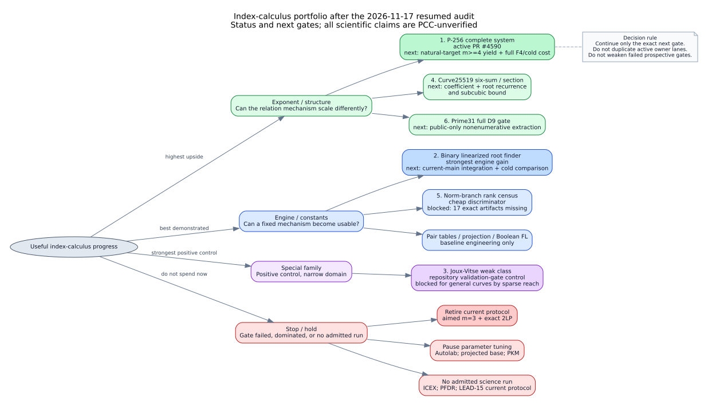

# Index-calculus lead portfolio — resumed audit

**Audit time:** 2026-11-17, refreshed at 20:25 UTC\
**Repository base:** `isogeny-labs/crypto` `833a35d21ec2368ab081b2083d7762ed0bfd2bbc`\
**Task branch / PR:** `codex/index-calculus-resume-20261117`, [#4594](https://github.com/isogeny-labs/crypto/pull/4594)\
**Evidence class:** source/PR/run-record audit; no new scientific run. Every scientific or performance statement below is `[pcc:unverified]` unless an exact standing is stated.

## Decision

The portfolio now has three different kinds of leader; collapsing them into one score would be misleading.

1. **P-256 complete-system regularity has the highest structural upside.** The owner reports exact `m=2` producer certificates with regularity `198 → 14` on the unplanted cell and `197 → 14` on one planted control. The unplanted cell returned zero useful relations. Higher-arity natural-target yield and complete affine F4 cost remain open. `[pcc:unverified]` [PR #4590](https://github.com/isogeny-labs/crypto/pull/4590)
2. **Strongest demonstrated engine improvement: binary linearized root finding.** Continue the implementation already owned by `claude/index-calculus-root-finding-e95kd6` and the upstream [lfd-summation-systems PR #28](https://github.com/isogeny-labs/lfd-summation-systems/pull/28). It reports a 293× `m=3` kernel gain at `k=12`, but its own ECC2K-130 relation-stage extrapolation remains about `3·10^13` core-years; it is an engine advance, not a sub-rho attack. `[pcc:unverified]`
3. **Strongest special-family positive control: corrected Joux–Vitse sieve.** Retain the weak `E(F_{p^6})` class result as a validation/control row. The later repository validator passed the frozen comparison, but operational reach into the weak locus is roughly one percent on the tested starts. The class-group rows reported `0/3`, zero completed walks, and `0/2` at `p=1009,1511,1823`; the paired rational-root reach rows reported `0/9`, `0/8`, and `0/23`. It is not a promising general prime-order route. `[pcc:unverified]`

The best unowned research slot is **Curve25519 compressed six-sum / norm-section coefficient selection**, but it is a theory-and-construction slot: derive a target-conditioned coefficient recurrence, root extraction, and subcubic storage/work bound before another solver campaign. The proposed mechanism has no complete constructor, useful-yield bound, or exponent change yet. `[pcc:unverified]`

The vector source is [portfolio.dot](portfolio.dot); the rendered vector is [portfolio.svg](portfolio.svg).

## Ranked continuation list

1. **P-256 complete-system regularity.** The two `m=2` cells give complementary controls. The owner froze a higher-arity hypothesis checker, and independent review of the bound and certificates remains open. The next evidence needed is natural-target yield and full F4 cost including setup at `m >= 4`. `[pcc:unverified]` [Owner head](https://github.com/isogeny-labs/crypto/commit/7cbb1a2edae610ec37576ccd405d259a6638f5d8)
2. **Binary linearized root finder.** The largest demonstrated decomposition-engine gain in this audit and its structured-basis dependence survive. Next gate: rebase the unpublished crypto port onto current main, pass unscaffolded tests, then compare rational-for-rational against rootfind-MITM, pair tables and matrix F4 with setup, yield and recovery charged. **Continue in the owner lane.** `[pcc:unverified]`
3. **Joux–Vitse weak-class sieve.** Repository validation-gate evidence and favorable reachable-start pricing survive. Next gate: PCC/evidence completion, or a qualitatively new way to classify and reach the sparse weak locus. **Keep as a special-family control; do not rerun the stale workflow.** `[pcc:unverified]`
4. **Curve25519 compressed six-sum / section constructor.** A candidate-checking section interface and cost criterion have been derived, but no quotient query or coefficient solver is implemented. Next gate: construct coefficients and roots with total work below the `B^3` collision floor, including useful-yield loss. **Use as the moonshot theory slot.** `[pcc:unverified]`
5. **Norm-branch tensor census.** A cheap preregistered discriminator could decide whether a rank-one defect persists, but no census result exists. Next gate: restore the 17 exact historical artifacts from an approved source, then rerun the already frozen `$2` EKS contract. **Blocked before launch; do not substitute inputs.** `[pcc:unverified]`
6. **Prime31 full eight-equation D9 extraction.** The active lane reports two replayed B8 negative unit certificates. Its positive job failed during unit tests and skipped witness capture. A recovered public-only positive witness and the B31 extension remain open. `[pcc:unverified]` [Owner PR #4604](https://github.com/isogeny-labs/crypto/pull/4604) · [Positive job](https://github.com/isogeny-labs/crypto/actions/runs/44159155698/job/134307981275)

These priorities separate *upside* from *readiness*. The P-256 and Curve25519 routes could change the relation exponent if their missing constructions work; the linearized root finder is much better demonstrated but currently changes only the engine constant; Joux–Vitse is already a strong positive control but only on a sparse special class.

## Stop, retire, or hold

- **Aimed `m=3` + exact 2LP:** retire the current protocol. Its prospectively frozen selector found no strict witness among 528 target-independent tuples; widening the grid or predicate after seeing that result would be post hoc. This is only a bounded negative for that protocol. `[pcc:unverified]`
- **Projected factor base:** hold as engineering. Earlier binary results improve the adjusted raw arm by `1.29×–3.36×` but remain `6.1×–14.4×` behind matched rho; the frozen volcano run never passed checkpoint custody. `[pcc:unverified]`
- **Autolab parameter rounds:** pause. Round 39 reports `0.944` in counted GAE but `1.2356×` worse solve wall time and about `1.73×` matched rho; another configuration round lacks a new mechanism beyond the `K=3` collision floor. `[pcc:unverified]`
- **Prime-field PKM bounded-degree optimism:** downgrade. The November 17 HKY cells report last-fall degree 6 at depth 13 and at least 9 for `m=9`, depth 2; low-degree membership has not produced bounded complete solving degree. `[pcc:unverified]`
- **Direct root/pair-table, compiled projection, Boolean FL and HEC certificate work:** retain as baseline/component engineering. The current prime pair-table path remains about `18.6×–33.2×` behind rho, the projection run has no result, Boolean FL has no matched Semaev timing, and HEC complete costs are mixed. `[pcc:unverified]`
- **Prime31 barycentric B8:** stop treating sign-chart algebra as compression. The seven-equation quotient is a product of 128 signed branches, and the complete 1,024-target mixed IC result remains about `13.06×` slower than shared-precomputation BSGS. `[pcc:unverified]`
- **ICEX:** retain only as an execution-gate scaffold. The live autoresearcher branch ends at the November 1 S0 source/manifest binding; no admitted science execution or PCC claim exists. `[pcc:unverified]`
- **PFDR:** hold pending a genuinely new approved run package. The November 9 prospective pilot was rejected for interpreter-command provenance and released its failed claim; no scientific result followed. `[pcc:unverified]`
- **LEAD-15:** stop the current common-cover protocol, but call its obstruction an unverified mathematical assertion, not a verified/formal no-go. `[pcc:unverified]`

## What supersedes the November 2 portfolio

- **Corrected Joux–Vitse:** narrowed from strongest surviving scientific lead to strongest special-family control; sparse weak-locus reach blocks generalization.
- **Projected factor base:** downgraded from safest engineering refinement to constant-only engineering, farther from rho than newer structural gates and blocked before its frozen run.
- **Aimed `m=3` + exact 2LP:** retired at this protocol; the prospectively frozen 528-tuple selector null supersedes the old atlas action.
- **PFDR:** still blocked; the later pilot failed provenance admission before science.
- **ICEX:** still code/static-gate only; no admitted execution.
- **LEAD-15:** same operational stop, but with weaker wording because no PCC standing exists for the proof assertion.

## Why no new experiment was launched from PR #4594

- PR #4590 owns the P-256 work and records S3 `HeadObject` HTTP 403 during artifact migration. The binary rootfinder integration and Prime31 D9 also have active owner branches. `[pcc:unverified]`
- The old Joux–Vitse run is terminal/cancelled and has been superseded by later validation and coverage studies; a retry would repeat lower-value work.
- The norm census failed before build because 17 exact required artifacts are absent from both Git history and the admitted cache. Approved original-store recovery is required; substituting inputs would invalidate the frozen contract.
- The aimed-2LP selector null, projected-base checkpoint failure, and PFDR provenance rejection are protocol/admission results, not invitations to weaken their gates.

## Retrieval and claim-standing receipt

The dedicated research-KB MCP was not loaded, and `scripts/research-kb status` exited 127 because the executable/catalogue were absent. The current `crypto-autoresearcher` main is Vault-encrypted in this environment, so its exact files could not be decoded. The explicit fallback was:

- Local atlas review `7e12aa99c3c652fc3918ed43c04617343345fb11`, reviewed 2026-10-30.
- **Query:** “Joux Vitse Nagao cover descent.”
  - LEAD-TRF-jv-nagao-genus2-cover-decomp
  - LEAD-TRF-jv-sieve-fp6-weak-class
- **Query:** “linearized two-summand rootfind pairtable decomposition oracle.”
  - LEAD-ICE-rootfind-pairtable-oracle
- **Query:** “large prime unsaturated relation graph.”
  - LEAD-ICB-large-prime-variants
  - LEAD-ICE-relation-graph-rank-large-prime
- **Query:** “projected factor base algebraic membership.”
  - LEAD-ICP-algebraic-membership-factor-base
  - LEAD-ICP-pkm-tower-algebraic-oracle
- **Query:** “prime field Semaev rootfinding PKM.”
  - LEAD-ICP-pkm-tower-algebraic-oracle
  - LEAD-ICP-digit-presentation-solving-degree
- Current source-bounded sweep: [the November 17 lead report](../README.md) at `833a35d21e`.

Primary repository records then overruled stale atlas actions where they were newer. The PCC audit ran `tools/pcc/pcc.py standing-by-type --json` on main and found all 3,544 records unverified; none of the portfolio assertions has signed standing. `[pcc:unverified]`

## Primary sources

- P-256 sources include the [complete-law protocol](../../../../research/p256_aux_smooth_20261114/goal_dreg_half_20261117/COMPLETE_LAW_PROTOCOL.md), [component report](../../../../research/p256_aux_smooth_20261114/goal_dreg_half_20261117/REPORT.md), and [pinned planted certificate](https://github.com/isogeny-labs/crypto/blob/7cbb1a2edae610ec37576ccd405d259a6638f5d8/research/p256_aux_smooth_20261114/goal_dreg_half_20261117/ANN_M2_PROOF.md).
- Linearized root finder: [lfd-summation-systems PR #28](https://github.com/isogeny-labs/lfd-summation-systems/pull/28) and the [crypto tracking/integration branch](https://github.com/isogeny-labs/crypto/tree/claude/index-calculus-root-finding-e95kd6).
- Joux–Vitse: [validation record](../../../../research/jv_sieve_line_vs_rho_20261103/VALIDATION.json), [validated-study README](../../../../research/jv_sieve_line_vs_rho_20261103/README.md), [walk-charge study](../../../../research/jv_walk_charge_20261111/README.md), and [class-group reach study](../../../../research/jv_classgroup_walk_20261112/README.md).
- Curve25519: [exponent-ideas report](../../../../research/curve25519_torus_native_20261115/reports/exponent-ideas-v1/REPORT.md), [section-search report](../../../../research/curve25519_torus_native_20261115/reports/section-search-v1/REPORT.md), and [coefficient-selection problem](../../../../problems/curve25519-section-coefficient-selection.md).
- Prime31 sources include the [generic-control result](../../../../research/prime31_ic_20261115/rr9/RR9_B8_GENERIC_MITM_RESULT_20261117.md), [seven-quotient result](../../../../research/prime31_ic_20261115/rr9/RR9_SEVEN_QUOTIENT_SPLIT_RESULT_20261117.md), and [D9 negative certificate report](https://github.com/isogeny-labs/crypto/blob/40886bd9ef6ab0872ab7f85692cbe13b818e30e9/research/prime31_ic_20261115/rr9/RR9_D9_BLACKBOX_RESULT_20261117.md). A later pair-table baseline run completed both timing steps after the earlier compile failure. Its uploaded raw evidence still awaits validation. `[pcc:unverified]` [Baseline PR #4596](https://github.com/isogeny-labs/crypto/pull/4596) · [Exact-cohort run](https://github.com/isogeny-labs/crypto/actions/runs/44153776142)
- Prior lanes: `codex/jv-validation` at `c1de0e8a317`; `codex/large-prime` at `78a460ca018`; `codex/projected-base` at `a9f147161ac`; and `codex/lead15` at `ae7e5d089f0`.

## Canonical-graph decision

No canonical scoreboard, curve graph, or performance chart is changed. This audit produced a portfolio decision, not a newly admitted measurement. Existing quantitative rows remain at their own validation scope; the diagram above displays route status and next gates, not performance magnitude.
