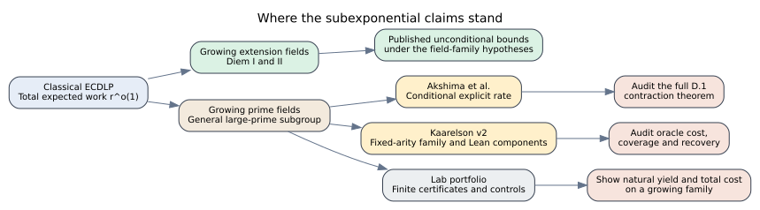

# Subexponential ECDLP goal and lead assessment

2026-11-17 UTC · Main base `833a35d21e` · [Goal and assessment PR #4627](https://github.com/isogeny-labs/crypto/pull/4627)

**Akshima et al. give an explicit conditional prime-field index calculus.** It bounds expected time by $2^{O(b/(\log b)^{1/4})}$ for $b$-bit prime fields with prime-order elliptic curve groups, with a stated fixed-cofactor extension. The key dependency is the exact general Boolean tensor-contraction theorem D.1, whose full proof was outside the scope of this audit. Kaarelson v2 gives a second candidate with a fixed-arity family and formalized decomposition components. Diem supplies a published, unconditional result for specific growing extension-field families. This audit found no independently substantiated general prime-field algorithm among the reviewed sources. [pcc:unverified]

## Literature and mathematical scope

- **Diem, extension fields.** For $Q=q^d$, the 2011 bound is $\exp(O(\max\{\log q,d^2\}))$, giving $\exp(O((\log Q)^{2/3}))$ when $d$ is on the order of $\sqrt{\log q}$. The 2013 Theorem 2 gives $\exp(O(\max\{\log q,d\sqrt{\log q},d^{3/2}\}))$, which is $Q^{o(1)}$ if $d\to\infty$ and $d=o((\log q)^2)$. Theorem 3 covers fixed characteristic when the absolute extension degree factors as $uv$ with both factors tending to infinity. These are ambient-field bounds and give $r^{o(1)}$ when $\log r$ and $\log Q$ are comparable. The prime-field specialization $d=1$ lacks the relevant acceleration. The lab's Diem chart audit addresses a local $\mathbb F_2$ proof helper and its repair. [Diem I](https://doi.org/10.1112/S0010437X10005075) · [Diem II, Theorems 1–3](https://msp.org/ant/2013/7-6/ant-v7-n6-p01-s.pdf) · [Chart audit](https://github.com/isogeny-labs/crypto/blob/833a35d21ec2368ab081b2083d7762ed0bfd2bbc/research/diem_chart_audit_20261114/README.md)
- **Akshima et al., explicit conditional prime-field bound.** Theorem 4 and Lemmas 11–13 supply a growing-arity reduction with expected log-work $O(b/m + mb/\sqrt{\log b})$. The choice $m$ of order $(\log b)^{1/4}$ balances these terms. The audit checked that the stated encoding's $O(mb)$ edges, $O(b^{3/4})$ degree and polynomial description/entry cost fit the stated D.1 interface, including the bipartite conversion and scalar ring case. D.1 itself remains the key open independent proof check. The published-file preprint acknowledges that its constants place the stated saving far beyond current key sizes. Its prime-order recovery uses a nonzero row dependence and a random coefficient test. Full base-column rank is unnecessary for that recovery route. [pcc:unverified] [Pinned Bochum v0.2, Theorem 4](https://github.com/bochum-crypto/subexponential-ecdl/blob/1ee44e562b1b9a50ea339f3b8f81112b5a24b96f/subexponential-ecdl.pdf) · [Pinned D.1 and D.4](https://github.com/openai/math/blob/7ef5c0cc5ca4b0e072b7a050fca09ab24bc6fa3a/preprints/The-Exponential-Time-Hypothesis-is-False-October-25-2026/paper.pdf)
- **Kaarelson v2, a second prime-field candidate.** Theorem 1 claims expected $p^{2/m+o(1)}$ for every fixed integer $m$ under its explicit size hypotheses. The repository reports Lean proofs for the fixed-$m$ decomposition oracle and counting endpoint. Table 3 leaves coverage and end-to-end discrete-log bounds as paper arguments, with named hypotheses in component formalizations. Theorem 7's explicit growing-$m$ rate relies on assumptions E and N. Audit the oracle's machine/input-length correspondence and the prime-order coverage and recovery arguments before relying on the full claim. No independent kernel rebuild was performed. [pcc:unverified] [Pinned v2, Theorems 1–4 and 7](https://github.com/kaarelkaarelson/fast-ecdlp/blob/d1deb5abe008e981206ed58cbd83012b6afc3740/v2/paper.pdf) · [Formal artifact scope](https://github.com/kaarelkaarelson/fast-ecdlp/blob/d1deb5abe008e981206ed58cbd83012b6afc3740/v2/README.md)

The goal is $\exp(o(\log r))$ total expected work, including construction, useful relation production, linear algebra and individual recovery. A fixed positive exponent $r^\delta$ remains exponential in the input bit length even for $\delta<1/2$. Both explicit preprint rates above use logarithmic savings in that bit length and do not assert a fixed $\alpha<1$ in standard $L_r(\alpha,c)$ notation. For the fixed-$m$ family, a separate qualitative implication is worth checking: if every fixed-$m$ expected bound is sound in an ordinary machine model and candidate answers can be checked in polynomial time, universal scheduling with geometric time budgets and repeated runs can turn arbitrarily small fixed powers into a weak $r^{o(1)}$ guarantee. This gives no explicit quantitative rate for that scheduler. [pcc:unverified]

### A necessary scaling test

For independently uniform residuals in a group of order $r$, a factor base of $B$ signed elements and arity at most $m$ can cover at most $\sum_{j=0}^{m}B^j$ residues. Thus at fixed $m$ and $B=r^{o(1)}$ the hit rate is at most $r^{-1+o(1)}$, even if decomposition were free. Growing arity can clear this counting gate, but it still needs a lower bound on actual coverage and complete extraction cost. The bound concerns uniform decomposition and leaves direct relation-generation and other target distributions outside its scope. It is a finite counting argument, and no new asymptotic solver is claimed. [pcc:unverified]

## What the lab has already assessed

Each item below gives an evidence level and the missing step at the stated scope. Open-PR claims and local replays retain unsigned standing. [pcc:unverified]

- **Hashed factor-base tensor contraction — source audit, implementation, bounded correctness.** The narrower SAT endpoint and the general implicit-entry contraction needed by the ECDLP paper were distinguished in the October bridge. The public native range exercises a finite-size fallback, with forced small controls for recursion. A scalable runtime claim still needs the full independent proof and cost audit. [pcc:unverified] [Bridge](https://github.com/isogeny-labs/crypto/blob/833a35d21ec2368ab081b2083d7762ed0bfd2bbc/research/hashed_ecdl_leads_20261030/BRIDGE.md) · [Open problem](https://github.com/isogeny-labs/crypto/blob/833a35d21ec2368ab081b2083d7762ed0bfd2bbc/problems/hashed-ecdl-tensor-backend.md)
- **P-256 complete-system regularity — exact finite producer certificates.** At $m=2$ the unplanted and planted controls report regularity $198\to14$ and $197\to14$. The unplanted control yielded zero useful rows. The owner has frozen a higher-arity qualification checker. Natural-target yield, completion cost, and growth with arity remain open. This is the best-assessed internal prime-field structural lead in the current portfolio. [pcc:unverified] [Owner PR #4590 at `7cbb1a2e`](https://github.com/isogeny-labs/crypto/pull/4590)
- **Binary linearized root finding — measured kernel and port.** Structured binary toy measurements exist and there is now a crypto integration PR. A matched rational-domain comparison and a full pipeline gain remain open. The ECC2K-130 campaign audit reports zero useful natural rows in its assessed cohort. Bounded-degree Semaev/PKM claims remain conditional, with finite degree-growth and complete-cost issues already documented. [pcc:unverified] [Upstream #28](https://github.com/isogeny-labs/lfd-summation-systems/pull/28) · [Port #4600](https://github.com/isogeny-labs/crypto/pull/4600) · [ECC2K-130 audit #4602](https://github.com/isogeny-labs/crypto/pull/4602) · [Complete-cost gap](https://github.com/isogeny-labs/crypto/blob/833a35d21ec2368ab081b2083d7762ed0bfd2bbc/problems/ic-low-degree-complete-cost-and-scaling.md)
- **Prime31 RR9 and Dickson31 — small algebraic controls plus generic-equivalent baseline.** Two B8 D9 negative witnesses replayed. The native positive job failed before capture. A separate Singular implementation extracted the positive B8 coefficients without sign guesses and replayed them independently. Dickson31 reached rank 31 and completed the 1,024-target cohort via enumeration, and the matched occupancy-null plan awaits data. Natural B31 algebraic extraction and scalable yield remain open. [pcc:unverified] [D9 #4604](https://github.com/isogeny-labs/crypto/pull/4604) · [Singular #4624](https://github.com/isogeny-labs/crypto/pull/4624) · [Dickson control #4623](https://github.com/isogeny-labs/crypto/pull/4623) · [Occupancy plan #4626](https://github.com/isogeny-labs/crypto/pull/4626)
- **Curve25519 six-sum section and H115 moments — theory or structural fixtures.** The six-sum section has a candidate interface and a rejected uniform coefficient sampler. A target-conditioned constructor and witness recovery bound are open. Its current subcubic target at fixed arity concerns a fixed-power gain. The H115 Frobenius–Kummer plan has frozen toy inputs with an open compression and decoding obligation. [pcc:unverified] [Section report](https://github.com/isogeny-labs/crypto/blob/833a35d21ec2368ab081b2083d7762ed0bfd2bbc/research/curve25519_torus_native_20261115/reports/section-search-v1/REPORT.md) · [H115 #4625](https://github.com/isogeny-labs/crypto/pull/4625)
- **Joux–Vitse weak class — assessed special-family control.** The repository validation record covers its frozen comparison. Tested approaches reach the sparse weak locus infrequently. [pcc:unverified] [Validation](https://github.com/isogeny-labs/crypto/blob/833a35d21ec2368ab081b2083d7762ed0bfd2bbc/research/jv_sieve_line_vs_rho_20261103/VALIDATION.json) · [Reach study](https://github.com/isogeny-labs/crypto/blob/833a35d21ec2368ab081b2083d7762ed0bfd2bbc/research/jv_classgroup_walk_20261112/README.md)
- **Coverage and primary rank — assessed on synthetic fixtures.** The complete 6,188-base census changed estimator preference with sampling gate on 1,066 bases. Streaming primary-rank implementations matched batch elimination on 388 prefixes. Carry these diagnostics into comparable studies as appropriate to their recovery model. [pcc:unverified] [Synthetic report #4617](https://github.com/isogeny-labs/crypto/blob/a01f13235f838abb2f7518ef50fb5c4712770177/docs/leads/2026-11-17/synthetic-coverage-rank/extension/REPORT.md)
- **Aimed exact 2LP — bounded negative; projected base and pair tables — engineering controls; norm-branch census — blocked pre-data.** The aimed selector was null over 528 frozen tuples, and the norm census still needs 17 exact inputs. PFDR and ICEX remain execution-admission cases. [pcc:unverified] [Portfolio audit](https://github.com/isogeny-labs/crypto/blob/5fc8e2a923e6d8ce64437c07f0008413b04b6f2b/docs/leads/2026-11-17/index-calculus-portfolio-resume/REPORT.md)

## First unresolved proof check

The first review item is D.1 §D.4.6–7, following one retained tensor and one new packet tensor through a child call. The elementary cost check is consistent with the claimed exponent: scanning at most $s^{1/1000}$ factors with polynomially many terms costs $\exp(O(s^{1/1000}\log s))$, which fits the stated entry allowance. The missing review is whether the preceding packing, precision and coefficient identities keep those local descriptions valid at every level. Acceptance requires a checked uniform bound or a precise counterexample to an identified inference. Parallel review of Kaarelson's prime-order coverage and recovery arguments can assess a distinct path while the P-256 owners work through their finite checks. [pcc:unverified] [Pinned D.1 source](https://github.com/openai/math/blob/7ef5c0cc5ca4b0e072b7a050fca09ab24bc6fa3a/preprints/The-Exponential-Time-Hypothesis-is-False-October-25-2026/paper.pdf) · [Existing lab checklist](https://github.com/isogeny-labs/crypto/blob/833a35d21ec2368ab081b2083d7762ed0bfd2bbc/research/hashed_ecdl_leads_20261030/BRIDGE.md)

The research-KB MCP was absent and the wrapper had no executable. The fallback used the local lead atlas at `7e12aa99c3c6` and current primary sources. Search families covered Diem extension growth, prime-field subexponential claims, first-fall-degree counterexamples, and implicit tensor contraction. PR head observations are a non-atomic documentary snapshot. The scope of this assessment is the linked papers and tracked lab leads.
