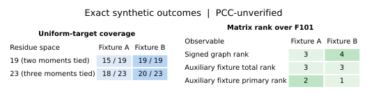

# Two synthetic controls for index-calculus studies

2026-11-17 UTC · [PR #4617](https://github.com/isogeny-labs/crypto/pull/4617)

I would advance coverage calibration first. It exposes a measurable gap between planted success and coverage of a uniform target. The rank diagnostic is the next choice when a study adds auxiliary columns or uses graph coverage as a stopping condition. The evidence here consists of exact finite examples and a complete toy census.

## Target coverage from planted multiplicities

Two sets modulo 19 supplied 36 ordered pairs each and both had squared multiplicity sum 90. Their exact uniform-target coverages were **15/19 and 19/19**, a gap of 4/19. Two sets modulo 23 matched all three multiplicity sums (49, 151, 541) and covered **18/23 and 20/23**. Each planted pair lands on a covered residual by construction. [pcc:unverified] [Coverage receipt](coverage.txt)

The complete census of all 330 four-element subsets modulo 11 repeats the first-two-moment ambiguity beyond the selected fixtures. Of the 165 sets with squared multiplicity sum 36, 110 cover 8 residues and 55 cover 9. The other bins have single support counts (110 sets at squared sum 32 and support 9, and 55 at squared sum 44 and support 7). [pcc:unverified] [Coverage receipt](coverage.txt)

The calibration is a finite specialization of standard size-biased sampling. If an eligible tuple is drawn uniformly, a residual with multiplicity $R(x)$ is drawn with probability $R(x)/T$, where $T$ is the tuple count. For a uniform residual space of size $N$, averaging $T/(N R(x))$ over plants recovers the support fraction. This follows by summing one contribution of $1/N$ for each occupied residual. The replay checks that cancellation with integer weights and a separate subtraction-based count on every fixture and census row. [pcc:unverified] [Arratia, Goldstein and Kochman, Section 2](https://arxiv.org/abs/1308.2729) · [Native replay](replay.cpp)

The diagnostic requires the same tuple universe for generating plants and counting multiplicities. For a certified interval $1\le L(x)\le R(x)\le U(x)$ at a planted residual, inverse weighting with $U(x)$ bounds the coverage below and inverse weighting with $L(x)$ bounds it above. A partial enumeration ordinarily gives only $L(x)$. Keep a uniform-target cohort when evaluating operational success, particularly if counting all representations is costly. [pcc:unverified]

## Rank that survives auxiliary elimination

The matched signed graphs both connect all four vertices by the third row. Over the fields of orders 3 and 101, one has final rank **3** and the other **4**. Across all ten placements of the two negative signs, four placements reach rank 4 at row four and eight reach it at row five. Over the field of order 2, all ten end at rank 3. The matched pair holds supports, the multiset of row sign histograms, and each column histogram fixed. The ten-placement census conditions only on topology and the total number of negative signs. [pcc:unverified] [Rank receipt](rank.txt) · [Zaslavsky, *Signed graphs*](https://doi.org/10.1016/0166-218X(82)90033-6)

The auxiliary fixture has three rows, two primary columns and two auxiliary columns. Both matrices have the same support, the same per-row and per-column sign histograms, and rank **3** over the fields of orders 3 and 101. They differ in primary-only rank, **2 versus 1**. The row span's projection onto the auxiliary columns has rank equal to the rank of that block. Its kernel therefore has dimension $\operatorname{rank}(M)-\operatorname{rank}(M_{\rm aux})$, which counts the independent constraints involving only primary columns. The replay computes both ranks at every prefix and cross-checks nullities by enumerating field vectors at orders 2 and 3. [pcc:unverified] [Rank receipt](rank.txt) · [Native replay](replay.cpp)

## Replay and sources

For a study that collects rows with auxiliary columns, record primary-only rank at matched work cutoffs. The resulting rank curve can distinguish arms when raw relation and total rank counts agree. Collection costs on elliptic curves remain unmeasured.

The source and fixed replay scope were committed at `ff175b2eb9d`. Both native modes completed with GCC 14.2, each produced a text receipt, and their outputs are deterministic. A second reader independently reproduced the coverage results using bitmask intersections and the rank results using nonzero minors. The repository records both sets of results as producer statements with unsigned standing. [pcc:unverified] [Replay instructions](CHECKS.md) · [Coverage claim PCC-20261117-51f399](../../../../pcc/claims/PCC-20261117-51f399.json) · [Rank claim PCC-20261117-b89b3c](../../../../pcc/claims/PCC-20261117-b89b3c.json)

The research-KB tool was unavailable and its CLI wrapper had no executable. The fallback searched planted versus uniform targets, multiplicity moments, connectivity versus modular rank, and auxiliary elimination. The October 30 atlas entry on relation-graph rank already recommends accounting for independence. The repository's Fp4 ladder uses planted targets, while the Kummer Fourier study exhaustively counts target decompositions for a different statistic. The two controls here apply standard statistics and linear algebra to those evaluation questions. [Atlas entry](https://github.com/isogeny-labs/crypto-autoresearcher/blob/7e12aa99c3c652fc3918ed43c04617343345fb11/knowledge/leads/ecdlp/ic-engine/LEAD-ICE-relation-graph-rank-large-prime.yaml) · [Fp4 study](../../../../research/ic_next10_20261014/01-fp4-ladder/README.md) · [Kummer study](../../../../research/ic_next10_20261014/04-kummer-fourier/README.md)
