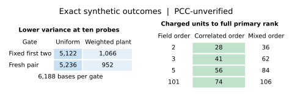

# Coverage census and streaming primary rank

2026-11-17 UTC · [PR #4617](https://github.com/isogeny-labs/crypto/pull/4617) · [Matched-work fixtures](../followup/REPORT.md)

Uniform sampling had lower variance on most of the 6,188 synthetic bases. The choice of gate changed the preferred estimator on 1,066 of them. The auxiliary-first streaming method agreed with two reference calculations at all 388 rank prefixes. This supports keeping a uniform cohort for coverage and tracking primary-only rank directly when rows contain auxiliary columns. [pcc:unverified]

## Coverage at ten probes

The census enumerated all labelled five-element subsets of residues modulo 17 in canonical ascending order. Each base gives 25 ordered pairs, with repeats allowed. At ten membership probes, the uniform arm averages five two-probe draws and the planted arm averages two five-probe draws. The latter uses all five probes to count the exact residual multiplicity and reuses the two gate positions for acceptance. The program checks that both means agree and independently enumerates every elementary target and plant outcome to check the exact variance differences. The work model counts membership probes. [pcc:unverified] [Coverage receipt](coverage.txt) · [Size-biased sampling](https://arxiv.org/abs/1308.2729)

- With the first two positions fixed, uniform has lower variance on **5,122 of 6,188** bases. Weighted planting has lower variance on 1,066.
- Choosing a fresh position pair for each draw, uniform has lower variance on **5,236 of 6,188**. Weighted planting has lower variance on 952.
- There are no ties. Changing the gate switches 590 bases from planted to uniform and 476 in the other direction. [pcc:unverified]

For the fresh-pair gate, weighted planting wins on every base with raw support 9 or 10, while uniform wins on every base with support 12–14. At support 11 the census splits 544 to 408. A residual with multiplicity $R$ is accepted by $10-\binom{5-R}{2}$ of the ten position pairs, so raw support and the second multiplicity moment determine that gate's comparison in this model. The first-two gate can depend on the canonical ordering, and the census counts labelled subsets rather than equivalence classes. The finite spread describes this census. [pcc:unverified] [Support strata and variance ranges](coverage.txt)

## Rank on charged row streams

The comparison includes four matrix shapes over fields of orders 2, 3, 5 and 101. The ordered pairs use the same distinct rows and event prices, with duplicate and rejection positions held fixed. Rearranging which auxiliary directions appear early preserves the full rank trace within each pair. Full primary rank occurs at charged work **28 and 36**, **41 and 62**, **56 and 84**, and **74 and 106**, respectively. The test also includes four deterministic stress streams and two characteristic controls. [pcc:unverified] [Rank receipt](rank.txt)

The primary-only dimension is the total row rank minus the rank of its auxiliary projection. The one-pass method uses an auxiliary pivot basis and only updates the primary basis when the residual has zero auxiliary coordinates. A separate batch routine eliminates auxiliary columns in each retained prefix and directly ranks the induced primary rows. It agreed with the one-pass method and with the two-basis rank difference on **388 prefixes across 14 streams**, including 14 empty prefixes. [pcc:unverified] [Native implementation](rank_incremental.cpp)

Using total rank at least as large as the primary dimension as the readiness criterion produced 2–15 premature prefixes per ordered or stress stream. Requiring full matrix rank delayed readiness by 2, 6, 8 and 9 prefixes on the four auxiliary-correlated streams. At the largest shape, the one-pass pivots store **171** coefficients against **261** for the two-basis method. These are entry counts, and the charged stream costs are fixed fixture inputs. The implementation's wall time, allocator cost, and actual relation-collection costs remain unmeasured. [pcc:unverified] [Shortcut counts](rank.txt)

## Reproduction and scope

The [fixed inputs and source](CHECKS.md) were committed at `48649d18a4` before replay. Both optimized C++17 binaries and builds with undefined-behavior checks reproduced identical receipts. The research-KB wrapper lacked its executable, so the earlier study's linked literature and fixtures provided the source baseline. PCC records the outcomes as unsigned producer statements. [pcc:unverified] [Coverage PCC-20261117-934096](../../../../../pcc/claims/PCC-20261117-934096.json) · [Rank PCC-20261117-d15adc](../../../../../pcc/claims/PCC-20261117-d15adc.json)
