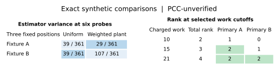

# Coverage and primary rank at matched synthetic work

2026-11-17 UTC · [PR #4617](https://github.com/isogeny-labs/crypto/pull/4617) · [Original controls](../REPORT.md)

Use uniform draws as the primary coverage estimate. Inverse-multiplicity weighting recovered the same mean in both synthetic fixtures, but the variance comparison reversed between them. For row streams with auxiliary columns, record primary-only rank against all charged attempts. It distinguished streams whose total rank agreed at every prefix. [pcc:unverified]

## 1. Coverage at equal probe cost

The synthetic modulo-19 fixtures each contain six base elements and 36 ordered pairs. The full support fractions are **15/19** for A and **19/19** for B. For the fixed three-position gate, both accept **13/19** of uniform residuals. One unit is a candidate-complement membership probe. Uniform sampling checks three positions per draw and averages two independent draws per six-probe block. A planted draw reads all six positions to recover its exact multiplicity and reuses the first three for the gate. Its score for an accepted planted residual is the total pair count divided by the group size and the residual's multiplicity. [pcc:unverified] [Coverage receipt](coverage.txt) · [Size-biased sampling, Section 2](https://arxiv.org/abs/1308.2729)

At exactly six probes the uniform estimate has variance **39/361** on both fixtures. The weighted planted estimates have variances **29/361** on A and **107/361** on B. Thus the planted-to-uniform variance ratio is **29/39** on A and **107/39** on B. Averaging over all 20 choices of three positions gives the same direction, with ratios **2106/2623** and **1273/459**. Averaging independent blocks divides each variance by the number of blocks. [pcc:unverified] [Exact variance receipt](coverage.txt)

The raw support comparison prices early-exit uniform draws at an average 55/19 and 51/19 probes on A and B. Exact planted counts cost six probes per draw. For a sample size chosen to match expected work, variance times expected probes was **3300/6859 versus 54/361** on A and **0 versus 462/361** on B, in uniform then planted order. This is an expected-work calculation per draw. Sample generation, bookkeeping and preprocessing are outside both probe models. [pcc:unverified] [Raw-coverage receipt](coverage.txt)

## 2. Primary rank after charging rejected and duplicate rows

The two synthetic streams each attempt eight rows, including two rejections and two accepted duplicates. Both touch every column after five charged units and have equal acceptance count and total rank at every prefix. At work 10, both have total rank 2. Their primary-only ranks are **1 and 0**. At work 15, both have total rank 3. Their primary-only ranks are **2 and 1**, and the second stream first reaches rank 2 at work **21**. This holds over the fields of orders 3 and 5. Both streams finish at primary rank zero over the field of order 2. The work units are fixed costs assigned to fixture events. [pcc:unverified] [All 24 field-prefix rows](rank.txt)

The native replay enumerates the complete row span at each prefix and counts vectors with zero auxiliary coordinates. A second calculation enumerated combinations independently. Over odd fields, adding rows 1 and 2 and rows 1 and 3 in A gives two pure primary directions. In B, the first two auxiliary rows are independent, and only one pure primary direction exists after adding row 3. Both final integer determinants have absolute value 8. [pcc:unverified] [Fixed matrices and event costs](CHECKS.md)

## Reproduction and scope

The fixed inputs and C++ source were committed at `41c57eb21d` before the native replay. Both modes run without random draws and reproduce exact text receipts. The probe accounting and rank thresholds are evidence for the diagnostic setup on these fixtures. Collection costs on elliptic curves remain unmeasured. The research-KB service was unavailable and the prior study's linked literature and fixtures served as the starting point. The results have unsigned PCC standing. [pcc:unverified] [Coverage PCC-20261117-b66b9e](../../../../../pcc/claims/PCC-20261117-b66b9e.json) · [Rank PCC-20261117-40008d](../../../../../pcc/claims/PCC-20261117-40008d.json) · [Replay instructions](CHECKS.md)
