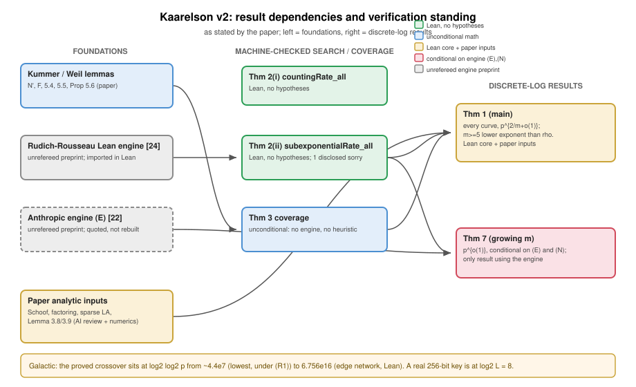
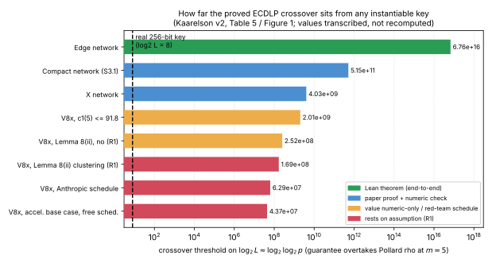

# Kaarelson v2 "A Fast Algorithm for ECDLP": full-paper assessment

2026-11-18 UTC · Main base `9ec88b7637` · [Assessment PR #4672](https://github.com/isogeny-labs/crypto/pull/4672) · extends the [2026-11-17 subexponential-ecdlp-goal lead](../../2026-11-17/subexponential-ecdlp-goal/REPORT.md) (PR #4627)

**Scope.** This is a literature assessment of one external preprint. Every
statement below about the paper is attributed to the paper; this note carries
no independent verification and runs no experiment. `[pcc:unverified]`

**Source.** Kaarel Kaarelson, *"A Fast Algorithm for Elliptic-Curve Discrete
Logarithms"*, version 2, 2026-11-01. Repository
`github.com/kaarelkaarelson/fast-ecdlp`. The paper states it was produced by the
author directing Claude agents (coordinating model Claude Opus 5.5; sub-agents
Opus, Sonnet, Haiku), with the main results obtained 2026-10-30/31, and that its
reviewers were AI agents in the same environment rather than human referees
(its §"Limits of this process").

## What the paper claims, and at what standing

The paper states four results. The honest reading turns on which of them touch
the unrefereed October-2026 counting engine, and on the enormous constants.

- **Theorem 1 (main).** For every fixed `m ≥ 2`, a Las Vegas algorithm that
  claims to solve the ECDLP on *every* curve over `F_p`, of any group order and
  structure, in expected time `p^{2/m+o(1)}`; with a lower exponent than
  Pollard's rho for `m ≥ 5` (the paper's claim). The paper states its decomposition oracle is a Lean
  theorem (Theorem 2(ii)) and that Theorem 1 does **not** assume the Anthropic
  engine statements (E): the engine enters only through a Lean-formalized engine
  (Rudich–Rousseau [24]) that the paper's development imports. The coverage
  bound, point counting and factoring, the sparse linear algebra, and
  Lemmas 3.8/3.9 are stated as **paper proofs** checked by the authors'
  AI adversarial review and numerics, not by machine.
- **Theorem 2 (fast decomposition).** The search over `x`-strings with sign
  bits (Theorem 2(ii), Lean module `L104_Final.subexponentialRate_all`) and its
  counting form (Theorem 2(i), `L132_Final.countingRate_all`) are stated as Lean
  theorems with **no hypotheses, engine included**, with the axiom check
  reporting only `propext, Classical.choice, Quot.sound`. The paper discloses one
  deliberate `sorry` in `ECDLP.subexponentialRate` (module `L35_Challenge`),
  stating it is never used as a lemma and its type is checked separately. This is
  the part the paper offers as machine-checked.
- **Theorem 3 (coverage — unconditional).** On a uniformly random isomorphic
  model `E_u` of any curve, a fraction at least `c_m(κ)` of points have a generic
  decomposition into points with `x`-coordinate in `[1, X]`, `X = ⌊p^{1/m}⌋`. The
  paper states this **uses no engine and no heuristic**: it is a Kummer-theory
  second-moment argument (Lemmas N′, F, 5.4, 5.5, Proposition 5.6), replacing the
  standard `1/m!` decomposition assumption. Its probabilistic skeleton is stated
  as a Lean proof with the analytic lemmas as **named hypotheses**
  (`DilationNondeg`, `FactorBaseVar`, `SemaevNondeg`). This is the result that is
  worth reading regardless of the engine's fate.
- **Theorem 7 (growing `m`, conditional).** Letting `m` grow as
  `(log_2 L)^{α′/2}` gives expected time `p^{o(1)}`, **conditional on (E)** (the
  Anthropic engine's published statements) **and (N)** (Proposition N). The paper
  states this is the only discrete-log result that uses the engine, that it has
  had one adversarial review, and that it "says nothing at any size anyone could
  compute: `m* ≥ 2` already requires `log_2 L ≥ 6.25·10^4`."

**What is genuinely new, in the paper's own terms.** Two ideas carry the work.
(i) Averaging over isomorphic models `E_u : y² = x³ + u⁴Ax + u⁶B` replaces the
`1/m!` decomposition heuristic by a second-moment bound (Theorem 3); the
interval factor base `{x < p^{1/m}}` becomes a dilated box whose `m`-fold
additive energy is controlled by a Kummer/Weil argument. (ii) The counting
engine makes the decomposition *search* cost `p^{o(1)}` because a decomposition
is witnessed by `O(m)` field elements, so the shared-information budget is
`U = O(mL)` rather than `Θ(L²)`. The paper argues (its §9) that this refutes a
prior conjecture that any succinct factor base of size `√p` needs `p^{1/2−o(1)}`
per decomposition: Theorem 2(ii) at `m = 2`, a Lean theorem, is offered as the
counterexample. In the program's language, this is the claim that interval
factor bases over `F_p` are not inherently useless.

## The constants: no instantiable curve is affected

The paper is explicit (its §10 "The results are galactic", §"No effect on
deployed curves") that nothing here bears on P-256, secp256k1, Curve25519, or
any curve at a size anyone can instantiate. Its Table 5 / Figure 1 give the
crossover at which its stated guarantee would overtake rho, as a threshold on
`log_2 L ≈ log_2 log_2 p`. A real 256-bit key sits at `log_2 L = 8`.

| Network / schedule (paper Table 5) | threshold `log_2 L ≥` | status the paper gives |
| --- | --- | --- |
| V8x, block clustering, accelerated base case, free schedule | `4.372·10^7` | lowest; needs assumption (R1), numeric V8x value |
| V8x, block clustering, Anthropic schedule | `6.292·10^7` | needs (R1); base case Lean |
| V8x, block clustering of Lemma 8(ii) | `1.693·10^8` | under (R1); clustering paper + 221-network check |
| same, without (R1) | `2.52·10^8` | schedule reproduced by a red-team agent |
| V8x, `c1(5) ≤ 91.8` | `2.014·10^9` | value numeric only; sizes extrapolated beyond `L = 2^400` |
| X network | `4.027·10^9` | value paper + 292-instance check |
| Compact network (§3.1) | `5.154·10^11` | value and sizes paper + checked |
| Edge network | `6.756·10^16` | value and size bounds are Lean theorems |

The one row that is a Lean theorem end-to-end (edge network) places the crossover at
`log_2 log_2 p ≈ 6.8·10^16`; the lowest row buys `~10^7` only with a hand-audited
assumption (R1), a numerically-checked network value, and a free schedule. The
paper's Figure 1 labels the best case as still roughly eight million times away
from real keys measured in `log log p`. So `p` must have far more than `2^{10^8}`
bits for any guarantee to engage.

Against the lab's success criterion (iterative, measured progress over the
index-calculus baseline, reported as gap to matched rho), this paper is **not a
success-criterion row**: it is an asymptotic existence result with galactic
constants and no measured arm against the lab's baseline. The paper's own
measured comparison (§10) reports that a full index calculus at `m = 3` loses to
rho with the negation map at every size from 10 to 40 bits — consistent with the
program's repeated negative results at instantiable sizes.

## Provenance and the review it has had

The foundations are unrefereed and the checking was overwhelmingly done by AI,
which the paper states plainly and treats as its main risk.

- **The engine is unrefereed.** (E) consists of statements from the Anthropic
  preprint [22], formalized in Lean by its authors; the paper quotes them and did
  not rebuild that development. The Lean pipeline for Theorems 1 and 4–6 uses the
  Rudich–Rousseau Lean engine [24] instead — also an unrefereed preprint. The
  paper notes that if (E) fails, Theorem 7 and the deterministic `y`-digit
  extension lose their proofs, but Theorems 1 and 3–6 do not depend on (E).
- **The reviewers were AI agents.** The paper's own "Limits of this process"
  states the reviewers are AI agents in the same environment, not human referees,
  that the engine papers are recent and unrefereed (Anthropic's produced with an
  internal Claude model), and that agents can share blind spots.
- **Review did catch real errors.** The paper lists errors found and fixed by
  review before this version: a `2^m`-vs-`4^m` sign-choice constant exposed by the
  Lean formalization; a vacuous average-over-curves density statement; an
  unsatisfiable hypothesis in an intermediate Lean theorem; and a wrong Lemma N′
  statement missing `X < p/3`. That the process surfaced these is the strongest
  reassurance in the document.
- **Reproducibility is partial.** The paper states `scripts/` recompute the
  numerical checks but that the Poisson fit, the plain-box `u = 1` comparison, the
  appendix networks, and the Theorem 7 / block-clustering / `c1` computations
  cannot be checked from the repository.

## What the program can take from this

The engine-free kernel is adoptable and testable with the lab's existing
prime-field machinery; the engine-dependent claims are an audit target, not an
input to rely on.

1. **Coverage theorem (Theorem 3) — independent re-derivation and measurement.**
   The averaging-over-models second moment is engine-free and lands squarely on
   the lab goal. The paper reports mean coverage `0.39–0.42` at
   `p ∈ {1009, 4099, 10007}`, `m = 2`, and `E_2/X² ≈ 4`. The lab's native
   coverage harness (`research/prime_field_followup_20261117/coverage`, the
   `synthetic-coverage-rank` leads) can reproduce these exact small-prime numbers
   and check the Lemma N′ / Proposition 5.6 bound without touching the engine.
2. **The plain box `u = 1` (paper's open problem 1).** Whether `{x ≤ p^{1/m}}` on
   the *given* model, with no dilation, already has coverage bounded below is left
   open; the paper reports that on its data `u = 1` matches the average over `u`.
   The lab's interval-factor-base work
   (`research/curve25519_leads_wave3_20261103/t11_ecbench_interval_base`,
   `src/cryptanalysis/semaev_projection.rs`) is the natural place to measure
   `u = 1` coverage at the lab's own primes.
3. **Independent audit of the Lean engine claim.** Theorem 2(ii)
   `subexponentialRate_all`, the disclosed `sorry` in `L35_Challenge`, and the
   Rudich–Rousseau [24] dependency are a `lean-instance-gate` and
   independent-validator target, sibling to the existing item that audits the
   Boolean tensor-contraction theorem D.1 behind the *Bochum* engine (a different
   engine). Rebuilding or re-checking `subexponentialRate_all` against Mathlib is
   the one check that would move the machine-checked part from "stated" to
   independently re-checked here.
4. **Fold the honest conclusion into the lead atlas.** Record that this paper is
   a galactic existence result with no bearing on deployed curves, so later
   sessions do not over-read it, and that its `m = 3` measured negative
   corroborates the program's own instantiable-size negatives.

## Next technical step

Re-derive and measure Theorem 3 coverage at `p ∈ {1009, 4099, 10007}`, `m = 2`,
with the lab's native coverage harness, as an engine-free check of the one claim
the program can actually use; compare the measured mean coverage and
`E_2/X²` against the paper's `0.39–0.42` and `≈ 4`. The material remaining
dependency for the full Theorem 1 claim — the Lean engine `subexponentialRate_all`
and its Rudich–Rousseau import — stays an open audit obligation and is not relied
on here.

## Sources checked

- Primary: the uploaded PDF (Kaarelson v2, 66 pp.), read in full — abstract,
  Theorems 1–3 and 7, §5 (index calculus and coverage), §8 (formal
  verification), §10 (limitations), §11 (conclusion), and the acknowledgments /
  AI-use declaration.
- Lab prior art: [`docs/leads/2026-11-17/subexponential-ecdlp-goal/REPORT.md`](../../2026-11-17/subexponential-ecdlp-goal/REPORT.md)
  (PR #4627); `research/prime_field_followup_20261117/` (coverage, Split4, RR9);
  `research/curve25519_leads_wave3_20261103/t11_ecbench_interval_base`.
- `research-kb` MCP: no executable in this runtime (`scripts/research-kb
  kb_status` → "no executable found"), matching the 2026-11-17 report's note;
  fallback was the local lead atlas and the pinned primary source above.
