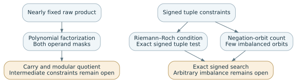

# Dense product constraints and signed sum certificates

2026-11-18 UTC · [Draft PR #4668](https://github.com/isogeny-labs/crypto/pull/4668) · [Earlier short-box and window results](FOLLOWUP.md)

For fixed raw product outputs, polynomial factorization gives an exact deterministic counter with both operand masks. Two further constructions give a signed Riemann–Roch test for all arities and an exact counter for tuples with few unbalanced negation orbits. The new algorithms cover specified parts of the original oracle. The full uniform subexponential decision bound remains open. [pcc:unverified]

{width=100%}

## Factorization with dense raw outputs

Let $X(T),Y(T)$ have at most $L$ coefficients each and independent bit masks on their $J$-bit coefficient words. Suppose the complete ordinary convolution polynomial $C=XY$ is fixed. For $C\ne0$, factor its primitive part over $\mathbb Z[T]$. Every ordered factor pair is obtained by splitting each irreducible multiplicity between the operands, then dividing the integer content and assigning the signs. If the multiplicities are $e_i$, the number of polynomial splits is at most $\prod_i(e_i+1)\le 2^{\deg C}$. Trial enumeration of content divisors costs at most the largest coefficient magnitude, $2^{O(J+\log L)}$ for the convolution of the given limbs. Test the degree, coefficient ranges and masks on each pair. For $C=0$, use $X=0$ or $Y=0$ and count the independent masks directly, subtracting the double count. For $u$ free bits in the raw output, enumerate its completions first. This yields deterministic bit time $2^{O(u+L+J+\log L)}\operatorname{poly}(L,J)$ and polynomial space. Ordinary convolution has no polynomial wraparound. [pcc:unverified] [Lenstra–Lenstra–Lovász](https://doi.org/10.1007/BF01457454) · [Bochum, Lemma 5](https://github.com/bochum-crypto/subexponential-ecdl/blob/1ee44e562b1b9a50ea339f3b8f81112b5a24b96f/subexponential-ecdl.pdf)

There is an exact squarefree residue version for fully specified $C$ modulo $M=\prod_{i=1}^h p_i$. For each field where $C\ne0$, factor $C$ and enumerate its irreducible splits and the nonzero leading scalar. Deterministic finite-field splitting by enumerating field constants fits the $p_i\operatorname{poly}(L,\log M)$ setup budget. Where $C=0$, expand the local product predicate as $[X=0]+[Y=0]-[X=Y=0]$. For each combined case, every input coefficient has prescribed residues in some components and is free in the others. Count its masked canonical lifts independently by scanning at most $M$ values, then multiply the word counts and sum the signed cases. The bit-time bound is $2^{O(\log M+Lh)}\operatorname{poly}(L,\log M)$ with polynomial space. If all prime factors admit transform roots of order at least $L$, then $h\le \log M/\log(L+1)$. This argument includes zero divisors of the squarefree ring. [pcc:unverified]

At precision four, a different lift uses the binary masks directly. Split by the two operands' truncated contents modulo four. For a normalized factor pair modulo two, polynomial factorization lists the possibilities for their first bits. If a second bit is required, write $X=X_0+2A$ and $Y=Y_0+2B$ with the known first-bit polynomials. The remaining equation is linear over $\mathbb F_2$ in the coefficient bits of $A,B$, since $4AB=0$. Arbitrary fixed bits are affine restrictions. Count the lift solutions by rank and multiply by the choices of bits above the required precision. The content cases cover zero products and the argument allows extra nilpotent high-degree terms. This gives $2^{O(L)}\operatorname{poly}(L,J)$ time for full raw output modulo four. It does not evaluate the parity of the original exact integer product predicate. [pcc:unverified]

## The carry and quotient boundaries

A fixed canonical integer product can have exponentially many raw coefficient vectors satisfying the carry recurrence and every positional coefficient upper bound. For base $\beta\ge4$ a power of two, take $n\ge2$ input limbs per operand and fix output $z=\beta^{2n-2}$. Set carry $\kappa_0=\kappa_{2n-1}=0$ and $\kappa_{2n-2}=1$. Choose $\kappa_1,\ldots,\kappa_{2n-3}$ independently in $[1,\beta/2]$, and let $c_j=z_j+\beta\kappa_{j+1}-\kappa_j$ for $0\le j\le 2n-2$. All $c_j$ lie in $[0,(\beta-1)^2]$, hence satisfy even the upper bound for the end coefficients of an $n$-limb convolution. The recurrence telescopes to $z$, and the distinct histories give $(\beta/2)^{2n-3}$ distinct raw vectors. This is a lower bound for explicitly enumerating carry-compatible vectors before testing full polynomial factorability. [pcc:unverified] [Bochum, Eq. 9](https://github.com/bochum-crypto/subexponential-ecdl/blob/1ee44e562b1b9a50ea339f3b8f81112b5a24b96f/subexponential-ecdl.pdf)

Direct integer factoring handles this case with few unknown output bits. For each canonical completion, factor the integer and enumerate its signed divisors as appropriate for the operand ranges. With $u$ free output bits and $b$-bit operands, rigorous randomized factoring and the divisor bound give expected $2^{O(u+b/\log b)}$ bit operations, with exact mask checks. Handle the zero product directly. A modular output $z$ admits the same algorithm if its integer lifts $z+kp$ can be enumerated within the desired bound. An unrestricted $b$-bit modular product may have $\Theta(p)$ numerically possible quotients before checking factorability. [pcc:unverified] [Lenstra–Pomerance](https://doi.org/10.1090/S0894-0347-1992-1137100-0)

There is also a short-box route when the quotient range is unavailable. For $(a+x)(a'+y)=z\pmod p$, with $z\ne0$ and bounds $|x|\le H_1$, $|y|\le H_2$, use the four-dimensional lattice of coefficient vectors reducing modulo $p$ to multiples of the bilinear polynomial's coefficient vector. Scale the weights for $xy,x,y,1$ by $H_1H_2,H_1,H_2,1$. The scaled determinant is $p^3(H_1H_2)^2$. Fixed-dimensional LLL yields a polynomial $Axy+Bx+Cy+D$ of weighted norm $O(p^{3/4}\sqrt{H_1H_2})$. For $H_1H_2\le c\sqrt p$ with sufficiently small absolute $c$, this is less than $p$. The polynomial is a nonzero scalar multiple modulo $p$ of the original and has magnitude below $p$ on the box. Consequently every modular solution satisfies the integer equation $(Ax+C)(Ay+B)=BC-AD$. Both $A$ and the right side are nonzero modulo $p$. Factor the right side and verify all masked candidates in expected $2^{O(b/\log b)}$ time. Arbitrary ordinary modular products may lack the short-box premise. [pcc:unverified] [Cilleruelo–Garaev, §2](https://arxiv.org/abs/1007.1526)

## A signed determinant for the full sum

For affine nonidentity $R$, append $-R$ to the ordered signed points and let $D$ be their effective divisor of degree $n=m+1$. For identity $R$ use only the $m$ points. The tuple sums to $R$ exactly when $D-nO$ is principal. The space of functions with pole order at most $n$ at $O$ has basis $x^j$ for $2j\le n$ and $x^j y$ for $2j+3\le n$. The condition is singularity of its $n$-row evaluation matrix, with local coefficient rows up to multiplicity minus one at any repeated point. Indeed, a nonzero kernel function has a zero divisor containing $D$ and at most $n$ poles at $O$, hence that is its entire divisor. Local parameters $x-x(P)$ for $y(P)\ne0$ and $y$ at affine two-torsion give exact rows by formal expansion of the curve equation. The test uses the actual signed points and extends the familiar evaluation condition to repeated points. [pcc:unverified] [Cheng, elliptic curve code minimum-distance formulation](https://arxiv.org/abs/cs/0507026) · [Earlier lab divisor formulation](https://github.com/isogeny-labs/crypto/blob/9ec88b7637/research/prime_one_shot_20261029/README.md)

For distinct abscissas, write $W(X)=\prod_i(X-x_i)$ and a section as $U(x)+V(x)y$ with $\deg U\le\lfloor n/2\rfloor$ and $\deg V\le\lfloor(n-3)/2\rfloor$. The unique interpolant $U(x_i)=-V(x_i)y_i$ has the required degree exactly when its high moments vanish. Lagrange interpolation then reduces the test to the Hankel matrix with entries $\sum_i y_i x_i^{j+k}/W'(x_i)$, of order $n-\lfloor n/2\rfloor-1$. The determinant is smaller than the full evaluation determinant. Its singularity test still takes a particular tuple as input. [pcc:unverified]

For disjoint slot masks excluding $-R$, one can express simultaneous discovery as a factored resultant. Use the $m$-dimensional section space vanishing at the appended $-R$ if present. For coefficient vector $c$ and evaluation row $v(P)$, slot $i$ imposes the homogeneous form $\prod_{P\in F_i}(c\cdot v(P))$. The multivariate resultant is, up to normalization, the product of the selected-row determinants over all slot tuples. Its vanishing detects existence. The ordinary dense Macaulay matrix at degree $1+\sum_i(|F_i|-1)$ has $N^{1-1/m+o(1)}$ monomial columns at $|F_i|\asymp N^{1/m}$. A factored evaluation method would be needed to change that cost. Distinctness can be imposed for relation sampling by dropping cross-slot duplicate points and excluding $-R$. Given membership in their own slots, a tuple of distinct points survives the additional $m(m-1)$ cross-slot tests with probability at least $1-m(m-1)\rho$ by the two-point hash bound. Tuples with repeats or a prescribed point cost $O(m^2/N)$ of the unfiltered first moment for $m\ge3$. The second moment only decreases. This thinning is for relation yield. The original uniform oracle still has to handle repeats. [pcc:unverified] [Resultant matrix formulas](https://doi.org/10.1016/S0022-4049%2800%2900145-6) · [Bochum, Lemmas 9–10](https://github.com/bochum-crypto/subexponential-ecdl/blob/1ee44e562b1b9a50ea339f3b8f81112b5a24b96f/subexponential-ecdl.pdf)

At growing arity, any target-independent **stored subfamily** of prefix tuples preserving every pinned suffix completion needs $N^{1/2-o(1)}$ representatives on some admitted seeds. Take $k=\lfloor m/2\rfloor$ independent slots, and set $n=N-1$, $L=n\rho$. Their tuple count has mean $L^k$. The expected number of distinct ordered colliding tuples is at most $L^{2k}(1+1/L)^k/n$ by the agreement-set count. Repeated-point tuples cost $O(k^2L^k/n)$ in expectation. Thus some seeds give $\Omega(L^k)$ distinct attainable sums with distinct points. A pinned suffix can isolate the complement of any one of them. With at least two remaining slots in an odd prime-order group, choose distinct nonidentity suffix points outside the prefix lists by leaving the last two free, selecting one and solving for the other. This excludes only the listed points, their translates, and at most one equality case. The bound concerns stored representatives, leaving implicit and target-specific methods open. [pcc:unverified]

At even growing arity, a single allowed query also separates determinant rank from exact zero detection. Take even-ordinate points on the first half and mirror them by negation on the second half using the matching offset shifts. The same collision estimate on the half-size sign universe gives $N^{1/2-o(1)}$ distinct sums of tuples with distinct points. At target $O$, representatives and their mirrored tuples form an identity minor of that size in the Boolean acceptance matrix. Opposite parities separate the points across halves. The evaluation determinant itself has flattening rank at most $q=\binom{m}{m/2}$ by Laplace expansion. Applying a scalar polynomial of degree $d$ to its entries gives rank at most $\binom{q+d}{d}$ by expanding the separable terms. At $m=O((\log b)^{1/4})$, $q=b^{o(1)}$, so a scalar polynomial of degree polynomial in $b$ cannot turn this determinant into the exact acceptance matrix on all inputs. This restricts that particular zero-filter method. [pcc:unverified]

## Count balanced negation orbits directly

For odd group order, enumerate and sort the explicit hashed lists by negation orbit $\{A,-A\}$. Each orbit has a pair of masks showing the slots admitting each sign. Given an orbit and a slot subset, its number of sign assignments with zero net imbalance is a binomial coefficient after the forced signs. Use that number as the orbit's weight for the subset. Process the orbits by disjoint subset convolution on the $m$ slots. The full-set entry counts each ordered tuple whose orbit imbalances all vanish, once. The assignment of slots to orbits is unique even when multiple canceling pairings exist. Time is $O(m\tau\,3^m\operatorname{poly}(b))$. [pcc:unverified]

For fixed $k$, also count tuples with at most $k$ nonzero imbalances. Guess the distinct imbalanced orbits and their nonzero difference counts in $[-m,m]$. Check that their weighted point sum is the target. Use the appropriate imbalance in each guessed orbit's local weight and use zero in the others. The extra factor is at most $(O(m^2\tau))^k$ times a polynomial in $m$. This counts dense paired witness families without walking their outputs and has subexponential cost for fixed $k$ at growing arity. The group operations for nonzero imbalances use the already enumerated lists, whose square-root setup is expected polynomial per entry. With at most $m\tau$ orbits, tuples in this class reach at most $\sum_{j\le k}\binom{m\tau}{j}(2m)^j=N^{k/m+o(1)}$ targets. A fixed $k$ therefore gives vanishing coverage on uniform targets. [pcc:unverified] [Subset convolution](https://arxiv.org/abs/cs/0611101)

## A smaller parity obligation for relation sampling

For the original hashes, choose a slightly smaller threshold so $L^m=(\theta+o(1))N$ for a fixed $0<\theta<1$. At the same growing-arity scale the rounding error is negligible. For each fixed target the tuple count $X$ has mean $\theta+o(1)$. The agreement-set estimate with identical pairs removed gives $\mathbb E[X(X-1)]\le\theta^2+o(1)$. Since $[X=1]\ge X-X(X-1)$, unique witnesses occur with probability at least $\theta-\theta^2-o(1)$. With a parsimonious encoding, one unweighted parity query detects those cases and odd parity permits prefix recovery. This removes the isolation sweep from the expected relation problem. Exact parity on the implicit networks remains open by a new algorithm. The uniform exact decision goal also requires correct treatment of even nonzero counts. [pcc:unverified] [Bochum, Lemmas 8–10 and Corollary 2](https://github.com/bochum-crypto/subexponential-ecdl/blob/1ee44e562b1b9a50ea339f3b8f81112b5a24b96f/subexponential-ecdl.pdf)

The full proof still needs an exact search over signed short boxes or joint arithmetic counting with neither a sparse nor a nearly fixed raw output. The hand proofs in this checkpoint have no local kernel receipt. No benchmark or target run occurred.
