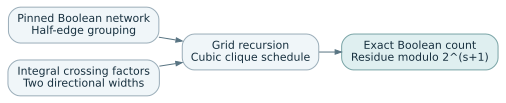

# Division-free subexponential decomposition oracle

2026-11-18 UTC · [PR #4668](https://github.com/isogeny-labs/crypto/pull/4668) · [Earlier component audit](DENSE.md)

There is a deterministic exact counter for an $s$-edge Boolean tensor network of maximum degree $O(s^{9/10})$, with polynomial-size description and polynomial-time predicate queries. It uses polynomial space and

$$2^{O(s/(\log s)^\alpha)}\operatorname{poly}(s)\quad\text{bit operations},\qquad
\alpha=\log_3\left(\frac{4}{\log_2 12}\right)>0.$$

The algorithm works directly modulo $2^{s+1}$ using an explicit integral factorization of the crossing pieces. The one-bit swap expansion, its cut-rank estimate and the row-or-column grid layout are prior art. The construction here supplies unimodular factor queries over an even modulus, a cubic size schedule with two elementary packing bounds, and the uniform bit-cost and workspace proof. It uses the cited grid idea and does not assume either cited preprint's contraction theorem. This is a hand-checked proof, with no new kernel receipt. [pcc:unverified] [Anthropic, §5 and Appendix G](https://github.com/anthropics/formal-math/blob/16a5ce41304fcdaea4e0be7c132e1c361dc26da5/eth/paper.pdf) · [Condensed prior description](https://github.com/anthropics/formal-math/blob/16a5ce41304fcdaea4e0be7c132e1c361dc26da5/eth/README.md#the-key-idea-in-condensed-form-interpretable-by-ai-models)

{width=100%}

## 1. Explicit crossing factors over a ring

Work in any commutative ring with identity. For four single bits let $F(x,y,u,v)=[x=v][y=u]$, $I(x,y,u,v)=[x=u][y=v]$, and $D=F-I$. For $\lambda$ bits per string, group the expansion of $F^{\otimes\lambda}$ by Hamming count:

$$T_j=[z^j](I+zD)^{\otimes\lambda},\qquad j=0,\ldots,\lambda.$$

These pieces sum to the crossing tensor exactly. Let

$$A_j=\sum_{h=j}^\lambda \binom{\lambda}{h}3^{\lambda-h},\qquad c_j=\lceil\log_2 A_j\rceil.$$

In the row flattening $(x,y)\mid(u,v)$, $I$ is the identity matrix and $F$ swaps the middle two basis words. The matrix $D$ kills $e_{00},e_{11},e_{01}+e_{10}$. Append $e_{01}$ to obtain the integral basis matrix $B_r$, with determinant $\pm1$. In $T_j B_r^{\otimes\lambda}$ an input word with fewer than $j$ copies of that last basis symbol has zero column. Select the $A_j$ remaining columns and the corresponding rows of $(B_r^{-1})^{\otimes\lambda}$. Their product is the row flattening. [pcc:unverified]

In the column flattening $(x,u)\mid(y,v)$, $I=w w^{\mathsf T}$ with $w=e_{00}+e_{11}$. Use the basis $B_c$ with columns $e_{01},e_{10},e_{00}-e_{11},e_{00}$. It again has determinant $\pm1$, and $I$ kills the first three columns. Every term of $T_j B_c^{\otimes\lambda}$ has $\lambda-j$ factors of $I$ applied to basis vectors. Retaining only input words with at least $\lambda-j$ last symbols therefore gives the column factorization through $A_{\lambda-j}$ states by the same column-selection rule. These are explicit factorizations over the ring, including rings with zero divisors. [pcc:unverified]

In each cut, index the surviving basis words in lexicographic order and pad their indices to $c_j$ or $c_{\lambda-j}$ bits with zero factors on the unused states. Unranking uses binomial suffix counts on $O(\lambda)$-bit integers. Each first-factor entry is one coefficient of a product of $\lambda$ linear polynomials, with coefficients selected from constant matrices. It is computed by an $O(\lambda^2)$ coefficient recurrence. The second-factor entry is a product of $\lambda$ entries of a constant inverse basis matrix. Direct piece entries use the same coefficient recurrence. Since $A_j\le 4^\lambda$ and $A_j\le6^\lambda3^{-j}$, the two widths are individually at most $2\lambda$, and

$$c_j+c_{\lambda-j}\le 4\rho\lambda+2,\qquad \rho=\frac{\log_2 12}{4}<1.$$

The integer basis matrices and their inverses can be reduced directly into the working ring. There is no rescaling of the Boolean count and no division by a power of two. A bounded exact integer check compared all 34,368 piece entries across both cuts for string lengths one through three, and all 8,736 sums to the crossing entries. These checks exercise the basis and coefficient formulas. [pcc:unverified] [Earlier width observation, Appendix G](https://github.com/anthropics/formal-math/blob/16a5ce41304fcdaea4e0be7c132e1c361dc26da5/eth/paper.pdf)

## 2. Grouping lemma with explicit width bounds

A weighted network has $g$ nodes, each with at most $P$ setting bits and a ring-valued local weight. Each pair interaction is given by an entry oracle and a factorization through $w_{ab}$ binary bits, with $\sum_{b\ne a}w_{ab}\le P$. Put $U=\sum_{a\ne b}w_{ab}$ and $N=gP$. A coloring of nodes by $K$ groups produces a $K$-clique with one shared boundary string per pair of groups. Its width $\lambda'$ is the largest sum of $w_{ab}$ between two groups, rounded up to at least one. Pad the unused bits and force them to zero. Each grouped table entry sums over the settings of the group's original nodes, evaluating internal interactions and the externally specified factors. Thus the clique value is the network value, with no multiplicative padding factor. With at most $2g/K$ nodes per group, a table query uses $2^{2N/K}\operatorname{poly}(g,P)$ ring operations and local queries. Exhaustive deterministic grouping search costs $K^g\operatorname{poly}(g,P)$. [pcc:unverified]

Two packing bounds give the required colorings. For $g=K^6$ and arbitrary $w_{ab}\le P$, color all nodes independently and uniformly for the existence proof. For distinct colors $i,j$, the sum $W_{ij}$ between them has mean $U/K^2$. In its variance sum the disjoint ordered pairs cancel. Identical ordered pairs contribute at most $gP^2/K^2$. Pairs sharing one endpoint contribute $O(gP^2/K^3)$ by the load bound. Reversed ordered pairs have nonpositive covariance. Chebyshev and a union over color pairs give failure probability $O(K^4/g)$ for the bound $W_{ij}\le(U+N)/K^2$. A size bound of $2g/K$ on all groups fails with probability at most $K^2/g$ by the same argument for unweighted group sizes. A coloring meeting both bounds exists for large $K$. [pcc:unverified]

For the inner grouping take $g=K^{3/2}$, $w_{ab}\le P/g$ and $\epsilon=K^{-1/8}$. For a proposed color $j$ and node $a$, let $Y_{aj}$ be its weighted load to that color. Let $D_i$ be the sum of full node loads in color $i$. Weighted Bernstein bounds yield, simultaneously,

$$|G_i|\le 2g/K,\qquad D_i\le(U+\epsilon N)/K,\qquad
Y_{aj}\le(\sum_b w_{ab}+\epsilon P)/K.$$

For example, scale individual summands of $Y_{aj}$ by $g/P$. They are independent, lie in $[0,1]$, and have total mean at most $g/K$. The additive error is $\epsilon g/K$. The normalized $D_i$ and group size have the same parameters. Each failure probability is $\exp(-\Omega(\epsilon^2 g/K))$, which is $\exp(-\Omega(K^{1/4}))$. The union has only polynomially many events. Consequently

$$W_{ij}=\sum_{a\in G_i}Y_{aj}\le (U+3\epsilon N)/K^2.$$

Deterministic search uses only actual group sizes and these rational width bounds. Choose the initial $K$ to be a sufficiently large power of two whose logarithm is divisible by eight. All subsequent sizes preserve integral $g$ and rational $\epsilon$. [pcc:unverified] [Related grouping construction, Lemma 8](https://github.com/anthropics/formal-math/blob/16a5ce41304fcdaea4e0be7c132e1c361dc26da5/eth/paper.pdf)

## 3. Recursion and its bit cost

Set $K_{i+1}=K_i^3$. A clique at level $i+1$ has $K'=g^2$ nodes with $g=K_i^{3/2}$, and one $\lambda$-bit shared string per pair. Arrange its nodes on a $g\times g$ grid. The two diagonal edges of every rectangle give one crossing. Every edge between different rows and columns occurs in one such pair. For each rectangle choose one of the $\lambda+1$ pieces $T_j$ and sum the contraction over those choices. This uses a ring equality without a scalar multiplier. [pcc:unverified] [Grid layout, §5](https://github.com/anthropics/formal-math/blob/16a5ce41304fcdaea4e0be7c132e1c361dc26da5/eth/paper.pdf)

For fixed choices, group by rows or by columns. The settings of one group have at most $P=g^3\lambda$ bits. Each pair of rows participates in at most $\binom g2$ respective rectangles plus $g$ straight equality connections. The pair width is therefore at most $g^2\lambda=P/g$, and the same holds for columns. All local and factor entries are polynomially computable using the parent clique's table queries and the coefficient recurrence above. For $N=gP=g^4\lambda$, the smaller total ordered width satisfies

$$\min(U_{\rm row},U_{\rm col})\le (\rho+1/g)N+O(g^4).$$

The straight contributions are at most $N/g$ in either direction. Every rectangle contributes its two widths to the average of the ordered totals, with sum at most $4\rho\lambda+2$. Choose the direction of smaller total, then use the inner grouping on its $g$ nodes. The child clique has $K_i$ nodes and

$$K_i^2\lambda'\le (\rho+4\epsilon_i)N+O(g^4+K_i^2).$$

The $1/g$ term is absorbed by $\epsilon_i$. A clique table query in the child has cost at most $2^{2N/K_i}\operatorname{poly}(K',\lambda)$ parent queries and ring operations. [pcc:unverified]

Inductively, charge at most

$$2^{e_i K_i^2\lambda}\bigl(K_i(\lambda+1)\bigr)^{C K_i^2}$$

ring operations, polynomial-bit index operations, and input table queries at level $i$. Brute force at fixed $K_0$ permits $e_0=1$. Put $e_{i+1}=(\rho+4\epsilon_i)e_i+3/K_i$. The child exponent and the cost of its queries fit the new main term. The rectangle choices contribute $O(g^4\log(\lambda+1))$ to log-work. The grouping search contributes $O(g\log K_i)$. Rounding widths contributes $O(e_i(g^4+K_i^2))$. The inherited prefactor has log at most $O(CK_i^2\log(K'(\lambda+1)))$, since $\lambda'\le O((K')^2\lambda)$. Its coefficient is a vanishing fraction of $C(K')^2$ as $K_0$ grows. A fixed sufficiently large $C$ absorbs these costs into the asserted prefactor. Dividing the recurrence by $\rho^{i+1}$ gives summable multiplicative errors and additive terms, because $K_i=K_0^{3^i}$. Hence $e_i=O(\rho^i)$ and in particular the coefficients $e_i$ are bounded. [pcc:unverified]

All grouping choices, rectangle labels and setting sums are streamed. Along a recursion path the child size parameter is at most a constant times the parent's, and the depth is $O(\log\log s)$. Thus size parameters remain polynomial in $s$. The stack holds only the current descriptions, indices, and accumulators. Input table callbacks expand a chain of older grouped tables one setting at a time. They do not call a contraction recursively and add only polynomial space. Ring operations modulo $2^{s+1}$ and all indexing have polynomial bit cost. [pcc:unverified]

## 4. Apply to the original Boolean networks

Choose the largest level $i$ with $K_i^{64}\le s$. Pack the original vertices in $g=K_i^6$ clusters by assigning each vertex to the least loaded cluster, with its degree as size. Each cluster has at most $P=\lceil 2s/g\rceil+O(s^{9/10})$ half-edge bits, so $gP=O(s)$. Each setting has one bit per incident half-edge. A local weight checks the predicates and internal edge equalities. Between clusters, equality of the crossing bits factors through those bits. This network's value is exactly the Boolean count. The coarse grouping gives a clique with $K_i^2\lambda=O(s)$. Both grouping search $K_i^g$ and root table queries $2^{2gP/K_i}\operatorname{poly}(s)$ fit the target exponent since $K_i^6\le s^{6/64}$ and $K_i>s^{1/192}$ for asymptotically large inputs. The prefactor costs $O(K_i^2\log s)$ in log-time. Finally $\log K_i=\Theta(3^i)=\Theta(\log s)$, so $e_i=O((\log s)^{-\alpha})$. Small sizes are handled by the fixed brute-force base case. [pcc:unverified]

Work throughout modulo $2^{s+1}$. The actual count is between zero and $2^s$, so the final residue recovers the exact integer. A witness bit pin just adds a local indicator and preserves all size bounds. Exact zero testing and bit-by-bit prefix descent therefore solve the original decomposition queries in the stated time and space, including empty inputs and arbitrary interface pins. [pcc:unverified] [Bochum, Lemma 1 and Lemma 11](https://github.com/bochum-crypto/subexponential-ecdl/blob/1ee44e562b1b9a50ea339f3b8f81112b5a24b96f/subexponential-ecdl.pdf)

The [full-group reduction](https://github.com/isogeny-labs/crypto/pull/4665) has expected log-cost $O(b/m+mb/(\log b)^\alpha)$ with these oracle calls. Taking $m\asymp(\log b)^{\alpha/2}$ yields expected $2^{O(b/(\log b)^{\alpha/2})}$ bit time, including setup, useful relations, exact elimination and recovery at arbitrary cofactor. It is $r^{o(1)}$ for prime subgroup order $r$ with $\log r=\Omega(b)$. This is a weaker explicit rate than the two earlier preprint-dependent bounds, with a self-contained counting proof. No implementation benchmark, key-size crossover or formal kernel verification is claimed. [pcc:unverified] [Bochum, Remark 2](https://github.com/bochum-crypto/subexponential-ecdl/blob/1ee44e562b1b9a50ea339f3b8f81112b5a24b96f/subexponential-ecdl.pdf)
