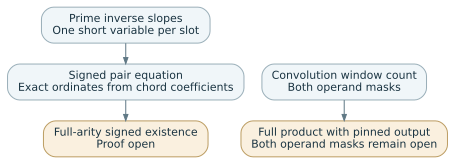

# Signed short-box queries and joint multiplication

2026-11-18 UTC · [Draft PR #4668](https://github.com/isogeny-labs/crypto/pull/4668) · [Previous proof checkpoint](REPORT.md)

Prime inverse slopes give a factor-base family with one short integer coordinate per slot and expected subexponential amplification cost. A chord formula solves the signs of a two-slot nonidentity query from its two abscissas without taking square roots. A separate dynamic program counts selected raw product coefficients with both operand domains intact. These are paper-level components. The uniform subexponential decision bound for the original network is open. [pcc:unverified] [Bochum, Lemmas 9–11](https://github.com/bochum-crypto/subexponential-ecdl/blob/1ee44e562b1b9a50ea339f3b8f81112b5a24b96f/subexponential-ecdl.pdf)

{width=100%}

## A one-coordinate hash family

Let $N=|E(\mathbb F_p)|$, $b=\lceil\log_2 p\rceil$, $\sigma\in[2p,4p]$ the hash prime, and $\tau$ Bochum's threshold, so $(N-1)\tau/\sigma\ge N^{1/m}$ and $\tau=\Theta(N^{1/m})$ in the polylogarithmic arity range. Put $A=\lfloor\sigma/\tau\rfloor$. In each slot, choose the **inverse** slope $a$ uniformly among primes in $[A/2,A]$. Choose $d$ uniformly modulo $\sigma$, independently. The accepted labels are $z=at+d-\sigma h$ for $0\le t<\tau$, $0\le z<2p$, and $h\in\{0,1\}$. There is at most one wrap because $a(\tau-1)<\sigma$. At fixed wrap and label parity, write $t=2u+\delta$. The two integer range inequalities give a single interval for $u$, and $x=(z-(z\bmod2))/2$ is affine in $u$. The product thus has at most $4^m$ disjoint rectangular branches with $m$ short variables. This family changes the distribution of the original hash seeds. [pcc:unverified]

Every affine point still passes a slot with probability $\rho=\tau/\sigma$. For distinct labels with difference $\Delta_z\in[1,\sigma-1]$, the corresponding hash outputs must differ by $\Delta_t$ satisfying $a\Delta_t=\Delta_z$ or $a\Delta_t=\Delta_z-\sigma$. Since $A\ge c\sqrt\sigma$ for a constant $c>0$, each of the two nonzero integers has at most two distinct prime divisors in the slope interval for all sufficiently large $b$. For each compatible slope there are at most $\tau$ offsets. The prime number theorem gives $\Omega(A/\log\sigma)$ slopes. Consequently joint membership is at most $K\rho^2$ with $K=O(b)$. Prime sampling costs expected polynomial bit work by uniform rejection and deterministic primality testing. [pcc:unverified]

For a fixed residual let $X$ count decompositions, $n=N-1$, $L=n\rho$, and $\mu=\mathbb E X$. Counting tuples by their final point gives $\mu\ge(1-1/n)L^m/n$. Counting ordered pairs by their agreement set, with $j$ agreeing slots, uses at most $n^{m-j-1}$ completions and joint probability at most $K^{m-j}\rho^{2m-j}$. Therefore

$$\mathbb E X^2\le\mu\left(1+\frac{(1+KL)^m}{n}\right).$$

Cauchy–Schwarz gives $\Pr(X>0)\ge\eta=(Cb)^{-m}$ for a constant $C$. Averaging over targets gives mean coverage at least $\eta$ over seeds. Since coverage is bounded by one, a seed has coverage at least $\eta/2$ with probability at least $\eta/2$. A capped collection round can therefore amplify both the seed choice and the target trials with log-cost $O(m\log b)$ beyond base enumeration and individual oracle calls. The one-coordinate branches retain the needed relation yield. The signed search within the branches remains open. [pcc:unverified] [Second-moment comparison, Bochum Lemma 10](https://github.com/bochum-crypto/subexponential-ecdl/blob/1ee44e562b1b9a50ea339f3b8f81112b5a24b96f/subexponential-ecdl.pdf)

## A signed two-slot equation

Write the curve as $y^2=f(x)=x^3+a_E x+b_E$, and the target as $R=(u,v)$ with $v\ne0$. The line through $-R$ with slope $\lambda$ has ordinate $\lambda(x-u)-v$. For candidate abscissas $x_1,x_2$ put

$$D=x_1x_2-u(x_1+x_2)-2u^2-a_E.$$

Matching the degree-two and degree-one coefficients of $f(x)-(\lambda(x-u)-v)^2$ to the cubic with roots $x_1,x_2,u$ yields

$$D^2=4v^2(x_1+x_2+u),\qquad \lambda=D/(2v).$$

The constant terms then agree because both cubics vanish at $u$. The group law proves equivalence even for repeated intersections. Every root determines the actual signed ordinates $y_i=\lambda(x_i-u)-v$, after which range, parity, membership and interface pins are exact checks. As a quadratic in one abscissa the discriminant is $16v^2 f(x)$, so the curve is absolutely irreducible and birational to $E$. [pcc:unverified] [Semaev, Theorem 1](https://eprint.iacr.org/2004/031)

One deterministic batch solver enumerates inverse-hash labels as lists of abscissas with parity masks. With

$$q_x(\lambda)=(u-x)\lambda^2+2v\lambda+x^2+ux+u^2+a_E,$$

build a product tree of the second list's $q_x$ polynomials and route first-list queries down it by batch remainders and gcds. Each $q_x$ has at most two slopes, and each slope can match at most two distinct second-slot abscissas because the equation in $x$ is monic quadratic. Each level therefore has total query count and polynomial degree $O(\tau)$. Common slopes for distinct abscissas give exact sign checks by the displayed formula. For diagonal pairs in the odd prime-order case, check the unique half of $R$. Product and remainder trees cost $\tau\operatorname{poly}(b)$ bit work without computing square roots. At the ordinary two-slot threshold $\tau=\Theta(\sqrt N)$ this is still an exponential scan. [pcc:unverified]

If $v=0$ and $R$ is nonidentity two-torsion, the equation instead has the product constraint $(x_1-u)(x_2-u)=f'(u)\pmod p$ with $f'(u)\ne0$. For signed integer lift bounds $B_1,B_2$ with $B_1B_2/p=p^{o(1)}$, enumerate the $p^{o(1)}$ candidate integer products, factor them, and test their signed divisors and the line's slopes. Rigorous expected subexponential integer factoring and the divisor bound give expected $p^{o(1)}$ total work for this chart. The premise includes the required short lifts and two-torsion. [pcc:unverified] [Cilleruelo–Garaev, §2](https://arxiv.org/abs/1007.1526) · [Lenstra–Pomerance](https://doi.org/10.1090/S0894-0347-1992-1137100-0)

### Exact integer lifting of smaller pair boxes

For a fixed monomial set of size $D_0$, the lattice of coefficient vectors reducing to a scalar multiple of a nonzero $F$ modulo $p$ has determinant $p^{D_0-1}$. Scale each indexed coefficient by its maximal monomial magnitude $H^{|\gamma|}$ in a side-$H$ box. If $S=\sum_\gamma |\gamma|$ and $H^S$ is below $p$ by a sufficiently large constant factor depending on $D_0$, fixed-dimensional LLL finds a nonzero vector of weighted $\ell_1$ norm below $p$. Its polynomial $G$ cannot reduce to zero modulo $p$. For all integer box points, $|G|<p$, so $F\equiv0$ is exactly equivalent to $G=0$. The biquadratic has $S=18$ in two variables and $S=96$ after substitution of two affine coordinates per abscissa. The lift leaves an integer genus-one search in the generic non-two-torsion case. It also loses its smallness hypothesis at the usual two-slot threshold and on the full growing-arity summation polynomial. [pcc:unverified] [Semaev, degree bound](https://eprint.iacr.org/2004/031) · [Dual Coppersmith, conditional recovery](https://eprint.iacr.asia/2026/2740)

## Exact joint multiplication with restricted outputs

Let $x_i,y_i$ be arrays of $L$ limb words with independent per-word masks. Consider the $t$ consecutive raw product coefficients at indices $k_0,\ldots,k_0+t-1$. Rewrite $y'_i=y_{k_0-i}$, with out-of-range entries zero. Then $x_i$ contributes $x_i y'_{i-\delta}$ to coefficient $k_0+\delta$. Sweep the union of the operand index ranges in order, carrying the previous $t-1$ words of $y'$ and the $t$ coefficient accumulators. At each index enumerate only the local allowed words. For $J$-bit limbs, exact accumulators need $2J+O(\log L)$ bits. The update uses $2^{O(t(J+\log L))}\operatorname{poly}(L,J)$ bit operations for the whole count. On the implicit transition matrix, recursive computation of a matrix entry gives polynomial space with an additional $O(\log L)$ factor in the exponent. This handles arbitrary per-word masks on both operands when the constrained window is narrow. Simultaneously pinning all product coefficients can require a window of length $\Theta(L)$. [pcc:unverified]

For a few **arbitrarily placed** output pins, pad the raw product into a cyclic convolution of prime length $P=\Theta(L)$ with $P\ge2L-1$. A multiplicative reindexing of $\mathbb Z/P$ permutes the inputs, their masks, and the output coefficients. For distinct pin positions $k_1,\ldots,k_t$, partition the residues on each axis into $K=\lfloor(P-1)^{1/(t-1)}\rfloor$ intervals of length at most $H=\lceil P/K\rceil$. Among the $P$ vectors $j(k_i-k_1)_{i=2}^t$, two share one of the $K^{t-1}<P$ boxes. Their index difference is a nonzero multiplier sending the offsets into $[-H,H]$ modulo $P$. This multiplier can also be found by scanning $P$ choices. Apply the cyclic version of the window count with $2H$ history words and only $t$ accumulators, conditioning on matching initial and terminal histories. With $t-1\le\log P/(c\log\log P)$, one has $H=O(P/(\log P)^c)$. For $c\ge3$ and $L,J$ of order $\sqrt b$, the resulting $2^{O((HJ+t(J+\log P))\log P)}\operatorname{poly}(b)$ bound is subexponential in $b$, with polynomial space. The proved regime concerns sparse output pins. [pcc:unverified]

A second exact algorithm handles many consecutive output pins when one operand has full residue domains. Use $M=2^J+1$, $J$ a power of two, with a principal length-$L$ root $\omega=2^{2J/L}$ for $L\mid 2J$. Let $x$ have at most $n$ consecutive coefficient positions with arbitrary independent masks and zero padding, and let $y$ range over $(\mathbb Z/M)^L$. Fix $t\le L-n+1$ consecutive cyclic convolution coefficients. For content $d=\gcd(M,x_0,\ldots,x_{L-1})$, divide $x$ by $d$ modulo $M/d$. At each prime divisor of $M/d$, the normalized input polynomial is nonzero and has degree below $n$ after removing its starting monomial. At least $L-n+1$ Fourier evaluations are units modulo that prime, because $\omega$ has order $L$ in every residue field. A $t$-column Vandermonde minor on the corresponding consecutive inverse rows is a unit. It follows over each prime-power factor that the pinned-output map is surjective modulo the reduced modulus. Over $\mathbb Z/M$ its image is $(d\mathbb Z/M)^t$, and each admissible fiber has size $M^{L-t}d^t$. Count the masked $x$ values by content using Möbius inversion of the products of per-word divisibility counts. The exact answer then costs $2^{O(J)}\operatorname{poly}(L,J)$ bit operations and polynomial space, including trial division of the auxiliary modulus. Restricting the second operand's ordinary limb intervals changes those fiber sizes. [pcc:unverified] [Bochum, Lemmas 3–5](https://github.com/bochum-crypto/subexponential-ecdl/blob/1ee44e562b1b9a50ea339f3b8f81112b5a24b96f/subexponential-ecdl.pdf)

## Relation search from parity

Exact parity would suffice for the expected relation pipeline even without a uniform exact decision bound. At the original prime-order threshold, $\mathbb E X\le1+o(1)$ while $\Pr(X>0)\ge2/5$. Thus a constant share of targets over seeds have between one and 32 witnesses. The arithmetic and hash gadgets can be composed parsimoniously. A set of at most 32 Boolean witnesses has a singleton restriction on at most five bits by selecting the smaller nonempty side at each differing bit. Enumerate these pins and query parity, then descend to a witness whenever the count is odd. For the prime-slope variant the expectation is still $O(1)$, so a cap $(C'b)^m$ retains the smaller positive mass from the proof above. Its pin sweep adds $\exp(O(m(\log b)^2))$ work outside the parity calls. A failed sweep provides no emptiness certificate on instances outside the multiplicity cap. [pcc:unverified] [Bochum, Lemmas 8–11](https://github.com/bochum-crypto/subexponential-ecdl/blob/1ee44e562b1b9a50ea339f3b8f81112b5a24b96f/subexponential-ecdl.pdf)

The remaining uniform proof needs either a signed existence algorithm that composes across all slots or an arithmetic contraction that enforces both operand masks and the full comparison. No new kernel checks, benchmarks or target runs were performed.
