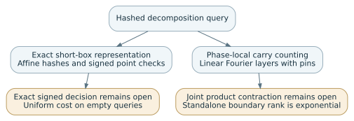

# Independent decomposition oracle research

2026-11-18 UTC · Source snapshot `9ec88b7637` · [Tracking PR #4668](https://github.com/isogeny-labs/crypto/pull/4668)

The two constructions give an exact short-box formulation of the hashed point query and a subexponential counter for its isolated linear transform layers. The short-box route has small expected output, and admits both large-output and all-false-positive instances. The transform route still encounters exponential rank in standalone multiplication. The goal remains one exact decision algorithm using $2^{O(s/(\log s)^\alpha)}$ bit operations for some fixed $\alpha>0$ on every admissible $s$-edge network, including fixed witness prefixes and empty queries. These checks are paper derivations. [pcc:unverified] [Bochum, §§2.3–3.3](https://github.com/bochum-crypto/subexponential-ecdl/blob/1ee44e562b1b9a50ea339f3b8f81112b5a24b96f/subexponential-ecdl.pdf)

{width=100%}

## Short boxes for the original hash

Let $b=\lceil\log_2 p\rceil$, $N=|E(\mathbb F_p)|$, and write $\sigma$ for the hash prime in $[2p,4p]$. A slot accepts an encoding $z=2x+e$ with $0\le z<2p$ when its affine hash output $t$ satisfies $0\le t<\tau$. With inverse slope $a$ and inverse offset $d$, this is $z\equiv at+d\pmod\sigma$. The normalized coordinates $(t/\tau,z/\sigma)$ lie in the unit square and in a coset of the lattice generated by $(1/\tau,a/\sigma)$ and $(0,1)$. The lattice has determinant $1/\tau$. [pcc:unverified] [Bochum, Lemmas 9–11](https://github.com/bochum-crypto/subexponential-ecdl/blob/1ee44e562b1b9a50ea339f3b8f81112b5a24b96f/subexponential-ecdl.pdf)

Reduce the two-dimensional rational basis by Gauss reduction. The angle sine is at least $\sqrt3/2$. Two independent lattice vectors have bounded length, since the ordinate of the first displayed generator can be reduced modulo the second. At least one such vector has a nonzero coordinate on the longer reduced basis vector. Its perpendicular projection bounds that longer length by $O(1)$. Each side of the inverse image of the unit square in reduced coordinates has width $O(1/\|v_i\|)$, where $v_i$ is its corresponding basis vector. The enclosing rectangle thus has $O(\tau)$ integer pairs, by the determinant identity. Scaling by common denominators permits exact polynomial-bit-time basis reduction and evaluation of the four corners. All original range and parity tests remain exact after the coordinate change. At the Bochum threshold $\tau=\Theta(N^{1/m})$ and $m$ polylogarithmic in $b$, the product of the boxes has $b+O(m)$ bits of integer labels. [pcc:unverified]

For each parity choice, $x=(z-e)/2$ is an affine function modulo $p$ of its two reduced coordinates. Substituting these functions into the summation polynomial gives a modular root problem in the product box. For $R\ne O$ use $S_{m+1}$ with the target abscissa fixed. At $R=O$ use $S_m$, with equality of abscissas for $m=2$. Recover the accepted point for each encoding from the factor-base list, then check its sign, range, pins and sum. This final check is necessary because the summation polynomial admits algebraic-closure lifts with either sign. [pcc:unverified] [Semaev, Theorem 1](https://eprint.iacr.org/2004/031) · [Petit–Kosters–Messeng, §5](https://people.maths.ox.ac.uk/petit/files/16PKC_primeECDLP.pdf)

For a fixed seed and uniform ambient target, each box tuple can contribute roots for at most $2^{O(m)}$ target points, by choosing lifts and signs. The tuple count is $O(\tau)^m$, so the expected number of raw roots, including all parity choices, is at most $2^{O(m)}$. An exact reporting routine with subexponential startup, delay and empty-output termination could use this bound for expected relation work. The first moment gives no uniform decision bound for every target. [pcc:unverified]

### Why full root reporting cannot be the uniform oracle

Take an odd prime-order curve group and even $m$. For fixed nonzero hash slope, averaging the intercept admits at least $(N-1)\tau/(2\sigma)=\Omega(\tau)$ points with even ordinate. Negation changes their encoding from $z$ to $z+1$. Pair each slot using that hash with a slot whose intercept is reduced by the slope, so these encodings pair with their negations. At target $O$, independent choices in the $m/2$ pairs give $\sqrt N\,2^{-O(m)}$ valid ordered tuples. A reporting routine must pay for all of them. [pcc:unverified]

There is also a negative decision instance with many raw roots. Use the same two-slot hash $H(z)=((\sigma+1)/2)z-u\bmod\sigma$, with $0\le u\le p-\tau$. This selects exactly the even-ordinate points with $x\in[u,u+\tau)$. An interval with $\Omega(\tau)$ such points exists by partitioning $[0,p)$ into length-$\tau$ intervals and extending the final interval to full length. At target $O$ no pair of these points sums to zero. The x-only equation accepts each diagonal pair. Explicitly checking every relaxed root can cost $\Omega(\sqrt N)$ on this negative instance. A uniform solver needs an exact decision or certificate for the signed constraints within its time bound. [pcc:unverified]

At growing arity the same issue can be forced using singleton hash slots. Choose a prime $\sigma\in[3p,4p]$. For a point encoding $z$ in the last $D=\lfloor(\sigma-2p)/(2\tau)\rfloor$ affine positions, take the inverse hash progression $z+(2p-z)t$ for $0\le t<\tau$. Only its initial encoding lies below $2p$. The terminal interval in $x$ has length $\Theta(p/\tau)$. For $m\ge3$, the completed Weil character-sum bound gives $\Omega(p/\tau)$ such points. Take $\ell=\lfloor(m-2)/2\rfloor$ inverse base pairs and $k=m-2\ell$ singleton slots. The sumset $S$ of the inverse pairs has size at most $\tau^{2\ell}=o(p/\tau)$ in the stated arity range. Choose an isolatable point $V$ with $-2V\notin S$ and use it in every singleton slot. Target $(k-2)V$ has no signed solution with the prescribed points. The unsigned equation still accepts every canceled pair choice by flipping one singleton sign. For growing $m$, this supplies $N^{1/2-o(1)}$ relaxed tuples on an empty signed query. [pcc:unverified] [Kim–Tibouchi, Lemma 3.1](https://nutmic2019.imj-prg.fr/confpapers/Coset.pdf)

### Exact cancellation by floor sums

At the identity target with two slots and no rational 2-torsion, test $F_1\cap(-F_2)$. For parity $e$, negation changes $z$ to $z+1-2e$. In terms of the first hash output $t$, the second output must be $at+d_e\bmod\sigma$ for computable constants $a,d_e$. For any interval of $t$ values, the count satisfying the second hash bound is the sum of

$$\left\lfloor\frac{at+d_e}{\sigma}\right\rfloor-
\left\lfloor\frac{at+d_e-\tau}{\sigma}\right\rfloor.$$

The floor sum $S(n;a,d,v)=\sum_{t=0}^{n-1}\lfloor(at+d)/v\rfloor$ is computed by Euclidean reciprocity. After reducing $a,d$ modulo $v$ and accounting for their quotient terms, set $Y=\lfloor(a(n-1)+d)/v\rfloor$. For $a>0$, summing over the $Y$ horizontal lattice levels gives $S(n;a,d,v)=nY-S(Y;v,v-d+a-1,a)$. The modulus decreases as in the Euclidean algorithm. Split the first hash interval and recurse only on subintervals with a nonzero count. At each returned $t$, invert the first hash and check canonical range, parity and quadratic residuosity. This deterministic decision procedure takes $\operatorname{poly}(b)(1+C)$ bit work, where $C$ is the number of raw hash intersections. Given the first seed, the independent second intercept gives $\mathbb E C\le2\tau^2/\sigma=O(1)$ at the two-slot threshold. Worst-case work is $\tau\operatorname{poly}(b)$. The same tests can certify paired cancellation witnesses at higher arity. [pcc:unverified]

## Phase-local counting for the linear transform

For a $b$-bit multiplication choose powers of two $J,L$ with $JL=\Theta(b)$ and $g=2J/L=\Theta((\log b)^3)$. The hidden constant in $JL$ can accommodate twice the number of limbs of width $\lfloor J/4\rfloor$. Work modulo $2^J+1$. The root, twiddle and inverse kernel shifts are multiples of $g$, so their signed rotations preserve the bit position modulo $g$. Keep the raw inverse transform and check its output against $L$ times the normalized output. Assign a terminal bit of the normalized output to its phase after that fixed shift. [pcc:unverified] [Bochum, Lemmas 3–7](https://github.com/bochum-crypto/subexponential-ecdl/blob/1ee44e562b1b9a50ea339f3b8f81112b5a24b96f/subexponential-ecdl.pdf)

Write each linear word equation as $\sum_{j=0}^{J-1}D_j2^j=0\bmod(2^J+1)$ with bounded signed digit sums $D_j$. This is equivalent to the unique carries satisfying

$$D_j+c_j=2c_{j+1},\qquad c_J=-c_0.$$

Summing the recurrence gives $\sum_j D_j2^j=-(2^J+1)c_0$. Conversely set $c_0$ by this formula. Divisibility of $c_0+\sum_{i<j}2^iD_i$ by $2^j$ gives integral $c_j$. If each $|D_j|\le D$, induction gives $|c_j|\le D$. A canonical residue equal to $2^J$ has a separate flag and zero low bits, contributing a signed unit to the appropriate digit sum. Enumerate those flags once across the linear layers. They cost $2^{O(L)}$ for a fixed number of layers. [pcc:unverified]

Carries join adjacent phases on a cycle. For a fixed number of transform layers, a phase has $O(b/g)$ word bits and carries, and each carry needs $O(\log b)$ bits. Condition on boundary carries and split intervals recursively. Enumeration at each level uses $2^{O(b\log b/g)}$ bit work times polynomial factors. Depth $O(\log g)$ gives time $2^{O((b\log b/g)\log g+L)}$ and polynomial space, since only the current branch and exact partial counts persist. Fixed word bits are checked in their assigned phase. This counter covers the linear layers alone. [pcc:unverified]

The same carry construction counts exact integer multiplications with one operand supported in one public phase. Enumerate its $O(b/g)$ active bits. With that operand fixed, the product constraint is a signed sum of shifts of the other operand. All shifts have the same phase offset, so a fixed relabeling of output phases leaves only adjacent carry constraints, now with zero end carries. The extra enumeration costs $2^{O(b/g)}$. An unrestricted operand contributes $b$ independent bits, and general pointwise products have no phase-support premise. [pcc:unverified]

## Rank barrier for standalone multiplication

For canonical multiplication modulo $q\ge 2^{b-1}$ with $b$-bit words, flatten the Boolean external predicate across any cut with at least $b$ of the $3b$ bits on each side. A directed copy edge connects a bit of either operand at position $i$ to output bit $j$ for $i\le j\le b-2$. Each edge is realized by multiplication by $2^{j-i}$ with the other bits pinned. Every balanced cut crosses $\Omega(b^2)$ such edges. To see this, orient the cut so the first input quarter contains at least $b/4-O(1)$ bits on the left, across the two operands. That core is completely joined to the last output quarter up to position $b-2$. If the cut crosses only $\epsilon b^2$ edges for small $\epsilon$, all but $O(\epsilon b)$ of those core outputs lie on the left. Each input bit below position $3b/4$ sees that core output set, so all but $O(\epsilon b)$ of those inputs lie on the left. Each output bit from $b/4$ through $b-2$ sees the first input quarter, giving the same bound for those outputs. The right then has at most $3b/4+O(\epsilon b+1)$ bits, contradicting balance. [pcc:unverified]

There are $2b$ operand and shift choices. One produces $\Omega(b)$ consistently directed crossings. Set the other operand to the corresponding power of two and free only those input bits. There is no modular wrap, since the highest output index is $b-2$. The corresponding slice contains an identity minor of size $2^{\Omega(b)}$ over every field. With one terminal per external bit, any binary contraction tree for a standalone exact encoding has a balanced cut of the terminals. Its boundary dimension must be at least that rank. This rules out dense boundary tables and exact low-rank linear factorization of the isolated predicate as a route to subexponential cost. A global method can still consume neighboring constraints before making the cut. [pcc:unverified] [Markov–Shi, Proposition 4.2](https://arxiv.org/abs/quant-ph/0511069)

## Comparison with the checked clique approach

The Rudich–Rousseau source vendored in Kaarelson contains a generic clique path loop with separate correctness and cost statements. Its root table can be preloaded using the earlier half-edge reduction. The recurrence for the processed widths is $N_d\le(11/12+2/K_d)N_{d+1}+2G_d^4$, with $K_{d+1}=9K_d^{16}$. The product of the multiplicative terms is $O((11/12)^{\ell-d})$ since $\sum_d1/K_d$ converges. Choosing $K_\ell^{40}\le s<K_{\ell+1}^{40}$ gives $(11/12)^\ell=O((\log s)^{-\log_{16}(12/11)})$. The branch exponent divides the local width by $K_d$, which absorbs the factor $(12/11)^d$. Prime residues larger than the scaling factors permit exact CRT reconstruction. This is a source-level audit using the existing rectangle and grouping mechanism, with a weaker explicit exponent. The generic composition has no local kernel receipt. [pcc:unverified] [Cost](https://github.com/kaarelkaarelson/fast-ecdlp/blob/d1deb5abe008e981206ed58cbd83012b6afc3740/lean/vendor/rudich-factoring/FactoringAux/UniCostPath.lean) · [Recurrence](https://github.com/kaarelkaarelson/fast-ecdlp/blob/d1deb5abe008e981206ed58cbd83012b6afc3740/lean/vendor/rudich-factoring/FactoringAux/EngineRate.lean) · [Earlier audit](https://github.com/isogeny-labs/crypto/pull/4665)

## Next proof obligation

The short-box route can be tested independently of the tensor engines. It needs an exact signed existence test with uniform subexponential startup, including the negative instances above. A coordinate-based algorithm must use the polynomial and the sign constraints together, or prove a cost bound for excluding roots outside the admissible set. The phase route needs a joint treatment of pointwise products and neighboring transforms that avoids materializing the standalone cut. A full-shift Fourier table also has rank $N$ at prime order for nonempty proper slot indicators, since no nontrivial prime-order Fourier coefficient of a nonconstant rational indicator can vanish. That leaves fixed-target implicit algebraic methods within scope. [pcc:unverified]

The research-KB connector and executable were unavailable. The search used the pinned Bochum and counting proofs, the previous goal audit, Semaev's polynomial construction, and the cited root-finding and contraction literature. No local kernel checks, benchmarks or target experiments were run.
