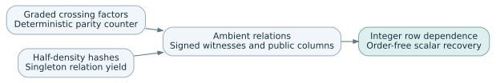

# A graded-parity proof of subexponential prime-field ECDLP

2026-11-18 UTC · Lab base `ad2a014c00` · [PR #4698](https://github.com/isogeny-labs/crypto/pull/4698)

Let $E/\mathbb F_p$ be nonsingular with $p>3$. Given a valid instance $P,Q\in E(\mathbb F_p)$ with $Q\in\langle P\rangle$, one classical randomized algorithm returns a scalar $d$ with $dP=Q$ in expected total bit time

$$2^{O\left(b/(\log b)^\beta\right)},\qquad
b=\lceil\log_2 p\rceil,\qquad
\beta=\tfrac12\log_2\left(1/H_2(3/4)\right)\approx0.150866.$$

Here $H_2$ is binary entropy. The algorithm has no cofactor restriction and requires no supplied order of $P$. If $r=|\langle P\rangle|$ is supplied, reduce the output modulo $r$. The bound is $p^{o(1)}$ and is $r^{o(1)}$ whenever $b/(\log b)^\beta=o(\log r)$, in particular when the field and subgroup orders have comparable bit lengths. It includes point counting, factor-base setup, useful relations, integer elimination and final recovery. This is a source-level proof. Independent kernel verification and practical crossover remain open. [pcc:unverified]

{width=100%}

## 1. A binary parity counter

The deterministic parity counter takes a Boolean tensor network with $s$ edges, degree $O(s^{9/10})$, polynomial description size and polynomial-time local predicates. It accepts fixed edge bits by multiplying one endpoint predicate by the required indicator. Its time is $2^{O(s/(\log s)^\alpha)}\operatorname{poly}(s)$ with polynomial space, where

$$\rho=H_2(3/4),\qquad \alpha=\log_2(1/\rho)=2\beta.$$

The bit-swap pieces and grid layout are from the cited Anthropic work. Davis previously derived the characteristic-two grading and the entropy constant for these pieces. We give explicit factor access and instantiate the recursion directly, including bit cost and workspace. The earlier #4668 report credited the crossing identity but described the division-free integral factors too broadly. The pinned Anthropic formal source already gives integral bases and duals. Its later application and schedule are what #4668 establishes independently. [pcc:unverified] [Anthropic, §5](https://github.com/anthropics/formal-math/blob/16a5ce41304fcdaea4e0be7c132e1c361dc26da5/eth/paper.pdf) · [Pinned integral factors](https://github.com/anthropics/formal-math/blob/16a5ce41304fcdaea4e0be7c132e1c361dc26da5/eth/proof/networks/Groundwork/Cross/Cuts.lean) · [Davis, binary coefficient ranks](https://github.com/1337isnot1337/integer-factoring/blob/7de9d9641c364256aa41753d9e691b02e572b8e9/research/binary-coefficient-entropy.md) · [Earlier integral counter #4668](https://github.com/isogeny-labs/crypto/pull/4668)

### Graded crossing pieces

For bits $x,y,u,v$, set $F=[x=v][y=u]$, $I=[x=u][y=v]$ and $D=F-I$. For strings of length $\lambda$, the pieces

$$T_j=[z^j](I+zD)^{\otimes\lambda},\qquad 0\le j\le\lambda,$$

sum to $F^{\otimes\lambda}$. In the row flattening $(x,y)\mid(u,v)$, $I$ is the identity, $F$ swaps the middle two basis words and $D$ is a rank-one nilpotent over $\mathbb F_2$. Choose active basis symbols $e_{01}+e_{10}$ and $e_{01}$, and passive symbols $e_{00},e_{11}$. Then $D$ sends the second active symbol to the first and kills the other three. Fix an active set of size $h$ and passive symbols outside it. The matrix of $T_j$ maps the subspace with $\ell$ second active symbols into that with $\ell-j$. Each block can be factored through the smaller of its input and output coordinate lists. It uses

$$\min\!\left\{\binom h\ell,\binom h{\ell-j}\right\}\le
\binom h{\lfloor(h-j)/2\rfloor}$$

states. This follows by splitting at $\ell=(h+j)/2$ and using binomial monotonicity up to the middle. Sum over the at most $\lambda+1$ values of $\ell$, and then over the active masks and passive tags. Put $a=\lfloor(h-j)/2\rfloor$, so $h-2a$ is $j$ or $j+1$. The integer generating function $(z+2+z^{-1})^\lambda=z^{-\lambda}(1+z)^{2\lambda}$ therefore bounds the row states by

$$M_j=(\lambda+1)\left(\binom{2\lambda}{\lambda+j}+\binom{2\lambda}{\lambda+j+1}\right).$$

[pcc:unverified]

In the column flattening $(x,u)\mid(y,v)$, $I=ww^{\mathsf T}$ with $w=e_{00}+e_{11}$, and $F$ again swaps the middle words. The identities $I^2=2I$, $FI=IF=I$ give $D^2=\mathrm{Id}$ and $DI=I$ over $\mathbb F_2$. Thus $T_j=D^{\otimes\lambda}[z^{\lambda-j}](\mathrm{Id}+zI)^{\otimes\lambda}$ in this cut. The same grading uses the active symbols $w,e_{00}$ and the passive symbols $e_{01},e_{10}$ for $I$. The column state bound is $M_{\lambda-j}$. Encode a state by its rank in the disjoint union of all block lists, and enumerate those lists to unrank it. To query a factor, use the block's projection and block matrix, then apply the tensor products of the constant basis matrices. Enumerating their basis words takes $2^{O(\lambda)}$ time and polynomial space. Direct entries can also use the coefficient of a product of $\lambda$ linear polynomials. Pad the binary state labels with zero factors on unused labels. Cap either cut width at $2\lambda$ by the direct endpoint factorization. [pcc:unverified]

The sum of the two cut widths is at most $4\rho\lambda+O(\log(2\lambda))$. Indeed, $\binom{2\lambda}{\lambda+j+1}\le\binom{2\lambda}{\lambda+j}$, with out-of-range terms zero. Apply the entropy bound to the two binomial factors at $1/2+j/(2\lambda)$ and $1-j/(2\lambda)$. Their average is $3/4$, and concavity bounds the sum. No piece expansion rescales the network count. A bounded control checked 34,368 transformed entries in both cuts for lengths one through three, plus 2,144 exact combinatorial width bounds through length 64. [pcc:unverified]

### Deterministic grouping and shrinkage

Here are the packing and bit-cost details. For a network on $g$ nodes with at most $P$ setting bits per node, let each pair interaction factor through $w_{ab}$ bits, with node loads $d_a=\sum_b w_{ab}\le P$. Write $U=\sum_a d_a$ and $S=gP$. A coloring into $K$ groups gives a $K$-clique whose pair widths are the weighted sums between groups. To query its table at one group, sum over the settings of its nodes, evaluating original local weights, direct internal interactions and one endpoint's factors on across-group boundaries. Unused bits in padded boundary strings are forced to zero. With group sizes at most $2g/K$, table lookup takes at most $2^{2S/K}\operatorname{poly}(g,P)$ old queries and ring operations, with the direct local factor costs charged separately. The transformation preserves the contraction by expanding each across-group interaction. Find a valid coloring by deterministic enumeration in $K^g\operatorname{poly}(g,P)$ time once existence is shown. [pcc:unverified]

For the top grouping, take $g=K^6$ and $w_{ab}\le P$. Independently uniform colors give any ordered between-group weight mean $U/K^2$ and variance $O(gP^2/K^2)$. In the variance expansion, only edges sharing endpoints contribute. The identical-edge sum is bounded by $\sum w_{ab}^2/K^2$ and the nonnegative single-endpoint covariance by $O(\sum_a d_a^2/K^3)$. Reversed edges for distinct colors have nonpositive covariance. Chebyshev and a union over the $K^2$ pairs give a coloring with all pair widths at most $(U+S)/K^2$ and group sizes at most $2g/K$, for large $K$. [pcc:unverified]

For inner grouping we have $w_{ab}\le P/g$. Set $h=\lceil\log_2K\rceil$, $g=Kh^4$ and $\epsilon=1/h$. In independent uniform coloring, the total node load in a group is at most $(U+\epsilon S)/K$ and the load from node $a$ to any color is at most $(d_a+\epsilon P)/K$, simultaneously with the size bound $2g/K$. For the per-node bound, scale the summands by $g/P$. They are independent, lie in $[0,1]$, have total mean at most $g/K$ and permitted error $\epsilon g/K$. Bernstein gives tail $\exp(-\Omega(\epsilon^2g/K))=\exp(-\Omega(h^2))$. Scaling group load by $1/P$ and using unit terms for group size give the same estimate. A union over the $O(gK)$ events succeeds at sufficiently large fixed initial $K$. Summing the per-node bound over any group gives all between-group weights at most $(U+3\epsilon S)/K^2$. [pcc:unverified] [Related grid grouping, Anthropic Lemma 8](https://github.com/anthropics/formal-math/blob/16a5ce41304fcdaea4e0be7c132e1c361dc26da5/eth/paper.pdf)

Choose $K_{i+1}=g_i^2$ with $g_i=K_i\lceil\log_2K_i\rceil^4$. Put a clique with $K'=g^2$ nodes and pair width $\lambda$ on a square grid. Each pair of crossed rectangle diagonals is one crossing; expand it into the $T_j$. For each collection of piece labels evaluate in rows or columns, choosing the smaller total width. In either direction one grouped node has at most $P=g^3\lambda$ setting bits, and a distinct pair shares at most $g^2\lambda=P/g$ bits from the straight edges and the rectangle pieces. For $S=g^4\lambda$, the average of the two ordered width totals is at most

$$\rho S+S/g+O(g^4\log(2\lambda)).$$

There are at most $g^4/4$ rectangles. Each contributes its two cut widths to this average, and the straight contribution is at most $S/g$. After the inner grouping and rounding, the child size satisfies

$$K_i^2\lambda'\le(\rho+4\epsilon_i)S+O(g_i^4\log(2\lambda)+K_i^2).$$

The actual pair weights also give $K_i^2\lambda'\le(1+3\epsilon_i)S+K_i^2$, so the sizes stay polynomial along a recursion path. [pcc:unverified]

Charge level $i$ at most $2^{e_iK_i^2\lambda}(K_i(\lambda+1))^{CK_i^2}$ ring operations, polynomial-bit indexing operations and table queries. A constant-size brute-force level has $e_0=1$. Take

$$e_{i+1}=(\rho+4\epsilon_i)e_i+4/K_i.$$

A child query expands one group table for at most $2^{2S/K_i+O(\lambda)}\operatorname{poly}(g_i,\lambda)$ old queries and operations. The $O(\lambda)$ term comes from grade-factor entry queries and fits in $S/K_i$ by the size of $g_i$. The other additive log costs are $O(g_i^4\log(2\lambda))$ for rectangle choices, $O(g_i\log K_i)$ for grouping, and the width-rounding term. The child prefactor is $O(CK_i^2\log(K'(\lambda+1)))$ in logs, since $\lambda'\le O(S)$. A fixed large $C$ absorbs these terms into the parent prefactor $CK'^2\log(K'(\lambda+1))$, since $K'^2=g_i^4$ and $K_i^2/g_i^4$ is small at every level. [pcc:unverified]

Writing $x_i=\log_2K_i$ gives $x_{i+1}=2x_i+8\log_2\lceil x_i\rceil$. At large $x_0$, $2x_i\le x_{i+1}\le 3x_i$. Dividing by $2^{i+1}$ and summing the $O(i/2^i)$ errors yields $x_i=\Theta(2^i)$. Dividing the $e_i$ recurrence by $\rho^i$ gives summable multiplicative errors $O(1/x_i)$ and additive terms $O(\rho^{-i}/K_i)$. Thus $e_i=O(\rho^i)$, including the bounded coefficients used in charging the additive width terms. [pcc:unverified]

For the Boolean network choose the largest $K_i$ with $K_i^{64}\le s$. Greedily pack incident half-edges by assigning each original vertex to its least loaded cluster among $K_i^6$ clusters. The maximum cluster load is at most $\lceil2s/K_i^6\rceil+O(s^{9/10})$, so $gP=O(s)$. Local weights check predicates and internal equality, and cross-cluster equality factors through the shared edge bits. Isolated predicates are scalar factors. The top grouping yields $K_i^2\lambda=O(s)$. Its enumeration and root query costs and the prefactor are subdominant, since $K_i^6\le s^{6/64}$ and $K_i>s^{1/192}$ asymptotically. Now $\log K_i=\Theta(\log s)$, giving $e_i=O((\log s)^{-\alpha})$. Use brute force at the finite base sizes. The recursion has $O(\log\log s)$ depth. All branches, colorings, state lists and table indices are streamed. Each table callback only expands older table descriptions, and the sizes and callback stack are polynomial in $s$. This proves the claimed bit time and polynomial workspace. [pcc:unverified]

## 2. Odd decompositions with constant yield

Let $G=E(\mathbb F_p)$, $N=|G|$ and $n=N-1$. Compute $N$ by polynomial-time point counting. Hasse gives $N=\Theta(p)$, so $\log_2 N=b+O(1)$. Choose a public prime $\sigma\in[2p,4p]$ by rejection and a deterministic primality test. Encode a nonidentity point by $2x+(y\bmod2)$, using canonical coordinates. This is injective on the affine rational points, including $y=0$. In each slot independently take a uniform invertible affine hash modulo $\sigma$ and retain outputs below $\tau$. Inverse hashing enumerates each list in $\tau\operatorname{poly}(b)$ expected bit work by range, square-root and parity checks. The list size is at most $\tau$. Write $q=\tau/\sigma$ and $L=nq$. Single-point membership probability is $q$ and distinct points' joint membership is at most $q^2$, since their images are uniform distinct labels. Choose the smallest integer $\tau$ with $2(n\tau)^m\ge n\sigma^m$ by binary search. This gives $L^m/n=1/2+o(1)$, because the relative rounding error is $O(m/L)=o(1)$ for polylogarithmic $m$. [pcc:unverified] [Bochum, Lemmas 9–10 and 13](https://github.com/bochum-crypto/subexponential-ecdl/blob/1ee44e562b1b9a50ea339f3b8f81112b5a24b96f/subexponential-ecdl.pdf)

For fixed $R\in G$ let $X_R$ count its ordered decompositions. There are between $(n-1)n^{m-2}$ and $n^{m-1}$ nonidentity tuples before hashing, by freely choosing all but the final entry. Thus $\mu=\mathbb E X_R=1/2+o(1)$ uniformly in $R$. Fix the first tuple and an agreement set of $j<m$ slots for a distinct second tuple. At most $n^{m-j-1}$ choices remain, at joint membership probability at most $q^{2m-j}$. Summation yields

$$\mathbb E[X_R(X_R-1)]\le\mu\,(L+1)^m/n=1/4+o(1).$$

The inequality $[X_R=1]\ge X_R-X_R(X_R-1)$ gives $\Pr(X_R=1)\ge 1/4-o(1)$. Averaging over uniform $R$ and using that the covered fraction is at most one yields a constant fraction of frozen seeds with a constant fraction of singleton residuals. [pcc:unverified]

The relation predicates have a parsimonious $O(mb)$-edge encoding of degree $O(b^{3/4})$. The integer multiplier uses two-stage radix transforms over $\mathbb Z/(2^J+1)$ with $J=\Theta(\sqrt b)$, plus pointwise products and a carry pass. It has $O(b)$ wire bits and vertices of degree $O(b^{3/4})$. Modular multiplication fixes the canonical quotient and remainder uniquely. The complete elliptic addition gadget has unique zero tests, selectors, slopes and intermediate sums, including identity and two-torsion cases. Canonical affine hash arithmetic, comparison and copied bits are also uniquely determined by the points. Composing these gadgets on the full group leaves exactly one satisfying Boolean assignment per ordered tuple. This uses the published encoding identities and size bounds. [pcc:unverified] [Bochum, Theorem 3, Lemmas 2 and 8, Corollary 2, and Lemma 11](https://github.com/bochum-crypto/subexponential-ecdl/blob/1ee44e562b1b9a50ea339f3b8f81112b5a24b96f/subexponential-ecdl.pdf)

Use one parity query per residual, discarding even results. On an odd result, fixing each successive witness bit partitions its count into two parts whose parities sum to one. Follow the odd part and verify the tuple. This costs at most $O(mb)$ extra parity queries and always returns a genuine decomposition. Singleton yield is enough for constant-throughput relation collection. An even result here is a missed trial, which is compatible with the expected relation bound. [pcc:unverified]

## 3. Order-free recovery and total cost

For each trial, sample $k=4\lceil\log_2N\rceil$ independent uniform ambient points $A_j$. Sampling uses the affine encoding plus one identity slot and rejection. While the generated subgroup is proper, one uniform point enlarges it with probability at least $1/2$. At most $\lceil\log_2N\rceil$ enlargements are needed. By Markov the capped list generates $G$ with probability at least $1/2$. Independently freeze the factor bases. For each relation query take $z_j,u,v$ uniformly modulo $N$ and set

$$R=\sum_j z_j A_j+uP+vQ.$$

On the generation event these residuals are independent uniform. Give each accepted row the slot-specific point incidences and the $k$ integer columns of $z_j$ coefficients. Collect one more row than the total column count $D=O(m\tau+b)$, with a constant multiple of $D+1$ attempts as the round cap. Conditional on a generating list and good seed, the cap succeeds with constant probability by the expectation of a geometric wait and Markov's inequality. The dependence and acceptance rules use the public transcript and no hidden multiplier. [pcc:unverified] [Full-group reduction #4665](https://github.com/isogeny-labs/crypto/pull/4665)

Compute a nonzero rational left dependence of the rows, clear denominators and divide by their coefficient gcd in the exact integer kernel. Hadamard bounds the pivot-minor coefficients by $O(D(b+\log D))$ bits. Fraction-free elimination uses polynomial work and space in $D,b$. The resulting primitive vector $c$ cancels the listed points and the ambient generators, leaving $UP+VQ=O$ with $U=\sum c_i u_i$ and $V=\sum c_i v_i$ modulo $N$. [pcc:unverified]

Fix all proposed residuals and their $z_j$ coefficients before conditioning on selection. Given them, each $v$ modulo $N$ has exactly $N/r$ matching $u$ values, with $r=|\langle P\rangle|$ even if $r$ is unknown. Thus the selected $v_i$ remain independent uniform. The integer vector $c$ is primitive, so Bézout makes the linear form $V$ surjective and uniform modulo $N$. It is a unit with probability $\varphi(N)/N\ge1/(1+\log_2N)$, because the $i$-th smallest distinct prime divisor is at least $i+1$. On that event return $-UV^{-1}$ modulo $N$ after checking the group equation. This recovers the log representative since $N$ annihilates $G$. If $P=O$, the valid target is $O$ and zero suffices. Otherwise unsuccessful rounds restart independently. [pcc:unverified]

A round has expected setup cost $m\tau\operatorname{poly}(b)$, at most $O((D+1)mb)$ parity calls of size $O(mb)$, and polynomial elimination and recovery work in $D,b$. It succeeds with probability $\Omega(1/b)$, so the expected restart multiplier is polynomial. Since $\tau=2^{O(b/m)}$, the expected log-work is

$$O\left(b/m + mb/(\log b)^\alpha\right).$$

Taking $m\asymp(\log b)^{\alpha/2}$ gives the theorem. The oracle has polynomial workspace, and the relation matrix and elimination give $2^{O(b/m)}\operatorname{poly}(b)$ total workspace. The same schedule with the integral factors of #4668 uses $\rho=(\log_2 12)/4$ and computes exact pinned counts modulo $2^{s+1}$ with exponent $\log_2(4/\log_2 12)$ in the network-size log denominator. The present ECDLP bound uses binary parity. The counting recurrence used here is derived from the displayed pieces and groupings. [pcc:unverified] [Exact count proof #4668](https://github.com/isogeny-labs/crypto/pull/4668)

The research-KB connector and executable were unavailable. The audit used the pinned primary sources, the merged lab proofs and parallel hand checks of the graded widths, layout and recovery. The bounded controls cover local algebra, and the time and space theorem is a paper proof. No kernel replay, implementation benchmark or target run took place.
