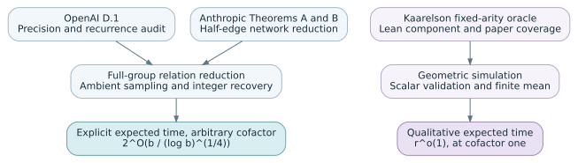

# Prime-field ECDLP subexponential proof audit

2026-11-18 UTC · Lab snapshot `9ec88b7637` · [Tracking PR #4659](https://github.com/isogeny-labs/crypto/pull/4659)

For a nonsingular elliptic curve over a growing prime field, write $b=\lceil\log_2 p\rceil$ and let $r$ be the supplied prime order of the subgroup of interest. The full-group reduction below gives **expected total time $2^{O(b/(\log b)^{1/4})}$**, with arbitrary cofactor, using either of two exact counting theorems in the pinned preprints. This is $r^{o(1)}$ when $\log r=\Omega(b)$. The alternate composition uses Anthropic's Lemma 8 and Theorems A and B in place of OpenAI's Theorem D.1. Separately, a new diagonal argument turns Kaarelson's claimed fixed-$m$, arbitrary-group dense bound $p^{3/m+o(1)}$ into one qualitative $p^{o(1)}$ Las Vegas algorithm: a verified universal scheduler enumerates all finite programs, so no growing-$m$ uniformity theorem is needed. The generic scheduler and fixed-numerator implications are locally kernel-checked. Kaarelson's decomposition oracle and planted finite-round reduction are Lean-checked in their pinned projects; the curve-specific coverage estimates and concrete dense-algorithm machine-cost instantiation remain external. These are mathematical deductions from the specified preprint results. Independent end-to-end kernel verification is open. No experiments or timings were run. [pcc:unverified] [Bochum](https://github.com/bochum-crypto/subexponential-ecdl/blob/1ee44e562b1b9a50ea339f3b8f81112b5a24b96f/subexponential-ecdl.pdf) · [Anthropic](https://github.com/anthropics/formal-math/blob/16a5ce41304fcdaea4e0be7c132e1c361dc26da5/eth/paper.pdf) · [OpenAI](https://github.com/openai/math/blob/7ef5c0cc5ca4b0e072b7a050fca09ab24bc6fa3a/preprints/The-Exponential-Time-Hypothesis-is-False-October-25-2026/paper.pdf) · [Kaarelson v2](https://github.com/kaarelkaarelson/fast-ecdlp/blob/d1deb5abe008e981206ed58cbd83012b6afc3740/v2/paper.pdf)

{width=100%}

## Total cost of the Bochum reduction

For polylogarithmic arity $m\ge 2$, Bochum's Lemmas 9–13 bound the expected number of Boolean contraction calls by $O(m^2br^{1/m})$. Each network has $O(mb)$ edges and maximum degree $O(b^{3/4})$. Setup and other per-call work have polynomial expected cost in $b$ apart from factor-base enumeration of size $O(mr^{1/m})$, at expected polynomial cost per listed candidate. Dense elimination costs $O(m^3r^{3/m}b^2)$ bit operations. We checked the collision estimate and the row-dependence argument. The two-point hash bound controls the second moment of the decomposition count. A constant fraction of bases cover a constant fraction of residuals, and Markov's inequality controls collection under a finite restart cap. Conditional on the points and their decomposition rows, the uniform hidden coefficients remain independent. A nonzero row dependence therefore gives an invertible coefficient with probability $1-1/r$. Full base-column rank is unnecessary. [pcc:unverified] [Bochum, §§3.2–3.5 and Remark 2](https://github.com/bochum-crypto/subexponential-ecdl/blob/1ee44e562b1b9a50ea339f3b8f81112b5a24b96f/subexponential-ecdl.pdf)

A contraction time of $2^{O(s/(\log s)^\alpha)}$ for the networks of size $s=O(mb)$ gives expected log-time

$$O\!\left(\frac{b}{m}+\frac{mb}{(\log b)^\alpha}\right).$$

Here $\log_2 r=b+O(1)$ by Hasse's bound at fixed cofactor. Set $m=\lceil(\log b)^{\alpha/2}\rceil$ for $2^{O(b/(\log b)^{\alpha/2})}$. The fixed-cofactor extension certifies membership by projection and filters the enumerated bases. The counting engine's workspace contributes separately. The alternate composition below uses the time accounting in Remark 2. [pcc:unverified] [Bochum, Theorem 4 and Remark 2](https://github.com/bochum-crypto/subexponential-ecdl/blob/1ee44e562b1b9a50ea339f3b8f81112b5a24b96f/subexponential-ecdl.pdf)

## Extend the reduction to arbitrary cofactor

Let $G=E(\mathbb F_p)$ and $N=|G|$, computable in polynomial time by point counting. For input $P,Q$ with $|P|=r$ prime and $Q=\xi P$, use Bochum's hash bases on $G\setminus\{O\}$. Lemma 9 uses injectivity of the point encoding. Lemma 10 counts tuples by fixing all but one entry, then bounds pairs by the number of entries on which they agree. Both proofs use only the ambient group law, so $N$ replaces $r$ throughout the coverage argument. The predicates in Lemma 11 now test ambient points. The network still has $O(mb)$ edges and degree $O(b^{3/4})$. Hasse gives $\log_2 N=b+O(1)$, and the sum of base sizes is $O(mN^{1/m})$. [pcc:unverified] [Bochum, Corollary 2 and Lemmas 9–11](https://github.com/bochum-crypto/subexponential-ecdl/blob/1ee44e562b1b9a50ea339f3b8f81112b5a24b96f/subexponential-ecdl.pdf)

Take $k=4\lceil\log_2 N\rceil$ independent uniform ambient points $A_j$ per trial. Rejection from the affine encoding range plus one identity slot gives a uniform point at expected polynomial cost. While the points so far generate a proper subgroup, the next point enlarges it with probability at least $1/2$. There are at most $\lceil\log_2 N\rceil$ strict enlargements. The expectation is at most $2\lceil\log_2 N\rceil$ draws, so the capped list generates $G$ with probability at least $1/2$. For each query take independent $z_j$ uniform modulo $N$ and $u,v$ uniform modulo $r$. The residual is $R=\sum_j z_j A_j+uP+vQ$. On a generating list the residual is uniform over $G$ and successive draws are independent. [pcc:unverified]

In addition to the base-incidence columns, include one integer column per auxiliary generator, with the recorded $z_j$ coefficient. After collecting more accepted rows than columns, take a nonzero rational row dependence, clear denominators, and divide its integer coefficients by their gcd inside the exact matrix kernel. This primitive dependence cancels all base points and auxiliary generators in the group, leaving $UP+VQ=O$. At fixed $R$ and $z$, each choice of $v$ has exactly one matching $u$. Conditional on the query points, the auxiliary coefficients and all accepted rows, the hidden $v$ values therefore stay independent uniform. The dependence is a function of the conditioned data, and some coefficient is nonzero modulo $r$. Thus $V\ne0$ with conditional probability $1-1/r$, giving $\xi=-U/V$ modulo $r$. This recovery argument applies even when the sampled list fails to generate. [pcc:unverified]

There are $D=O(mN^{1/m}+b)$ columns with $O(b)$-bit entries. At rank $q\le D$, express an extra row in the independent rows using a nonzero pivot minor and clear denominators with its determinant. Hadamard bounds the resulting coefficient lengths by $O(D(b+\log D))$, and fraction-free elimination has polynomial bit cost in $D,b$. Generation, hash coverage, capped collection and recovery give a constant trial success probability. Expected log-time is still $O(b/m+mb/(\log b)^\alpha)$ including setup, relation collection, elimination and recovery. No cofactor-dependent membership circuit is needed. [pcc:unverified]

For a promised valid instance with unspecified order of $P$, one can sample $u,v$ modulo $N$. Given $R,z$, each $v$ has the same number of matching $u$ values. Primitivity makes $V$ uniform modulo $N$ by Bézout's identity. On $\gcd(V,N)=1$ the quotient modulo $N$ gives a representative satisfying $[\xi]P=Q$. For the distinct prime divisors $q_1<\dots<q_k$ of $N$, $q_i\ge i+1$ gives $\varphi(N)/N\ge 1/(k+1)\ge 1/(1+\log_2 N)$. Thus only a polynomial restart multiplier is needed, without factoring $N$. The bound is in the field bit length. [pcc:unverified]

## Route 1. Audit the original contraction proof

The hand audit traced Theorem D.1 through Appendix D.4's packing, deformation, precision extension, mode expansion and recurrence. With $\lambda=\lceil\log_2 s\rceil$, the active graph at depth $d$ satisfies $M_d\le C s8^{-d}$. Active depth is at most $(\log_2\lambda)/6+O(1)$ because the recursion stops when the residual problem has size $O(s/\sqrt{\lambda})$. The padded packet accounting gives at most $6M_d/64$ edges per child, with its degree bound preserved. [pcc:unverified] [OpenAI, D.4.1–D.4.4](https://github.com/openai/math/blob/7ef5c0cc5ca4b0e072b7a050fca09ab24bc6fa3a/preprints/The-Exponential-Time-Hypothesis-is-False-October-25-2026/paper.pdf)

Each tensor uses the same coordinate representatives chosen at its creation precision in every descendant call. Each child evaluates the contraction of those representatives at its own precision, using congruences for reduction. The identities never require a representative map to preserve addition or multiplication. Interpolation on the residue grid uses unit differences. At a Hermite recovery step, precision $p+8hD_t+8M(a+1)$ bounds the losses $6hD_t+4M(a+1)$ in the notation of D.4. The root specialization and the base-subring coordinate recover the exact nonnegative count. [pcc:unverified] [OpenAI, Lemmas D.4–D.5 and D.4.6](https://github.com/openai/math/blob/7ef5c0cc5ca4b0e072b7a050fca09ab24bc6fa3a/preprints/The-Exponential-Time-Hypothesis-is-False-October-25-2026/paper.pdf)

The mode count costs $\exp(O((s/\sqrt\lambda)(\sqrt2/8)^d))$ at depth $d$. The geometric sum gives $\exp(O(s/\sqrt{\log s}))$ for the recursion. A packet entry enumerates at most $\exp(O(s^{1/1000}\log s))$ local terms and uses original entry queries. It does not recursively invoke packets from older levels. Entry work is absorbed in the time bound, and depth-first traversal yields the stated polynomial contraction workspace. No discrepancy surfaced in these checks. The independent CNF Lean rebuilds concern a narrower endpoint than this implicit-entry theorem. [pcc:unverified] [OpenAI, D.4.5–D.4.7](https://github.com/openai/math/blob/7ef5c0cc5ca4b0e072b7a050fca09ab24bc6fa3a/preprints/The-Exponential-Time-Hypothesis-is-False-October-25-2026/paper.pdf) · [Formal scope](https://github.com/openai/math/blob/7ef5c0cc5ca4b0e072b7a050fca09ab24bc6fa3a/lean/docs/378.md) · [Independent rebuilds](https://ethdiscussion.blog/2026/10/30/lean-replications/)

## Route 2. Substitute the clique-counting theorem

Use a size parameter $s$ bounding the edge count, with maximum degree $D=O(s^{9/10})$. Isolated predicates contribute scalar factors. Choose the largest level with $g=3K^8\le s^{1/20}$ in Anthropic's Theorem A. Since successive levels satisfy $K_{\ell+1}\le K_\ell^{10}$, this gives $K=s^{\Omega(1)}$ for sufficiently large $s$. Assign vertices to the least-loaded of $g$ clusters, charging their degree. The maximum load is at most $P=\lceil2s/g\rceil+D$ and $gP=O(s)$. [pcc:unverified] [Anthropic, Theorem A(a) and Lemma 8(i)](https://github.com/anthropics/formal-math/blob/16a5ce41304fcdaea4e0be7c132e1c361dc26da5/eth/paper.pdf)

A cluster setting records one bit per incident half-edge. Its weight checks local predicates and equality on internal edges. Two clusters share an equality interaction on their $c_{ab}$ cross-edge bits. This factors through those same bits using equality indicators. Valid settings then correspond to edge assignments with their original weight. The network has $U=2\sum_{a<b}c_{ab}\le 2s$, $\sum_{b\ne a}c_{ab}\le P$, value-width parameter $B=1$ and polynomial-time entry queries for the explicit Bochum predicates. [pcc:unverified] [Anthropic, Definitions 1–3](https://github.com/anthropics/formal-math/blob/16a5ce41304fcdaea4e0be7c132e1c361dc26da5/eth/paper.pdf) · [Bochum, Lemma 11](https://github.com/bochum-crypto/subexponential-ecdl/blob/1ee44e562b1b9a50ea339f3b8f81112b5a24b96f/subexponential-ecdl.pdf)

Lemma 8(i) gives a clique parameter $\lambda=\max(1,\lceil(U+gP/K)/K^2\rceil)$, hence $K^2\lambda=O(s)$. Its grouping enumeration has log-cost $g\log_2 K=O(s^{1/20}\log s)$, and its entry-query overhead has log-cost $O(gP/K+\log s)$. Theorem A(b) costs $2^{e_\ell K^2\lambda}$ times a factor of log-cost $O(K^2\log s)$. Here $e_\ell=O((\log s)^{-\alpha})$ with $\alpha=\log_2(1/\rho)$. The initial width $B'=\lceil2gP/K\rceil+g^2 B$ is $O(s)$. In any recursive clique let $\Xi=K(\lambda+B)$ with that call's width $B$. Local integer lengths are polynomial in $\Xi$ and a child has parameter at most $\Xi^{c+5}$. From polynomial root size and $O(\log\log s)$ depth the bit-cost multiplier is at most $2^{(\log s)^{O(1)}}$, which is subdominant. The main-text pieces have $\rho=11/12$, giving the ECDLP log-denominator exponent $\log_2(12/11)/2$. Appendix B gives $\rho=1/\sqrt2$, raising that exponent to $1/4$. The stronger composition's contraction workspace is open in this audit. Strassle and Subercaseaux independently identify both counting sources for the related bounded-arity circuit-CSP bound. [pcc:unverified] [Anthropic, Lemma 8, Theorem A and Appendix B](https://github.com/anthropics/formal-math/blob/16a5ce41304fcdaea4e0be7c132e1c361dc26da5/eth/paper.pdf) · [Strassle–Subercaseaux, Fact 1.3](https://arxiv.org/abs/2611.11832)

## Route 3. Close the fixed-arity quantifier gap

Kaarelson's checked theorem gives, for each fixed $m$, one finite-alphabet decomposition machine satisfying the subpolynomial time bound at every positive constant exponent. Tracing its compiler endpoint to Mathlib's `TM2ComputableInTime` confirms an actual finite machine and a per-input step proof, not merely a numeric cost assertion. The pinned challenge passed the upstream Lean and Nanoda comparator run. The paper's unrestricted Theorem 5 combines this oracle with deterministic dense elimination and claims expected time $p^{3/m+o(1)}$ for every nonsingular prime-field curve, arbitrary group order and structure, and every valid $P,Q$. This already suffices: `fixedNumeratorCandidateFamilyHasVanishingRate` (`PCC-20261119-76300b`) kernel-checks that every fixed numerator, including $3$, is absorbed after any fixed polynomial universal-simulation degree. Its local verifier passes and signed standing remains unverified. The sparse planted Theorem 1 improves the numerator from $3$ to $2$ but is unnecessary for the qualitative $p^{o(1)}$ diagonal. The pinned v2 tree checks the planted reduction and more of the concrete round: `algSpec_row_rel`, `cap_bound`, `gen_two_explicit`, `genBound_primePow`, `trans_count_indep`, `bad_nu_union`, `block_isUnit`, `planted_kernel`, `round_failure_le`, and `round_output`. Targeted builds completed through `ECDLPv2.L116_Main` (9,067 jobs), and explicit axiom output for every audited theorem is `[propext, Classical.choice, Quot.sound]`. `L118_Tot` additionally kernel-checks the uniform two-generator expectation `1/Pr[generate] <= (16/5)(1+log₂|G|)`. Locally, `nearUniformPairEventTransfer` (`PCC-20261119-a2fecb`) checks that a distortion-$D$ finite sampler loses at most $D^2$ on any pair event. Its verifier passes; applying it to the curve sampler still requires a positive identity fibre, which an explicit identity branch can supply. [pcc:unverified] [Pinned decomposition theorem](https://github.com/kaarelkaarelson/fast-ecdlp/blob/d1deb5abe008e981206ed58cbd83012b6afc3740/lean/ECDLP/L104_Final.lean#L75) · [Pinned planting source](https://github.com/kaarelkaarelson/fast-ecdlp/blob/d1deb5abe008e981206ed58cbd83012b6afc3740/v2/lean/ECDLPv2/L114_Plant.lean) · [Pinned round source](https://github.com/kaarelkaarelson/fast-ecdlp/blob/d1deb5abe008e981206ed58cbd83012b6afc3740/v2/lean/ECDLPv2/L114_Main.lean) · [Pinned concrete round source](https://github.com/kaarelkaarelson/fast-ecdlp/blob/d1deb5abe008e981206ed58cbd83012b6afc3740/v2/lean/ECDLPv2/L116_Main.lean) · [Pinned generator expectation](https://github.com/kaarelkaarelson/fast-ecdlp/blob/d1deb5abe008e981206ed58cbd83012b6afc3740/v2/lean/ECDLPv2/L118_Tot.lean) · [CI receipt](https://github.com/kaarelkaarelson/fast-ecdlp/actions/runs/41396680438/job/125119476792) · [Theorems 1 and 5](https://github.com/kaarelkaarelson/fast-ecdlp/blob/d1deb5abe008e981206ed58cbd83012b6afc3740/v2/paper.pdf)

**Coverage correction.** Lemma 5.5 incorrectly places all torsion over a finitely generated transcendence-degree-one extension of $\mathbb F_p$ in $E(\mathbb F_p)$. The curve $y^2=x^3+1$ over $\mathbb F_5$ has two nonrational 2-torsion points in $\mathbb F_{25}(t)$. The finite fiber of multiplication by the torsion order makes the coordinates algebraic over $\mathbb F_p$. This supplies the contradiction with the transcendental coordinate used in the coverage proof. A first-moment check also suffices for the dilation test. For the paper's signed base count $f$ over $X$ abscissas, the two character sums have total absolute bound $5\sqrt p+2$. Thus $\mathbb E f\ge3X/4$ for $p\ge441$, and $f\le 2X$ gives $\Pr(f\ge X/2)\ge 1/6$. Intersecting with the energy bound at Markov parameter 12 leaves a good dilation with probability at least $1/12$. The division-free finite steps are locally kernel-checked as `firstMomentForcesLargeValueSeeds` (`PCC-20261118-07b50f`), `twelveMarkovBadSetBound` (`PCC-20261119-1fd609`), `oneSixthEventSurvivesOneTwelfthBadSet` (`PCC-20261118-aee405`), and their composed endpoint `firstMomentAndEnergyGiveOneTwelfthGoodSeeds` (`PCC-20261119-5bbc92`). Their local verifiers pass and signed standing remains unverified. The character-sum and total-energy estimates remain paper-to-curve obligations; no further probabilistic inference is missing. The resulting coverage fraction is bounded below by a positive constant depending on $m$. [pcc:unverified] [Kaarelson, §5, Lemma 5.5 and Theorem 3](https://github.com/kaarelkaarelson/fast-ecdlp/blob/d1deb5abe008e981206ed58cbd83012b6afc3740/v2/paper.pdf)

For the character-sum step, put $\ell(x)=x^3+Ax+B$ and let $\chi$ be the quadratic character, extended by zero. Averaging $\chi(\ell(t/u^2))$ over $u\ne0$ gives the sum of $\chi(\ell(x))$ and $\chi(t)\chi(x\ell(x))$ over $x\ne0$, divided by $p-1$. The substitution is two-to-one onto the square class of $t$. The cubic is squarefree. The quartic $x\ell(x)$ is squarefree when $B\ne0$ and has squarefree part $x^2+A$ otherwise. The Weil bound yields the stated absolute estimate. The energy and generic-tuple estimates retain the paper's condition $X\ge12m$. [pcc:unverified] [Kaarelson, §5.3](https://github.com/kaarelkaarelson/fast-ecdlp/blob/d1deb5abe008e981206ed58cbd83012b6afc3740/v2/paper.pdf)

**Planted-diagonal count.** The deterministic counting core of the planting step is now locally kernel-checked. `charpolySingularShiftCardLeDimension` proves that an $f$-dimensional square matrix has at most $f$ candidate shifts $\nu$ with $\det(\nu I-M)=0$. A finite-union theorem gives at most $wf$ bad shifts for $w$ supplied blocks, and `sevenEighthsShiftsSurvive` gives the exact division-free $7/8$ survival bound once the candidate pool has size at least $8wf$. Claims `PCC-20261119-d2e9ce`, `PCC-20261119-b68c62`, `PCC-20261119-698c76`, and `PCC-20261119-5e863b` pass their local Lean verifiers and retain unverified signed standing. The bounded-residue layer is checked too: `zmodNatCastInjectiveOnFin` proves that the first $\nu_0$ natural shifts remain distinct modulo $\ell$ from $\nu_0\le\ell$, and `zmodCharpolySingularShiftCardLeDimension` composes that injection with the determinant root count over a prime residue field. Claims `PCC-20261119-5adae9`, `PCC-20261119-7817f3`, and `PCC-20261119-b9e430` pass locally and retain unverified signed standing. The pinned upstream v2 project independently proves the stronger integer and algorithm-facing chain: transcript independence, determinant divisibility, union counting, invertibility modulo prime powers, planted kernel vectors, the complete finite round-failure budget, and successful-round correctness. Sparse Wiedemann--Dixon cost remains relevant to the sharper numerator $2$, but the qualitative subexponential route now uses dense Theorem 5 and does not depend on it. [pcc:unverified] [Kaarelson, Lemmas 6.8–6.10 and §6.6](https://github.com/kaarelkaarelson/fast-ecdlp/blob/d1deb5abe008e981206ed58cbd83012b6afc3740/v2/paper.pdf)

**One machine.** At stage $h$, a universal scheduler simulates every description of length at most $h$ for $2^h$ steps, with $R$ fresh independent repetitions, and accepts only a scalar of at most $b+O(1)$ bits satisfying $[d]P=Q$. Let its total stage cost be at most $\operatorname{poly}(b)2^{Ch}$ for an absolute interpreter constant $C$. For any fixed candidate of mean runtime $\mu_m$, once its description is admitted and $2^h\ge2\mu_m$, Markov's inequality makes one copy fail with probability at most $1/2$ and all $R$ copies fail with probability at most $q=2^{-R}$. Fresh stages are independent. The expected post-threshold cost is therefore bounded by

$$\operatorname{poly}(b)2^{Ch_0}\sum_{j\ge0}(q2^C)^j,$$

which converges for $R>C$ and is $O_m(\operatorname{poly}(b)\mu_m^C)$. Applying dense Theorem 5's fixed-$m$ claim $\mu_m\le C_{m,\delta}p^{3/m+\delta}$ gives $p^{3C/m+C\delta+o(1)}$. The exponent $3/m$ itself is locally kernel-checked without real powers: `denseCubicRowBoundAtFixedArity` (`PCC-20261119-77d40e`) proves that $X^m\le p$ and $N_r\le3X$ imply $N_r^{3m}\le3^{3m}p^3$. For every $\epsilon>0$, choose fixed $m>6C/\epsilon$ and then fixed $\delta<\epsilon/(2C)$. The same scheduler has expected time $p^\epsilon$ for all sufficiently large $p$, hence $p^{o(1)}$; it is $r^{o(1)}$ when $\log r=\Omega(b)$. Enumeration of all descriptions removes the need for a computable selector $m\mapsto A_m$. The generic transfer, its geometric tail, and the fixed-numerator conversion are locally kernel-checked as `polynomialUniversalSchedulerIsSubexponential` (`PCC-20261118-546652`), `geometricSchedulerTailBound` (`PCC-20261118-ed2042`), and `fixedNumeratorCandidateFamilyHasVanishingRate` (`PCC-20261119-76300b`); all local verifiers pass and signed standing remains unverified. Their ECDLP specialization remains conditional on the paper-to-machine Theorem 5 bridge. The detailed derivation and exact pins are in [`FIXED_ARITY_DIAGONAL.md`](../../../../research/tensor_boolean_breakthrough_20261031/FIXED_ARITY_DIAGONAL.md). [pcc:unverified] [Kaarelson, Theorems 2–5 and §§5–8](https://github.com/kaarelkaarelson/fast-ecdlp/blob/d1deb5abe008e981206ed58cbd83012b6afc3740/v2/paper.pdf)

## Which other leads clear the scaling test?

For uniform residuals, a fixed signed alphabet of $B$ points at arity at most $m$ covers at most $\binom{B+m}{m}$ residues by commutativity. The per-trial hit probability is bounded by this count divided by $r$. Fixed $m$ with $B=r^{o(1)}$ therefore costs $r^{1-o(1)}$ uniform trials even with immediate decomposition. Growing arity, a target-dependent generator, and algebraically constructed relations require their own yield arguments. [pcc:unverified] [Previous assessment](../../2026-11-17/subexponential-ecdlp-goal/REPORT.md)

- **P-256 complete law and low-degree polynomial systems.** The merged $m=2$ certificates report unplanted $198\to14$ and planted $197\to14$, with zero useful natural rows in the unplanted control. If slot $i$ has $B_i$ distinct complete membership tuples and all functions on them have representatives of degree at most $t_i$, products of interpolants span all functions on the product domain in degree at most $\sum_i t_i$. A Macaulay matrix materializing every column through that degree needs at least $\prod_i B_i$ columns. That product also bounds its possible uniform-residual support, so a subpolynomial inverse hit rate would force $r^{1-o(1)}$ columns. Smaller actual solving degrees, sparse methods and structured contraction are outside this obstruction. The four-summand multi-target study varies target count at a fixed 32-bit field size and remains behind folded BSGS in the recorded cells. [pcc:unverified] [PR #4590](https://github.com/isogeny-labs/crypto/pull/4590) · [Complete proof](https://github.com/isogeny-labs/crypto/blob/867b9ab32c4/research/p256_aux_smooth_20261114/goal_dreg_half_20261117/FULL_BOUND_PROOF.md) · [PR #4662](https://github.com/isogeny-labs/crypto/pull/4662)
- **Prime31 and binary linearized systems.** Prime31 has B8 extraction controls, full enumerated B31 recovery, size sensitivity and a negation quotient. In the open matched B31 audit, Dickson31 covered 237/256 held-out residuals, rational-x 244/256, and both seeded random bases 237/256. The new CM conductor certificate concerns one curve. These finite checks supply no scalable extraction bound. Binary linearized root finding has kernel evidence, an integration port and a merged tail-inversion improvement. Rational-domain completeness, natural yield and full-pipeline cost remain open. [pcc:unverified] [Prime31 #4623](https://github.com/isogeny-labs/crypto/pull/4623) · [#4626](https://github.com/isogeny-labs/crypto/pull/4626) · [#4629](https://github.com/isogeny-labs/crypto/pull/4629) · [#4647](https://github.com/isogeny-labs/crypto/pull/4647) · [CM #4660](https://github.com/isogeny-labs/crypto/pull/4660) · [Binary #4600](https://github.com/isogeny-labs/crypto/pull/4600) · [#4602](https://github.com/isogeny-labs/crypto/pull/4602) · [#4661](https://github.com/isogeny-labs/crypto/pull/4661)
- **Constructors, transfers and finite controls.** Curve25519 six-sum and H115 Frobenius–Kummer moments still need target-conditioned construction and decoding bounds. Joux–Vitse covers a sparse special family, and the chained-transfer study gives fixed-packet comparisons. Aimed 2LP, projected bases, pair tables, norm branches and synthetic coverage/rank studies provide finite evidence or diagnostics. None currently supplies both a uniform growing-instance yield bound and subexponential extraction. [pcc:unverified] [Prior lead catalogue](../../2026-11-17/subexponential-ecdlp-goal/REPORT.md) · [H115 #4625](https://github.com/isogeny-labs/crypto/pull/4625) · [Chained transfers #4632](https://github.com/isogeny-labs/crypto/pull/4632)
- **Diem, published extension-field result.** Dividing Theorem 2's exponent by $\log(q^n)$ gives $\max\{1/n,1/\sqrt{\log q},\sqrt n/\log q\}$. The regime needs $n\to\infty$ and $n=o((\log q)^2)$. The abstract states this correctly. Consequence (i) on p. 1282 appears to print the first limit with $q$ in place of $n$. The prime-field case has $n=1$. [Diem II](https://msp.org/ant/2013/7-6/ant-v7-n6-p01-s.pdf)

The remaining formal obligations for the qualitative route are the half-edge interface and bit-cost bound, the curve-specific character-sum and total-energy inputs to the checked coverage endpoint, binding the decomposition oracle and coverage event to the concrete row collector, instantiating the near-uniform transfer with an identity-inclusive curve sampler, executable Howell/dense-elimination ring and bit costs and the remaining expected-time restart assembly for Theorem 5, and a concrete universal-interpreter cost instantiation. Sparse Wiedemann--Dixon is needed only for the sharper numerator-$2$ route. The local scheduler, fixed-numerator and dense-cubic conversions, sampler transfer, finite coverage, and planted-diagonal implications have a pinned Lean build, proof-gate result of 37 theorems with zero trusted declarations, and a successful fresh checker replay. The exact pinned upstream planting, row-collection, cap and generation modules also build locally with standard axiom output. The native hashed-tensor audit still needs a typed entry-cost contract and aggregate bit and allocation bounds. The research-KB connector and executable were unavailable. This audit used the local lead atlas, linked lab evidence, and the exact paper and Lean revisions above. [Native audit obligations](https://github.com/isogeny-labs/crypto/blob/9ec88b7637/problems/hashed-ecdl-tensor-backend.md)
