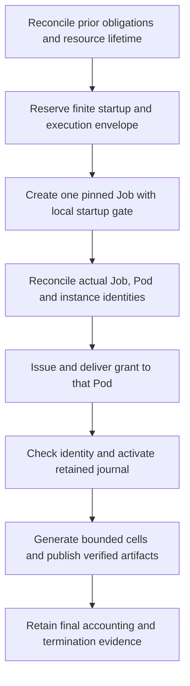

# Dataset launch adapter contract

Status: native two-stage allocation implemented and validated at `9c3d14b0395`
(5,119 full-library tests passed, zero failed, 123 ignored; exact-source exit 0). Launcher inventory starts at source `23b3c0e527d621aebf6532db61744fab77867f48`,
2026-10-28. No new worker,
resource allocation, IAM change or scientific generation follows from this
record. The native budget CLI exists; the complete lab launch adapter described
here does not yet exist.

## Existing capabilities and missing integration

The lower-level [submit-job](../../taskq/deploy/eks-karpenter/submit-job)
accepts an exact instance type and applies its node selector. The generic MCP
`isolab_k8s_run` does not expose that argument. Its CPU/memory requests alone do
not establish a machine type. The [MCP implementation](../../taskq/deploy/eks-karpenter/mcp/src/main.rs)
returns the created Job UID and selects status Pods by that controller UID,
returning actual Pod UIDs and node names. Its advertised pool vCPU limits are
hard-coded response fields, not a live NodePool capacity readback.

The manifest starts work immediately and has no pre-work grant delivery gate.
It supplies `POD_UID`, but `ISOLAB_JOB_ID` is the Job name, not its UID. It also
uses `emptyDir` for local state. The budget CLI verifies the supplied owner
against its grant; it does not query Kubernetes to attest that owner. The
launcher must establish those identities before issuing a spendable grant.

Job `activeDeadlineSeconds` terminates running Pods, and finished-Job TTL cleans
up Kubernetes objects. Neither sets an EC2 termination deadline. The tracked
[NodePools](../../taskq/deploy/eks-karpenter/nodepool.yaml) use `expireAfter: Never`
and empty-node consolidation; this does not establish a finite billing tail.
Termination grace starts after disruption begins. Current live NodePool and
NodeClaim evidence was unavailable because a read-only query could not assume
the existing launcher role. See [Kubernetes Job semantics](https://kubernetes.io/docs/concepts/workloads/controllers/job/)
and [Karpenter disruption semantics](https://karpenter.sh/docs/concepts/disruption/).

The [startup grant-delivery review](STARTUP-GRANT-DELIVERY.md) found no supported
post-creation delivery route in the generic launcher permissions and mounts. It
documents an unapplied exact-object ConfigMap proposal and its required issuer
permission. A projected file alone does not grant the launcher write access. The
[proposed native startup gate](STARTUP-GATE-PROPOSAL.md) specifies a local
nonrenewable wait and activation/generation handoff. Its source is now written
and independently reviewed; CLI registration and runtime validation are pending.

The benchmark bridge and recovery controller are tied to ecbench. They do not
provide a generic dataset startup gate or establish CRIU recovery for this CLI.

## Required launch sequence

1. Reserve provisioning, startup, runtime and termination costs before creating
   a billable worker. Bind actual region, permitted hardware, price evidence,
   original campaign deadline and finite resource lifetime. A waiting worker
   costs compute too. The native `budget reserve-launch` command
   implements this ownerless allocation; `budget bind-launch` transfers it to
   the observed owner without changing capacity. See the
   [frozen reservation contract](PRELAUNCH-RESERVATION.md).
2. Create one digest-pinned Job with exact instance selection, no automatic
   replacement/retry and a bounded local startup gate. The gate must perform no
   solver work, STS call or S3 polling before admission. Expose actual Pod UID
   and controller-UID label through the downward API. Suspending the Job alone
   cannot establish a Pod UID because no Pod is created while suspended.
3. Retain the creation response and reconcile the Job UID, Pod owner reference,
   Pod UID and node placement. Verify instance/provider identity and the
   resource-lifetime mechanism. Reconcile an ambiguous submission under the
   same Job name; do not create a second job to resolve uncertainty.
4. Issue a grant from the retained authoritative allocator and deliver it only
   to the designated worker. Bind source, binary, canonical plan, protocol,
   shard, owner and exact journal path. A projected configuration object is a
   possible delivery route; manifest support and launcher permissions must be
   verified before choosing it. Worker-side downward-API checks supplement the
   trusted launcher's reconciliation. Retain the authority marker and journal;
   loss of state stops spending and does not recreate quota.
5. Activate using the already-reserved request allowance, then generate and
   publish. Retain intermediate chunks, immutable receipts, fresh readbacks and
   accounting checkpoints. A replacement needs a separately admitted identity;
   audit snapshots are not spendable balance backups.
6. Preserve actual resource termination evidence. A planned cleanup command,
   Job timeout or two-minute consolidation setting cannot be recorded as an
   independently enforced billing lifetime. Native request accounting is not
   an account-wide AWS spending cutoff.

## Existing reservations and capacity

The retained campaign ceiling remains USD 200 total. The earlier conservative
reservation record held USD 188.3888, leaving USD 11.6112 estimated headroom;
these are reservations, not verified billing. Historical E12 resources are in
us-east-1, while this budget policy admits us-east-2. The proposed c6a worker
reservation did not establish an existing available worker.

Existing capacity can avoid an additional compute obligation only when its exact
identity, owner, availability and full remaining finite lifetime are covered by
retained campaign accounting, and this workload cannot extend that lifetime or
trigger more provisioning. No such eligible resource was verified in this
inventory. Do not move other work or release its reservations by assumption.

The current ledger adds prior obligations and worker grants, and every grant
must cover a positive compute floor. It has no credit-transfer mechanism for a
named prior compute reservation. A new conservative grant must fit remaining
headroom, or a separately reviewed allocation mechanism must preserve the same
whole-campaign obligation. Never obtain admission by zeroing rates or deleting
prior costs. The regional On-Demand price lookup is evidence for a price input,
not evidence of actual placement, availability, runtime or billing.

## Acceptance evidence

A ready adapter must demonstrate actual owner reconciliation, startup gating,
finite resource admission, durable authority retention and failure behavior on
replacement or journal loss. Then the first authorized worker must perform
conditional PUT and fresh GET/hash verification under its own role, complete a
bounded cell, and support independent fresh restore/replay. Only those artifacts
establish the first verified cloud cell. The scoped worker IAM proposal remains
unapplied; software tests and controller-role uploads do not discharge it.

Keep the frozen 720-cell pilot, the initial 36-cell wave and the full requested
campaign intact. Their planning counts do not become generated data when this
adapter is implemented. See [BUDGET-CLI.md](BUDGET-CLI.md),
[BUDGET-ADMISSION.md](BUDGET-ADMISSION.md) and
[REMAINING-COVERAGE.md](REMAINING-COVERAGE.md).
