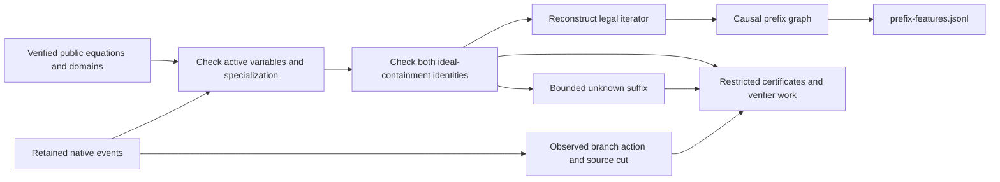

# Prime-chain decision replay certificates

This implementation contract extends `PRIME-CHAIN-ML-PROJECTION.md`. The full
dataset requirements remain in `REMAINING-COVERAGE.md`; this increment concerns
causal recursive decision examples from retained prime F4 streams. It does not
launch a new generator or certify complete native instruction histories.

## Algebra before features

For a node's input equations F and returned polynomial set G, require exact
certificates of both ideal containments. Each polynomial in G must be a sum of
monomial multiples of members of F, and conversely each member of F must be such
a sum of members of G. Check each identity by multiplying and accumulating terms
over the declared prime field. Certificates and verifier work belong in restricted
artifacts, never model features. Two checked containments establish equality of
the generated ideals. They do not establish that G is a complete Groebner basis,
that a native implementation executed the claimed trace, or that its costs are
accurate. Degree-truncated outputs that fail certification supply no verified
branch example through this route.

The certificate finder uses deterministic sparse elimination on monomial
multiples of the supplied generators up to a fixed degree. It retains the row
combinations so a separate identity checker can verify its result without
replaying elimination. Bounds cover variables, input terms, degree, enumerated
rows, retained sparse entries, arithmetic work and certificate size. Exhausting a
bound, or failing to find a representation in that finite span, means unknown.
It is not proof of ideal nonmembership, nor an exact polynomial-calculus degree,
first fall degree, last fall degree, or lower bound on any of these quantities.
No implicit Boolean or field equations are added.

## Causal replay and learning task

The replay layer must subsequently validate event numbering, the DFS parent map,
fixed bindings, active variables, specialization, basis certificates and the exact
branch iterator. The first task predicts an observed next branch attempt after
a native call. It does not label optimal actions or intra-F4 pivots. Reconstruct
root sets from pre-cut equations; do not infer them from future branch records.
Candidate assignments, lift outcomes, elapsed future work and source identifiers
stay restricted. An incomplete source remains censored. Each prefix identity
depends only on the projected mathematical state available before its action.
Changing a later suffix cannot change those bytes.

A static graph plus verified specialized equations, partial bindings and legal
action domains can support learning repeated algebraic structure and candidate
ordering. Imitating the current ascending iterator can be trivial; a useful
policy needs controlled counterfactual runs with inference/fallback cost and held
out components. The existing whole-field-size partition remains conservative;
cross-size algebraic-link unions remain a separate open requirement.

## Prior work and scope

Checked the existing projection contract, `f4_fp.rs` recursive visitor,
`solvers.rs` retained events, and the root extraction implementation. Native root
splitting has an unbounded retry loop without a deadline, so an exporter cannot
reuse that path as a deterministically bounded verifier unchanged.

[Miksa and Nordstrom, section 2, Definition 2.1](https://arxiv.org/html/1505.01358)
defines polynomial-calculus derivations using linear combinations and variable
multiplication. Our finite generator-multiple span is a restricted certificate
search, not the full iterated closure in that proof system. Its bounded failure
cannot inherit that paper's lower-bound conclusions. This work claims no new
algebraic method. The earlier Clegg--Edmonds--Impagliazzo DOI redirected to an
inaccessible ACM endpoint; the ECCC TR97-042 PDF has broken text extraction.
Neither inaccessible text is used as mathematical evidence here. Semaev and
fall-degree references from the parent design continue to govern the equation
encoding and scientific claim boundaries.

## Validation obligations

Check successful bidirectional identities, unequal ideals, cancellation,
multiple variables, zero ideals, nonprime fields, malformed dimensions and
coefficients, every cap and forged certificates. Test near-2^61 arithmetic with
independent BigUint identities. Then validate actual retained prime-chain states
and adversarial event modifications, including future-suffix invariance, before
publishing prefix features through `crypto dataset export`.

Status at contract creation: certificate search, prefix replay and CLI prefix
publication are not yet implemented. Static graph export is merged in PR2865;
verified cloud dataset cells remain zero.

## Implemented format and current validation state

Source `5d4336b45d2` implemented the initial modules and CLI integration; the next
commit corrects the bounded reader and adds cumulative verifier accounting.
Sourceadde10cad21 passed29 focused tests and strict maintained Clippy.
Source `06773dcf28f` subsequently passed a release build and four actual CLI
export/retry checks on retained curve/twist cells, producing four branch prefixes
for the curve and zero for the twist's certified inconsistent root. Combined
source `113526b5770` passed 236 dataset tests, with 0 failures and 1 ignored;
this includes both subsequently added certificate/cap regression tests.
The same combined runtime then passed the full release library suite
(5,441 passed, 0 failed, 123 ignored) and the explicitly selected 360-case
endpoint integration test. Combined strict maintained Clippy, release CLI build
and all four retained curve/twist export/retry commands also passed. Each phase
has an exit-zero receipt with matching runtime-source readback. These checks
validate bounded software behavior and add no scientific samples or cloud cells.
The initial build failed on Rust reader ownership; that failure is retained.

The validated v5 format stages `prefix-features.jsonl` alongside static
`features.jsonl`, with policy `strict-structural-allowlist-v5`. Those two files
are its eligible model inputs. `restricted/prefix-records.jsonl` holds observed action
labels, source cuts/joins, explicit ideal-equality certificates and replay summaries.
Static feature identities remain unchanged. Prefix identities hash the task,
public initial input, active-variable map, fixed bindings, fresh polynomial graphs
and independently derived remaining iterator. Field elements are decimal strings.
The iterator selects its variable from pre-cut algebra using the current native
rule; this is observed value-order imitation, not evidence of optimal variable
selection. Monomial/exponent and equation incidence are explicit in each graph.

The subsequent v6 source adds `algebraic-features.jsonl` as a third eligible
input file and `restricted/algebraic-records.jsonl` for independently checked
polynomial-consequence labels. It preserves the static/branch input identity
rules and routes consequence records separately from branch record numbering.
Only already equality-certified prime native nodes supply these consequences;
the feature graph uses the source system before that native call, while returned
basis rows and separately searched multiplier witnesses remain restricted.
Zero and unknown rows create no new public feature occurrence. The consequence
channel has its own cumulative limits and does not consume the branch verifier
budget. Its witnessed cancellation label establishes no exact fall degree or
closure result. See the [frozen contract](../../research/ml_dataset_algebraic_targets_20261030/CONTRACT.md)
and [implementation status](../../research/ml_dataset_algebraic_targets_20261030/STATUS.md).
New-source runtime tests have not yet executed after an initial manifest-macro compilation failure; the v5 receipts above remain
evidence only for their recorded revisions.

The reader admits at most4096 events,8MiB per event and64MiB per source stream.
One containment/equality search admits degree8,8192 generated rows,262144 sparse
entries and10million coefficient operations. A shared100million coefficient
operation budget covers certificate and root routines across a cell. The root
splitter tries at most256 deterministic shifts per factor, verifies the exact
quotient and each distinct root, and checks its cardinality against
`gcd(f,X^p-X)`. Exceeding a cap preserves earlier certified prefixes and marks the
remaining suffix unknown. Full-field fallback domains are intervals, never arrays
of all field elements. Inputs and current native replay require p<2^32; wide-prime
static graphs remain supported through the existing separate path.

Verifier counters count their specified coefficient arithmetic and finite-domain
evaluations. They exclude parsing, primality checks, specialization, feature graph
construction and I/O, and cannot become whole-export instruction totals. Sparse
entry accounting bounds the search representation; no total-process RSS bound is
claimed. Verification does not import native F4 pivots or trust reported native
costs. Original trace completeness, missing native internals, comprehensive
measurements and the full campaign remain open.

## Review follow-up: polynomial parser caps

A read-only delivery review found that row/term and degree caps in the polynomial
parser propagated as export errors, unlike the documented bounded-unknown policy.
The follow-up distinguishes these caps from malformed admitted payloads. A cap
in initial equations produces zero certified examples; a cap in a later system
or native basis retains earlier verified prefixes and marks the suffix unknown.
Malformed data encountered within admitted bounds remains an error. Oversized
suffix content is not certified or scanned beyond the verifier budget.

The prior source113526 validation remains evidence for that exact source. The
follow-up has a separate frozen validation plan and receipts; until they pass,
prior full-suite and CLI results do not validate the changed implementation.
