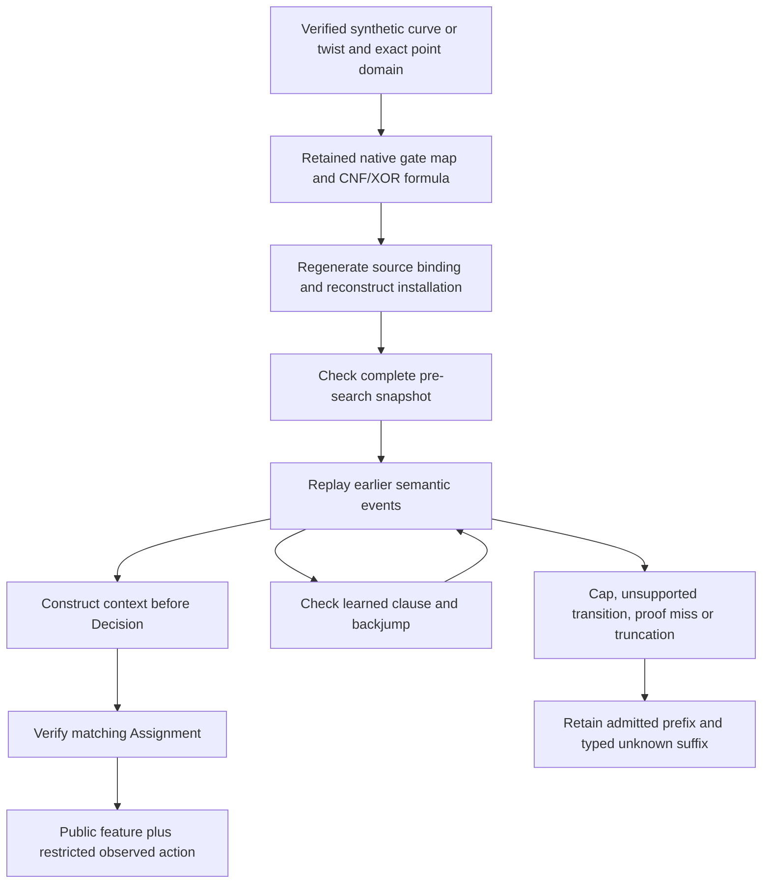

# Learning SAT policies from checked algebraic prefixes

This document describes the implemented standalone SAT encoder/replay/export
increment and the remaining producer-to-CLI gate. It does not report a trained
model or a generated cloud corpus. See the [implementation status](../../research/ml_dataset_sat_prefix_20261030/STATUS.md)
for exact source, tests and pending integration. The full requested field-size,
family, twist and m=2..15 corpus scope remains in [DESIGN.md](DESIGN.md).

## What the network sees and predicts

The task `binary-sat-decision/v1` exposes the verified initial public problem,
its algebraic gate map, active CNF/XOR constraints and the trail/levels immediately
before a decision. The observed choice is a restricted imitation target. Identical
contexts have identical feature identities even if source events, eventual
outcomes, labels or later suffixes differ.

| Learning task | Available evidence | Acceptance beyond imitation |
| --- | --- | --- |
| Variable/sign selection | Pre-decision clause, parity and algebraic gate structure; restricted native choice | Run the proposed policy prospectively on held-out instances, checking answers and charging inference/fallback work |
| Algebra-aware representations | Exact coordinate wires, reduction/squaring maps and native S3 gate roles | Verify proposed transformations against the actual field/model and concrete factor-base domain |
| Learned-clause proposals | Earlier verified state and separately retained checked learned clauses | Certify entailment before admitting a proposed clause; retain proof misses and budget exhaustion |
| Restart or deletion policies | Retained observed transitions and causal active state | Add a separately specified decision view; current branch labels do not establish complete policy supervision |
| Cost prediction | Restricted observed counts and scoped diagnostics | Keep censored runs and missing measurements; observed cost is not the counterfactual cost of untried actions |

Activity/priority values reported only for the selected variable stay restricted:
they are not a complete pre-action activity vector. Scalars, models, decoded
coordinates, group lifts, future clauses, future costs and outcomes stay out of
model input. Native imitation cannot establish that the native action is optimal.

## How an example becomes admissible

Source regeneration reuses the native encoder; it is not an independent field
arithmetic implementation. A separate replay engine checks installation order,
clause identifiers, initial units, parity equations, reasons, learned clauses,
backjumps, restarts and deletions. An unmatched Decision is not a training row.
A later unsupported event cannot retroactively add, remove or change earlier
admitted feature bytes.

Learned clauses use bounded propagation under their negation, with admitted
original constraints and earlier certified lemmas. Current search decisions are
excluded from proof assumptions. The distinction between entailment checks and
more general satisfiability-preserving clausal transformations follows the
background in [Cruz-Filipe et al., sections2–3](https://arxiv.org/html/1612.02353v2).
The current mixed CNF/XOR checker also verifies parity operations; it does not
claim to be a certified LRAT checker or a complete native UNSAT proof.

A proof search that reaches a fixed point without contradiction yields
`ProofNotEstablished`, not a non-entailment theorem. An unknown suffix remains
useful as a restricted censoring observation. It must not be relabeled as a false
clause, impossible PDP, solved ECDLP or completed negative instance.

## Explicit limits and measurements

| Resource | Current default ceiling |
| --- | --- |
| Raw events across patterns | 100,000 |
| Raw event bytes | 16MiB |
| Admitted decisions | 4,096 |
| Derived feature/record bytes | 64MiB, plus a separately bounded terminal record |
| Verifier logical retained payload | 64MiB |
| Source formula/map payload | 64MiB; each gate map at most16MiB |
| Input variables | 100,000 |
| Literal visits plus parity-word operations | 10,000,000 |

These are bounded accounting scopes, not process RSS or hardware retired
instructions. Parsing, encoding, hashing, sorting, I/O, native solving and export
are separate costs. Whole-worker instruction and complete execution-trace claims
remain false. Keep raw counters and availability/cap states alongside any derived
training target; do not fill missing measurements with zero.

## Files, compatibility and corpus admission

Export policy v7 adds `sat-features.jsonl` and
`restricted/sat-records.jsonl`. The existing static, prime-prefix and algebraic
channels retain their own semantics. Historical cells without a gate map report
SAT-channel unavailability. They cannot acquire reconstructed producer evidence
merely because a newer exporter can infer a plausible formula.

The initial capture supports fresh finite-coordinate domains and one solve per
identity pattern for binary/Koblitz chained-S3 encoding. Orbit selectors,
ordering/lazy constraints, model enumeration and complete private solver states
remain separate extensions. The map and formula must bind the actual target,
field representation, curve coefficient, arity and concrete domain.

Before producer-to-export admission, the bounded native CLI fixture must show
nonzero checked decisions on a curve and its twist and a same-pattern sequence
with a checked decision, certified learned clause, matching backjump and later
checked decision. It must also pass immutable retry, exact joins/hashes, source
immutability and four semantic corruption/censor controls. A schema-valid empty
export does not satisfy that gate.

The fixture protocol must be frozen before candidate data; the integrated draft
is not yet frozen. Its workflow-level export
must retain all subordinate cells and commands, including failures, partially
attempted controls and genuinely unrun cases. Passing official export schema/files
checks does not by itself mean that the native acceptance predicates passed.
Synthetic Python test fixtures validating that adapter are software evidence only.

Use the conservative existing split policy across every new key, generator,
twist and policy variant. The [factor-base policy proposal](../../research/ml_dataset_sat_prefix_20261030/FACTOR-BASE-POLICY-PROPOSAL.md)
is prospective: its closed orbit populations and policy axis are not implemented
by this SAT increment. Neural discovery of hidden structure remains a research
objective whose proposals require exact checking and prospective evaluation.
