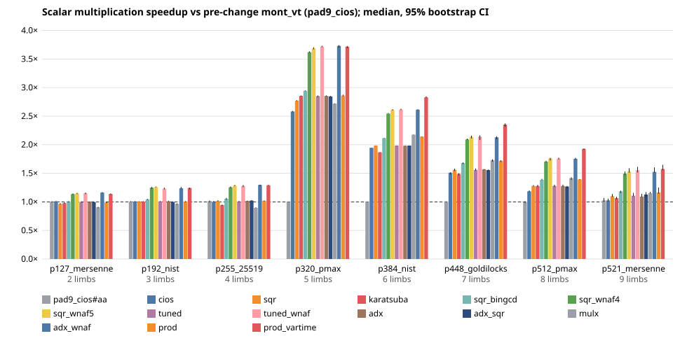
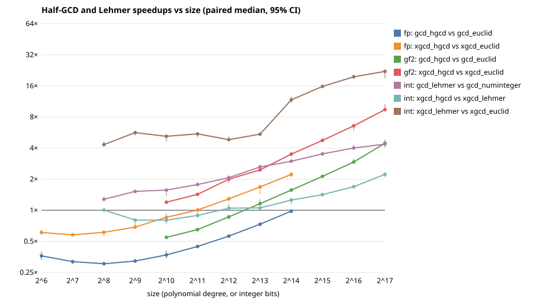

# ADX/MULX Montgomery kernels and library-wide half-GCD (2026-11-25/26)

Branch `feat/lucid-cray-tckh5e`, PR isogeny-labs/crypto#5209 (follow-up to
#5173). Benchmark records `benchmarks/records/20261125T2351Z-adx-mulx-kernel.json`
and `benchmarks/records/20261125T2351Z-hgcd-crossovers.json`. Every number
below is an **unverified assertion** [pcc:unverified]: one local host (4-vCPU
Intel Xeon @ 2.10 GHz cloud VM, no PMU, `taskset -c 3`), no independent
replay, not run on Iso Lab EKS.

## 1. ADX/MULX kernels (`src/ecc/mont_vt.rs`)

* `mont_mul4_adx`: inline-asm 4-limb Montgomery product (CIOS). Each row
  adds the low halves of the `mulx` products on the `adcx` (CF) chain and
  the high halves on the `adox` (OF) chain. After the reduction the
  register holding t₀ is exactly zero and becomes the next row's top word,
  so the one-word shift is a register rotation, not moves. Uses all 13
  allocatable GPRs; p and n0 are read from one per-context array.
* `Mont::mul_mulx`: CIOS on the `_mulx_u64` / `_addcarry_u64` intrinsics for
  every width, compiled with `#[target_feature(enable = "adx,bmi2")]`.
* Both run only after a one-time `is_x86_feature_detected!("adx")` +
  `"bmi2"` check; without ADX nothing changes.
* `ProdAdxKernel` (production on ADX CPUs, chosen once per scalar
  multiplication): asm product + tuned dedicated squaring at 4 limbs,
  `mulx` CIOS (products and squares) at 6–9 limbs, the tuned kernel at
  2–3 and 5 limbs.

### Results (`mont_mul_bench`, 41 interleaved paired rounds × 30 scalars per field)

Run 1 (04fed21/ad5d040, kernels only) and run 2 (8f0b91a, with
`ProdAdxKernel` and the `prod` arm timing `Point::scalar_mul`) agree to
about 1% on common arms. Run 2:

Per product (dependent-chain latency, 4 limbs): asm ADX 20.65 ns vs CIOS
21.67 ns = **0.95×** (run 1: 0.94×). The `mulx` intrinsic CIOS is 1.5–1.8×
slower than CIOS at 2–4 limbs, 1.0–1.08× at 6–8 limbs and 0.9× at 9 (run 1).

End to end (`k·P`), production kernel on this ADX CPU vs the previous
production (tuned) kernel — derived ratio of the paired medians against the
pre-#5173 baseline:

| field | limbs | `scalar_mul` | `scalar_mul_vartime` | kernel used |
|:--|--:|--:|--:|:--|
| 2^127−1 | 2 | 0.998× | 0.988× | tuned (same code) |
| P-192 | 3 | 0.996× | 1.009× | tuned (same code) |
| 2^255−19 | 4 | **1.013×** | **1.010×** | asm ADX product + tuned squaring |
| prime < 2^320 | 5 | 1.003× | 1.000× | tuned (same code) |
| P-384 | 6 | **1.079×** | **1.082×** | mulx CIOS |
| Goldilocks | 7 | **1.102×** | **1.098×** | mulx CIOS |
| prime < 2^512 | 8 | **1.089×** | **1.097×** | mulx CIOS |
| 2^521−1 | 9 | **1.050×** | 1.014× | mulx CIOS |

Cumulative against the pre-#5173 path (paired medians, `prod` arm):
`scalar_mul` 1.018× at 4 limbs, 2.859× at 5, 2.141× at 6, 1.719× at 7,
1.393× at 8, 1.163× at 9 (full table with CIs: `adx_run2/summary.md`).

Reading: the dual carry chain shortens the add chain but not the
`m = t₀·n0` → `mulx` dependency that dominates a Montgomery row, so the
4-limb asm kernel gains ~5% per product and ~1.5% per scalar
multiplication over LLVM's `mul`/`adc` code. At 6–9 limbs the compiler's
code from the `mulx`/`addcarry` intrinsics beats the `u128` CIOS by 5–10%
per scalar multiplication even through a non-inlined `target_feature`
call. Arms `adx` (asm squares too) and `adx_wnaf` gave nothing beyond
`adx_sqr` / `tuned_wnaf`.

## 2. Half-GCD (`src/gcd/`)

One half-GCD driver (`hgcd.rs`, von zur Gathen–Gerhard §11.1 / Thull–Yap)
over a `PolyRing` trait, instantiated for:

* `poly`: F[x] over any field (`PolyField` trait; `Fp64` for p < 2^63),
  Karatsuba products;
* `gf2`: bit-packed GF(2)[x] with PCLMULQDQ carry-less products (portable
  fallback);
* `int`: integers — binary GCD and a one-divide-per-step unsigned inverse on
  words; for `BigUint`, Lehmer (Knuth Algorithm L on the top 62 bits) and a
  recursive half-GCD (Schönhage/Möller control structure) that applies only
  validated, progress-making unimodular matrices and otherwise takes one
  exact division step, so the gcd is exact whatever the truncation does.

All entry points return canonical results — monic polynomial gcd, the
classical minimal-degree Bézout cofactors, integer cofactors reduced to the
classical range — so every algorithm and threshold gives bit-identical
output. Unit tests force the recursion at every size and compare with
classical Euclid (F_p for seven primes from 2 to ~2^63; GF(2) to 6000 bits;
integers from 1 to 40 000 bits including a Fibonacci worst case).

### Crossovers

`hgcd_bench`, 11 interleaved paired rounds per size, random inputs with a
planted common factor of size/8, results checked equal before timing;
F_p with p = 2^61 − 1. Paired median speedup [95% CI] (run 2, fixed
baseline; full table `hgcd_summary_run2.md`):

| ring, operation | size → | | | | |
|:--|:--|:--|:--|:--|:--|
| F_p[x] xgcd: half-GCD vs Euclid | deg 2048: 1.01× [0.85, 1.04] | 4096: **1.29×** [1.23, 1.36] | 8192: **1.68×** [1.43, 1.73] | 16384: **2.23×** [2.08, 2.33] | |
| F_p[x] gcd: half-GCD vs Euclid | deg 4096: 0.56× | 8192: 0.73× | 16384: 0.98× [0.94, 0.99] | | |
| GF(2)[x] xgcd | 1024 bits: **1.20×** [1.16, 1.21] | 4096: **2.00×** | 16384: **3.50×** | 65536: **6.58×** | 131072: **9.43×** [9.27, 10.68] |
| GF(2)[x] gcd | 4096: 0.86× | 8192: **1.16×** [1.12, 1.28] | 16384: **1.57×** | 65536: **2.93×** | 131072: **4.46×** [4.20, 4.86] |
| BigUint gcd: Lehmer vs num-integer | 256 bits: **1.28×** [1.26, 1.35] | 1024: **1.57×** | 8192: **2.63×** | 32768: **3.51×** | 131072: **4.37×** |
| BigUint xgcd: Lehmer vs classical Euclid | 256: **4.33×** | 1024: **5.20×** | 8192: **5.46×** | 32768: **15.8×** | 131072: **22.1×** |
| BigUint xgcd: half-GCD vs Lehmer | 4096: 1.05× | 8192: 1.05× | 16384: **1.26×** | 65536: **1.69×** | 131072: **2.22×** [2.09, 2.31] |
| BigUint gcd: half-GCD vs Lehmer | 16384: 0.57× | 65536: 0.83× | 131072: **1.09×** | | |

Production thresholds follow from these (and a leaf-size sweep, best leaf
≈256 for both polynomial rings): F_p[x] xgcd/inverse 3072, plain gcd 32768
(beyond the measured range: classical still wins at 16384); GF(2)[x]
xgcd/inverse 1024 bits, gcd 6144 bits; BigUint xgcd/inverse 8192 bits, gcd
131072 bits; Lehmer everywhere below.

### Bugs found and fixed while measuring

* Equal-degree polynomial inputs started the remainder sequence with a swap
  instead of classical Euclid's first division: valid but non-canonical
  cofactors. Found by the unit test; fixed in `prepare`.
* The integer recursion could loop forever when the truncated top part of
  `b` was already below the recursion target (identity matrix accepted as
  "progress"). Now a matrix is applied only if it shortens `b`.
* The benchmark's "never" threshold (`usize::MAX`) wrapped to −1 when cast
  to `isize`, so the first crossover run's "Euclid" arms for F_p and GF(2)
  actually ran half-GCD; production thresholds never hit the cast. The
  first `hgcd_raw.jsonl` is kept but its F_p/GF(2) Euclid arms are invalid;
  the integer arms of that run are valid. Crossovers above come from the
  rerun on the fixed binary.

## 3. Routing the library through `crate::gcd`

Owner's scope choice: every non-frozen GCD / extended-GCD / inverse site.
An inventory found 372 definitions in 247 files (plus name variants such as
`mod_inv`, `invmod`, `inverse_mod`). Six agents, each owning disjoint
files, replaced bodies with calls into `crate::gcd` while keeping every
signature and observable behaviour (monic vs raw results, zero and non-unit
handling, panics, call-count hooks such as `jv_bitops::hook_inv`). Per their
reports about 260 definitions were routed; the lead then reverted four
files (below). Everything compiles (`cargo check --lib --bins --examples
--tests`; the only error is a pre-existing example that includes a
`research/` file outside the sparse checkout).

**Not routed, by rule:**

* hash-pinned or digest-bound sources (smith protocol sources,
  `utils/mod.rs`, `poly_f2m.rs`, `cover_transfer.rs`, `fp_poly.rs`,
  `checker.rs`, `fixed_f8_order.rs`, `prime_split_sextic_oracle.rs`,
  `jacobian_certificate.rs`, `odd_extension_transfer_pilot.rs`,
  `mceliece.rs`), frozen reference copies inside tests, and files declared
  frozen or byte-identical copies (koblitz fixture/strong instruments,
  `r6_2_pooled_class_rho.rs`, `tree_split_structured.rs`);
* separate crates (`isogeny_algos/`, `crates/*`, `tools/*`), which cannot
  depend on `crypto_lib`;
* every site whose arithmetic threads recorded operation counters, work
  gates, certificate traces or replayed accounting (`Cnt`, `FieldOps`,
  `Nat`, `muls +=`, `gate.charge`, `OpCounts`, Fp2 counter windows,
  `prime_root_trace` GcdStep events, `vieta_coset` half-GCD budgets): a
  different algorithm there would change recorded GAE/op counts;
* hand-tuned fixed-width kernels whose speed is the point
  (`ic_boundary::invmod*` asm/32-bit paths behind every ecbench affine
  addition, `fp_backend` Pornin/Kaliski/binary inverses, `Mont::inv_bingcd`);
* coefficient types that are not `Copy` (BigUint polynomial coefficients),
  and Fermat inverses whose modulus is not known prime.

**Reverted by the lead after review** (speed or provenance):
`prime_fast.rs` (division-free binary inverse in the FastCurve rho walks; its
root-finding gcd now uses half-GCD above the crossover only),
`isoclass_rho/field.rs` (per-step F_{2^m} inverse would allocate),
`hyperelliptic_word.rs` (stack arrays + table inverse), `jv_sieve.rs`
(hash-checked by `sha256sum -c` in live preparation scripts).

**Speed effect on routed sites.** Most routed sites pass small operands
(degree ≤ 8 Cantor/quartic gcds, single-word integers); for them the
shared module runs its classical kernels, so the effect is neutral to
positive (binary GCD; one-divide unsigned inverse, the same algorithm the
fastest local copies used; Lehmer for `BigUint`, 1.3–2.6× over num-integer's gcd and 4.3–5.5× over
a classical BigInt extended Euclid on 256–8192-bit operands). Half-GCD itself
engages only at the sizes in the crossover table.

## 4. Open

* An AVX-512 IFMA (52-bit) Montgomery kernel; a 6-limb inline-asm ADX kernel
  (needs memory-resident accumulators — 15 > 13 registers).
* F_p[x] half-GCD with an FFT/NTT product would lower the crossovers by an
  order of magnitude; the Karatsuba/`u128 %` product sets them now.
* EKS rerun of both benchmarks; independent replay.
