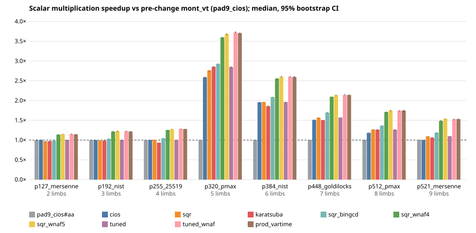
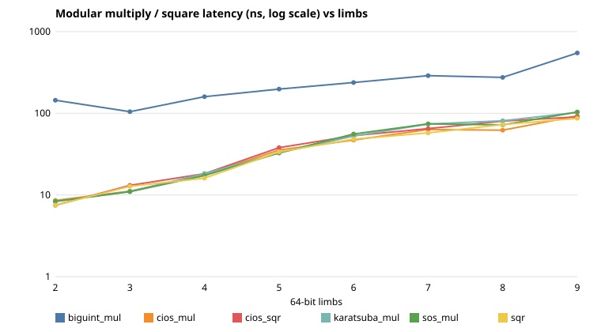

# Faster fixed-width multiplication for generic-prime ECC scalar multiplication (2026-11-25)

Branch `feat/lucid-cray-tckh5e`, PR isogeny-labs/crypto#5173. Benchmark record
`benchmarks/records/20261125T1820Z-mont-mul-kernels.json`. Status of every
number below: **unverified assertion** (local single-host measurement, no pcc
claim, no independent replay).

## Boundary

What is measured: wall time of one scalar multiplication `k·P` (random
`k < 2^bits(p)`, random affine `P`, random curve coefficient `a`) through the
fixed-width Montgomery path `src/ecc/mont_vt.rs` behind `Point::scalar_mul` and
`Point::scalar_mul_vartime`, including entry to Montgomery form, the ladder,
the final inversion and the conversion back to `BigUint`. Also the latency of
one dependent modular multiplication / squaring / inversion per width.

Not measured, not changed: the P-256 and secp256k1 paths (they have their own
specialised ladders and are dispatched before `mont_vt`), single-word primes
(the `Word` path), the constant-time `scalar_mul_ct`, binary fields, and any
ECDLP solver. This is a component speed-up of public-input scalar
multiplication (set-up multiplications of walks and searches, signature
verification on curves other than P-256/secp256k1); it says nothing about the
cost of ECDLP and is not an index-calculus row.

Fields (one per limb width): 2^127−1 (2 limbs), P-192 (3), 2^255−19 (4), the
largest prime below 2^320 (5), P-384 (6), Goldilocks 2^448−2^224−1 (7), the
largest prime below 2^512 (8), 2^521−1 (9).

## What changed

| change | where | applies to | result semantics |
|:--|:--|:--|:--|
| exact limb widths 5..8 (were padded to 9 limbs: 81 word products per CIOS pass instead of 25–64) | `Point::scalar_mul` dispatch | every 5..8-limb modulus | bit-identical for every odd modulus |
| dedicated Montgomery squaring: cross products once, doubled by a shift, diagonal added, SOS reduction (`N(N+1)/2 + N²` word products vs `2N²`) | `Mont::sqr`, `TunedKernel` for N ≥ 4 | `scalar_mul`, `scalar_mul_vartime` | bit-identical |
| separated schoolbook + SOS reduction product | `TunedKernel` at N = 5 only | both | bit-identical |
| fixed-width binary extended-GCD inverse (`Mont::inv_bingcd`), 4–16× faster than the Fermat power | final `Z⁻¹` of `scalar_mul_vartime` | multi-word primes | equal over a prime; Fermat fallback where it finds no inverse, as `FieldElement::inv_vartime` |
| width-4 (≤ 3 limbs) / width-5 NAF; odd multiples built on the isomorphic curve scaled by `Z(2P)` (so `2P` is affine without an inversion) and normalised by one batch inversion | `Mont::ladder_wnaf` | `scalar_mul_vartime`, multi-word primes | equal over a prime; declines to the binary ladder on a small-order base or non-unit `Z` |
| one-level subtractive Karatsuba product | `Mont::mul_wide_karatsuba` | measured only, **not used** | — |

`Point::scalar_mul`'s contract ("the same point the `BigUint` ladder returns,
for every odd modulus") is unchanged, so only the bit-identical changes go
there. `Point::scalar_mul_vartime` documents "exactly `scalar_mul` over a
prime `p`", which the wNAF and binary-GCD changes keep. The fast vartime path
runs only on moduli that pass Miller–Rabin (40 fixed bases, cached per thread
for the last eight moduli); a composite multi-word modulus runs `scalar_mul`
itself, so the existing test `composite_modulus_non_units_match_constant_time`
(strict equality on (2^31−1)(2^89−1), where the final `Z` is a unit) keeps
holding. It failed on the first version of this change, which is how the gap
was found.

## Method

`src/bin/mont_mul_bench.rs`, `taskset -c 3` on a 4-vCPU Intel Xeon @ 2.10 GHz
cloud VM (no hardware PMU, isolation: local container). Per field: 41 rounds;
each round draws 30 fresh scalars and runs every arm on the same scalars, arm
order shuffled per round from a derived seed; an A/A copy of the baseline arm
(`pad9_cios#aa`) measures the noise floor. Speedup = baseline ns / arm ns per
round, summarised by the median and a 2000-resample percentile bootstrap 95%
interval. Before timing, every arm and both production entry points are
checked equal to the `num-bigint` ladder on 38 scalars per field (edge values
0..256, p−1, 2^bits−1, 2^(bits−1), 24 random); the run aborts on any mismatch.
Kernel latency: 7 repetitions of 2·10^6 dependent operations (10^5 for
`num-bigint`, 2·10^3 for inversions), median.

Four runs, all under the one benchmark record:

- run 1 at f0271142f: kernels and arms;
- run 2 at 8427dc0c1: the first tuned kernel;
- run 3 at 8fc62fdc3: the final tuned kernel;
- run 4 at 17c530427: the final code, including the Miller–Rabin gate of the vartime path.

Run 2 showed that the first tuned kernel regressed `scalar_mul` by 1–3% at
2–3 limbs end to end. That kernel used the SOS product and dedicated squaring
at N ≤ 3, chosen from the isolated kernel loop. Run 3's kernel keeps plain CIOS
there. The runs agree to within about 1–2% on every common paired ratio.
Absolute times move between runs (shared VM, baseline 24–31 µs at 2 limbs),
which is why every comparison is paired within a round.

## Results (run 4, final code)

Baseline `pad9_cios` = the pre-change production path. A/A on every field:
0.996–1.002×, all intervals containing 1. Run 3 (before the Miller–Rabin
gate) agrees with every number here to within 1%.

| field | limbs | baseline µs | `scalar_mul` (tuned) | `scalar_mul_vartime` | `num-bigint` ladder → `scalar_mul_vartime` |
|:--|--:|--:|--:|--:|--:|
| 2^127−1 | 2 | 24.0 | 1.005× [0.987, 1.008] ¹ | 1.142× [1.129, 1.154] | 28.6× |
| P-192 | 3 | 57.9 | 1.002× [0.986, 1.010] ¹ | 1.216× [1.206, 1.228] | 17.9× |
| 2^255−19 | 4 | 100.0 | 1.006× [1.001, 1.011] | 1.278× [1.272, 1.283] | 18.5× |
| prime < 2^320 | 5 | 640.8 | 2.849× [2.832, 2.860] | 3.704× [3.683, 3.721] | 12.5× |
| P-384 | 6 | 782.3 | 1.961× [1.948, 1.970] | 2.596× [2.589, 2.620] | 9.7× |
| Goldilocks | 7 | 914.3 | 1.568× [1.560, 1.574] | 2.140× [2.136, 2.156] | 9.3× |
| prime < 2^512 | 8 | 1035.3 | 1.265× [1.245, 1.271] | 1.746× [1.723, 1.765] | 8.8× |
| 2^521−1 | 9 | 1041.3 | 1.096× [1.088, 1.101] | 1.531× [1.526, 1.543] | 11.8× |

¹ At N ≤ 3 the tuned kernel is the same CIOS code as the baseline (expected
1.000×; run 3 read 1.000× and 0.992× there).
The last column is a derived ratio of medians (`prod_vartime` speedup /
`biguint` speedup), not a paired interval. `scalar_mul_vartime` timings are
cache hits of the per-modulus Miller–Rabin test; the first call on a new
modulus pays one test (not measured separately).



Where the gain comes from (run 4, paired medians against the baseline):

| limbs | exact width (`cios`) | + squaring (`sqr`) | + bingcd inverse | + wNAF-5 (`sqr_wnaf5`) | Karatsuba instead of CIOS |
|--:|--:|--:|--:|--:|--:|
| 2 | 1.002× | 0.969× | 0.983× | 1.152× | 0.973× |
| 3 | 0.999× | 0.986× | 1.031× | 1.225× | 0.986× |
| 4 | 1.000× | 1.008× | 1.048× | 1.275× | 0.933× |
| 5 | 2.588× | 2.761× | 2.927× | 3.682× | 2.856× ² |
| 6 | 1.956× | 1.961× | 2.087× | 2.601× | 1.858× |
| 7 | 1.511× | 1.566× | 1.695× | 2.137× | 1.504× |
| 8 | 1.183× | 1.263× | 1.365× | 1.749× | 1.265× |
| 9 | 0.998× | 1.094× | 1.187× | 1.537× | 1.061× |

² N = 5 is odd, so the Karatsuba arm falls back to the schoolbook + SOS
product there; that number measures SOS, not Karatsuba.

Kernel latency (ns per dependent operation; full tables in
`run{1..4}/summary.md`). Dedicated squaring vs CIOS `a·a`: 0.88–0.96× at
N ≥ 4 in run 4. One-level Karatsuba vs the CIOS product: **slower** at every
even width in both final runs, by 3–30% (run 4: 1.03×, 1.12×, 1.30× at
N = 4, 6, 8; run 3: 1.09×, 1.15×, 1.05×). Binary-GCD inverse vs Fermat power:
0.24× at 2 limbs down to 0.066× at 9 limbs.



## Reading

* Most of the `scalar_mul` gain at 5–8 limbs is the dispatch fix, not a
  new multiplication algorithm: those moduli were paying for 9-limb
  arithmetic.
* Asymptotically fast multiplication does not pay at these sizes. One
  Karatsuba level saves `N²/4` word products but adds carries, two
  absolute differences and a recombination, and on this host it lost 3–30%
  per product at N = 4, 6, 8 (and 7% per `k·P` at 4 limbs). Toom-Cook,
  Schönhage–Strassen and Harvey–van der Hoeven have crossovers in the
  thousands to millions of bits; ECC fields are 2–9 words. The levers here
  are fewer word products (squaring), the right width, fewer inversions, and
  fewer point additions.
* For variable-time public scalars the larger lever is the scalar side
  (wNAF: ~bits/6 additions instead of bits/2) together with an inversion
  that is cheap enough to normalise a precomputed table.

## Tests

* New: `ecc::mont_vt::tests::{squaring_and_karatsuba_match_cios,
  bingcd_inverse_matches_fermat, wnaf_digits_reconstruct}` (every width
  1..=9, edge and random residues, all-ones carry chains, a composite
  modulus) and `ecc::point::mont_kernel_arms::{arms_match_biguint_ladder,
  arms_handle_two_torsion}` (all arms and both production entry points
  against the `num-bigint` ladder on 2..9-limb primes; a 2-torsion base).
* `cargo test --lib -- ecc::mont_vt ecc::point`: 26 passed. Whole `ecc::`
  module: 345 passed, 2 ignored.
* The 40 modules outside `ecc` that call `scalar_mul` / `scalar_mul_vartime`:
  1093 passed, 49 failed. All 49 are pre-existing in this sparse checkout:
  36 panic on data files under `research/` that are not checked out, and the
  other 13 fail identically on the pre-change `point.rs` / `mont_vt.rs`
  (rebuilt and rerun one by one).
* The benchmark's correctness gate (every arm, `scalar_mul` and
  `scalar_mul_vartime` equal to the `num-bigint` ladder on 38 scalars per
  field) passed in all four runs.
* Build note: the library test target needs more than this container's
  ~15 GB with debuginfo; it was built with `CARGO_PROFILE_DEV_DEBUG=0
  CARGO_PROFILE_TEST_DEBUG=0 CARGO_PROFILE_DEV_CODEGEN_UNITS=64 -j 1`.

## Not done / open

* No ADX/MULX (`adcx`/`adox` dual carry chains) assembly kernel; the host has
  `adx` and `bmi2`. That is the next measurable lever for the product itself
  (it is how the fastest libraries reach ~2× over portable CIOS at 4 limbs).
* No "no-carry" CIOS variant for moduli with spare top bits (applies to
  2^521−1 here, and to BN254/BLS12-381-style primes).
* `scalar_mul_ct` (secret scalars) still runs `FieldElement` on `num-bigint`
  for generic primes; it was not touched.
* Single host, no PMU (cycles/IPC unavailable), not run on Iso Lab EKS; no
  independent replay. An EKS rerun of `mont_mul_bench` would make the numbers
  lab-grade.

## Files

* `raw.jsonl.gz`, `raw_run2.jsonl.gz`, `raw_run3.jsonl.gz`, `raw_run4.jsonl.gz` — every timing row
  (gzip; kept in Git under the 64 KiB data limit because this session's AWS
  identity could not write the artifact store, HeadObject 403).
* `run{1,2,3,4}/summary.md|json` — analysis output
  (`mont_mul_bench --analyze`), `run{3,4}/*.svg|png` — graphs.
* `REPORT.html` / `REPORT.pdf` — this study as a report.

Reproduce:

```bash
cargo build --release --bin mont_mul_bench
taskset -c 3 ./target/release/mont_mul_bench --rounds 41 --batch 30 --kernel-iters 2000000 --seed 7885634870099997748 --out raw_run4.jsonl
./target/release/mont_mul_bench --analyze raw_run4.jsonl --report-dir run4
# or, from the committed data: gunzip -k raw_run4.jsonl.gz first
```
