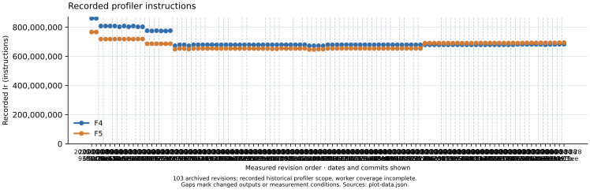
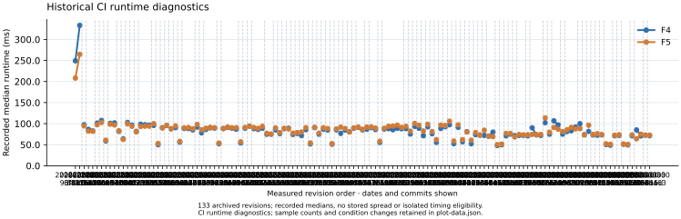
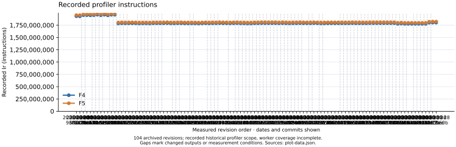
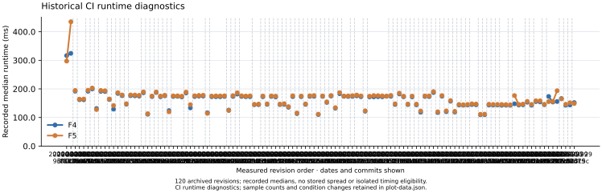

# Separate F4/F5 performance history

Frozen rendering of **139 recorded main revisions**, plus the native allocation baseline/candidate audit. No new performance run or speedup claim.

Plots retain each algorithm as its own series. CI runtime is diagnostic; incomplete historical profiler coverage is retained as recorded. Connecting lines stop when fingerprints or measurement conditions change. X spacing is revision order, not elapsed time.

[Combined PDF](report.pdf) · [Editable source](report.typ) · [Native plot data and provenance](plot-data.json)

## Boolean matrix step: F4 and F5

One shared K_1 / 2^23 m=2 system, 22 Boolean variables, maximum degree 4. Matrix construction, reduction and readback; F5 includes its criterion.

[Group PDF](boolean-matrix.pdf) · [Editable source](boolean-matrix.typ)

| UTC date / revision | F4 Ir | F5 Ir | F4 ms | F5 ms |
| --- | --- | --- | --- | --- |
| 2026-10-08 / 93ff0c72 | 860,633,889 | 766,940,469 | 249.241 | 208.250 |
| 2026-10-09 / 6f81260f | 860,555,567 | 766,776,087 | 333.279 | 264.687 |
| 2026-10-11 / 8a41eca7 | 808,263,705 | 718,576,235 | 97.380 | 94.658 |
| 2026-10-11 / 0cfba411 | 808,263,705 | 718,578,523 | 86.390 | 82.214 |
| 2026-10-11 / f88e5909 | 807,989,935 | 718,391,055 | 82.597 | 81.948 |
| 2026-10-11 / fb926c02 | 808,263,705 | 718,576,189 | 101.379 | 97.323 |
| 2026-10-11 / e478b952 | 803,017,657 | 719,516,063 | 107.585 | 102.927 |
| 2026-10-11 / aa0cee7b | 808,281,869 | 718,492,761 | 58.723 | 60.673 |
| 2026-10-12 / 81ca1c78 | 803,015,877 | 719,509,003 | 100.762 | 98.775 |
| 2026-10-12 / a8194d61 | 808,072,539 | 718,282,030 | 101.827 | 96.904 |
| 2026-10-12 / 5cbe16d5 | 802,824,065 | 719,316,911 | 81.784 | 83.144 |
| 2026-10-12 / eb70862e | 802,824,065 | 719,316,876 | 63.944 | 62.505 |
| 2026-10-12 / 31088bfc | 776,242,363 | 686,315,894 | 102.929 | 99.489 |
| 2026-10-12 / 0d34f782 | 774,379,185 | 686,521,131 | 96.521 | 93.790 |
| 2026-10-12 / 89e3233c | 776,490,367 | 686,543,371 | 81.628 | 80.581 |
| 2026-10-12 / 80f5391d | 774,379,185 | 686,519,896 | 98.501 | 93.239 |
| 2026-10-12 / c62555b7 | 774,379,185 | 686,519,896 | 97.360 | 94.117 |
| 2026-10-12 / 633d2158 | 776,467,358 | 686,512,000 | 96.637 | 94.008 |
| 2026-10-12 / ca0d5f86 | 672,500,776 | 649,174,334 | 95.848 | 99.895 |
| 2026-10-12 / b5cc6ffc | 679,242,389 | 653,622,849 | 49.965 | 52.882 |
| 2026-10-13 / bf92906b | 679,242,389 | 653,622,849 | 90.163 | 90.201 |
| 2026-10-13 / d85756aa | 672,486,486 | 649,160,075 | 95.497 | 95.480 |
| 2026-10-13 / ab28b57b | 679,449,939 | 653,823,121 | 87.697 | 87.878 |
| 2026-10-13 / 56f66e43 | 679,449,939 | 653,828,331 | 90.448 | 94.715 |
| 2026-10-13 / 28b1daf2 | 679,449,939 | 653,828,331 | 56.215 | 57.961 |
| 2026-10-14 / cc962159 | 679,449,939 | 653,831,656 | 88.546 | 90.149 |
| 2026-10-14 / 33816db5 | 679,549,997 | 654,627,509 | 88.344 | 90.874 |
| 2026-10-14 / 191a0739 | 679,240,609 | 653,664,759 | 85.135 | 87.917 |
| 2026-10-14 / cd226d0c | 679,240,609 | 653,664,759 | 92.059 | 98.073 |
| 2026-10-14 / b2272a44 | 679,449,939 | 653,873,401 | 78.007 | 85.621 |
| 2026-10-14 / bc82d128 | 679,449,939 | 653,873,401 | 86.126 | 89.102 |
| 2026-10-14 / 912a98ed | 679,098,623 | 653,830,968 | 89.995 | 91.125 |
| 2026-10-14 / 8d8b1295 | 679,098,623 | 653,830,968 | 89.395 | 90.230 |
| 2026-10-14 / b339e847 | 679,240,608 | 653,621,583 | 52.150 | 53.839 |
| 2026-10-15 / 7912faa5 | 679,226,318 | 653,606,027 | 88.406 | 88.091 |
| 2026-10-15 / 3c5d435e | 678,905,208 | 653,631,022 | 90.855 | 91.956 |
| 2026-10-15 / f0599bf9 | 679,098,622 | 653,825,706 | 89.060 | 90.253 |
| 2026-10-15 / 3db0ecbc | 679,449,938 | 653,830,913 | 86.813 | 90.492 |
| 2026-10-15 / addb6a02 | 679,256,525 | 653,632,330 | 54.248 | 56.951 |
| 2026-10-15 / 12348e50 | 679,449,939 | 651,714,930 | 89.150 | 90.941 |
| 2026-10-15 / b906df02 | 679,449,939 | 651,714,179 | 94.066 | 94.227 |
| 2026-10-15 / cf274521 | 679,549,984 | 654,627,503 | 88.061 | 90.795 |
| 2026-10-15 / 1b874fcc | 679,449,939 | 653,830,975 | 86.246 | 88.831 |
| 2026-10-15 / 700f7d31 | 679,444,579 | 653,824,679 | 89.023 | 93.545 |
| 2026-10-15 / 289bb5fb | 679,264,149 | 653,687,604 | 74.802 | 77.102 |
| 2026-10-16 / 92246530 | 679,449,938 | 653,829,966 | 75.128 | 75.009 |
| 2026-10-16 / 3a4a5cec | 679,549,995 | 654,621,347 | 85.229 | 89.944 |
| 2026-10-16 / 333c08c0 | 672,605,656 | 647,427,799 | 76.341 | 78.831 |
| 2026-10-16 / 4cfcb94e | 672,605,656 | 647,427,799 | 87.944 | 88.781 |
| 2026-10-16 / ca0310ff | 672,486,486 | 649,202,105 | 89.012 | 87.501 |
| 2026-10-16 / de0c9391 | 672,500,776 | 649,216,408 | 74.498 | 77.487 |
| 2026-10-16 / 7051f4e2 | 679,449,938 | 653,873,407 | 76.675 | 78.834 |
| 2026-10-16 / 082d5507 | 679,445,034 | 653,868,507 | 71.580 | 80.148 |
| 2026-10-16 / 2f02e32c | 679,549,984 | 654,627,503 | 85.711 | 90.622 |
| 2026-10-16 / 6d437f0c | 679,549,984 | 654,627,503 | 51.852 | 54.190 |
| 2026-10-16 / 6bf2bcf0 | 679,549,997 | 654,621,861 | 90.619 | 91.074 |
| 2026-10-16 / f8300065 | 679,549,997 | 654,669,949 | 75.064 | 77.431 |
| 2026-10-16 / ccf43056 | 679,549,997 | 654,669,949 | 86.686 | 90.254 |
| 2026-10-16 / 57b028d8 | 679,350,531 | 654,421,882 | 84.863 | 88.297 |
| 2026-10-16 / f25d5e52 | 679,549,984 | 654,669,936 | 51.138 | 52.369 |
| 2026-10-16 / 213e7a80 | 679,449,939 | 653,830,971 | 85.272 | 87.253 |
| 2026-10-16 / 78adfda4 | 679,240,609 | 653,621,067 | 76.846 | 91.802 |
| 2026-10-17 / b1bf5b89 | 679,449,939 | 653,825,765 | 84.571 | 88.476 |
| 2026-10-17 / 40bcf690 | 679,449,939 | 653,825,765 | 80.639 | 80.305 |
| 2026-10-17 / 8efd4e48 | 679,549,984 | 654,622,293 | 88.930 | 89.875 |
| 2026-10-17 / 89036527 | 679,449,939 | 653,830,971 | 91.230 | 91.994 |
| 2026-10-17 / a90646f1 | 679,435,649 | 653,817,360 | 85.170 | 86.662 |
| 2026-10-17 / b59187e5 | 679,340,625 | 654,418,146 | 86.682 | 91.890 |
| 2026-10-17 / fd043d4f | 679,549,955 | 654,621,012 | 90.548 | 92.367 |
| 2026-10-17 / 17c71374 | 679,449,939 | 653,830,397 | 86.043 | 89.344 |
| 2026-10-17 / 7d751c8d | 679,098,491 | 654,182,814 | 55.523 | 58.269 |
| 2026-10-17 / a95fcd95 | 679,098,493 | 654,182,133 | 87.157 | 88.860 |
| 2026-10-17 / 2c1164df | 679,198,639 | 690,798,036 | 88.066 | 93.755 |
| 2026-10-17 / e59342d3 | 679,198,639 | 690,798,036 | 85.604 | 94.177 |
| 2026-10-17 / ca00c151 | 679,198,639 | 690,798,036 | 88.918 | 96.426 |
| 2026-10-18 / f8501268 | 679,449,938 | 690,826,836 | 87.801 | 91.097 |
| 2026-10-18 / a1d0f1e6 | 679,449,938 | 690,826,836 | 88.118 | 93.700 |
| 2026-10-18 / c8613fe5 | 679,449,938 | 690,825,106 | 75.312 | 82.144 |
| 2026-10-18 / 3c192c34 | 679,449,938 | 690,825,106 | 93.514 | 100.589 |
| 2026-10-18 / 805b6279 | 679,549,993 | 691,623,334 | 89.125 | 96.021 |
| 2026-10-19 / 21d553b1 | 679,453,166 | 690,824,740 | 71.297 | 82.510 |
| 2026-10-19 / fc5d4835 | 679,449,937 | 690,826,048 | 92.362 | 98.482 |
| 2026-10-20 / 841a45cd | 679,451,718 | 690,805,442 | 76.066 | 81.266 |
| 2026-10-20 / 0e3c51ed | 679,340,663 | 691,396,123 | 55.582 | 62.124 |
| 2026-10-20 / d0337ff5 | 679,551,773 | 691,602,405 | 88.546 | 96.658 |
| 2026-10-20 / d30a63b8 | 679,549,994 | 691,600,618 | 92.571 | 95.491 |
| 2026-10-20 / 892ef408 | 679,549,994 | 691,600,618 | 97.275 | 105.731 |
| 2026-10-21 / b4f05610 | 679,551,773 | 691,602,032 | 52.495 | 58.611 |
| 2026-10-21 / 43e01b10 | 679,551,773 | 691,602,032 | 91.335 | 97.133 |
| 2026-10-22 / 02b37807 | 679,551,773 | 691,602,032 | 57.057 | 61.964 |
| 2026-10-23 / 6ed792e8 | 679,549,983 | 691,604,220 | 80.788 | 80.079 |
| 2026-10-23 / d34b9b39 | 679,549,983 | 691,604,220 | 52.168 | 60.548 |
| 2026-10-27 / 7e271266 | 681,943,949 | 691,347,680 | 73.901 | 78.829 |
| 2026-10-27 / c402a154 | 682,282,779 | 691,707,737 | 72.619 | 73.294 |
| 2026-10-27 / 1c756bcb | 681,899,901 | 692,697,266 | 72.047 | 84.493 |
| 2026-10-28 / a5db1413 | 681,899,901 | 692,697,266 | 70.151 | 70.376 |
| 2026-10-28 / 0650ca8b | 681,899,901 | 692,697,266 | 79.912 | 69.027 |
| 2026-10-28 / d4e85a6a | 681,885,611 | 692,687,520 | 48.174 | 50.139 |
| 2026-10-28 / e74711b4 | 679,810,476 | 692,710,161 | 49.796 | 51.316 |
| 2026-10-28 / cafd2389 | 681,943,647 | 692,740,867 | 71.045 | 76.833 |
| 2026-10-28 / eec5dcc3 | 681,943,647 | 692,740,867 | 75.109 | 76.743 |
| 2026-10-28 / 98a2f7fa | 683,245,465 | 693,927,563 | 71.387 | 68.293 |
| 2026-10-28 / 3f0e13ee | 683,415,446 | 694,093,622 | 72.074 | 74.215 |
| 2026-10-28 / 7be0960b | 683,415,446 | 694,093,622 | 72.232 | 73.439 |
| 2026-10-28 / a988ff46 | 681,943,879 | 692,741,225 | 70.987 | 73.705 |
| 2026-10-28 / 8177cd08 | 683,437,564 | 694,188,206 | 90.137 | 74.414 |
| 2026-10-28 / 0d839d5b | 681,899,901 | 692,698,574 | 73.298 | 74.059 |
| 2026-10-28 / 7fe71c4a | 682,335,928 | 693,119,282 | 72.101 | 74.442 |
| 2026-10-29 / 25d0e671 | 682,335,928 | 693,119,282 | 102.392 | 113.613 |
| 2026-10-29 / 0fc7cdad | 682,218,335 | 691,617,426 | 75.044 | 79.697 |
| 2026-10-29 / 3f1dcd9e | 683,439,590 | 694,127,041 | 106.645 | 91.019 |
| 2026-10-29 / 0af11c62 | 682,263,636 | 693,066,268 | 97.025 | 86.703 |
| 2026-10-29 / f73e667b | 682,263,636 | 693,066,268 | 75.045 | 81.275 |
| 2026-10-29 / be2969ce | 682,263,636 | 693,066,268 | 81.162 | 85.238 |
| 2026-10-29 / ca0c809d | 682,037,440 | 692,830,863 | 83.099 | 91.075 |
| 2026-10-29 / 85d80508 | 682,037,440 | 692,830,863 | 92.024 | 87.672 |
| 2026-10-29 / 91902d0c | 682,037,440 | 692,830,863 | 99.730 | 88.072 |
| 2026-10-29 / 117c9c4f | 682,076,130 | 692,882,707 | 73.768 | 73.314 |
| 2026-10-29 / 992c2579 | 682,032,151 | 692,835,720 | 81.606 | 96.247 |
| 2026-10-29 / 2c583c5c | 681,686,676 | 692,985,843 | 73.089 | 74.436 |
| 2026-10-29 / 78f84234 | 681,686,676 | 692,980,550 | 72.621 | 76.212 |
| 2026-10-29 / 8eb04d5e | 683,400,900 | 694,082,886 | 73.332 | 73.948 |
| 2026-10-29 / 055c5035 | 682,218,705 | 693,065,470 | 50.283 | 52.017 |
| 2026-10-29 / 11b1130e | 682,218,705 | 693,065,470 | 48.863 | 51.023 |
| 2026-10-29 / 21f66351 | 681,905,560 | 692,750,765 | 71.271 | 72.453 |
| 2026-10-30 / 00d005d4 | 681,510,817 | 692,810,040 | 72.133 | 73.652 |
| 2026-10-30 / a0be31d0 | 683,020,225 | 694,203,117 | 51.174 | 51.359 |
| 2026-10-30 / f32aa536 | 681,568,096 | 692,878,781 | 49.454 | 50.717 |
| 2026-10-30 / 178c03f4 | 683,014,384 | 694,042,678 | 70.999 | 73.487 |
| 2026-10-30 / 50f24e8b | 683,419,396 | 694,100,165 | 85.036 | 64.112 |
| 2026-10-30 / 01df67aa | 682,999,367 | 694,032,870 | 70.858 | 75.058 |
| 2026-10-30 / 1d9e815d | 682,791,459 | 693,824,962 | 72.658 | 72.715 |
| 2026-10-30 / af6ed463 | 681,856,292 | 692,705,445 | 71.310 | 72.802 |
| 2026-10-30 / 954c0bb0 | 681,856,292 | 692,705,445 | 74.932 | 75.330 |
| 2026-10-30 / 4a9fa67d | 681,856,292 | 692,705,445 | 75.418 | 79.647 |
| 2026-10-30 / 2c8f16e2 | 682,218,708 | 693,021,503 | 50.538 | 53.501 |
| 2026-10-30 / 2fc5cfb6 | 683,016,885 | 694,092,807 | 82.289 | 87.545 |
| 2026-10-30 / f0b71ae7 | 683,016,885 | 694,092,807 | 86.269 | 81.606 |
| 2026-10-30 / b8bbde65 | 683,016,885 | 694,092,807 | 74.371 | 82.015 |

- Historical Python-orchestrated perf.history/v1 snapshots; no new performance run or speedup claim.
- Runtime: one recorded median per kernel and revision; sample counts retained per point, no stored spread, no isolated timing eligibility. Runtime is diagnostic.
- Profiler Ir is the recorded historical scope. Worker-thread coverage is incomplete for these kernels; it is not a complete solver operation count.
- Lines stop at missing values, changed output fingerprints, or changed host/compiler/harness/profiler. Different algorithm fingerprints are expected and are not equated.
- X positions are measured revision order, labelled with UTC commit date and revision; spacing is not elapsed time.

## Boolean solver calls: F4 and F5

Shared K_1 / 2^17 m=2 workload, 16 Boolean variables, four planted and four random targets, maximum degree 3. The solve_boolean_system entry point, including root readback.

[Group PDF](boolean-solver.pdf) · [Editable source](boolean-solver.typ)

| UTC date / revision | F4 Ir | F5 Ir | F4 ms | F5 ms |
| --- | --- | --- | --- | --- |
| 2026-10-08 / 93ff0c72 | 1,930,989,200 | 1,953,108,992 | 316.570 | 297.297 |
| 2026-10-09 / 6f81260f | 1,929,374,570 | 1,952,598,745 | 324.403 | 435.004 |
| 2026-10-11 / 8a41eca7 | 1,953,021,023 | 1,974,789,730 | 192.203 | 194.561 |
| 2026-10-11 / 0cfba411 | 1,953,020,766 | 1,975,267,516 | 162.266 | 164.161 |
| 2026-10-11 / f88e5909 | 1,949,981,977 | 1,973,219,339 | 161.982 | 164.584 |
| 2026-10-11 / fb926c02 | 1,953,020,766 | 1,974,789,781 | 191.988 | 195.374 |
| 2026-10-11 / e478b952 | 1,962,376,386 | 1,985,422,672 | 200.058 | 202.996 |
| 2026-10-11 / aa0cee7b | 1,952,402,641 | 1,975,976,609 | 131.376 | 127.933 |
| 2026-10-12 / 81ca1c78 | 1,962,376,386 | 1,985,933,163 | 191.630 | 194.567 |
| 2026-10-12 / a8194d61 | 1,949,694,281 | 1,972,772,104 | 190.899 | 193.455 |
| 2026-10-12 / 5cbe16d5 | 1,961,124,313 | 1,981,687,200 | 163.135 | 164.619 |
| 2026-10-12 / eb70862e | 1,961,124,313 | 1,981,686,883 | 129.169 | 141.847 |
| 2026-10-12 / 31088bfc | 1,783,643,232 | 1,803,568,510 | 184.204 | 186.912 |
| 2026-10-12 / 0d34f782 | 1,787,314,371 | 1,807,797,314 | 176.437 | 178.824 |
| 2026-10-12 / 89e3233c | 1,786,351,448 | 1,806,842,750 | 146.640 | 148.159 |
| 2026-10-12 / 80f5391d | 1,787,314,371 | 1,807,244,283 | 176.353 | 178.878 |
| 2026-10-12 / c62555b7 | 1,787,314,371 | 1,807,244,283 | 175.899 | 178.689 |
| 2026-10-12 / 633d2158 | 1,786,234,678 | 1,806,168,901 | 174.990 | 177.494 |
| 2026-10-12 / ca0d5f86 | 1,783,289,117 | 1,802,994,551 | 186.580 | 189.492 |
| 2026-10-12 / b5cc6ffc | 1,785,257,434 | 1,804,956,249 | 111.497 | 113.333 |
| 2026-10-13 / bf92906b | 1,785,257,434 | 1,804,956,249 | 173.194 | 174.965 |
| 2026-10-13 / d85756aa | 1,783,003,746 | 1,802,715,389 | 187.409 | 189.039 |
| 2026-10-13 / ab28b57b | 1,787,965,641 | 1,807,670,514 | 172.579 | 174.785 |
| 2026-10-13 / 56f66e43 | 1,787,969,850 | 1,807,674,723 | 175.850 | 177.627 |
| 2026-10-13 / 28b1daf2 | 1,787,969,850 | 1,807,674,723 | 123.983 | 119.998 |
| 2026-10-14 / cc962159 | 1,787,965,641 | 1,808,168,023 | 173.510 | 175.690 |
| 2026-10-14 / 33816db5 | 1,790,194,799 | 1,810,456,555 | 174.166 | 175.821 |
| 2026-10-14 / 191a0739 | 1,785,256,826 | 1,805,459,208 | 172.076 | 174.475 |
| 2026-10-14 / cd226d0c | 1,785,256,826 | 1,805,459,208 | 185.930 | 188.735 |
| 2026-10-14 / b2272a44 | 1,787,965,186 | 1,808,230,025 | 133.809 | 144.964 |
| 2026-10-14 / bc82d128 | 1,787,965,186 | 1,808,230,025 | 173.338 | 176.053 |
| 2026-10-14 / 912a98ed | 1,784,912,427 | 1,805,177,722 | 174.838 | 177.121 |
| 2026-10-14 / 8d8b1295 | 1,784,912,427 | 1,805,177,722 | 175.021 | 177.613 |
| 2026-10-14 / b339e847 | 1,785,255,750 | 1,805,524,217 | 116.412 | 114.358 |
| 2026-10-15 / 7912faa5 | 1,784,970,955 | 1,804,687,873 | 172.752 | 174.937 |
| 2026-10-15 / 3c5d435e | 1,782,202,991 | 1,801,914,239 | 172.763 | 175.551 |
| 2026-10-15 / f0599bf9 | 1,784,990,781 | 1,805,255,060 | 172.667 | 175.531 |
| 2026-10-15 / 3db0ecbc | 1,787,964,110 | 1,808,232,577 | 173.668 | 175.897 |
| 2026-10-15 / addb6a02 | 1,785,268,499 | 1,805,533,338 | 125.807 | 124.378 |
| 2026-10-15 / 12348e50 | 1,788,056,225 | 1,808,318,933 | 173.678 | 176.547 |
| 2026-10-15 / b906df02 | 1,788,056,225 | 1,807,750,349 | 181.927 | 186.574 |
| 2026-10-15 / cf274521 | 1,790,285,878 | 1,810,547,645 | 173.613 | 176.055 |
| 2026-10-15 / 1b874fcc | 1,787,976,859 | 1,808,241,709 | 172.732 | 175.034 |
| 2026-10-15 / 700f7d31 | 1,787,976,859 | 1,807,671,995 | 172.808 | 175.713 |
| 2026-10-15 / 289bb5fb | 1,785,371,563 | 1,805,638,717 | 144.794 | 146.086 |
| 2026-10-16 / 92246530 | 1,788,058,429 | 1,807,748,501 | 144.989 | 146.889 |
| 2026-10-16 / 3a4a5cec | 1,790,297,890 | 1,809,989,439 | 172.711 | 175.194 |
| 2026-10-16 / 333c08c0 | 1,785,727,004 | 1,805,891,517 | 146.016 | 147.750 |
| 2026-10-16 / 4cfcb94e | 1,785,727,004 | 1,805,891,517 | 173.541 | 175.495 |
| 2026-10-16 / ca0310ff | 1,783,097,959 | 1,802,805,840 | 171.952 | 174.458 |
| 2026-10-16 / de0c9391 | 1,783,382,754 | 1,803,084,509 | 145.240 | 146.698 |
| 2026-10-16 / 7051f4e2 | 1,788,058,429 | 1,808,325,583 | 145.816 | 148.406 |
| 2026-10-16 / 082d5507 | 1,788,058,429 | 1,808,325,583 | 135.905 | 137.873 |
| 2026-10-16 / 2f02e32c | 1,790,289,796 | 1,810,551,563 | 173.111 | 176.139 |
| 2026-10-16 / 6d437f0c | 1,790,289,796 | 1,810,551,563 | 113.741 | 115.682 |
| 2026-10-16 / 6bf2bcf0 | 1,790,220,548 | 1,809,884,826 | 172.852 | 174.962 |
| 2026-10-16 / f8300065 | 1,790,220,548 | 1,810,482,315 | 145.826 | 147.493 |
| 2026-10-16 / ccf43056 | 1,790,220,548 | 1,810,482,315 | 173.926 | 175.928 |
| 2026-10-16 / 57b028d8 | 1,787,512,707 | 1,807,204,760 | 173.993 | 176.851 |
| 2026-10-16 / f25d5e52 | 1,790,210,949 | 1,810,472,716 | 110.513 | 111.595 |
| 2026-10-16 / 213e7a80 | 1,787,980,594 | 1,808,241,908 | 173.897 | 175.384 |
| 2026-10-16 / 78adfda4 | 1,785,272,234 | 1,804,971,060 | 152.949 | 154.518 |
| 2026-10-17 / b1bf5b89 | 1,788,059,441 | 1,808,326,595 | 175.225 | 176.824 |
| 2026-10-17 / 40bcf690 | 1,788,059,441 | 1,808,326,595 | 132.645 | 134.442 |
| 2026-10-17 / 8efd4e48 | 1,790,210,430 | 1,810,472,197 | 183.238 | 186.980 |
| 2026-10-17 / 89036527 | 1,788,059,441 | 1,808,322,547 | 174.065 | 174.959 |
| 2026-10-17 / a90646f1 | 1,787,695,280 | 1,807,903,799 | 173.534 | 175.412 |
| 2026-10-17 / b59187e5 | 1,787,474,342 | 1,807,737,121 | 173.891 | 176.406 |
| 2026-10-17 / fd043d4f | 1,790,182,702 | 1,809,892,450 | 175.761 | 178.537 |
| 2026-10-17 / 17c71374 | 1,787,980,075 | 1,807,678,901 | 172.788 | 175.501 |
| 2026-10-17 / 7d751c8d | 1,784,810,930 | 1,805,015,067 | 122.130 | 123.306 |
| 2026-10-17 / a95fcd95 | 1,784,812,954 | 1,805,078,260 | 172.140 | 174.437 |
| 2026-10-17 / 2c1164df | 1,787,129,943 | 1,807,393,178 | 172.286 | 176.688 |
| 2026-10-17 / e59342d3 | 1,787,129,943 | 1,807,393,178 | 172.825 | 176.495 |
| 2026-10-17 / ca00c151 | 1,787,129,943 | 1,807,393,178 | 172.532 | 175.739 |
| 2026-10-18 / f8501268 | 1,787,980,091 | 1,808,180,618 | 174.301 | 174.497 |
| 2026-10-18 / a1d0f1e6 | 1,787,980,091 | 1,808,180,618 | 174.167 | 177.133 |
| 2026-10-18 / c8613fe5 | 1,787,980,091 | 1,807,674,211 | 145.609 | 147.871 |
| 2026-10-18 / 3c192c34 | 1,787,980,091 | 1,807,674,211 | 182.414 | 185.143 |
| 2026-10-18 / 805b6279 | 1,790,216,532 | 1,810,414,822 | 172.598 | 174.347 |
| 2026-10-19 / 21d553b1 | 1,787,695,296 | 1,807,902,799 | 145.303 | 147.070 |
| 2026-10-19 / fc5d4835 | 1,787,979,079 | 1,808,242,913 | 172.170 | 174.760 |
| 2026-10-20 / 841a45cd | 1,787,979,207 | 1,807,773,273 | 144.351 | 146.669 |
| 2026-10-20 / 0e3c51ed | 1,787,512,766 | 1,807,304,761 | 118.682 | 122.765 |
| 2026-10-20 / d0337ff5 | 1,790,216,532 | 1,809,990,751 | 173.574 | 175.443 |
| 2026-10-20 / d30a63b8 | 1,790,222,138 | 1,809,996,357 | 173.214 | 175.560 |
| 2026-10-20 / 892ef408 | 1,790,222,138 | 1,809,996,357 | 187.412 | 190.624 |
| 2026-10-21 / b4f05610 | 1,790,217,528 | 1,810,009,523 | 117.362 | 120.020 |
| 2026-10-21 / 43e01b10 | 1,790,221,126 | 1,810,013,121 | 174.595 | 176.646 |
| 2026-10-22 / 02b37807 | 1,790,217,528 | 1,810,009,523 | 120.350 | 123.189 |
| 2026-10-23 / 6ed792e8 | 1,790,210,446 | 1,809,979,585 | 156.998 | 159.094 |
| 2026-10-23 / d34b9b39 | 1,790,210,446 | 1,809,979,585 | 119.174 | 121.524 |
| 2026-10-27 / 7e271266 | 1,776,988,613 | 1,797,707,009 | 143.678 | 145.644 |
| 2026-10-27 / c402a154 | 1,781,495,997 | 1,802,211,486 | 142.967 | 144.644 |
| 2026-10-27 / 1c756bcb | 1,776,237,685 | 1,797,266,192 | 143.898 | 145.607 |
| 2026-10-28 / a5db1413 | 1,776,237,685 | 1,797,266,192 | 145.191 | 147.819 |
| 2026-10-28 / 0650ca8b | 1,776,237,685 | 1,797,266,192 | 144.515 | 146.993 |
| 2026-10-28 / d4e85a6a | 1,775,956,559 | 1,796,991,899 | 109.618 | 111.144 |
| 2026-10-28 / e74711b4 | 1,776,473,583 | 1,797,499,723 | 109.894 | 111.658 |
| 2026-10-28 / cafd2389 | 1,776,720,989 | 1,797,369,864 | 143.591 | 146.283 |
| 2026-10-28 / eec5dcc3 | 1,776,720,989 | 1,797,369,864 | 143.314 | 145.658 |
| 2026-10-28 / 98a2f7fa | 1,799,185,931 | 1,819,795,133 | 143.748 | 145.769 |
| 2026-10-28 / 3f0e13ee | 1,801,087,270 | 1,822,006,681 | 142.700 | 145.559 |
| 2026-10-28 / 7be0960b | 1,801,087,270 | 1,822,006,681 | 143.045 | 145.262 |
| 2026-10-28 / a988ff46 | 1,776,956,800 | 1,797,817,362 | 142.697 | 144.302 |
| 2026-10-28 / 8177cd08 | 1,801,324,894 | 1,822,152,664 | 147.968 | 176.686 |
| 2026-10-28 / 0d839d5b | 1,776,189,713 | 1,797,398,940 | 143.690 | 145.684 |
| 2026-10-28 / 7fe71c4a | 1,782,794,781 | 1,803,971,012 | 144.406 | 146.744 |
| 2026-10-29 / 25d0e671 | 1,782,794,781 | 1,803,971,012 | 153.481 | 156.380 |
| 2026-10-29 / 0fc7cdad | 1,780,841,978 | 1,801,871,192 | 142.949 | 145.781 |
| 2026-10-29 / 3f1dcd9e | 1,801,870,248 | 1,822,542,227 | 155.684 | 158.554 |
| 2026-10-29 / 0af11c62 | 1,781,483,875 | 1,802,227,857 | 154.518 | 158.454 |
| 2026-10-29 / f73e667b | 1,781,483,875 | 1,802,227,857 | 144.992 | 145.908 |
| 2026-10-29 / be2969ce | 1,781,483,875 | 1,802,227,857 | 173.576 | 155.521 |
| 2026-10-29 / ca0c809d | 1,778,150,479 | 1,799,321,272 | 154.165 | 156.253 |
| 2026-10-29 / 85d80508 | 1,778,150,479 | 1,799,321,272 | 155.985 | 193.637 |
| 2026-10-29 / 91902d0c | 1,778,150,479 | 1,799,321,272 | 166.071 | 165.173 |
| 2026-10-29 / 117c9c4f | 1,778,781,973 | 1,799,496,223 | 142.918 | 146.213 |
| 2026-10-29 / 992c2579 | 1,778,186,668 | 1,799,215,980 | 143.946 | 151.537 |
| 2026-10-29 / 2c583c5c | 1,775,115,354 | 1,795,822,710 | 152.087 | 148.766 |
| 2026-10-29 / 78f84234 | 1,775,115,354 | 1,795,822,710 | 143.839 | 146.346 |
| 2026-10-29 / 8eb04d5e | 1,801,040,010 | 1,822,022,220 | 143.310 | 145.363 |
| 2026-10-29 / 055c5035 | 1,781,181,074 | 1,801,920,997 | 112.354 | 115.382 |
| 2026-10-29 / 11b1130e | 1,781,181,074 | 1,801,920,997 | 111.183 | 112.679 |
| 2026-10-29 / 21f66351 | 1,776,548,381 | 1,797,443,384 | 142.655 | 144.301 |
| 2026-10-30 / 00d005d4 | 1,772,767,993 | 1,793,461,281 | 142.851 | 144.959 |
| 2026-10-30 / a0be31d0 | 1,797,555,044 | 1,818,197,780 | 113.046 | 114.444 |
| 2026-10-30 / f32aa536 | 1,773,363,662 | 1,794,076,635 | 111.734 | 113.348 |
| 2026-10-30 / 178c03f4 | 1,797,396,653 | 1,818,572,844 | 144.184 | 146.512 |
| 2026-10-30 / 50f24e8b | 1,801,541,209 | 1,822,251,679 | 143.164 | 145.279 |
| 2026-10-30 / 01df67aa | 1,797,385,872 | 1,818,562,063 | 143.619 | 145.381 |
| 2026-10-30 / 1d9e815d | 1,794,716,434 | 1,815,892,625 | 143.861 | 145.570 |
| 2026-10-30 / af6ed463 | 1,776,148,173 | 1,797,317,965 | 143.349 | 145.555 |
| 2026-10-30 / 954c0bb0 | 1,776,148,173 | 1,797,317,965 | 203.507 | 145.639 |
| 2026-10-30 / 4a9fa67d | 1,776,148,173 | 1,797,317,965 | 142.174 | 143.875 |
| 2026-10-30 / 2c8f16e2 | 1,780,992,632 | 1,801,736,581 | 110.981 | 111.703 |
| 2026-10-30 / 2fc5cfb6 | 1,797,367,188 | 1,818,543,335 | 155.521 | 157.922 |
| 2026-10-30 / f0b71ae7 | 1,797,367,188 | 1,818,543,335 | 143.030 | 145.851 |
| 2026-10-30 / b8bbde65 | 1,797,367,188 | 1,818,543,335 | 143.407 | 145.462 |

- Historical Python-orchestrated perf.history/v1 snapshots; no new performance run or speedup claim.
- Runtime: one recorded median per kernel and revision; sample counts retained per point, no stored spread, no isolated timing eligibility. Runtime is diagnostic.
- Profiler Ir is the recorded historical scope. Worker-thread coverage is incomplete for these kernels; it is not a complete solver operation count.
- Lines stop at missing values, changed output fingerprints, or changed host/compiler/harness/profiler. Different algorithm fingerprints are expected and are not equated.
- X positions are measured revision order, labelled with UTC commit date and revision; spacing is not elapsed time.

## Complete Boolean calls: allocation history

Matching frozen Boolean allocation suite: 8 seeded systems, 3 repetitions, 24 calls per arm and revision. Polynomial dimensions, degrees and seeds are retained in the source audit protocol.

[Group PDF](complete-allocations.pdf) · [Editable source](complete-allocations.typ)

| UTC date / revision | F4 bytes | F5 bytes | F4 requests | F5 requests |
| --- | --- | --- | --- | --- |
| 2026-10-11 / e957e48c | 11,667,696 | 12,400,920 | 48,414 | 42,801 |
| 2026-10-11 / 2e3dffda | 6,712,608 | 6,762,696 | 48,294 | 39,507 |

- Native allocation audit. Original baseline/candidate rows, accepted comparison, exact outputs and accounting, shared inputs and all totals revalidated by the Rust plot-data tool.
- One baseline and one candidate point per accepted audit, not a daily sequence. A/A and replication pairs are controls, not additional algorithm revisions.
- Bytes are cumulative requested traffic, not peak memory. No timing is measured by this allocation series.
- Criterion construction is a separate part of F5 and is never compared as a complete solver.
- Audit revisions come from their frozen records. They are not inserted as measurements of historical CI workloads; the workloads and metrics remain separate.

## F5 criterion: allocation history

Matching frozen Boolean allocation suite: 8 seeded systems, 3 repetitions, 24 calls per arm and revision. Polynomial dimensions, degrees and seeds are retained in the source audit protocol.

[Group PDF](criterion-allocations.pdf) · [Editable source](criterion-allocations.typ)

| UTC date / revision | F5 criterion bytes | F5 criterion requests |
| --- | --- | --- |
| 2026-10-11 / e957e48c | 1,329,024 | 8,748 |
| 2026-10-11 / 2e3dffda | 660,480 | 5,676 |

- Native allocation audit. Original baseline/candidate rows, accepted comparison, exact outputs and accounting, shared inputs and all totals revalidated by the Rust plot-data tool.
- One baseline and one candidate point per accepted audit, not a daily sequence. A/A and replication pairs are controls, not additional algorithm revisions.
- Bytes are cumulative requested traffic, not peak memory. No timing is measured by this allocation series.
- Criterion construction is a separate part of F5 and is never compared as a complete solver.
- Audit revisions come from their frozen records. They are not inserted as measurements of historical CI workloads; the workloads and metrics remain separate.

## Historical provenance

Raw snapshots: `docs/perf/history/` on the `perf-history` branch; frozen copies: `research/f4_f5_history_20261012/records/history/` on the implementation branch. Every SHA-256 below was calculated natively from the original file bytes.

| Snapshot | SHA-256 | Recorded samples |
| --- | --- | --- |
| `20261008T150820Z-93ff0c72333c.json` | `161c9799f49c7c11059a869e0e09ede2d494980a23a32a7b59e4b28e25b3a65e` | 5 |
| `20261009T163719Z-6f81260f6ab5.json` | `325262d8694be901bf434abdf120933f9bcd071e26b63cbdfb9d602c72a4de03` | 5 |
| `20261011T173144Z-8a41eca79320.json` | `48b949e3d6db2930f266b8095297297e870b02abfedb2b4315b411953048062b` | 5 |
| `20261011T181908Z-0cfba41136ff.json` | `e2128df08370e31a34c66a783b16ed10ae7537f22ac396b259a7384441cbf340` | 5 |
| `20261011T204041Z-f88e5909f6cd.json` | `5a5e9ca300950b03163b9dbf71539e05a258e7120d7141c276ed52472ac1e8e4` | 5 |
| `20261011T220542Z-fb926c0206ab.json` | `f3ffddab49ee073b0ffda6ecd2e6513e5292a82035532020c0fb19e027ca9df5` | 5 |
| `20261011T222036Z-e478b952a890.json` | `d3195a2144c1e534f53d41a791c31a48462076a405bf2e4ae6c84a6a5f6967a9` | 5 |
| `20261011T235155Z-aa0cee7bd176.json` | `b9d970e259c97fb5868fd17228cc85bf4c535919e5996d041e5ff0b09baf9859` | 5 |
| `20261012T001856Z-81ca1c78df0a.json` | `3664215805eab84b3bb31f1088c8e404c0bf0d217bafaac661d9ae32e7c1d44a` | 5 |
| `20261012T003523Z-a8194d616ed8.json` | `c0418532025d47b30fffdcac3b9891f5ca8fdd147d4c7f26a047756ebf1eba10` | 5 |
| `20261012T025918Z-5cbe16d515f8.json` | `be4270af1b7d7d5a2c869367e9e438395d3c3ddd2e85e5644d3be14108d93872` | 5 |
| `20261012T040712Z-eb70862e4c69.json` | `fc4d98246f15b49e00dd99e995a019d93ae8de9eec50a95784faad01cc611325` | 5 |
| `20261012T042724Z-31088bfce9d9.json` | `ab40418dc93ef669658769c6b0a9b68615d2b92c344a7ff05c82e62cc15196b2` | 5 |
| `20261012T043519Z-0d34f782ec21.json` | `7807facf6ec02fb9768b0500adab861a905d54aef28ae934ccfb2b12787218ec` | 5 |
| `20261012T044326Z-89e3233c0647.json` | `89b8ab077974d3645755c273a2007ac97dc54a5f8482ea7f9da25cf38a4c4df3` | 5 |
| `20261012T052003Z-80f5391d4f70.json` | `213694afc2098d82e95a9afd842c65dd83155cd9db71d0bc0795435d435dc585` | 5 |
| `20261012T064600Z-c62555b7a174.json` | `cf047b1b18c9416520a5ac40cf653b4b282c00341cbeb345060fcf7a3ed67355` | 5 |
| `20261012T163202Z-633d21586f84.json` | `8a167f3ae0e1ea9138fec9b985b2ea68ef48075ebd9f269d8d08e9188e3cf4ae` | 5 |
| `20261012T212202Z-ca0d5f86a961.json` | `1493b96bc4ef8ebc06b94883fcde241d0b1b4851cefd708dee9ae20110eff871` | 5 |
| `20261012T232716Z-b5cc6ffcf00e.json` | `9acbdab678c5c82b5cdd05a13744c9a850ca8eb3aa0db043dc9cc577f2537026` | 5 |
| `20261013T012852Z-bf92906bd1eb.json` | `f798b7013474b8f89d4f8776c90a8f9accf441d8547a1cafdd75f90d8bf7fb07` | 5 |
| `20261013T043447Z-d85756aad150.json` | `b23716be7c6a6a9acf0f2142fafce6a8aceff5414ad6edf1b8512447e3f1afa6` | 5 |
| `20261013T044006Z-ab28b57b6584.json` | `c734900c7379153c867c9bb96782c313636993efa08e6ec6ceecd34645bd828d` | 5 |
| `20261013T103505Z-56f66e433d16.json` | `612e46d0bfe94b0266759a9454d20af576fcf3486cf114b9b1b76ffdaed86739` | 5 |
| `20261013T172625Z-28b1daf2b2f4.json` | `efbd712118a9b5ef341cab4107f33c6ef271642442b5f01639bcf3ba86a124d4` | 5 |
| `20261014T001920Z-cc9621595386.json` | `f7dbbad2540f887a05ebc89a2a80e2edbc148dcbb363398015ba224f94d50e2d` | 5 |
| `20261014T005941Z-33816db56b1b.json` | `6b12d55efa90fca83045599cd578c2057f8e041ff6afa6310dfc564a1b5133c8` | 5 |
| `20261014T014048Z-191a07392b37.json` | `045e85396166a47664bc3350c89988e09b209e07249e4673a5ae887871d8d67c` | 5 |
| `20261014T050330Z-cd226d0ceabf.json` | `563ecf5a69a72eb30207e14d948a5af6d0b1322459977a91b522c646634e5c02` | 5 |
| `20261014T050335Z-b2272a4462e1.json` | `23c5652feec6ac6b289b3e3bc1a9a230e8cabdadb5777b253aec62d73d0e0897` | 5 |
| `20261014T075813Z-bc82d128f990.json` | `e4c07d1ec5960fd1bdcf325abe8101095a2b088993d0f220e4e05d9c5f2b239e` | 5 |
| `20261014T083645Z-912a98edc744.json` | `4dd1e93448fb403bcb315e6b010b6fcb5b407656ca1ce56845bbbe81d3eb02f1` | 5 |
| `20261014T154215Z-8d8b1295c744.json` | `9398e49404cac3cd02ff3ee1dd26f47d84dbb89c75dce6dbc652cd19dc99f668` | 5 |
| `20261014T192244Z-b339e84754c2.json` | `7170b3c15a899aa06c7fc0b6c225d95cc273884caa6ac0248835d09ed1304723` | 5 |
| `20261015T001733Z-7912faa51f19.json` | `f8a1b34d1eb9ddb3f15a3305bd95f8dfbf66e9f3c8d08d09af46783efcf177d4` | 5 |
| `20261015T014217Z-3c5d435eea21.json` | `e2aeca2bd9e3c7a35a0e5dc27b0f1367490878280557038eea9d6d16e84f401e` | 5 |
| `20261015T021308Z-f0599bf9055e.json` | `1edf22152694523a620d19760755c83fe32065b76f94104e731510aecb6a786d` | 5 |
| `20261015T033132Z-3db0ecbc4b93.json` | `ef9626f48669035df0da86efdfac7f2012789a51788494d25c1d5c7895e95e63` | 5 |
| `20261015T172121Z-addb6a021282.json` | `ded151df325ff5b1eb6cb7642e5dfb07320ea407818c59e5606fd7e04d5d3cbc` | 5 |
| `20261015T173701Z-12348e5010c9.json` | `30631ce539b5fed92988da9d11fe03926ec5bf0d9da4fb5a6cc580a0bdb67f42` | 5 |
| `20261015T174920Z-b906df0247bb.json` | `07dc68f6f1531bf8213e23727302c6ae111fabab4463af5e2383ef577da85e68` | 5 |
| `20261015T185938Z-cf2745214d83.json` | `6c96f01502be0d0f6580bb01255b97d3cd8b71aa2bd3ce39c1ec39c495d30971` | 5 |
| `20261015T220700Z-1b874fccb87f.json` | `f36d85465ddaed0cab3a11ace14ee5a2ed29aa00c09ff57c3556c2fe923548ad` | 5 |
| `20261015T225129Z-700f7d311f05.json` | `6637494c974b15d940b619ac6d666f7b6de4486a8f92bb88db36374cb1f0af44` | 5 |
| `20261015T232744Z-289bb5fb9bf1.json` | `30cf375adf9bbff1407d399534d7aa9d2245e31f04a54b4dadee906628807866` | 5 |
| `20261016T010230Z-92246530c4f3.json` | `e0e78b6acb92e53cdf763a924296a2553a0cd7c885ffe679cdc5770ab27ae379` | 5 |
| `20261016T020453Z-3a4a5cec8d1e.json` | `9ac4a33900abc78e4903a1a1021b69bbcdcf0b04cbf4d1ce8e36a155a4eaa3b5` | 5 |
| `20261016T022048Z-333c08c09796.json` | `3078b194871c910ab5267c4e13caf55599dbc54d7a6c0ae5c8e0ce0844444a92` | 5 |
| `20261016T023626Z-4cfcb94ecfde.json` | `ef88d014c3d5b599202874e395c75d35b65b754f2e4c9c855bdff85bc91c5e8e` | 5 |
| `20261016T040552Z-ca0310ff800a.json` | `dbbd6b0eb261ccaa0c762353434089aef8e22b6dd5e92cb51c501f9206d0492d` | 5 |
| `20261016T065214Z-de0c93914801.json` | `bebd70b2f98b8c13b79a44870c009d42f564b386fd7623849685fc5c631dccfc` | 5 |
| `20261016T153646Z-7051f4e2d8d3.json` | `aa3b6c2106cc18a260f04a4bc89624287978f9b9f982a6a2cef85ae0f4d94f52` | 5 |
| `20261016T162634Z-082d55078598.json` | `e8353ab2c208059a149b87ecfde4a7f994199773a1ffd6b8dada7f0cec901695` | 5 |
| `20261016T193438Z-2f02e32c37a4.json` | `e5b01d8bbf97250c80f8b75b73981349030e9502972c8362a6a914ba6854f920` | 5 |
| `20261016T193540Z-6d437f0c28ea.json` | `77fd980ef5bba0e83f15d3e62c88e48bd3134d4531ad1588cbfd9af5fac0a3bf` | 5 |
| `20261016T200806Z-6bf2bcf0e0d5.json` | `566c6407f750cbe482f738f339cad9689370384e7c757c40cb659f451aca627a` | 5 |
| `20261016T202514Z-f8300065804c.json` | `50f36c5b9e18e86ec6611ba46e28fc5f4411f17da8906e90d384f10a2a34ee55` | 5 |
| `20261016T210252Z-ccf43056549f.json` | `5356c3d9a9a2c4d49bdeae79a6998c3fe7eb461955d2476acde702be52484bda` | 5 |
| `20261016T210340Z-57b028d8d305.json` | `555348bd5d65f1d50fc4133b308b42e0a944524e34d35e1758c3ecdcb8d6d255` | 5 |
| `20261016T221936Z-f25d5e520098.json` | `4e880c5ef5fcb47f34a14c8d2d5f44be8d99e994b92b253f52bfa4ee8b7040aa` | 5 |
| `20261016T231414Z-213e7a80f663.json` | `52081083d4aedd787e88bac1db51987b6f77e12be6d3a747a0af2fb80ae73b4e` | 5 |
| `20261016T233304Z-78adfda4c4be.json` | `bdae7b4d2e8ee8f54480ce9c3eeacf71a7f75f7f24c9730b212f40c8032f0115` | 5 |
| `20261017T005428Z-b1bf5b8935f6.json` | `6ddf7067d99e4ab82f70e680e8780a9de41d4874c267927ba8a9ff3c21f5b97e` | 5 |
| `20261017T021852Z-40bcf690ad1c.json` | `e329b21091214f1ae3cfb8147da633f722a478c40a7356c31bd19931afd19a37` | 5 |
| `20261017T023141Z-8efd4e4813e5.json` | `483ae8a4d4849ebec49cd6e60d1700bef5d229bcd376f237468c58d927b94b7c` | 5 |
| `20261017T035722Z-89036527b752.json` | `a55e413c95a1b84d21ee1bf8a0f7eefb35bf63aafc5025eec0e887ddf4c403ec` | 5 |
| `20261017T042023Z-a90646f15c7c.json` | `0184b0a915ac57eaf3097f9840c32e6adf6e3ee8204461f1d77c0d05cbc4e62e` | 5 |
| `20261017T045602Z-b59187e5549a.json` | `c5372823129e751f22f658a4bd032baebdeee77e636e68ec1b74dbc9d40f0cb0` | 5 |
| `20261017T053713Z-fd043d4f8161.json` | `4389bf4f83ac11220e07556ac3ce0fd5eedbe65f2a3cbfedfbb9cb0eba6e128e` | 5 |
| `20261017T082351Z-17c713742f37.json` | `b58415b6e34cf090bcc3aed55750f07af725b2f12abef1306e1252cc9bc2490d` | 5 |
| `20261017T102306Z-7d751c8db04b.json` | `2c8ecf7d8ae35fbb1bca60e6e14fd6aa1bc3b6157605e83749ca78d292a53c44` | 5 |
| `20261017T105953Z-a95fcd95305a.json` | `1398e0c6e3b21d84bc8ec23dd127cf702a36e5a17ddb6793e7edde48babdb2c9` | 5 |
| `20261017T121736Z-2c1164dff8ba.json` | `db3ffb0ba72b97b8999db8f9944233a406f397766beb3a3e13958cb2567dc9f1` | 5 |
| `20261017T152129Z-e59342d368f7.json` | `8bdad935bd8f193797ac6630c99fa392ba73c89f7c76efb0a0dacfcaeec3291e` | 5 |
| `20261017T171932Z-ca00c151764f.json` | `61e9ed547514d4daab9877d13362f7fe07f1dcfb5b7800ba1dd1eaf7818253f6` | 5 |
| `20261018T044503Z-f8501268305c.json` | `ee1d0a32ec45953df41214b775301eb89f70facbd72db576c24a0d8e6605c276` | 5 |
| `20261018T053621Z-a1d0f1e6d28b.json` | `b6d75190e4cc57560ce0c0b60d2aeeb2d9084d3e4a0bda85aaa14cf8710ae4c3` | 5 |
| `20261018T162256Z-c8613fe5769e.json` | `4cdba81ead3ed94fb962d6dc30c84f5aac984910b037c4ed5f69b2efdc051c0b` | 5 |
| `20261018T162326Z-3c192c34c614.json` | `4b86c0e6aa9a3b6e904be8291260b556680fe5b6562bf44743b7fa8eeb00f397` | 5 |
| `20261018T175233Z-805b6279ecda.json` | `6bab7bcc8b5927c4038eed685b4d689e633cce76ca0e914f4a69cdfa60e42c05` | 5 |
| `20261019T014258Z-21d553b1f9f6.json` | `6ba7b7e53e9519d08d86d63ea040d3c02279eaae30e1f91faa9f9c22c2182276` | 5 |
| `20261019T014308Z-fc5d48359644.json` | `6c4b3f6f5e48219e3cbd5020ad205f246d9e5a6f3074de9f66ee97ae3f0f3cce` | 5 |
| `20261020T061119Z-841a45cd0045.json` | `8de9ae83cd2449e434b49739e2d8c47de1a7822edac2929deeb133114d362c5e` | 5 |
| `20261020T061402Z-0e3c51ede25e.json` | `6f539f25236fe4ac0d499b4db9701421e0a9eb4d8d858b4353f7922c59f6eec0` | 5 |
| `20261020T154501Z-d0337ff54bf3.json` | `08e4431a7d099e188a5c5cd833a19b48887ed866b87af7ae628b47e4b7158fef` | 5 |
| `20261020T154955Z-d30a63b89c3a.json` | `347533b24267554a2f7883c1f3567fa952ca7a8377fb42ffa9e11c6b3d914eec` | 5 |
| `20261020T163935Z-892ef408e98f.json` | `a29d58678a5cfdd8e731d34830aa2372f0b5414002abace98d03431812fab0e6` | 5 |
| `20261021T034132Z-b4f056101a8d.json` | `0fe726be96734258692e5d6a35515ed0d884142fd8682360e646f09343608c95` | 5 |
| `20261021T040539Z-43e01b10e0e5.json` | `c9bc1395098756338a5c07f3b5c89c452fe08f34c337435e526171c9dc7afdd1` | 5 |
| `20261022T054445Z-02b37807a9be.json` | `41cc9b3fc0fee3c72a8fd2bd6bbd42f400c732c843014b2b23c93e6f20a26639` | 5 |
| `20261023T001801Z-6ed792e860c9.json` | `709e78c382f044c31bb645bd9af871663bc5038337429f68d3d9b966a07152e4` | 5 |
| `20261023T003609Z-d34b9b3908df.json` | `eae8ab1e506f6896b560bdbe64356e7ee0c08edbd930e06eb5139271c89f5f54` | 5 |
| `20261027T113009Z-7e271266f869.json` | `409ba3a15513a174f168eb005114acad2ab4aee42aef934bbb01e63446959bc6` | 5 |
| `20261027T232035Z-c402a15441a4.json` | `8b59856a5628c1e9e9984087d5c7c7cf2af7231ab9f420cbf5cf0a66f23dd9be` | 5 |
| `20261027T233300Z-1c756bcba0e4.json` | `e098c19f957ab0cb6b52a183a70ba0e7350b584dbea3829f6dde5725363309cc` | 5 |
| `20261028T002733Z-a5db1413a772.json` | `d1f630ddbb6ecf04a436ace40b03600e15a064eb3a4d2418a4f685cf10e9fb83` | 5 |
| `20261028T004522Z-0650ca8b3b88.json` | `743d886154f3e492473e8da7e1f7b7d1cd44eed30753d5f297f2ffcae6a9acc7` | 5 |
| `20261028T005102Z-d4e85a6a7087.json` | `24b0f6b45416b88f04365ef9ce599c6a387bc2fe5129d183236dd82ae39f3c93` | 5 |
| `20261028T050127Z-e74711b41a86.json` | `38044c64620b6ce78cf443c0fd5d814856625f84997e3b2527e9e17b8152035d` | 5 |
| `20261028T084316Z-cafd23890242.json` | `919a79b171911ec34d121c1ebc5bcf89876c88d75648b99081422e4f9df7418c` | 5 |
| `20261028T091352Z-eec5dcc31f28.json` | `e30ef6100422ec38fddca607130422866dfb8a7970267347c0a51a050efd64dc` | 5 |
| `20261028T121725Z-98a2f7fa408f.json` | `d4440a095473ad5ec00088251f225435972c1d7c3101d4fc17e3d93d8aec2cf3` | 5 |
| `20261028T152322Z-3f0e13ee6c6c.json` | `76aa442837d737a7ac42c73c73a57ff2f4bd42e86bb84b33fbeeb935966e7392` | 5 |
| `20261028T164924Z-7be0960b07b2.json` | `3f38a8021abf9037f1b6d2dd599d50da5fb1da8ab67d78c4ce66315e610f2778` | 5 |
| `20261028T181156Z-a988ff46a934.json` | `9d8a0a600e50bd141b346ec69f58607f7e3a98a8a83f23cbbe87e43cb41a2c02` | 5 |
| `20261028T193730Z-8177cd083ed4.json` | `cac7fb38c899aab9269989615269e772486a00f3ec379f85a448a80dfb422411` | 5 |
| `20261028T200555Z-0d839d5b7780.json` | `cb3cf05b9b9546f8c514f9c37f795e2adfc2e98ffbf5b1d4adc69077b07e257d` | 5 |
| `20261028T203513Z-7fe71c4a85aa.json` | `d4643c9d52ce39ef3b02f526cc9f7fc2562a160f480d187ec342243765be612a` | 5 |
| `20261029T033222Z-25d0e6712350.json` | `4ebeacfb13bf1cfeac9de84b1011de9d2fd97bea1ed6a30f2a16b27c8b2c2946` | 5 |
| `20261029T034929Z-0fc7cdadb3be.json` | `f934a8b6d4242731a4168e0767389b9f6edd52119e88eada0606bcd992eaa9f5` | 5 |
| `20261029T035847Z-3f1dcd9ef4a2.json` | `6d4279497ddd5c63f77182f533bd3885230594fee8b8a1a3aceb408de01abfe6` | 5 |
| `20261029T051550Z-0af11c628623.json` | `42aa037b1d97151dd438f0afbd99083206a31d83a1302f3eb82b82dcbdbdb455` | 5 |
| `20261029T060254Z-f73e667b0fbe.json` | `4afc62ff6748eae1471486afcd83875ea747b9c380456b199f24ad6d0608f394` | 5 |
| `20261029T061809Z-be2969cebf30.json` | `d4eba9d8cb2106fbb45606dd70f8d23b53d6ab565bbf82c2f0d2bc7fc1477591` | 5 |
| `20261029T071158Z-ca0c809d2dd3.json` | `a2e4837df63b6aea47d88636a98167378b286a2ce0b4e248410f3dad037624d3` | 5 |
| `20261029T104116Z-85d80508db30.json` | `a937a2a9a7fe337e16695fb7ade7b29f86579e724d0dd6dc0884bc0edc941eab` | 5 |
| `20261029T134433Z-91902d0ca3ec.json` | `054adaffe4c2aa4329b0977be860954888249276bc147cf516e1c871f19ec13c` | 5 |
| `20261029T145228Z-117c9c4f3ee8.json` | `bbafe94f205086d9e626ee2905e4e993c554d0f7740d39f33bec1c2a91c3a1fa` | 5 |
| `20261029T150450Z-992c2579e289.json` | `afecdd1624140d2a60a347a710b2d428c3005358a7792ce0b8df5bcd5d390fd9` | 5 |
| `20261029T163843Z-2c583c5c5786.json` | `ae88f08337c10ea5b98716595ac872e003324ce70ad7ec47262b687cb3740f54` | 5 |
| `20261029T172516Z-78f84234e18f.json` | `14a59970c49cc79607c41751b06314acf3253fa76a8f08e5c94bd060da627403` | 5 |
| `20261029T185742Z-8eb04d5e97a1.json` | `6cf1ec12cf376ccf3cbdcf81858938e8fb184c873fa283cdfb3bb753b044da7b` | 5 |
| `20261029T205614Z-055c5035be0e.json` | `5705ab1d2bccfe3e54643d897fead69ef5c6c0d546754b462719964d7e67186e` | 5 |
| `20261029T230646Z-11b1130e6fa2.json` | `f46a641f1dbd56035f4801131dcf3823fe87324545a941c73e1eb09cb5cb9616` | 5 |
| `20261029T235032Z-21f663511f14.json` | `069e97690dde47588ca84b8b5e9bb7f0a86c64b7fa80a07265744c288fd0f505` | 5 |
| `20261030T005539Z-00d005d4f767.json` | `a1575adf83e3f17ddbd332066d8cb86d98fde91bba5b324b0d5edf5d2f76234f` | 5 |
| `20261030T015108Z-a0be31d0ead4.json` | `8d322e11adff204a3b90a386fe6f7c0636bd31c6b05f46a559fcf0fb92a5afa2` | 5 |
| `20261030T020616Z-f32aa5367edd.json` | `c2bded6efeeb7417fd2b4aab0784c15852fe5341eebe9a635ed60ac50b83e419` | 5 |
| `20261030T051525Z-178c03f46d93.json` | `3fe9c811d9fc6c9cb22fd7aaf59f26dcbc21b47f6053b4da32f6a75feec94c35` | 5 |
| `20261030T055059Z-50f24e8b462c.json` | `79313e6c024b208f5160580cd91a1e42e3d8ac9c9bb68faa25736f5d563d6b10` | 5 |
| `20261030T055742Z-01df67aa7108.json` | `fd2571af7768abe4698f8cddec863886ed5e99ae5f79b7bcb8cf27f00c241d92` | 5 |
| `20261030T064514Z-1d9e815d8a74.json` | `465f846d7bbb7d61c9b53194619675b0f94d33cec4a2f9d85135214b9f9775b4` | 5 |
| `20261030T071002Z-af6ed463f556.json` | `cebd923fbadf37f552a7107fb884c182cd30439a087f9ff309b91b274458eef7` | 5 |
| `20261030T090632Z-954c0bb023f3.json` | `f202d8c5ea94429b1aebfa3b7d0081a12cb73be52a22fcd40de004208bf81a1b` | 5 |
| `20261030T150133Z-4a9fa67dc67b.json` | `47e610964f51c77e6e24f594d3f2ce5497c9ffd17b1b2bfdf6664b59e29a1d4b` | 5 |
| `20261030T180929Z-2c8f16e2eca1.json` | `a3a976264d18264fe7b780dfb2063e02046ff75745e5b53e7efa730f252348cd` | 5 |
| `20261030T194829Z-2fc5cfb6ae86.json` | `7633d726086c9c25d0baddbd4975347631e5ee91c3b633ce06a2472009085ca3` | 5 |
| `20261030T204132Z-f0b71ae773a4.json` | `28fd552d5252ea249199b562b3d0c17a11256dfdd644942e9d8c079815a6cf15` | 5 |
| `20261030T205743Z-b8bbde655fe3.json` | `68493d5e4ab0875ac296f1537a63d221f02d2eae539960b27c132c989965c2f9` | 5 |

Allocation provenance and hashes are in `plot-data.json`. Millisecond labels are the native conversion `wall_ns / 1,000,000`; no ratios, uncertainty estimates or fitted trends are calculated by the renderer.

Future history regeneration: native `tools/groebner-history`, followed by render-only `scripts/perf/render_groebner_history.py`; the workflow saves SVGs, PDFs, sources and JSON together.
