# ecdb schema: a Postgres catalogue for elliptic curves, curves of higher genus, Jacobians and the maps between them

This is the design of `ecdb`, a PostgreSQL schema (RDS-ready, Postgres 15+) and
the HTTP API in front of it. Agents query it to find curves, invariants,
isogenies, covers and DLP transfers. It reuses this repository's identity
conventions (ICV1 for a curve model, EC1 for a representation) and its trait
vocabulary, and it is loaded from catalogues that already exist here.

Files: [`../migrations/`](../migrations/) (the schema, eight immutable
migrations), [`../openapi.yaml`](../openapi.yaml) (the API),
[`../README.md`](../README.md) (running and deploying it).

## 1. Principles

These rules apply everywhere in the schema. Each one answers "don't assume
anything".

1. **Exact arithmetic.** Integers are `ec.zint` (Postgres `numeric` with a
   `trunc(x) = x` check), never `bigint` or `float`. A 571-bit group order, a
   Weil-polynomial coefficient, a Frobenius discriminant and a CM discriminant
   are stored exactly. The API returns integers beyond 2^53 as decimal
   strings so no client rounds them.
2. **Exact representations, not classes.** A `field` row is a modulus, a
   basis and an element encoding. GF(2^163) under two moduli is two rows,
   because a coefficient, a factor base or a log table means nothing under
   another modulus (`docs/curves/ICV1.md`). A `curve` row is an exact model
   over one field row.
3. **Three identities, never inferred from each other.**
   - The *ICV1 slug* names a model.
   - The *EC1 `curve_uid`* names a representation: model, subgroup,
     generator and target group (`docs/curve-identities.md`).
   - *Isomorphism, twist and isogeny relations* are explicit rows with a map
     or a kernel and a status.

   Equal j, order or degree never joins two curves. Twists share j, and an
   isogeny class shares the order.
4. **Every derived value carries a status.** `ec.fact_status` uses the
   vocabulary of `docs/curves/traits.json` (`proved`, `probable`, `bounded`,
   `unknown`, `not_evaluated`, `not_applicable`) extended by `heuristic`,
   `conjectural` and `refuted`. Unknown is `NULL` with status `unknown`,
   never 0, `false` or `'none'`. A bound is a separate column
   (`level_at_most`, `embedding_lower_bound`, `conductor_divides`), not a
   value.
5. **Provenance on every fact row.** Each row points to `ec.provenance` →
   `ec.source`, which records the repository, path, commit and the input
   file's SHA-256, or a database, paper or agent. Large blobs (certificates,
   big polynomials, map formulas) are content-addressed `ec.artifact` rows
   with an S3 URI.
6. **The database re-checks what it can.** CHECK constraints recompute:
   - SHA-256 of every EC1 field and curve preimage, and of every ICV1 model
     JSON (the slug suffix must match it);
   - the Hasse bound t^2 <= 4q;
   - q = p^r, and the end coefficients of the L-polynomial (1 and q^g);
   - Delta = v^2 d_K;
   - level <= depth in a volcano.

   A row that fails is refused, not stored with a warning.
7. **Claims stay separate.** Existence of a cover, an explicit construction,
   the subgroup action and a DLP advantage are separate columns or rows
   (`docs/endomorphism-rules.md`, `docs/curves/COVERS.md`). A transfer's cost
   is a formula estimate with its cost model attached, never a measured
   speedup.

## 2. Object model

```mermaid
erDiagram
  number_field ||--o{ field : "base of global fields"
  field ||--o{ field_ec1_record : "EC1 field preimages"
  field ||--o{ field_embedding : "sub/superfield"
  field ||--o{ curve : "over"
  curve ||--o| genus1_invariants : "a,b,c-invariants, Delta, j"
  curve ||--o| hyperelliptic_model : "y^2 + h y = f"
  curve ||--o| curve_equation_model : "plane / ideal models"
  curve ||--o{ geometric_invariant : "j, Igusa, Shioda, Dixmier-Ohno"
  curve ||--o{ curve_alias : names
  curve ||--o{ curve_standard : "published as"
  curve ||--o{ curve_representation : "EC1 subgroup + generator"
  curve ||--|| abelian_variety : "Jac(C) (auto)"
  abelian_variety }o--|| isogeny_class_fq : "Weil polynomial"
  isogeny_class_fq ||--o| frobenius_genus1 : "Delta = v^2 d_K"
  isogeny_class_fq ||--o{ frobenius_ell : "per prime l"
  curve ||--o{ curve_ell_torsion : "l-torsion of this curve"
  curve ||--o| endomorphism_ring : "End(E)"
  curve ||--o{ endomorphism_level : "volcano level per l"
  curve ||--o{ endomorphism : "pi, tau, GLV, GLS, distortion"
  curve ||--o| tau_adic_data : "Koblitz / subfield tau"
  curve ||--o| descent_data : "j-field, definition field"
  curve ||--o{ twist_data : "twist orders"
  abelian_variety ||--o{ subgroup : "target groups"
  subgroup ||--o| pairing_data : "embedding degree"
  subgroup ||--o{ security_assessment : "attack surface"
  abelian_variety ||--o{ isogeny : "source / target"
  isogeny }o--o{ isogeny_route : "ordered steps"
  curve ||--o{ curve_relation : "twist / iso / base change"
  curve ||--o{ curve_morphism : "covers C -> E"
  curve ||--o{ dlp_transfer : "priced routes"
  curve ||--o{ division_polynomial : psi_n
  polynomial ||--o{ modular_polynomial : Phi_l
  polynomial ||--o{ summation_polynomial : S_m
  polynomial ||--o{ class_polynomial : H_D
  curve ||--o| curve_global_data : "over Q / K"
  curve ||--o{ curve_local_data : "per prime"
```



**Why abelian varieties carry the groups.** A point, a subgroup and a group
structure belong to the Jacobian. For genus 1 the curve is its own Jacobian.
For genus 2 and above the group is `Jac(C)(F_q)` and its elements are Mumford
divisors. Every curve of genus >= 1 gets its `abelian_variety` row (with the
canonical principal polarization) from a trigger. Isogenies run between
abelian varieties, so Richelot and (l, l) isogenies of surfaces share the
table with Vélu isogenies of elliptic curves, and `source_curve_id` /
`target_curve_id` keep the genus-1 case one join away.

## 3. Tables, by layer

### Foundations (`0001`)

| Object | What it holds |
|:--|:--|
| `zint`, `nat`, `pos`, `fe`, `sha256_hex` | exact integers, field elements, digests |
| `fact_status`, `provenance_class` | status vocabulary; recalled / retrieved / kb / internal citations |
| `source` | repository file (path, commit, sha256), standard, paper, database, agent |
| `artifact` | content-addressed blob (sha256, blake3, size, S3 URI, repo path) |
| `provenance` | method, tool, version, command, parameters (cost models, budgets), verifier list |
| `sha256_text`, `bits`, `isqrt` | helpers used by CHECK constraints and queries |

### Fields (`0002`)

| Table | What it holds |
|:--|:--|
| `number_field` | LMFDB label, defining polynomial, signature, discriminant, fundamental discriminant, class number and group, regulator, Galois group, CM flag, integral basis |
| `field` | kind (Q, number field, GF(p), GF(2^m), GF(p^k), p-adic, R, C, function field); characteristic, degree, q, ceil(log2 q); tower base; representation (prime, polynomial, normal, ONB type I/II, Gaussian normal type T, tower, power basis); defining polynomial; sparse binary exponents and hex modulus; trinomial / pentanomial shape; element encoding; ICV1 field id; irreducibility and primality status |
| `field_ec1_record` | each EC1 field record with its exact canonical bytes; CHECK re-hashes them |
| `field_embedding` | an explicit embedding K -> L (image of the generator), used by subfield descent, base change and Weil restriction |

### Curves, names, representations, points (`0003`)

| Table | What it holds |
|:--|:--|
| `curve` | field, genus, model, ICV1 form string, named coefficients, human equation, family, ICV1 model JSON and its SHA-256 (checked against the slug), ICV1 string and slug, smoothness |
| `curve_model` (enum) | genus 1: short and long Weierstrass, Montgomery, Edwards, twisted Edwards, Legendre, Hessian, twisted Hessian, Jacobi quartic, Jacobi intersection, Huff, Doche–Icart–Kohel, Tate normal, intersection of quadrics; characteristic 2: ordinary and supersingular binary Weierstrass, binary Edwards, binary Huff; characteristic 3: ternary Weierstrass. Genus >= 2: hyperelliptic, superelliptic, Picard, C_ab, plane curve, canonical model, general ideal |
| `genus1_invariants` | a1..a6, b2..b8, c4, c6, Delta, j, j = 0 / 1728 flags, j-field degree, and the explicit birational maps to and from long Weierstrass |
| `hyperelliptic_model` | f, h, degrees, ramified / split / inert at infinity (imaginary / real / unusual model), points at infinity, discriminant, Weierstrass points |
| `curve_equation_model` | ambient space (weighted projective included), variables, generators of the ideal as sparse polynomials, degree, complete-intersection flag, singular points |
| `geometric_invariant` | j; Igusa–Clebsch, Igusa, Cardona–Quer G2 and absolute Igusa (genus 2); Cardona–Nart–Pujolàs (genus 2, characteristic 2); Shioda (genus-3 hyperelliptic); Dixmier–Ohno (plane quartics); Rosenhain; theta constants |
| `curve_alias` | every spelling: slug, ICV1, EC1, OID, standard names, registry aliases, retired forms (flagged), LMFDB / Cremona / SafeCurves / challenge labels; trigram-indexed |
| `curve_standard` | publisher category, display name, OID, adoption status, validation notes, source documents |
| `abelian_variety`, `av_component`, `weil_restriction` | Jacobians, products, Weil restrictions, Pryms, quotients; polarization type; simplicity; decomposition up to isogeny; Res_{K/k} with its embedding |
| `curve_representation` | EC1 alias, `curve_uid`, digest, the exact preimage (re-hashed by CHECK; NULL when the producer's preimage is not on file, `identity_verified` says which) |
| `point` | points on curves and elements of Jacobians in any coordinate system (affine, projective, Jacobian, López–Dahab, extended Edwards, Montgomery XZ, x-only, compressed, Mumford); order and its factorization |
| `subgroup` | order, bits, primality status, cofactor, generator, invariant factors, EC1 representation |

### Arithmetic over finite fields (`0004`)

| Table | What it holds |
|:--|:--|
| `isogeny_class_fq` | isogeny classes of abelian varieties over F_q of any dimension. Holds the L-polynomial, the LMFDB-style label (computed for every q), trace, #A(F_q), point and curve counts over extensions, real Weil polynomial, p-rank, Newton slopes, ordinary / supersingular / almost-ordinary flags, simplicity and simple factors, angle rank, Q(pi), Jacobian and principal-polarization existence, twists, and LMFDB columns verbatim |
| `curve_zeta` | the curve's own point counts and how the order was established |
| `frobenius_genus1` | t, t / 2 sqrt(q), t mod p (anomalous, supersingular), Delta = t^2 - 4q with factorization and unfactored cofactors, d_K, the CM field, v = [O_K : Z[pi]] with factorization, conductor fraction, class number h(d_K) |
| `frobenius_ell` | what the class fixes per prime l: volcano depth v_l(v), splitting in Q(pi), and the number of rational l-isogenies when l does not divide v |
| `curve_ell_torsion` | what depends on the curve: Frobenius action on E[l] (scalar or Jordan block when l divides v, by the curve's volcano level; split / inert / ramified otherwise), its rational l-isogenies, fields of definition of l-torsion points, full l-torsion and l-isogenies, factorization pattern of psi_l |
| `endomorphism_ring` | End(E) over the base field or the closure: imaginary quadratic order (discriminant f^2 d_K, conductor f, established bound f | f_0, maximality, the orders it contains), or a maximal order in B_{p,inf} (ramification, basis) for supersingular curves |
| `endomorphism_level` | the level in each l-volcano (0 on the crater, the depth on the floor), with bounds and method |
| `automorphism_group` | Aut over the base field and the closure (C2, C4, C6; up to SL(2,3) and C3 : C4 in characteristic 2 and 3) |
| `endomorphism` | explicit maps: Frobenius pi_q, subfield tau, Verschiebung, [m], automorphisms, CM / GLV maps, GLS, distortion maps. Each has degree, characteristic polynomial, trace, norm, separability, rational map, eigenvalue on the target subgroup and evaluation cost |
| `scalar_decomposition` | the GLV / GLS lattice and component sizes |
| `tau_adic_data` | Koblitz a and mu, tau^2 - t_k tau + p^k, V_n, partial-reduction constants, N((tau^n - 1)/(tau - 1)) |
| `descent_data` | least field containing j, least field of definition, base curve, base trace, whether its sign is an invariant |
| `twist_data` | quadratic, cubic, quartic and sextic twist orders, largest prime, cofactor |
| `group_structure` | A(F_{q^k}) = Z/n_1 x Z/n_2 x ..., order factorization |
| `pairing_data` | embedding degree ord_r(q) or its lower bound, (r - 1)/k bits, target field size, rho-value, pairing family, distortion map |
| `p_adic_invariants` | p-rank, a-number, Hasse–Witt and Cartier–Manin matrices, Ekedahl–Oort type, superspecial flag, Newton polygon |

### Maps (`0005`)

| Table | What it holds |
|:--|:--|
| `isogeny` | source and target varieties, dimension, degree with factorization, l, kernel invariant factors (cyclic or (l, l)), separability and inseparable degree, field of definition. Also the formula (Vélu, Kohel, Elkies, sqrt-Vélu, radical, modular polynomial, Richelot, Lubicz–Robert, Cosset–Robert, Kani, Frobenius, dual, composition, CM action), and the kernel as a polynomial, generators or ideal. Also the raw codomain and the post-isomorphism onto the stored model, the rational map (inline or artifact), volcano direction, the dual, the certificate and the status |
| `isogeny_route`, `isogeny_route_step` | ordered chains (IW1 routes) with total degree |
| `isogeny_volcano`, `volcano_vertex` | components of the l-isogeny graph: depth, crater size and shape, completeness, vertex levels |
| `curve_relation` | typed non-isogeny links: isomorphism (u, r, s, t), quadratic, cubic, quartic and sextic twists, base change (with embedding), Frobenius conjugate, birational model change, reduction mod p, CM lift, quotient by an automorphism |
| `curve_morphism` | covers C -> E. Kinds: GHS Weil descent, generalized GHS, Diem, isogeny-then-GHS, explicit hyperelliptic pullback, Scholten, (2, 2)-gluing, Frey–Kani, Satoh, quotient. Also the descent degree, the GHS magic number m, cover genus, the explicit map, existence over the base field, minimal degree and genus, whether the DLP subgroup is carried, and a per-claim contract |
| `dlp_transfer` | routes that move a DLP to another group: Jacobian, Weil restriction, F_{q^k}^* (MOV / Frey–Rück), additive group (anomalous), isogenous curve, extension-field curve, Pohlig–Hellman factor. Each carries invariants, the full cost record, log2 transfer / target / total / matched-reference costs, the ratio, the verdict and notes; the cost model is stored once in the provenance |
| `certificate` | volcano-level, order, kernel, Jacobian-gluing, cover, primality and irreducibility certificates with their hypotheses |

### Polynomials (`0006`)

`polynomial` is a content-addressed store (dense univariate, dense bivariate
or sparse; inline or as an artifact, with factorization). These tables point
into it:

- `division_polynomial`: psi_n and its x-only form, with factor degrees (the
  torsion fields of definition).
- `modular_polynomial`: classical, Atkin, Weber, canonical, eta and genus-2
  Igusa, over Z or reduced into a field.
- `summation_polynomial`: Semaev S_m per model, generic or per curve, raw or
  symmetrized.
- `class_polynomial`: Hilbert, Weber, Ramanujan, double-eta, Atkin and Igusa
  class polynomials for the CM method.

Other polynomials sit beside the object they define:

- the Weil polynomial on `isogeny_class_fq`;
- the kernel polynomial on `isogeny`;
- defining polynomials on `field` and `number_field`;
- characteristic polynomials on `endomorphism`;
- f and h on `hyperelliptic_model`.

### Global curves, security, evidence (`0007`)

| Table | What it holds |
|:--|:--|
| `curve_global_data` | over Q or a number field: conductor, minimal discriminant, semistability, rank (and its status, distinct from the analytic rank), torsion, Mordell–Weil generators, regulator, real period, analytic Sha, Tamagawa product, root number, Faltings heights, modular degree, Manin constant, CM, isogeny class and matrix, adelic image, BSD status |
| `curve_local_data` | Tate's algorithm per prime: reduction type, Kodaira symbol, conductor exponent, valuations, Tamagawa number, local root number, a_p, link to the reduced curve |
| `galois_image` | mod-l / l-adic image label, index, surjectivity |
| `generation_provenance` | X9.62 verifiably random, Brainpool, rigid, CM method, Koblitz, subfield, seeded generator, isogeny walk, published standard; seed, hash, procedure, constructor call |
| `security_assessment` | rho estimate and automorphism fold, largest prime (Pohlig–Hellman), embedding degree, anomalous flag, twist security, CM discriminant size, Cheon r +/- 1, GHS susceptibility, complete addition law, ladder, Elligator, SafeCurves verdicts |
| `trait_record` | verbatim producer records (e.g. curve-traits/2 with DiSSECT families), jsonb-indexed |
| `external_label` | crosswalk to LMFDB, Cremona and others, with the status of the model match |
| `evidence_link` | pointers from a curve to research runs and reports (ecbench sessions, walks, IC runs, papers) |

### Query surface (`0008`)

- `ec.resolve_curve(ref)` maps any name to curve ids.
- `ec.v_curve_summary` has one row per curve with the most-used invariants.
- `ec.curve_document(id)` returns everything about one curve as JSON.
- `ec.isogeny_neighbourhood(root, depth, l)` walks the recorded isogeny
  graph.
- `ec.v_isogeny_edge` lists isogeny edges with curve slugs.
- Roles: `ecdb_reader` has SELECT only. `ecdb_writer` has INSERT and UPDATE
  but no DELETE.

## 4. Coverage of the brief

| Asked for | Where it lives |
|:--|:--|
| Elliptic curves, every model | `curve`, `curve_model`, `genus1_invariants` (with explicit birational maps) |
| Binary curves | `field` (polynomial / normal / ONB / Gaussian bases, trinomial and pentanomial moduli), `binary_weierstrass` / `binary_supersingular` / `binary_edwards` models |
| Koblitz curves | family `koblitz`, `tau_adic_data`, `endomorphism` kind `tau`, `endomorphism_ring` (Z[tau] maximal, d_K = -7) |
| "Subspaces" | read as substructures: subfields (`field_embedding`, `descent_data`), subgroups (`subgroup`, `group_structure`, torsion fields in `curve_ell_torsion`), sub-abelian varieties (`av_component`, `weil_restriction`), and the F_2-subspace behind the GHS magic number (`curve_morphism.ghs_magic_number`, transfer invariants) |
| Frobenius endomorphism | `endomorphism` kind `frobenius` (x^2 - t x + q), `frobenius_genus1`, `frobenius_ell`, `isogeny_class_fq` |
| Polynomials | Weil / L, characteristic, division, modular, summation, class, kernel, defining (section 3, Polynomials) |
| Isogenies, linking curves | `isogeny` (kernel, formula, direction, dual, certificate), `isogeny_route`, `isogeny_volcano`, graph traversal function and endpoint |
| Jacobians | `abelian_variety` (automatic for every curve), `point` with Mumford coordinates, `subgroup`, `group_structure`, `p_adic_invariants` |
| Hyperelliptic, low and high genus | `hyperelliptic_model`, `curve_equation_model`, `geometric_invariant` (Igusa, Shioda, Dixmier–Ohno), `isogeny_class_fq` for any g |
| Transfers | `curve_morphism` (covers, GHS, gluing) and `dlp_transfer` (Jacobian, Weil restriction, MOV / Frey–Rück, anomalous, extension-field index calculus) with cost accounting |
| Endomorphism rings, CM | `endomorphism_ring`, `endomorphism_level`, `number_field`, `class_polynomial` |
| Twists, isomorphisms, base change | `curve_relation`, `twist_data` |
| Pairings | `pairing_data`, distortion maps in `endomorphism` |
| Curves over Q / number fields | `curve_global_data`, `curve_local_data`, `galois_image`, reduction links |
| Provenance and research links | `source`, `provenance`, `artifact`, `certificate`, `evidence_link` |

## 5. What is populated today

A full import of this checkout (`ecdb import all`, about 3 minutes against
a local Postgres 16) gives the counts below. Every count is a row count after
the import's own checks.

| Source | Rows |
|:--|:--|
| `docs/curves/registry.json` | 20,817 curves over 891 fields. Each has a computed `genus1_invariants` row whose j equals the registry's j: 0 mismatches, Montgomery and Edwards models included through their birational maps. Also 1,808 isogeny classes, 1,023 EC1 representations (every digest reproduced from its preimage), 258 standards publications and 43,915 aliases |
| six `isogeny_routes.json` walk outputs | 263 more curves (rebuilt model JSON reproduces each slug), 478 kernel-certified Vélu isogenies with kernel polynomials, codomains and u^2, 687 IW1 routes, and the walks' proved volcano levels. The walk curves land in their source curve's isogeny class, as Tate's theorem requires |
| `docs/curves/traits.json` | Frobenius data for 1,808 classes (Delta = v^2 d_K re-checked by CHECK), per-prime class rows and per-curve l-torsion rows, 20,991 endomorphism rings, 26.6k volcano levels, 1,273 CM fields, subgroups, embedding degrees, twists, and 20,992 verbatim trait records |
| `docs/curves/covers.json` | 20,815 genus-2 and genus-3 hyperelliptic curves and their Jacobians, and 20,817 explicit covers H -> E. For the 30 Montgomery and Edwards targets the polynomial map lands on an intermediate short Weierstrass model; the certificate's `target_model_map` is kept in the map with the composition stated. Two genus-2 curves each cover two models: the Montgomery and twisted Edwards models of one curve share a Weierstrass model, so they share the cover |
| `docs/curves/jacobian-transfers.json` | 61,305 priced DLP transfer routes; the cost model is in the provenance parameters |
| level and Jacobian certificates | 19 + 1 certificates |
| derived in SQL | 21,080 automorphism groups (79 C6, 14 C4), 21,082 attack-surface rows, 21,080 Frobenius endomorphisms, 73 subfield-tau records with their endomorphisms |
| an LMFDB `av_fq_isog` export (optional) | label recomputed from the polynomial and required to match: 10 sample rows matched |

These tables exist and wait for a producer:

- `division_polynomial`, `modular_polynomial`, `summation_polynomial` and
  `class_polynomial`, with `polynomial` and `artifact` for the large ones
  (the repository's Phi_l and Semaev tooling);
- `geometric_invariant` (Igusa invariants of the cover curves);
- `endomorphism` rows for GLV maps and `scalar_decomposition`
  (`docs/endomorphism-rules.md` producers);
- `group_structure` and `p_adic_invariants`;
- `curve_relation` (twist pairs, and the Montgomery / Edwards model pairs
  above);
- `isogeny_volcano` (the volcano tools);
- `curve_global_data`, `curve_local_data` and `galois_image` (the LMFDB
  `ec_curvedata` / `ec_nfcurves` exports);
- `field_embedding` (the subfield constructions).

## 6. Query recipes

```sh
# one curve, everything
curl -s localhost:8080/v1/curves/secp256k1 | jq '{j: .genus1_invariants.j_invariant, End: .endomorphism_ring, transfers}'

# Koblitz curves over fields of 160 to 300 bits, largest first
curl -s 'localhost:8080/v1/curves?family=koblitz&field_bits_min=160&field_bits_max=300&sort=field_bits&order=desc'

# curves with CM by -3, End maximal, fields of at least 200 bits
curl -s 'localhost:8080/v1/curves?cm_discriminant=-3&end_is_maximal=true&field_bits_min=200'

# small embedding degree (pairing transfer targets)
curl -s 'localhost:8080/v1/curves?embedding_degree_max=12&sort=subgroup_bits&order=desc'

# the recorded l = 3 isogeny graph around P-256, three steps out
curl -s 'localhost:8080/v1/curves/P-256/graph?depth=3&ell=3'

# transfer routes with a formula advantage (leads, not measured speedups)
curl -s 'localhost:8080/v1/transfers?verdict=formula_advantage&limit=20'
```

```sql
-- POST /v1/sql: class-number-1 CM curves with a deep 2-volcano
SELECT s.icv1_slug, s.cm_discriminant, l.depth, l.level
FROM v_curve_summary s JOIN endomorphism_level l ON l.curve_id = s.id
WHERE s.class_number = 1 AND l.ell = 2 AND l.depth >= 3
ORDER BY l.depth DESC LIMIT 20;

-- curves whose quadratic twist is weaker than the curve itself
SELECT s.icv1_slug, s.subgroup_bits, s.twist_largest_prime_bits
FROM v_curve_summary s
WHERE s.twist_largest_prime_bits < s.subgroup_bits - 32 AND s.field_bits >= 160;

-- genus-2 covers of standard curves, with the cover equation
SELECT c.icv1_slug, h.equation, m.construction, m.subgroup_transfer
FROM curve_morphism m JOIN curve c ON c.id = m.target_curve_id JOIN curve h ON h.id = m.source_curve_id
JOIN curve_standard st ON st.curve_id = c.id WHERE h.genus = 2 LIMIT 10;

-- trait-record fields without a column, e.g. DiSSECT kn-factorizations
SELECT c.icv1_slug, t.record->'dissect'->'kn_factorization'
FROM trait_record t JOIN curve c ON c.id = t.curve_id WHERE c.family = 'koblitz' LIMIT 5;
```

## 7. Decisions and the alternatives not taken

- **numeric, not bigint or bytea, for integers.** It is exact, comparable,
  indexable and printable, and Postgres CHECKs can do arithmetic on it (the
  Hasse bound, Delta = v^2 d_K). bytea would lose all of that.
- **Field elements as canonical text, polynomials as jsonb arrays.** Equality
  is text equality in a declared canonical encoding. The encodings are the
  repository's own: the ICV1 j for GF(p^k), hex bitsets for GF(2^m). jsonb
  arrays index, slice and round-trip without a custom type.
- **No canonical isomorphism-class key.** A key from (field, j, twist class)
  is tempting but wrong for j = 0 and 1728, in characteristic 2 and 3, and
  across bases. Isomorphisms are explicit `curve_relation` rows with their
  map; `geometric_invariant` indexes invariants for search, not identity.
- **Isogeny classes keyed by (q, L-polynomial).** This is Tate's theorem, and
  the label is LMFDB's encoding computed for every q, so 256-bit classes and
  LMFDB's small-q classes share one table and one naming.
- **Verbatim producer records beside the columns.** Trait records keep
  everything a producer computed (DiSSECT families, Hamming weights, kn
  factorizations) without inventing a column per family. Columns exist for
  what agents filter and join on.
- **Set-based, idempotent importers.** Each batch travels as one jsonb array
  joined on natural keys (slug, `curve_uid`, label) in SQL. That is one round
  trip per 2,000 rows to RDS, and a second import adds nothing.
- **Migrations are immutable.** The runner refuses to start if an applied
  file's SHA-256 changed; corrections are new migrations.

## 8. Sources checked

- **This repository** (internal): `docs/curves/ICV1.md`,
  `docs/curve-identities.md`, `tools/curve_identity.py`,
  `docs/curves/TRAITS.md`, `traits.json`, `registry.json`, `COVERS.md`,
  `covers.json`, `JACOBIAN_TRANSFERS.md`, `jacobian-transfers.json`,
  `JACOBIAN_CERTIFICATES.md`, `level-certificates.json`,
  `cover-transfer-assessments.json`, `docs/curves/ic/curve-links/README.md`,
  `docs/endomorphism-rules.md`, `src/bin/isogeny_walk.rs` outputs, and the
  earlier SQL in `docs/ecbench/schema.sql` and
  `research/weak_curve_database_20261012/schema.sql`.
- **LMFDB** (retrieved): `av_fq_isog` rows in
  `ml-cryptanalysis/data/lmfdb/av_fq_isog_g1_q8.json` and
  `research/ghs_hess_c_parameter_audit_20261026/lmfdb_548.json`. These fixed
  the column names mirrored in `isogeny_class_fq` and the label encoding,
  which ecdb reproduces exactly (tested). The `ec_curvedata` and `g2c_curves`
  column names behind `curve_global_data`, `galois_image` and
  `geometric_invariant` come from the LMFDB inventory pages found by web
  search (`igusa_clebsch_inv`, `eqn`, `st_group`, `lmfdb_label`, `ainvs`,
  `jinv`) and are otherwise recalled. The live LMFDB API sits behind a
  captcha and was not read.
- **Recalled, not re-read for this change**, and listed as pointers:
  - Silverman, *The Arithmetic of Elliptic Curves*: invariants, Aut(E) in
    III.10.1, Tate's algorithm;
  - Tate's isogeny theorem; Kohel's thesis and Fouquet–Morain on volcanoes;
  - Gaudry–Hess–Smart and Hess on Weil descent;
  - Semaev's summation polynomials;
  - Bernstein–Lange (SafeCurves) and the DiSSECT trait families;
  - Bernstein et al., *Twisted Edwards curves*, for the
    Edwards–Montgomery map, which ecdb checks numerically: every registry
    Edwards and Montgomery model reproduces the registry's j.

## 9. Next steps

1. Producers for the empty tables listed in section 5, starting with division
   and modular polynomials (`polynomial` plus S3 artifacts) and GLV
   endomorphisms with eigenvalues.
2. Typed twist and model-change relations from explicit maps, not from shared
   j.
3. LMFDB `ec_curvedata` / `g2c_curves` importers into the global and genus-2
   invariant tables, with `external_label.match_status` kept `unknown` until
   a model match is proved.
4. An MCP wrapper over the same endpoints for agent runtimes that prefer
   tools to HTTP.
