# ecdb schema: a Postgres catalogue for elliptic curves, curves of higher genus, Jacobians and the maps between them

This is the design of `ecdb`, a PostgreSQL schema (RDS-ready, Postgres 15+) and
the HTTP API in front of it. Agents query it to find curves, invariants,
isogenies, covers and DLP transfers. It reuses this repository's identity
conventions (ICV1 for a curve model, EC1 for a representation) and its trait
vocabulary, and it is loaded from catalogues that already exist here.

Files: [`../migrations/`](../migrations/) (the schema, immutable
migrations), [`../openapi.yaml`](../openapi.yaml) (the API),
[`../README.md`](../README.md) (running and deploying it).

## 1. Principles

These rules apply everywhere in the schema. Each one answers "don't assume
anything".

1. **Exact arithmetic.** Integers are `ec.zint` (Postgres `numeric` with a
   `trunc(x) = x` check), never `bigint` or `float`. A 571-bit group order, a
   Weil-polynomial coefficient, a Frobenius discriminant and a CM discriminant
   are stored exactly. The API returns integers beyond 2^53 as decimal
   strings so no client rounds them.
2. **Exact representations, not classes.** A `field` row is a modulus, a
   basis and an element encoding. GF(2^163) under two moduli is two rows,
   because a coefficient, a factor base or a log table means nothing under
   another modulus (`docs/curves/ICV1.md`). A `curve` row is an exact model
   over one field row.
3. **Three identities, never inferred from each other.**
   - The *ICV1 slug* names a model.
   - The *EC1 `curve_uid`* names a representation: model, subgroup,
     generator and target group (`docs/curve-identities.md`).
   - *Isomorphism, twist and isogeny relations* are explicit rows with a map
     or a kernel and a status.

   Equal j, order or degree never joins two curves. Twists share j, and an
   isogeny class shares the order.
4. **Every derived value carries a status.** `ec.fact_status` uses the
   vocabulary of `docs/curves/traits.json` (`proved`, `probable`, `bounded`,
   `unknown`, `not_evaluated`, `not_applicable`) extended by `heuristic`,
   `conjectural` and `refuted`. Unknown is `NULL` with status `unknown`,
   never 0, `false` or `'none'`. A bound is a separate column
   (`level_at_most`, `embedding_lower_bound`, `conductor_divides`), not a
   value.
5. **Provenance on every fact row.** Each row points to `ec.provenance` →
   `ec.source`, which records the repository, path, commit and the input
   file's SHA-256, or a database, paper or agent. Large blobs (certificates,
   big polynomials, map formulas) are content-addressed `ec.artifact` rows
   with an S3 URI.
6. **The database re-checks what it can.** CHECK constraints recompute:
   - SHA-256 of every EC1 field and curve preimage, and of every ICV1 model
     JSON (the slug suffix must match it);
   - the Hasse bound t^2 <= 4q;
   - q = p^r, and the end coefficients of the L-polynomial (1 and q^g);
   - Delta = v^2 d_K;
   - level <= depth in a volcano.

   A row that fails is refused, not stored with a warning.
7. **Claims stay separate.** Existence of a cover, an explicit construction,
   the subgroup action and a DLP advantage are separate columns or rows
   (`docs/endomorphism-rules.md`, `docs/curves/COVERS.md`). A transfer's cost
   is a formula estimate with its cost model attached, never a measured
   speedup.

## 2. Object model

```mermaid
erDiagram
  number_field ||--o{ field : "base of global fields"
  field ||--o{ field_ec1_record : "EC1 field preimages"
  field ||--o{ field_embedding : "sub/superfield"
  field ||--o{ curve : "over"
  curve ||--o| genus1_invariants : "a,b,c-invariants, Delta, j"
  curve ||--o| hyperelliptic_model : "y^2 + h y = f"
  curve ||--o| curve_equation_model : "plane / ideal models"
  curve ||--o{ geometric_invariant : "j, Igusa, Shioda, Dixmier-Ohno"
  curve ||--o{ curve_alias : names
  curve ||--o{ curve_standard : "published as"
  curve ||--o{ curve_representation : "EC1 subgroup + generator"
  curve ||--|| abelian_variety : "Jac(C) (auto)"
  abelian_variety }o--|| isogeny_class_fq : "Weil polynomial"
  isogeny_class_fq ||--o| frobenius_genus1 : "Delta = v^2 d_K"
  isogeny_class_fq ||--o{ frobenius_ell : "per prime l"
  curve ||--o{ curve_ell_torsion : "l-torsion of this curve"
  curve ||--o| endomorphism_ring : "End(E)"
  curve ||--o{ endomorphism_level : "volcano level per l"
  curve ||--o{ endomorphism : "pi, tau, GLV, GLS, distortion"
  curve ||--o| tau_adic_data : "Koblitz / subfield tau"
  curve ||--o| descent_data : "j-field, definition field"
  curve ||--o{ twist_data : "twist orders"
  abelian_variety ||--o{ subgroup : "target groups"
  subgroup ||--o| pairing_data : "embedding degree"
  subgroup ||--o{ security_assessment : "attack surface"
  abelian_variety ||--o{ isogeny : "source / target"
  isogeny }o--o{ isogeny_route : "ordered steps"
  curve ||--o{ curve_relation : "twist / iso / base change"
  curve ||--o{ curve_morphism : "covers C -> E"
  curve ||--o{ dlp_transfer : "priced routes"
  curve ||--o{ division_polynomial : psi_n
  polynomial ||--o{ modular_polynomial : Phi_l
  polynomial ||--o{ summation_polynomial : S_m
  polynomial ||--o{ class_polynomial : H_D
  curve ||--o| curve_global_data : "over Q / K"
  curve ||--o{ curve_local_data : "per prime"
```



**Why abelian varieties carry the groups.** A point, a subgroup and a group
structure belong to the Jacobian. For genus 1 the curve is its own Jacobian.
For genus 2 and above the group is `Jac(C)(F_q)` and its elements are Mumford
divisors. Every curve of genus >= 1 gets its `abelian_variety` row (with the
canonical principal polarization) from a trigger. Isogenies run between
abelian varieties, so Richelot and (l, l) isogenies of surfaces share the
table with Vélu isogenies of elliptic curves, and `source_curve_id` /
`target_curve_id` keep the genus-1 case one join away.

## 3. Tables, by layer

### Foundations (`0001`)

| Object | What it holds |
|:--|:--|
| `zint`, `nat`, `pos`, `fe`, `sha256_hex` | exact integers, field elements, digests |
| `fact_status`, `provenance_class` | status vocabulary; recalled / retrieved / kb / internal citations |
| `source` | repository file (path, commit, sha256), standard, paper, database, agent |
| `artifact` | content-addressed blob (sha256, blake3, size, S3 URI, repo path) |
| `provenance` | method, tool, version, command, parameters (cost models, budgets), verifier list |
| `sha256_text`, `bits`, `isqrt` | helpers used by CHECK constraints and queries |

### Fields (`0002`)

| Table | What it holds |
|:--|:--|
| `number_field` | LMFDB label, defining polynomial, signature, discriminant, fundamental discriminant, class number and group, regulator, Galois group, CM flag, integral basis |
| `field` | kind (Q, number field, GF(p), GF(2^m), GF(p^k), p-adic, R, C, function field); characteristic, degree, q, ceil(log2 q); tower base; representation (prime, polynomial, normal, ONB type I/II, Gaussian normal type T, tower, power basis); defining polynomial; sparse binary exponents and hex modulus; trinomial / pentanomial shape; element encoding; ICV1 field id; irreducibility and primality status |
| `field_ec1_record` | each EC1 field record with its exact canonical bytes; CHECK re-hashes them |
| `field_embedding` | an explicit embedding K -> L (image of the generator), used by subfield descent, base change and Weil restriction |

### Curves, names, representations, points (`0003`)

| Table | What it holds |
|:--|:--|
| `curve` | field, genus, model, ICV1 form string, named coefficients, human equation, family, ICV1 model JSON and its SHA-256 (checked against the slug), ICV1 string and slug, smoothness |
| `curve_model` (enum) | genus 1: short and long Weierstrass, Montgomery, Edwards, twisted Edwards, Legendre, Hessian, twisted Hessian, Jacobi quartic, Jacobi intersection, Huff, Doche–Icart–Kohel, Tate normal, intersection of quadrics; characteristic 2: ordinary and supersingular binary Weierstrass, binary Edwards, binary Huff; characteristic 3: ternary Weierstrass. Genus >= 2: hyperelliptic, superelliptic, Picard, C_ab, plane curve, canonical model, general ideal |
| `genus1_invariants` | a1..a6, b2..b8, c4, c6, Delta, j, j = 0 / 1728 flags, j-field degree, and the explicit birational maps to and from long Weierstrass |
| `hyperelliptic_model` | f, h, degrees, ramified / split / inert at infinity (imaginary / real / unusual model), points at infinity, discriminant, Weierstrass points |
| `curve_equation_model` | ambient space (weighted projective included), variables, generators of the ideal as sparse polynomials, degree, complete-intersection flag, singular points |
| `geometric_invariant` | j; Igusa–Clebsch, Igusa, Cardona–Quer G2 and absolute Igusa (genus 2); Cardona–Nart–Pujolàs (genus 2, characteristic 2); Shioda (genus-3 hyperelliptic); Dixmier–Ohno (plane quartics); Rosenhain; theta constants |
| `curve_alias` | every spelling: slug, ICV1, EC1, OID, standard names, registry aliases, retired forms (flagged), LMFDB / Cremona / SafeCurves / challenge labels; trigram-indexed |
| `curve_standard` | publisher category, display name, OID, adoption status, validation notes, source documents |
| `abelian_variety`, `av_component`, `weil_restriction` | Jacobians, products, Weil restrictions, Pryms, quotients; polarization type; simplicity; decomposition up to isogeny; Res_{K/k} with its embedding |
| `curve_representation` | EC1 alias, `curve_uid`, digest, the exact preimage (re-hashed by CHECK; NULL when the producer's preimage is not on file, `identity_verified` says which) |
| `point` | points on curves and elements of Jacobians in any coordinate system (affine, projective, Jacobian, López–Dahab, extended Edwards, Montgomery XZ, x-only, compressed, Mumford); order and its factorization |
| `subgroup` | order, bits, primality status, cofactor, generator, invariant factors, EC1 representation |

### Arithmetic over finite fields (`0004`)

| Table | What it holds |
|:--|:--|
| `isogeny_class_fq` | isogeny classes of abelian varieties over F_q of any dimension. Holds the L-polynomial, the LMFDB-style label (computed for every q), trace, #A(F_q), point and curve counts over extensions, real Weil polynomial, p-rank, Newton slopes, ordinary / supersingular / almost-ordinary flags, simplicity and simple factors, angle rank, Q(pi), Jacobian and principal-polarization existence, twists, and LMFDB columns verbatim |
| `curve_zeta` | the curve's own point counts, #C(F_{q^k}) for k = 1..g (one per degree of the class), and how they were established (`order_method`). Genus-1 rows hold #E(F_q); the genus-2 and genus-3 cover sources hold their exact counts, see "Frobenius data of the cover sources" below |
| `frobenius_genus1` | t, t / 2 sqrt(q), t mod p (anomalous, supersingular), Delta = t^2 - 4q with factorization and unfactored cofactors, d_K, the CM field, v = [O_K : Z[pi]] with factorization, conductor fraction, class number h(d_K) |
| `frobenius_ell` | what the class fixes per prime l: volcano depth v_l(v), splitting in Q(pi), the number of rational l-isogenies when l does not divide v, and the characteristic polynomial X^2 - (t mod l) X + (q mod l) of Frobenius on E[l] (`frobenius_trace_mod_ell`, `frobenius_det_mod_ell`, migration 0013) |
| `curve_ell_torsion` | what depends on the curve: Frobenius action on E[l] (scalar or Jordan block when l divides v, by the curve's volcano level; split / inert / ramified otherwise), its rational l-isogenies, fields of definition of l-torsion points, full l-torsion and l-isogenies, factorization pattern of psi_l |
| `endomorphism_ring` | End(E) over the base field or the closure: imaginary quadratic order (discriminant f^2 d_K, conductor f, established bound f | f_0, maximality, the orders it contains), or a maximal order in B_{p,inf} (ramification, basis) for supersingular curves |
| `endomorphism_level` | the level in each l-volcano (0 on the crater, the depth on the floor), with bounds and method |
| `automorphism_group` | Aut over the base field and the closure (C2, C4, C6; up to SL(2,3) and C3 : C4 in characteristic 2 and 3) |
| `endomorphism` | explicit maps: Frobenius pi_q, subfield tau, Verschiebung, [m], automorphisms, CM / GLV maps, GLS, distortion maps. Each has degree, characteristic polynomial, trace, norm, separability, rational map, eigenvalue on the target subgroup and evaluation cost |
| `scalar_decomposition` | the GLV / GLS lattice and component sizes |
| `tau_adic_data` | Koblitz a and mu, tau^2 - t_k tau + p^k, V_n, partial-reduction constants, N((tau^n - 1)/(tau - 1)) |
| `descent_data` | least field containing j, least field of definition, base curve, base trace, whether its sign is an invariant |
| `twist_data` | quadratic, cubic, quartic and sextic twist orders, largest prime, cofactor |
| `group_structure` | A(F_{q^k}) = Z/n_1 x Z/n_2 x ..., order factorization |
| `pairing_data` | embedding degree ord_r(q) or its lower bound (k > bound), (r - 1)/k bits, target field size, rho-value, pairing family, distortion map; filled by `import enrich` where no degree is held (below, "Exact embedding degrees") |
| `p_adic_invariants` | p-rank, a-number, Hasse–Witt and Cartier–Manin matrices, Ekedahl–Oort type, superspecial flag, Newton polygon |

### Maps (`0005`)

| Table | What it holds |
|:--|:--|
| `isogeny` | source and target varieties, dimension, degree with factorization, l, kernel invariant factors (cyclic or (l, l)), separability and inseparable degree, field of definition. Also the formula (Vélu, Kohel, Elkies, sqrt-Vélu, radical, modular polynomial, Richelot, Lubicz–Robert, Cosset–Robert, Kani, Frobenius, dual, composition, CM action), and the kernel as a polynomial, generators or ideal. Also the raw codomain and the post-isomorphism onto the stored model, the rational map (inline or artifact), volcano direction, the dual, the certificate and the status |
| `isogeny_route`, `isogeny_route_step` | ordered chains (IW1 routes) with total degree |
| `isogeny_volcano`, `volcano_vertex` | components of the l-isogeny graph: depth, crater size and shape, completeness, vertex levels |
| `curve_relation` | typed non-isogeny links: isomorphism (u, r, s, t), quadratic, cubic, quartic and sextic twists, base change (with embedding), Frobenius conjugate, birational model change, reduction mod p, CM lift, quotient by an automorphism, and (`0013`) `prym_complement`: E -> E', the other elliptic factor of a genus-2 cover's Jacobian |
| `curve_morphism` | covers C -> E. Kinds: GHS Weil descent, generalized GHS, Diem, isogeny-then-GHS, explicit hyperelliptic pullback, Scholten, (2, 2)-gluing, Frey–Kani, Satoh, quotient. Also the descent degree, the GHS magic number m, cover genus, the explicit map, existence over the base field, minimal degree and genus, whether the DLP subgroup is carried, and a per-claim contract |
| `curve_relation` | typed non-isogeny links: isomorphism (u, r, s, t), quadratic, cubic, quartic and sextic twists, base change (with embedding), Frobenius conjugate, birational model change, reduction mod p, CM lift, quotient by an automorphism |
| `curve_morphism` | covers C -> E. Kinds: GHS Weil descent, generalized GHS, Diem, isogeny-then-GHS, explicit hyperelliptic pullback, Scholten, (2, 2)-gluing, Frey–Kani, Satoh, quotient (the Ciani quartic quotients, below). Also the descent degree, the GHS magic number m, cover genus, the explicit map, existence over the base field, minimal degree and genus, whether the DLP subgroup is carried, and a per-claim contract |
| `curve_relation` | typed non-isogeny links: isomorphism (u, r, s, t), quadratic, cubic, quartic and sextic twists, base change (with embedding), Frobenius conjugate, birational model change, reduction mod p, CM lift, quotient by an automorphism |
| `curve_morphism` | covers C -> E. Kinds: GHS Weil descent, generalized GHS, Diem, isogeny-then-GHS, explicit hyperelliptic pullback, Scholten, (2, 2)-gluing (rows from `import gluings`, below), Frey–Kani, Satoh, quotient. Also the descent degree, the GHS magic number m, cover genus, the explicit map, existence over the base field, minimal degree and genus, whether the DLP subgroup is carried, and a per-claim contract |
| `dlp_transfer` | routes that move a DLP to another group: Jacobian, Weil restriction, F_{q^k}^* (MOV / Frey–Rück), additive group (anomalous), isogenous curve, extension-field curve, Pohlig–Hellman factor. Each carries invariants, the full cost record, log2 transfer / target / total / matched-reference costs, the ratio, the verdict and notes; the cost model is stored once in the provenance |
| `certificate` | volcano-level, order, kernel, Jacobian-gluing, cover, primality and irreducibility certificates with their hypotheses |

### Polynomials (`0006`)

`polynomial` is a content-addressed store (dense univariate, dense bivariate
or sparse; inline or as an artifact, with factorization). These tables point
into it:

- `division_polynomial`: psi_n and its x-only form, with factor degrees (the
  torsion fields of definition).
- `modular_polynomial`: classical, Atkin, Weber, canonical, eta and genus-2
  Igusa, over Z or reduced into a field.
- `summation_polynomial`: Semaev S_m per model, generic or per curve, raw or
  symmetrized.
- `class_polynomial`: Hilbert, Weber, Ramanujan, double-eta, Atkin and Igusa
  class polynomials for the CM method.

Other polynomials sit beside the object they define:

- the Weil polynomial on `isogeny_class_fq`;
- the kernel polynomial on `isogeny`;
- defining polynomials on `field` and `number_field`;
- characteristic polynomials on `endomorphism`;
- f and h on `hyperelliptic_model`.

### Frobenius data of the cover sources

`import covers` ends by computing the exact L-polynomial of the Jacobian of
every cover source (`curve_morphism` kind `hyperelliptic_pullback`,
constructions `prime_quadratic_pullback_v1` and `binary_cubic_pullback_v1`) from
the stored model (`hyperelliptic_model` f, h), and stores it as for every other
abelian variety:

- an `isogeny_class_fq` row: `l_polynomial` (ascending, degree 2g), the
  `g.q.a1_..._ag` label from the same `weil_label` as the genus-1 rows,
  `order_value` = L(1) = #Jac(F_q), `point_counts` = [#Jac(F_q)],
  `curve_counts` = [#H(F_{q^k}), k = 1..g], `is_ordinary` (the middle
  coefficient is prime to p), `has_jacobian`, status `proved` (`probable` when
  the primality of p or the irreducibility of an extension modulus is not
  proved), and the provenance of the method;
- `abelian_variety.isogeny_class_id` of the source's Jacobian;
- a `curve_zeta` row with `point_counts` = [#H(F_{q^k}), k = 1..g], the same
  status and `order_method` = the method text.

The pass is idempotent and only inserts or fills NULLs (a source that already
has both is left alone; nothing is deleted). A stored value is never
overwritten: when the source's Jacobian is already linked to a different class,
or its `curve_zeta` row names a different class or records a different point
count, nothing is written for that source and it is reported as a problem
(`cover_lpoly_refused_conflict`). A `curve_zeta` row with the same counts and a
NULL class only gets the class filled in.

| Construction | Field | Method |
|:--|:--|:--|
| `prime_quadratic_pullback_v1`, genus 2 | F_p, 5 <= p < 2^62; GF(p^k), q < 2^48 | H: v^2 = G(u^2) is a double cover of E: v^2 = G(x) (the target) and of E': Y^2 = x G(x), and Jac(H) ~ E x E' over F_q. L = (1 - tT + qT^2)(1 - t'T + qT^2), so a1 = -(t + t') and a2 = 2q + t t'. Both traces come from group orders found by baby-step giant-step in the Hasse interval, intersecting the candidates of random points until one is left (the true order is always a candidate, so a single survivor is the order). Method "derived" |
| the same, p < 2^22 | F_p | also #H(F_p) = p + 2 + sum chi(f(u)) counted exhaustively, which must give the same a1 |
| the same, p < 2^12 | F_p | also #H(F_{p^2}) counted exhaustively (the character of F_{p^2} is that of the norm to F_p); a2 = (#H(F_{p^2}) - p^2 - 1 + a1^2)/2 must agree. The exhaustive counts are the stored result; method "exhaustive count" |
| the same, beyond those ranges | F_p, 2^62 <= p < 2^128; GF(p^k), 2^48 <= q < 2^128, p < 2^60, k <= 16 | The same decomposition, with t and t' by Schoof's algorithm (`src/import/schoof.rs`): t mod 2 from gcd(x^q - x, cubic); t mod l for odd primes l <= 61, l != p, in F_q[x]/(h) with h a factor of the l-division polynomial (x^{q^2}, y^{q^2} by Brent-Kung composition, [q mod l]P by division polynomials, the tau loop in projective coordinates; a zero divisor met by an inversion restarts modulo the factor it exposes, and an unmatched tau or y-sign is an error); the residue class of #E modulo the product of the primes (at most 2^36 terms of the Hasse interval) finished by baby-step giant-step on random points, intersected until one order is left. Method "derived ... by Schoof's algorithm". The limit keeps each source near 10 s at import (two traces; measured on a loaded 4-core host: about 3.7 s per trace at 128-bit p, 3.6 to 4.8 s at 126 to 128-bit q = p^k); NIST P-192 takes about a minute per trace |
| `binary_cubic_pullback_v1`, genus 3 | GF(2^m), m <= 12 | H: y^2 + u^2 y = u^7 + a u^4 + d u has one point at infinity; s = y/u^2 gives #H(F_Q) = Q + 1 + sum_{u != 0} (-1)^Tr(u^3 + a + d u^-3), counted exhaustively over F_{2^m}, F_{2^{2m}} and, when 3m <= 24 (m <= 8), F_{2^{3m}}, with a and d embedded through a root of the modulus. Three counts: L by Newton's identities (method "exhaustive count"). Two counts: L = L_E L_B, where E (y^2 + xy = x^3 + a x^2 + d^2) is counted exhaustively and the Prym surface B is fixed by the two counts (method "derived") |

Cross-checks, applied to every result: L(T) has the functional-equation shape,
#Jac > 0, and for each recorded target trace tau (the target's genus-1 class in
ecdb), T^2 - tau T + q divides the reversed polynomial T^{2g} L(1/T). A failure
is reported (`cover_lpoly_crosscheck_failures` and a problem line) and nothing
is stored for that source. Cases outside the ranges above are skipped and
counted under `cover_lpoly_skipped_*`: a field of 2^128 elements or more for
genus 2 (`field_too_large`: Schoof's algorithm would need primes above 61, which
costs minutes per curve without Elkies' and Atkin's improvements), and a binary
field with m > 12 for genus 3 (the counts over F_{2^{2m}} need 2^24 elements or
fewer; a sound method for larger m, such as a Kloosterman-sum or p-adic
algorithm, is not implemented). No value is guessed. Of the 1,423 sources of the
pinned `covers.json` that the baby-step giant-step pass skips (301 genus-2 over
F_p, 63 to 638 bits; 959 over GF(p^k), 49 to 253 bits; 163 genus-3 over GF(2^m),
m = 13 to 577), the fields in `registry.json` put 43 within Schoof's range (17
over F_p, 26 over GF(p^k)); the remaining 286 + 933 genus-2 sources and the 163
genus-3 sources stay skipped.

### Prym complements of the genus-2 cover sources (`0013`)

After the L-polynomials, `import covers` materialises the second elliptic
factor of every genus-2 source (`src/import/cover_prym.rs`). For
`prime_quadratic_pullback_v1`, H: v^2 = G(u^2) with G(x) = x^3 + g2 x^2 +
g1 x + g0, the quotients of H by (u, v) -> (-u, v) and (-u, -v) are the
target E: v^2 = G(x) and E': w^2 = x G(x), and Jac(H) ~ E x E' over F_q (E' is
the Prym variety of H -> E).

- **The model.** Z = g0/x, V = g0 w/x^2 gives V^2 = Z^3 + g1 Z^2 + g0 g2 Z +
  g0^2, and X = Z + g1/3 gives E': Y^2 = X^3 + A X + B with A = g0 g2 - g1^2/3
  and B = g0^2 - g0 g1 g2/3 + 2 g1^3/27. So H -> E' is (u, v) -> (g0/u^2 +
  g1/3, g0 v/u^3). E' is a `curve` row under its ICV1 slug: the model JSON
  of (A, B) over the field of H (prime, or GF(p^k) with the extension model
  JSON of `docs/curves/ICV1.md`), its hash, and the trace t'. The family is
  `prym-complement`, unless the curve already exists. It also gets
  `genus1_invariants`, the genus-1 `isogeny_class_fq` row of t', the link
  `abelian_variety.isogeny_class_id`, `curve_zeta` (with `order_check` and
  `order_method`) and the `icv1_slug` alias.
- **The relations.**
  - `curve_relation` E -> E' has kind `prym_complement`, the enum value
    migration 0013 adds. Its `map` holds the source H
    (`via_cover_source_curve_id`), g0, g1 and g2, both maps from H, and the
    change of variables. There is one row per target of H. No row is written
    when E' is E itself (the table's CHECK).
  - `av_component` rows give Jac(H) ~ Jac(E) x Jac(E'), with relation
    `isogeny_factor`. When E' = E, the one row has multiplicity 2. When H
    covers two models of one curve, the short Weierstrass target is the
    factor.
  - Neither kind of row transports a discrete logarithm.
- **Cross-checks.** A failure is reported (`prym_crosscheck_failures` and a
  problem line), and nothing is stored for that source.
  - t' = -a1 - t, from the stored L-polynomial and the target's stored trace
    t. It must satisfy a2 = 2q + t t' and the Hasse bound.
  - #E' = q + 1 - t' must equal the group order of the short model (A, B),
    found independently. The search is baby-step giant-step with a unique
    candidate in the Hasse interval, or an exhaustive count for q < 2^20 when
    the search is inconclusive. An inconclusive order above that is skipped.
  - j(E') is computed twice: as 1728 * 4A^3 / (4A^3 + 27B^2) from the short
    model, and as 6912 I^3 / (4I^3 - J^2) from the invariants of the quartic
    x G(x) itself, I = g1^2 - 3 g0 g2 and J = 9 g0 g1 g2 - 27 g0^2 - 2 g1^3.
    The two must agree.
  - The field's ICV1 name, recomputed from its modulus, must equal the
    stored one.
  - A curve that already has the same model must carry the same slug. If its
    Jacobian is already linked to a class, that class must be of genus 1 with
    trace t'; if it has a `curve_zeta`, its #E(F_q) must be #E'. The class link
    is only filled where it is NULL, never replaced. A relation or
    `av_component` row already present is counted
    (`prym_relations_already_present`, `prym_av_components_already_present`),
    not replaced.
- **Status.** The status is that of the L-polynomial (`proved`, or
  `probable` when the field is not proved). The invariants are `proved`.
- **Idempotence.** A source whose Jacobian already has `isogeny_factor` rows
  is left alone (`prym_already_complete`). Every insert is
  insert-or-nothing. Nothing is deleted.
- **The pinned load.** A throwaway database loaded with `import registry`
  and then `import covers` holds the following.
  - All 20,842 genus-2 sources with an L-polynomial get E': 20,428 over F_p
    and 412 over GF(p^k), with no failure and no skip.
  - That is 20,842 distinct E', of which 20,840 are new curves. The other 2
    are their own targets (E' = E).
  - 5,818 new genus-1 classes, 20,840 `prym_complement` relations (all
    `proved`) and 41,682 `av_component` rows.
  - For every relation, #Jac(H) = #E · #E'.
  - A second import inserts nothing.
  - The deployed ecdb also holds the census and dataset curves. Against it,
    the split between new and existing E' can differ: a census curve with
    exactly the same (A, B) is reused under its slug.
### Ciani plane quartics: genus-3 non-hyperelliptic covers

`ecdb import ciani-quartics` (`src/import/ciani.rs`; also part of
`ecdb import all`, after `enrich`) generates, verifies and stores Ciani plane
quartics C: a x^4 + b y^4 + c z^4 + d y^2 z^2 + e x^2 z^2 + f x^2 y^2 = 0 over
F_p with their three elliptic quotients by x -> -x, y -> -y and z -> -z. No
migration: every row fits an existing table and enum value.

- **Generator** `ciani_quartic_seeded_v1`: for every prime 5 <= p < 64,
  SplitMix64 seeded with `0x4349414e49510001` xor (p * 0x9E3779B97F4A7C15)
  draws a, b, c, d, e, f in turn as next() mod p; singular draws are rejected
  and repeats skipped until 8 quartics per prime are accepted (128 quartics;
  84 singular draws rejected on the way). `ciani::sample(p, n)` reproduces the
  set.
- **Smoothness** (proved criterion, characteristic != 2): C is smooth iff
  a b c (f^2 - 4ab)(e^2 - 4ac)(d^2 - 4bc) det M != 0 with
  det M = 8abc + 2def - 2(a d^2 + b e^2 + c f^2). Tested against an
  exhaustive singular-point search over F_{p^2}, where every singular point
  lies.
- **Quotients**: C / <x -> -x> is D_x: w^2 = (f^2 - 4ab) y^4 + (2ef - 4ad)
  y^2 z^2 + (e^2 - 4ac) z^4 with w = 2a x^2 + f y^2 + e z^2, and likewise
  for y and z. A deterministic F_p-point of D_i and Washington's Thm 2.17
  give a birational map to long Weierstrass form, then to y^2 = x^3 + Ax + B.
- **Checks** (all must pass; a failure is `ciani_crosscheck_failures`, a
  problem line, and nothing of that quartic is stored): #C(F_{p^k}), k = 1,
  2, 3, counted exhaustively (the quadratic in x^2 is solved over every
  (y : z)), and #C(F_p) equal to a direct point enumeration; L(T) of Jac(C)
  from Newton's identities; #E_i(F_p) counted exhaustively and equal to
  #D_i(F_p) counted on the quartic model; every F_p-point of C off the
  chart's exceptional points maps onto E_i; L(T) = (1 - t_x T + pT^2)
  (1 - t_y T + pT^2)(1 - t_z T + pT^2).

| Rows | What |
|:--|:--|
| `curve` | the quartic: genus 3, model `plane_curve`, family `ciani-quartic`, form `a*x^4+b*y^4+c*z^4+d*y^2*z^2+e*x^2*z^2+f*x^2*y^2=0`, coefficients {a..f} decimal, `is_smooth` true, `smoothness_status` proved, geometrically irreducible; key (field, model, coefficients). Each E_i: short Weierstrass ICV1 curve, family `ciani-quotient` (an existing curve with the same model is reused) |
| `curve_equation_model` | P^2, variables x, y, z, the sparse quartic, degree 4, no singular points, proved |
| `generation_provenance` | method `seeded_generator`, the seed, `ecdb/src/import/ciani.rs (ciani_quartic_seeded_v1)`, `ciani::sample(p, 8)` |
| `isogeny_class_fq` | Jac(C): g = 3, `3.p.a1_a2_a3`, L(1), `curve_counts` [#C(F_p), #C(F_p^2), #C(F_p^3)], ordinary flag, `has_jacobian`, proved. E_i: g = 1 from the counted trace, proved (an existing class is left as it is) |
| `abelian_variety`, `curve_zeta` | the Jacobians linked to their classes; zeta rows with the counts, `order_check` proved and the method |
| `genus1_invariants` | of each E_i, computed from the model |
| `curve_morphism` | kind `quotient`, constructions `ciani_quotient_x_v1`, `ciani_quotient_y_v1`, `ciani_quotient_z_v1`, degree 2, cover genus 3, `C -> E`, same field, proved; `map` holds the involution, the quotient model (s, t, w and alpha, beta, gamma), the chart (u, v, u0, q and the translated quartic), the long Weierstrass coefficients A1..A6 and the change to short form |
| `av_component` | Jac(C) to each E_i, relation `isogeny_factor` (multiplicity = how many of the three quotients are that curve), proved by the equal L-polynomials (Tate) |

**Existing rows.** Every statement inserts or fills NULL only (a Jacobian's
class link is set only where none is stored). Before writing, the importer
compares the stored rows each quartic would meet with the computed values:
the quartic curve (genus, smoothness), its Jacobian's class link, zeta counts
(common prefix) and class, equation model, generation row and the class's
L-polynomial; each quotient curve's slug (model hash), a same-model curve
stored under another slug, class link, zeta counts and invariants; the three
maps (map, degree, status, method) and the `av_component` multiplicities. A
quartic meeting any disagreement is refused whole (`ciani_refused_conflict`,
one problem line per conflict) and nothing of it is written; after the
inserts every kept quartic's three maps must be stored exactly
(`ciani_morphisms_missing`, a problem).

**Limit.** The Weierstrass chart needs an F_p-point of D_i with w != 0. For
some smooth quartics over tiny fields every F_p-point of a D_i is a branch
point (e.g. 3x^4 + y^4 + z^4 + 3x^2y^2 over F_5); such a quartic is reported
as a cross-check failure and not stored. No quartic of the generator's sample
meets this.

Counts of the first import into an empty database: 16 fields, 128 quartics,
120 genus-3 classes, 384 morphisms, 346 distinct quotient curves in 133
genus-1 classes, 381 `av_component` rows; a second import inserts 0.
### Genus-2 gluings of census-fp pairs (`ecdb import gluings`)

`src/import/gluing.rs` (also part of `ecdb import all`, after `end-rings`)
glues pairs of census-fp curves along their 2-torsion. For every pair
{E1, E2} (E1 = E2 included) of short-Weierstrass census-fp curves over F_p,
5 <= p < 50, whose cubics split into three distinct linear factors over F_p,
and for each of the six bijections psi: (a_i, 0) -> (b_i, 0) of the sorted
2-torsion abscissae, it builds the genus-2 curve C whose Jacobian is
(2,2)-isogenous to E1 x E2 with kernel the graph of psi. No migration: the
rows go into existing tables, and `curve_morphism` kind `gluing_2_2` already
existed.

- **Formula.** Howe, Leprévost and Poonen, "Large torsion subgroups of split
  Jacobians of curves of genus two or three", Forum Math. 12 (2000),
  Proposition 4 (the n = 2 case of Frey–Kani 1991):
  C: y^2 = -prod_i (A (a_j - a_i)(a_i - a_k) x^2 + B (b_j - b_i)(b_i - b_k)), with
  A = Δ2 A1 / A2 and B = Δ1 B1 / B2 as in the module documentation. A psi
  for which A1, B1, A2 or B2 vanishes (among them the restriction of an
  isomorphism E1 -> E2) is counted `gluing_degenerate` and skipped.
- **Maps.** The sextic is even, h(u) = G(u^2), so C has the quotients
  Q_X: Y^2 = G(X) (X = u^2, Y = v) and Q_Z: W^2 = Z^3 G(1/Z) (Z = 1/u^2,
  W = v/u^3). The importer finds an F_p-isomorphism X = lambda x + mu,
  Y = w y of one quotient onto E1 and of the other onto E2 (a quadratic twist
  is refused), and stores each composite C -> E as
  `map` = {"x": {"num", "den"}, "y": {"v_num", "den"}}: x = num(u)/den(u),
  y = v v_num(u)/den(u), ascending residues mod p, with `quotient`, `convention`
  and `gluing` (E1, E2, their 2-torsion abscissae, psi, the formula). Degree 2
  (x o phi has degree 4 on C).
- **Checks, before any write.** Each census trace is recounted and must equal
  the trace in ecdb (otherwise `gluing_census_refused` and a problem). C is
  smooth of genus 2: deg h = 6 and gcd(h, h') = 1 over F_p. Each map is
  re-proved as the polynomial identity h yn^2 xd^3 = yd^2 (xn^3 + a xn xd^2 +
  b xd^3) over F_p. L(Jac C) from exhaustive counts of #C(F_p) and #C(F_p^2)
  must equal L(E1) L(E2) with the traces ecdb holds. A failure is
  `gluing_crosscheck_failures` with a problem line, and nothing of that gluing
  is stored. ecdb verifies the isogeny class (equal L-polynomials, Tate), the
  maps, and the kernel's 2-torsion correspondence: the two stored maps send
  each Weierstrass pair {(±r, 0)} of C to (a_i, 0) on E1 and (b_i, 0) on E2
  for the same i, so the graph of psi lies in the order-4 kernel (the order
  is the theorem's). For j = 0 or 1728 several isomorphisms of a quotient onto
  E exist; only a pair of maps that realizes psi is stored (the first version
  could store maps that realized psi composed with an automorphism).
- **Writes (insert only).** `curve` (family `gluing`, model `hyperelliptic`,
  `smoothness_status` `proved`); `hyperelliptic_model` (deg f = 6, `split` with
  2 points at infinity when the leading coefficient is a square, else `inert`);
  two `curve_morphism` rows of kind `gluing_2_2`, construction
  `hlp_2_2_gluing_v1_qx` or `hlp_2_2_gluing_v1_qz` by the quotient the map
  factors through (so a self-gluing keeps both maps), degree 2,
  `minimal_degree` 2, `subgroup_transfer` `not_tested`, status `proved`; an
  `isogeny_class_fq` row (status `proved`) and `abelian_variety.isogeny_class_id`
  where it is NULL; a `curve_zeta` row with [#C(F_p), #C(F_p^2)]. When several
  (pair, psi) give the same C, the first names it and its maps
  (`gluing_morphisms_duplicate` counts the rest).
- **Existing rows.** Before any write the importer reads what ecdb holds for
  each glued curve: the curve (genus, smoothness), its hyperelliptic_model
  (f, h, deg f, infinity type and points), curve_zeta (the counts as a prefix,
  its class), the Jacobian's class, its gluing_2_2 morphisms with the same
  target and construction (map, degree, status), and the class stored under
  the computed label (its L-polynomial). A NULL is no disagreement; any other
  difference refuses the curve as a whole (`gluing_existing_conflicts`, or
  `gluing_class_conflicts` for a class, with a problem line), and nothing of
  it is written or overwritten.
- **Verified so far (no deployed run yet).** Without a database, the ignored
  test `census_range_sweep` covers the whole range (one curve per
  F_p-isomorphism class): 3,877 gluings and 227 degenerate psi, every gluing
  passing. On a throwaway database seeded with every F_p-isomorphism class of
  curves over 5 <= p < 50 (682 curves, 113 with full 2-torsion, 684 pairs):
  3,877 gluings computed, 3,841 distinct curves, 7,682 morphisms, 199 genus-2
  classes, 3,841 Jacobians linked and 3,841 zeta rows, 0 problems; a second run
  inserted 0. A corrupted stored census trace was refused with its curve, and
  a glued Jacobian relinked to a wrong class was reported and left unchanged.
  After the review fixes (kernel check, existing-row comparison), a fresh
  throwaway database seeded the same way gave the same counts (3,841 curves,
  7,682 morphisms, 72 duplicate maps of an already-named curve not
  re-offered, 199 classes, 0 problems), a rerun inserted 0, and an
  independent script re-checked every stored map identity and the
  Weierstrass-pair correspondence with the stored psi. Corrupting a stored
  zeta count, an infinity type, a map, a morphism status, a Jacobian link or
  the L-polynomial of a stored class each refused the affected curves with a
  problem line and left the stored rows unchanged.
- **Not computed.** n = 3 ((3,3) Frey–Kani gluings along anti-isometries of
  E1[3] and E2[3]), and pairs without full rational 2-torsion (the general
  2-torsion gluing over the splitting field).
### Richelot (2,2)-isogenies of the cover sources

After the Frobenius data, `import covers` computes the Richelot
(2,2)-isogenous curves of the genus-2 cover sources over F_p, 3 <= p < 2^14
(`src/import/richelot.rs`). No migration: it uses `curve`,
`hyperelliptic_model`, `abelian_variety`, `curve_zeta` and `isogeny`.

- **Splittings.** f of y^2 = f(x) is factored over F_p (Cantor–Zassenhaus).
  Every factorisation f = G1 G2 G3 into factors of degree <= 2 over F_p is a
  rational maximal isotropic subgroup K of Jac[2]: irreducible quadratic
  factors are kept, rational roots are paired in every way. A factor of degree
  >= 3 leaves none (`richelot_no_splitting`).
- **Codomain.** With Delta = det of the rows (g_i0, g_i1, g_i2), Delta != 0
  gives C': y^2 = Delta^-1 [G2,G3][G3,G1][G1,G2], [A,B] = A'B - AB'. Delta = 0
  means Jac/K is a product of elliptic curves (a split Jacobian); it is counted
  (`richelot_split_jacobians`) and nothing is stored. Each cover source
  v^2 = G(u^2) with G split over F_p has the splitting u^2 - r_i, whose Delta
  is 0: the known Jac(H) ~ E x E'.
- **Cross-checks.** C' must be smooth of genus 2 (degree 5 or 6, squarefree),
  and #C'(F_p), #C'(F_{p^2}), counted exhaustively, must equal the source's
  (equal L-polynomials). The F_p count rejects the quadratic twist that the
  other sign convention for Delta gives when p = 3 mod 4. The source's counts
  are counted exhaustively for p < 2^12 and must equal its `cover_lpoly`
  `curve_zeta` row. For 2^12 <= p < 2^14 that row is required, since there it
  comes from the elliptic quotients by baby-step giant-step (an independent
  method), and #C(F_p) is recounted against it. A failure is a problem
  (`richelot_crosscheck_failures`) and nothing is stored for it.
- **Rows.** Each verified image gets:
  - an `ec.curve`: family `richelot`, model `hyperelliptic`, coefficients
    `{"f": [...], "h": []}`, smoothness `proved`;
  - its `hyperelliptic_model`: deg_f, and infinity type `ramified`, `split` or
    `inert` from the leading coefficient;
  - its Jacobian (the trigger), linked to the source's `isogeny_class_fq`.
    The link is only set where it is NULL; a class mismatch is reported
    (`richelot_class_mismatches`);
  - a `curve_zeta` row: [#C'(F_p), #C'(F_{p^2})], `exhaustive count`;
  - an `isogeny` row from Jac(C) to Jac(C'):
    - dimension 2, degree 4, ell 2, kernel_structure {2,2}, formula `richelot`;
    - `kernel_generators`: the three Mumford divisors (u = monic G_i, v = 0);
    - `codomain_raw`: the splitting, Delta, the three brackets and f';
    - `external_id` = `richelot1_` and 16 hex digits of SHA-256(p, f, kernel);
    - status `proved` when p is proved prime.
- **Existing rows.** The pass only inserts (and fills a NULL Jacobian class
  link). An image curve already stored must agree exactly with the computed
  one (model f, `curve_zeta` counts, isogeny class); otherwise it is a problem
  (`richelot_existing_conflicts`), the stored rows are left unchanged and no
  isogeny is attached to it. After the insert, every isogeny sent must be
  stored with exactly its source, target, kernel and formula; a stored row
  with the same `external_id` and other content is a problem and is left
  unchanged. A composite characteristic is skipped.
- **Idempotence.** A second import inserts 0 rows (`tests/richelot_db.rs`).
- **Pinned run** (throwaway cluster, registry + covers, pinned
  `covers.json`):
  - 126 sources with p < 2^14 (20,605 above, skipped as `field_too_large`);
  - 56 with no splitting, 258 splittings, of which 45 have Delta = 0;
  - 213 images verified and stored as 213 curves and isogenies;
  - 0 cross-check failures and 0 class mismatches.
- **Not covered.**
  - Above 2^14 the image would need a point count that is not exhaustive.
  - Splittings whose G_i are only Galois-stable as a set, not each defined
    over F_p, are left out.
  - Split Jacobians store no elliptic factors.
  - Dual isogenies are not stored.

### Exact embedding degrees

`import enrich` ends by computing k = ord_r(q) for every `subgroup` of prime
order r (`is_prime_order`, primality `proved` or `probable`) over a finite
field of q elements (`src/import/embedding.rs`). It writes `pairing_data`
only where no `embedding_degree` is held: a new row, the degree of a row that
has none, or a larger `embedding_lower_bound`. An existing degree is never
changed, an existing lower bound stays when an exact degree is added (it is
still true), a row marked `not_applicable` is left alone, and nothing is
deleted. A second run writes nothing.

- **r - 1 factored.** Trial division by every prime up to 2^20, then
  Pollard–Brent rho (3 polynomials, 2^16 steps each) on what is left; every
  factor is tested with deterministic Miller–Rabin below 3.3 * 10^24 (proved)
  and the same test above it (probable). k starts at r - 1 and is divided by
  each prime p while q^(k/p) = 1 mod r.
- **r - 1 not factored.** r - 1 = F C, C composite with no prime factor up to
  the trial bound T. If q^F = 1, k | F and k is computed exactly. Otherwise
  k / gcd(k, F) > 1 divides C, so k > T; with gcd(F, C) = 1 and k1 = ord(q^C)
  resting on proved primes, k = k1 ord(q^F) > k1 T. The stored
  `embedding_lower_bound` B always means k > B (status `bounded`), which also
  satisfies the weaker reading k >= B.
- **Status.** An exact k is `proved` when r is proved prime and every prime of
  k is proved prime, else `probable`. r | q (r = p) has no embedding degree and
  is only counted.
- **Cross-checks** (a failure is a problem line, `embedding_degree_crosscheck_failures`,
  and nothing is written): q^(r-1) = 1 mod r; q^k = 1 mod r; q^(k/p) != 1 for
  every prime p of k, whose prime powers must multiply to k (so no proper
  divisor of k works); a factorization-free scan of q^i, i <= 2000, whose first
  1 must be k (or absent when k > 2000 or only a bound is known); every
  existing `embedding_degree` must equal the computed k (or, when only a bound
  is computed, exceed it with q^k = 1); an existing lower bound must not exceed
  the computed k; a held `complement_bits` or `target_field_bits` must equal
  the computed value (they are filled only where NULL, never replaced); a
  degree held for a subgroup with r | q is refused. Every row that passes
  must be written: a row the SQL guard refuses is a problem line too.
- **Report.** `embedding_degree_targets`, `_exact_proved`, `_exact_probable`,
  `_bounded`, `_not_applicable`, `_inserted`, `_updated`,
  `embedding_lower_bound_raised`, `_existing_agree`, `_existing_consistent`,
  `_crosscheck_failures`.
- **On the pinned registry and traits** (local Postgres 16, `import registry`,
  `traits`, `enrich`): 144 targets; 6 exact degrees (probable: the 104- to
  158-bit subgroups of six prime-power-field curves whose r is only probable
  prime), 120 lower bounds raised from k > 1000 to k > 2^20 or more (up to
  109 bits; 109 of them above 2^20), 18 with r = p; the 2,432 existing degrees
  agree (2,139 recomputed exactly, 293 consistent with a computed bound);
  0 problems. `security_assessment.embedding_degree` is a copy taken by
  `import derived`, which runs before `enrich` and does not update.

### Global curves, security, evidence (`0007`)

| Table | What it holds |
|:--|:--|
| `curve_global_data` | over Q or a number field: conductor, minimal discriminant, semistability, rank (and its status, distinct from the analytic rank), torsion, Mordell–Weil generators, regulator, real period, analytic Sha, Tamagawa product, root number, Faltings heights, modular degree, Manin constant, CM, isogeny class and matrix, adelic image, BSD status |
| `curve_local_data` | Tate's algorithm per prime: reduction type, Kodaira symbol, conductor exponent, valuations, Tamagawa number, local root number, a_p, link to the reduced curve |
| `galois_image` | mod-l / l-adic image label, index, surjectivity |
| `generation_provenance` | X9.62 verifiably random, Brainpool, rigid, CM method, Koblitz, subfield, seeded generator, isogeny walk, published standard; seed, hash, procedure, constructor call |
| `security_assessment` | rho estimate and automorphism fold, largest prime (Pohlig–Hellman), embedding degree, anomalous flag, twist security, CM discriminant size, Cheon r +/- 1, GHS susceptibility, complete addition law, ladder, Elligator, SafeCurves verdicts |
| `trait_record` | verbatim producer records (e.g. curve-traits/2 with DiSSECT families), jsonb-indexed |
| `external_label` | crosswalk to LMFDB, Cremona and others, with the status of the model match |
| `evidence_link` | pointers from a curve to research runs and reports (ecbench sessions, walks, IC runs, papers) |

### Query surface (`0008`)

- `ec.resolve_curve(ref)` maps any name to curve ids.
- `ec.v_curve_summary` has one row per curve with the most-used invariants.
- `ec.curve_document(id)` returns everything about one curve as JSON.
- `ec.isogeny_neighbourhood(root, depth, l)` walks the recorded isogeny
  graph.
- `ec.v_isogeny_edge` lists isogeny edges with curve slugs.
- Roles: `ecdb_reader` has SELECT only. `ecdb_writer` has INSERT and UPDATE
  but no DELETE.

### Factor bases of the IC work (`0011`)

- `ec.factor_base` holds one row per factor base, under the id its
  producer gave it:
  - `fb1`: ecbench FB1, a point set. `digest_verified` says whether ecdb
    recomputed the id from its preimage `{schema, curve, family, params,
    columns, signed_points, points_sha256}`.
  - `fbarchive`: the cryptanalysis archive digest, keyed by that repo's EC1.
    Its `kb1` EC1 form does not resolve to ecdb curves, so `curve_id` stays
    NULL.
  - `spec`: FBS1, an ecdb id over `{curve, family, params}`, for results
    that never materialised a point set (large-prime receipts, SECG small-x).
- `ec.factor_base_alias` holds other names: plug-in strings, catalog ids,
  store paths, PS1 labels, cited digests and file digests.
- `ec.factor_base_point` holds the points, where a dump exists.
- `ec.factor_base_measurement` holds FBM1 configurations: curve × FB1 ×
  oracle × solver × linalg × instrument. Each is rebuilt the way
  `ecbench::fbm::config_from_ic_method` builds it and re-hashed.
- `ec.ecbench_run.factor_base_id`, `fb_id` and `fbm_id` link IC runs to
  their factor base and configuration.
- `ec.factor_base_result` holds results outside ecbench.
- `ec.v_factor_base_result` is the union of runs and results. A run is
  `solved` when it was verified and matched its target.
- `ec.v_factor_base_summary` has one row per base: size, result count,
  solved count, best and median solved S, and largest relations, rank and
  yield.
- `ec.ic_board_row.factor_base_id` links a leaderboard row whose
  `factor_base` names an FB1 id.

### Design grids and IC tool-program claims (`0012`)

- `ec.factor_base_design` holds a planned factor-base × solver grid: the n83
  sweep, `research/koblitz_n83_factor_base_sweep_20261008/design.json`. It
  stores the solver axes, the tuple counts, and the per-tuple disposition
  counts, which say why tuples were or were not run. All of these are design
  coverage, never results.
- `ec.factor_base_design_member` places each of the design's 1,050 base specs
  at its ordinal, as a `spec` factor base (FBS1). The specs sit on the two
  Koblitz models over GF(2^83), and a spec's `a` selects the model.
- `ec.factor_base` gains scheme `pointset`: an IC tool-program candidate's
  base, keyed by the SHA-256 of its usable point set. Its candidate labels
  (IC1…, one per rule version) and the geometric-set digest are aliases.
- `ec.ic_claim` holds one sealed claim per rule version × curve × target ×
  round (`research/ic_tool_program/rule/*/claims/`):
  - IC and rho online wall time and `online_speedup`;
  - the producer's S costs, including `s_setup`, `s_ic_cold`, `s_rho_cold`
    and `cold_ratio_ic_over_rho`;
  - native operation counts, the verdict, and the claim validator's status.

  `online_speedup` leaves out the IC reusable set-up.
  `cold_ratio_ic_over_rho` includes it, and is the figure to quote: the
  distance remaining to rho.
- `ec.v_ic_claim_summary` aggregates per rule version and candidate: claim
  and pass counts, the geometric mean of the online speedup and of the cold
  ratio, and mean S per phase.

### Class groups of imaginary quadratic orders (`0014`)

| Table | What it holds |
|:--|:--|
| `order_class_group` | one row per discriminant D = f² d_K of an order O (End(E) of an ordinary curve): h(D), Cl(O) as invariant factors n₁ \| n₂ \| … (ascending, `{}` when trivial), d_K, f, h(d_K), [O_K* : O*], the 2-rank, the independent identities that held (`cross_checks`) and the status. Join on `endomorphism_ring.discriminant` |
| `order_ell_class` | per (D, ℓ) with ℓ prime to f and split or ramified in O: the splitting, the form (ℓ, b, c) of a prime above ℓ, the order of its class in Cl(O) (the crater size of the ℓ-volcano of a curve with End(E) = O) and its `cross_checks` |

### Research sweeps and model-ready features (`0016`)

- `research_sweep` and `research_sweep_cell` content-bind saved cohort
  filters, already-defined factor-base selectors, measurement controls and
  required feature keys. `research_sweep_member` freezes selected curves with
  provenance. A sweep remains a plan, never a result.
- `factor_base_artifact` links an existing FB1/FBS1/archive identity to one or
  more content-addressed `artifact` rows. `artifact.storage_uri` is the S3 or
  HTTPS object reference; object bytes and remote verification stay outside
  Postgres.
- `feature_definition` versions semantic contracts. `feature_observation`
  stores a typed value or explicit missing reason on exactly one curve, field,
  subgroup, factor base, FBM1 configuration or sweep cell, with context,
  fact status and provenance. A database trigger enforces the definition's
  subject scope, JSON type and non-nullability even for direct writer inserts.
- `ml_dataset`, `ml_dataset_feature` and `ml_dataset_member` pin sample grain,
  selection SQL, exact feature versions/roles, split policy, frozen sample
  membership and an optional materialized artifact.
- `v_curve_ml_features`, `v_factor_base_ml_features` and
  `v_factor_base_measurement_ml_features` expose one stable row at each model
  grain. `curve_document` layers the curve row, factor-base objects,
  observations and sweep/dataset memberships onto the normalized document.

The checked-in manifests and workflow are documented in
[`RESEARCH_SWEEPS.md`](RESEARCH_SWEEPS.md).

## 4. Coverage of the brief

| Asked for | Where it lives |
|:--|:--|
| Elliptic curves, every model | `curve`, `curve_model`, `genus1_invariants` (with explicit birational maps) |
| Binary curves | `field` (polynomial / normal / ONB / Gaussian bases, trinomial and pentanomial moduli), `binary_weierstrass` / `binary_supersingular` / `binary_edwards` models |
| Koblitz curves | family `koblitz`, `tau_adic_data`, `endomorphism` kind `tau`, `endomorphism_ring` (Z[tau] maximal, d_K = -7) |
| "Subspaces" | read as substructures: subfields (`field_embedding`, `descent_data`), subgroups (`subgroup`, `group_structure`, torsion fields in `curve_ell_torsion`), sub-abelian varieties (`av_component`, `weil_restriction`), and the F_2-subspace behind the GHS magic number (`curve_morphism.ghs_magic_number`, transfer invariants) |
| Frobenius endomorphism | `endomorphism` kind `frobenius` (x^2 - t x + q), `frobenius_genus1`, `frobenius_ell`, `isogeny_class_fq` |
| Polynomials | Weil / L, characteristic, division, modular, summation, class, kernel, defining (section 3, Polynomials) |
| Isogenies, linking curves | `isogeny` (kernel, formula, direction, dual, certificate), `isogeny_route`, `isogeny_volcano`, graph traversal function and endpoint |
| Jacobians | `abelian_variety` (automatic for every curve), `point` with Mumford coordinates, `subgroup`, `group_structure`, `p_adic_invariants` |
| Hyperelliptic, low and high genus | `hyperelliptic_model`, `curve_equation_model`, `geometric_invariant` (Igusa, Shioda, Dixmier–Ohno), `isogeny_class_fq` for any g |
| Transfers | `curve_morphism` (covers, GHS, gluing) and `dlp_transfer` (Jacobian, Weil restriction, MOV / Frey–Rück, anomalous, extension-field index calculus) with cost accounting |
| Endomorphism rings, CM | `endomorphism_ring`, `endomorphism_level`, `number_field`, `class_polynomial` |
| Twists, isomorphisms, base change | `curve_relation`, `twist_data` |
| Pairings | `pairing_data`, distortion maps in `endomorphism` |
| Curves over Q / number fields | `curve_global_data`, `curve_local_data`, `galois_image`, reduction links |
| Provenance and research links | `source`, `provenance`, `artifact`, `certificate`, `evidence_link` |

## 5. What is populated today

A full import of this checkout (`ecdb import all`, about 3 minutes against
a local Postgres 16) gives the counts below. Every count is a row count after
the import's own checks.

| Source | Rows |
|:--|:--|
| `docs/curves/registry.json` | 20,817 curves over 891 fields. Each has a computed `genus1_invariants` row whose j equals the registry's j: 0 mismatches, Montgomery and Edwards models included through their birational maps. Also 1,808 isogeny classes, 1,023 EC1 representations (every digest reproduced from its preimage), 258 standards publications and 43,915 aliases |
| six `isogeny_routes.json` walk outputs | 263 more curves (rebuilt model JSON reproduces each slug), 478 kernel-certified Vélu isogenies with kernel polynomials, codomains and u^2, 687 IW1 routes, and the walks' proved volcano levels. The walk curves land in their source curve's isogeny class, as Tate's theorem requires |
| `docs/curves/traits.json` | Frobenius data for 1,808 classes (Delta = v^2 d_K re-checked by CHECK), per-prime class rows and per-curve l-torsion rows, 20,991 endomorphism rings, 26.6k volcano levels, 1,273 CM fields, subgroups, embedding degrees, twists, and 20,992 verbatim trait records |
| `docs/curves/covers.json` | 20,815 genus-2 and genus-3 hyperelliptic curves and their Jacobians, and 20,817 explicit covers H -> E. For the 30 Montgomery and Edwards targets the polynomial map lands on an intermediate short Weierstrass model; the certificate's `target_model_map` is kept in the map with the composition stated. Two genus-2 curves each cover two models: the Montgomery and twisted Edwards models of one curve share a Weierstrass model, so they share the cover. Every source also gets an `isogeny_class_fq` row, the link `abelian_variety.isogeny_class_id` and a `curve_zeta` row from `import covers` (`src/import/cover_lpoly.rs`): 20,853 of the 22,276 sources of the pinned file (20,842 of genus 2, 11 of genus 3) by baby-step giant-step and exhaustive counts, and by the fields of `registry.json` 43 more by Schoof's algorithm (q < 2^128; not yet counted by a re-import); the other 1,380 are skipped, not guessed (below) |
| `docs/curves/jacobian-transfers.json` | 61,305 priced DLP transfer routes; the cost model is in the provenance parameters |
| level and Jacobian certificates | 19 + 1 certificates |
| derived in SQL | 21,080 automorphism groups (79 C6, 14 C4), 21,082 attack-surface rows, 21,080 Frobenius endomorphisms, 73 subfield-tau records with their endomorphisms |
| an LMFDB `av_fq_isog` export (optional) | label recomputed from the polynomial and required to match: 10 sample rows matched |
| `enrich` (computed in Rust from the rows above) | 8 modular polynomials Phi_l (l = 2..19, over Z, sparse, both orders of each coefficient); 13 Hilbert class polynomials H_D for the class-number-one discriminants, each checked against every curve with that j (409 checks, 0 failed); Semaev S_2 and S_3, generic in (a, b), S_3 checked to vanish on sums; 84,320 division polynomials psi_2..psi_5 over prime fields (84,191 distinct after content addressing, which shares them between curves with the same model), checked to vanish exactly on the torsion points of small test curves; 93 GLV endomorphisms (j = 0 and 1728), 55 with the eigenvalue checked on the recorded generator and a reduced decomposition lattice (secp256k1: components of 129 bits); 471 relations (245 quadratic twists, 219 isomorphisms, 7 birational model changes); 1,126 cyclic group structures (628 proved, 498 probable; 1,756 left undecided because gcd(n, q - 1) does not settle them); 21,080 p-adic rows (p-rank, Hasse invariant); exact embedding degrees or proved lower bounds for the prime-order subgroups without one ("Exact embedding degrees" above) |

The import re-runs idempotently. Against a local Postgres 16 it takes about 13 s.

Migration `0009` adds measured results and the sibling repositories' records.

| Source | Rows |
|:--|:--|
| `docs/ic/leaderboard.json` | 3 families (`ic_family`: unit, reference, floor), 28 priced curves (`ic_board_row`, every one linked to its curve), 122 recipes (`ic_recipe`, phase split), the other 47 sections verbatim (`ic_leaderboard_section`) |
| `docs/ic/progress-timeline.json` | 16 series, 94 points |
| `docs/ic/boundary_targets.json` | 18 records (3 regimes × 6 stages), each with its next target and acceptance gates |
| `benchmarks/` | 385 directories: 132 admitted, 26 in the archive, 227 unlisted, each with its `VALIDATION.json` when present |
| every ecbench session in the checkout | 1,103 `ecbench.session/v1` sessions (1,127 session files; 20 of other schemas skipped; 4 duplicates), 543,290 runs (531,149 linked to a curve by slug), 1,082 paired comparisons, replay-audit summaries; `v_ecbench_arm` aggregates per session, arm and curve |
| the sibling checkouts (`src/import/siblings.rs`) | ml-cryptanalysis `data/ecdb/{tier1_rho,n4_rho_offset,n5_fp_costs,n7_binary_costs}.jsonl` (format `csd.ecdb-measurements/v1`, one curve per line; `n5_fp_costs` is read from its `.jsonl.gz`): a prime row is a dataset curve linked by computed ICV1 (kind `dataset_curve`), a binary row (`m`, `modulus` hex with the x^m term, `a` and `b` hex in that polynomial basis, `N` decimal) is a dataset curve too, linked by computed ICV1 through `binary_icv1` (kind `dataset_curve_binary`, kept so the record still says which field family the producer's row was; the link is the `slug` column, not the kind): the modulus must have degree m and be irreducible, b != 0 (a b = 0 row is a singular control, counted and skipped), N must lie in the Hasse interval, hex is normalised to `0x`, lower case, no leading zeros, and the slug is `icv1-f2m<m>-t<q+1-N>-<first 8 hex of SHA-256(model JSON)>` (docs/curves/ICV1.md), the same function `generated.rs` uses for census-f2m and other Sage binary records; a binary row that fails a check is a reported problem, keeps its record and measurements and has no slug; every `measurements` entry becomes one `measurement` row in its own method, metric, unit, value, sem and n (methods as the producer names them, e.g. `rho.plain`, `rho.automorphism_classes`; no constraint beyond non-empty and unique per curve with the metric), and a row with a non-finite value is a reported problem and is not inserted. Counts before this format (binary rows were still unlinked then: 9,189 is prime-field curves only): 10,760 `external_curve_record` rows, 9,238 of them linked (by EC1, curve_uid, ICV1 slug, computed ICV1 or a unique standard name); 9,189 prime-field dataset curves imported as curves (family `dataset`, ICV1 computed from p, a, b and #E); 24,096 `measurement` rows; 1,169 singular rows, the producers' negative controls, counted and skipped |

Curves generated by `ecdb/sage/generate.sage` (2026-10-31, SageMath 10.9),
every record re-verified by `ecdb import generated` before insertion (deployed counts):

| Set | Rows |
|:--|:--|
| `census-fp` | 160,812 curves, one per F_p-isomorphism class for every prime 5 ≤ p < 2^10 (160,862 verified; 50 were already ecdb curves under the same ICV1 identity), with #E, Frobenius/CM data and twist orders |
| `census-f2m` | 4,066 ordinary curves over GF(2^m), m ≤ 10, over ICV1's modulus (4,072 verified; 6 are the registry's Koblitz curves) |
| `crypto-prime` | 500 random prime-order curves (32–256 bits, generator verified by [r]G = O), their 500 quadratic twists, and 308 CM curves (the nine class-number-one discriminants, all twists) |
| `pairing` | 98 BN, BLS12, BLS24, KSS16 and KSS18 curves at 160–512 bits with r, cofactor, generator and the verified minimal embedding degree (`pairing_data`) |
| `genus2` | 2,160 random genus-2 Jacobians over 5–32-bit primes: L(T), #J, #C (recounted for p < 2^14), Igusa–Clebsch invariants |

| `isogenies` | 485,291 Vélu isogenies, ℓ = 2, 3, 5 (161,208 / 161,927 / 162,156). These are every F_p-rational ℓ-isogeny of every `census-fp` curve, so the stored ℓ-isogeny graphs over F_p, p < 2^10, are complete (ℓ = 7, 11, 13: `ecdb import ell-isogenies`, below). They also include the ℓ-neighbours of the crypto and pairing curves, with 2,953 neighbour curves (family `isogeny-neighbour`). For each edge the importer checks that the kernel divides ψ_ℓ, recomputes the Vélu/Kohel codomain, and checks that the target is reached by (a w², b w³) with w a square |

No record was refused. The full run in a 4-CPU container took under an hour; ecdb then held 222,481 curves and 485,769 isogenies (2.25 GB).

**ℓ-volcanoes** (`ecdb import volcanoes`, `src/import/volcano.rs`) are derived from the complete census graphs for ℓ = 2, 3, 5.

- **Rule.** The depth is v_ℓ(v), where t² − 4p = v² D_K. A curve's level is the depth minus its distance to the floor; the floor curves are those with exactly one rational ℓ-isogeny.
- **Checks.** Before any write, each class must pass:
  - the out-degrees match the theory;
  - no curve is farther from the floor than the depth;
  - the level sizes satisfy n_k = n₀(ℓ − (D_K/ℓ))ℓ^{k−1}. The D_K = −3, −4 classes are exempt, because automorphisms change the counts.

  Every class passed. The 8 classes over F₅ at ℓ = 5 were skipped, since there is no volcano when ℓ = p.

| Table | Rows |
|:--|:--|
| `isogeny_volcano` / `volcano_vertex` | 81,583 / 85,057 / 88,659 components for ℓ = 2 / 3 / 5. 8,228 / 3,144 / 946 of them have depth > 0, with maximum depth 5 / 3 / 2. Every census curve is a vertex. |
| `endomorphism_level` | 470,490 census levels, plus 1,045 crater levels of other curves where ℓ ∤ v |
| `isogeny.direction` | 468,785 census edges: 330,769 horizontal, 68,293 ascending, 69,723 descending. Outside D_K = −3, −4, ascending equals descending (60,687 each), as duality requires. |
| `endomorphism_ring` | 149,593 census curves whose v is {2, 3, 5}-smooth, so f_E = ∏ ℓ^level is determined. 90,799 of them are maximal. The remaining ordinary census curves are filled by `ecdb import end-rings` (below). |

**End(E) of every ordinary census curve** (`ecdb import end-rings`, `src/import/end_ring.rs`; also part of `ecdb import all`, after the volcanoes). The volcanoes pin End(E) only where v is {2, 3, 5}-smooth; this importer computes the conductor f of End(E) for every ordinary short-Weierstrass curve over F_p, 5 ≤ p < 2^10, whatever v is.

- **Rule (Kohel; Bisson–Sutherland).** For each prime ℓ | v with d = v_ℓ(v), v_ℓ(f) = d − k_max, where k_max is the largest k ≤ d such that Frobenius is a scalar on E[ℓ^k]. That is the ℓ-volcano level counted from the crater. The scalar must be a with 2a ≡ t (mod ℓ^k), and the test is x^p ≡ x([a]P) modulo the polynomial of x-coordinates of E[ℓ^k] \ {0} (the ℓ^k-division polynomial, times x³ + Ax + B for even ℓ^k). This works for every ℓ: about 7,750 census curves have a prime ℓ ≥ 7 (up to 37) dividing v, always with d = 1.
- **Checks.** Each one runs before any write; a failure is a reported problem, and the whole isogeny class is then left out:
  - the trace is recounted from the model, t² − 4p = v² D_K, and D_K is fundamental;
  - per curve: a scalar on E[ℓ^k] is a scalar on E[ℓ^(k−1)], a² ≡ p (mod ℓ^k), ℓ^(2k) divides #E or #E′ when a ≡ ±1, f | v, and t² − 4p = (v/f)² f² D_K;
  - per class (Deuring/Waterhouse): for every f | v, exactly h(f² D_K) F_p-isomorphism classes have conductor f, and isomorphic curves share it. Short and over-full classes are both refused;
  - existing `endomorphism_ring.conductor_f` / `discriminant` and `endomorphism_level` rows must agree exactly.
- **Writes.** `endomorphism_ring` (kind `imaginary_quadratic_order`, conductor f, discriminant f² D_K, `conductor_divides` = v, `is_maximal`, `contains` {Z[pi]}, `cm_field_id` where the quadratic field is stored, status `proved`) for curves without a row. A row with a NULL conductor is filled in place; a known conductor is never changed. `endomorphism_level` for each ℓ | v that has no row. A rerun inserts nothing.
- **Report.** `endomorphism_rings_inserted_census_fp` is the number of previously-null census-fp curves filled. The report also counts the agreements with stored End(E) and levels, and the refused classes.
- **Verified so far (no deployed run yet).**
  - Without a database, `full_census_sweep` (an ignored test) covers every ordinary F_p-isomorphism class over 5 ≤ p < 2^10: 157,350 curves in 13,558 classes, and every class satisfies the h(f² D_K) counts. 7,750 of those curves have v that is not {2, 3, 5}-smooth: 6,818 are on the floor at some ℓ ≥ 7, and 932 are on the crater at every ℓ ≥ 7.
  - End to end, on a throwaway database with a census of every curve over 5 ≤ p < 140 and its ℓ = 2, 3, 5 isogenies, after `volcanoes`: 948 classes passed and 0 problems. All 3,944 stored End(E) rows and all 12,270 stored levels agree, 146 previously-null census curves were filled, and a second run inserted 0. A deliberately corrupted stored conductor was refused with its class.

**Frobenius on E[ℓ] of every census curve** (`ecdb import ell-torsion`, `src/import/ell_torsion.rs`; also part of `ecdb import all`, after `end-rings`). For every short-Weierstrass curve over F_p, 5 ≤ p < 2^10 (the census-fp curves and any other stored curve over those fields) and ℓ ∈ {2, 3, 5, 7, 11, 13}, ℓ ≠ p, it computes the action of Frobenius on E[ℓ], which the census held only implicitly (rational ℓ-isogeny counts were read off the edge out-degree).

- **Rule.** Frobenius has characteristic polynomial X² − (t mod ℓ) X + (p mod ℓ) on E[ℓ]. Its class in GL₂(F_ℓ) is fixed by that polynomial, except at a double root λ = t/2, where it is the scalar λ or a Jordan block; the scalar test of `end_ring.rs` (x^p ≡ x([λ]P) mod ψ_ℓ) decides. A matrix of that class gives `frobenius_action` (`split`, `inert`, `scalar`, `jordan`), `rational_isogenies` (the stable lines: 2, 0, ℓ + 1, 1), `torsion_point_degree`, `full_torsion_degree` (the order of the matrix), `isogeny_field_degree`, `all_isogenies_degree`, and the orbits on (E[ℓ] \ {0})/±1, which are the irreducible factors of ψ_ℓ (the cubic for ℓ = 2).
- **Checks.** Each runs before any write; a failure is a reported problem and that (curve, ℓ) is not inserted:
  - the trace is recounted from the model, the model is nonsingular, t is in the Hasse interval;
  - ψ_ℓ is squarefree and is factored over F_p by distinct-degree factorization; the factor degrees must equal the orbit structure predicted from (t mod ℓ, p mod ℓ, scalar). The scalar and the Jordan block give different patterns, so this also confirms the scalar test;
  - identities: the point degree is the least k with ℓ | #E(F_{p^k}) (traces by recurrence); p^k ≡ 1 (mod ℓ) at the full-torsion degree k, so full rational ℓ-torsion requires p ≡ 1 (mod ℓ) and ℓ² | #E(F_p); the scalar case has ℓ + 1 isogenies;
  - for ℓ = 2, 3, 5 the isogeny count equals the out-degree of the complete census Vélu graph (census-fp curves and every source of a Vélu edge over these fields);
  - with t² − 4p = v² D_K verified and D_K a negative fundamental discriminant (a stored (v, D_K) that fails is a reported problem, and depth, splitting and count stay NULL): ℓ ∤ v excludes the scalar (Kohel), ℓ | v requires scalar or Jordan, and the scalar holds exactly when a stored volcano level is below the depth;
  - a stored `curve_ell_torsion` or `frobenius_ell` row (for example from `traits.json`) must agree in every non-null column.
- **Writes.** `curve_ell_torsion` (status `proved`; `division_poly_factor_degrees` in the traits.json format `1^2 2 4^2`) and, per isogeny class and ℓ, `frobenius_ell`: the characteristic polynomial (`frobenius_trace_mod_ell`, `frobenius_det_mod_ell`, migration 0013), and for ordinary classes the depth v_ℓ(v), the splitting of ℓ in Q(π) by the Kronecker symbol (D_K/ℓ), and 1 + (D_K/ℓ) isogenies at depth 0 (checked against every member curve). Depth, splitting and count stay NULL for supersingular classes. Insert only: stored rows are checked, never changed, and a rerun inserts nothing.
- **Pinned.** The eight prime-field curves of `traits.json` (p = 59 … 3529), whose `dissect.torsion` rows come from `src/cryptanalysis/curve_traits`, agree in every column for ℓ ≤ 13.
- **Verified so far (no deployed run yet).**
  - Without a database, `full_census_ell_torsion` (an ignored test, release build) runs every F_p-isomorphism class over 5 ≤ p < 2^10: all 160,862 curves (the census-fp count) pass every per-curve check for every ℓ ≠ p, in 309 s on one core; the importer spreads the work over up to 8 threads.
  - End to end, on a throwaway database with the registry, traits, a census of every curve over 5 ≤ p < 140 with its ℓ = 2, 3, 5 isogenies, volcanoes and end-rings: 4,325 census-fp curves and 16 other curves, 25,962 (curve, ℓ) pairs, 0 problems (3 s). Every ℓ = 2, 3, 5 count agrees with the census graph (4,330 / 4,330 / 4,318 curves; the 12 curves over F₅ have no ℓ = 5 row), 2,581 stored volcano levels agree, and the 42 stored `traits.json` torsion rows and 42 `frobenius_ell` rows agree. It inserted 25,868 census-fp and 52 other `curve_ell_torsion` rows (census actions: 10,970 inert, 8,382 split, 5,537 Jordan, 978 scalar) and 5,808 `frobenius_ell` rows; a second run inserted 0. A deleted census Vélu edge, a corrupted stored ψ_ℓ pattern and a corrupted stored trace residue were each reported, and the affected (curve, ℓ) and class rows were refused (a refused pair is not re-inserted).
**Certified ℓ = 5, 7 volcano levels** (`ecdb import levels57`, `src/import/levels57.rs`; also part of `ecdb import all`, after the end-rings). The stored graphs stop at ℓ = 5 and there is no stored 7-isogeny graph, while a curve-trait row can hold only an upper bound (`level_at_most`, status `bounded`) where its division-polynomial test is capped. This importer computes the rational ℓ-isogenies itself and certifies the exact level at ℓ = 5 and 7 for every ordinary census-fp curve (5 ≤ p < 2^10, p ≠ ℓ).

- **Isogenies.** The squarefree ℓ-division polynomial ψ_ℓ of the census model is split into its irreducible factors of degree ≤ (ℓ − 1)/2 (distinct- and equal-degree factorisation). For each factor, ∏ (T − x([k]P)), k = 1..(ℓ − 1)/2, is formed over F_p[X]/(factor); the subgroup is F_p-rational exactly when its coefficients lie in F_p, and that polynomial is the kernel. Each kernel is re-checked: monic of degree (ℓ − 1)/2, divides ψ_ℓ, and its Vélu/Kohel codomain is nonsingular with #E(F_p) points by an exhaustive count.
- **Level.** With d = v_ℓ(v): d = 0 gives level 0 (checked: 1 + (D_K/ℓ) rational isogenies). For d ≥ 1 a floor curve has exactly one rational ℓ-isogeny and any other curve ℓ + 1; the level is d minus the length of the shortest non-backtracking walk to the floor over all first steps. A descending first step always exists and a descending walk cannot turn, so the shortest walk has length exactly d − level.
- **Checks** (a failure refuses that class at that ℓ, reported, nothing written): the stored invariants are consistent (|t| < 2√p, p ∤ t, t² − 4p = v² D_K with D_K a negative fundamental discriminant; otherwise the class is refused at both ℓ and counted as `levels57_classes_refused_invariants`); the stored trace equals the model's point count; the isogeny counts at every curve and walk step; every codomain is a census curve of the class, curves of one j share a level, levels differ by ≤ 1 across every computed ℓ-isogeny edge, and (D_K ∉ {−3, −4}) every curve has the volcano's neighbour counts by level; levels differ by ≤ 1 across every stored ℓ = 5 Vélu edge; a stored exact level (volcano.rs, end_ring.rs) is equal, a stored `level_at_most` is not below, and a stored `depth` equals v_ℓ(v); level = v_ℓ(f) wherever End(E) is stored as proved.
- **Writes.** `endomorphism_level` (status `proved`, the depth, the level, a method naming the walk) where no row exists, and in place of a row whose `level` is NULL and whose `depth` is NULL or equal (its `level_at_most` bound is kept, and `method` also names the method the bound came from). A row with a conflicting depth is refused, never overwritten. An exact row is never changed; a rerun writes nothing. End(E) is not written here (end_ring.rs owns it).
- **Report.** `classes_ok_l5` / `_l7`, `classes_refused_l5` / `_l7` (each also a problem), `levels57_kernels_checked`, `levels57_edges_checked`, `levels57_walk_steps`, `levels57_agree_stored_level`, `levels57_agree_end_conductor`, `levels57_stored_l5_edges_checked`, `levels57_classes_refused_invariants`, `endomorphism_levels_l5_l7_written`.
- **Verified so far (no deployed run yet).**
  - Unit tests: the kernels equal a brute-force search (every monic divisor of ψ_ℓ of degree (ℓ − 1)/2 closed under x ↦ x([2]P)) for every curve over 11 ≤ p < 48 at ℓ = 5 and over p ≤ 29 plus the 7-deep classes over F_43 at ℓ = 7, covering 0, 1, 2 and ℓ + 1 isogenies; the walk levels equal BFS-from-the-floor levels on complete brute-force graphs for 19 ≤ p < 140 and a depth-2 5-volcano over F_499; the 5-torsion kernel of 11a1 (LMFDB 11.a2) and the Sage 3-isogeny codomain pinned in generated.rs are reproduced; a wrong order or depth and a codomain outside the class are refused.
  - End to end, on a throwaway database with a census of every curve over 5 ≤ p < 200 and p = 499, 541, 641 (11,944 curves, 1,850 ordinary classes), after `end-rings`: every class passed at both ℓ (1,842 at ℓ = 5, 1,840 at ℓ = 7; F_5 and F_7 skipped), 0 problems, all 22,950 levels agree with the end_ring.rs conductors (Kohel's torsion test, an independent method), 22,936 isogenies checked, 40 planted `level_at_most` rows were replaced by exact levels, and a second run wrote 0. In the other order, end_ring.rs agreed with all 22,950 levels written here. A stored level changed by hand and a corrupted census coefficient were each refused with their class. Depth is at most 2 at ℓ = 5 (only for D_K ∈ {−3, −4}) and at most 1 at ℓ = 7 in the census.
  - Independent review (2026-11-14): a separate Python computation (sympy factorisation of ψ_ℓ from the standard recursion, kernels as Galois-stable doubling orbits, Vélu codomains, levels by BFS from the floor, depth from its own t² − 4p = v² D_K) agrees with this importer on every curve of the census over 5 ≤ p < 140 and p = 499 at ℓ = 5 and 7 (10,134 curve-ℓ pairs, including j = 0 and 1728, p = 5 at ℓ = 7, p = 7 at ℓ = 5 and the depth-2 5-volcano over F_499), and end to end on a throwaway database (census over 5 ≤ p ≤ 73, 2,421 levels, 0 mismatches). The review added the invariant check and the depth guard: before it, a `level_at_most` row with a conflicting stored depth had its depth silently overwritten.
**Class groups of End(E)** (`ecdb import class-groups`, `src/import/class_group.rs`; also part of `ecdb import all`, after `end-rings`). For every ordinary census-fp curve with End(E) known (`endomorphism_ring` with a conductor), Cl(End(E)) and, for ℓ ∈ {2, 3, 5, 7} split or ramified in End(E) with ℓ ∤ f, the order of the class of a prime above ℓ. Cl(O) depends only on D = f² d_K, so the rows are per discriminant (`order_class_group`, `order_ell_class`).

- **Rule.** Cl(O) is the form class group: the h(D) primitive reduced forms of discriminant D under Dirichlet composition and reduction (Cohen, Alg. 5.4.2, 5.4.7). The invariant factors come from the q-power maps: N_j = #{x : x^(q^j) = 1} = q^(Σ min(e_i, j)) for each q | h. The prime above ℓ is the form (ℓ, b, c), b² ≡ D (mod 4ℓ), 0 ≤ b ≤ ℓ; its conjugate is its inverse, so its order is one number.
- **Checks.** Each one runs before any write; a failure is a reported problem and nothing is written for that discriminant:
  - D = f² d_K with d_K fundamental and one (f, d_K) per D;
  - every composition lands on a reduced form of discriminant D, x · x⁻¹ is principal, each N_j is a power of q and the q-parts multiply to h;
  - the class number formula for orders, h(D) = h(d_K) f / [O_K* : O*] · Π_{q | f} (1 − (d_K/q)/q) with h(d_K) counted separately, equals #Cl(O) (listed as `class_number_formula` when f > 1, where it is not a tautology);
  - h(d_K) equals the stored `frobenius_genus1.class_number` where that is `proved` (`stored_h_dK`);
  - genus theory: the 2-rank of the invariant factors is μ − 1 (Cox, Prop. 3.11, Thm 3.15) (`genus_theory_2rank`);
  - the ℓ-class: the form is primitive, its order divides the exponent and is ≤ 2 when ℓ ramifies; independently, ℓ^k has a primitive representation 4ℓ^k = X² − D y² by the principal form iff ord | k (split) or ord = 1 (ramified, k = 1), tested for every k ≤ ord with ℓ^k ≤ 10¹⁰ (`norm_equation`; `norm_equation_partial` when ℓ^ord exceeds the bound, so only k below it were tested);
  - where ecdb holds the ℓ-volcano (ℓ = 2, 3, 5): every census curve with End(E) = O and ℓ ∤ f is at level 0 and its crater size equals the order, or 1 when ℓ is inert (`volcano_crater`);
  - stored `order_class_group` / `order_ell_class` rows must agree exactly in every value column (d_K, f, h, Cl, h(d_K), unit index, 2-rank; splitting, prime form, class order), and a stored `number_field` class number and group must agree; any conflict refuses the discriminant as a problem (no silent `ON CONFLICT DO NOTHING` skip). A filled `number_field.class_group` keeps that row's existing provenance (no per-column provenance); the same value is in `order_class_group` under this importer's provenance.
- **Writes.** `order_class_group` and `order_ell_class` (status `proved`), and `number_field.class_group` where it is NULL, f = 1 and the stored class number is NULL or agrees. Insert or fill only; a rerun inserts nothing.
- **Report.** `class_group_discriminants`, `class_group_curves`, `class_groups_inserted`, `ell_classes_inserted`, `class_groups_refused`, `ell_orders_norm_full` / `_partial`, `ell_orders_volcano_agree` (pairs (D, ℓ)), `volcano_curves_agree`, `stored_h_dk_agree`, `existing_rows_agree`, `number_field_class_groups_filled`.
- **Verified so far (no deployed run yet).**
  - Without a database: Cl(D) for every discriminant −4100 < D < 0 matches the class numbers `end_ring.rs` uses and genus theory; the class number formula holds for every order with |D| < 4100; literature values Cl(−23) = Z/3, Cl(−56) = Z/4, Cl(−84) = (Z/2)², Cl(−420) = (Z/2)³, Cl(−3299) = Z/3 × Z/9, Cl(−4027) = (Z/3)² (Buell's first 3-rank-2 discriminants); composition is commutative and associative and the element-order statistics match the invariant factors on twelve discriminants; and on every F_p, 5 ≤ p < 110, the horizontal ℓ-isogeny component (Vélu, ℓ = 2, 3) through each curve has exactly as many curves as the order of the ℓ-class (or 1 when ℓ is inert).
  - End to end, on a throwaway database with every curve over 5 ≤ p < 140 and its ℓ = 2, 3, 5 isogenies, after `volcanoes` and `end-rings`: 202 discriminants covering all 4,090 ordinary census curves, 202 class groups and 399 ℓ-class orders inserted, 0 problems. All 202 stored h(d_K) agree, 398 orders are fully confirmed by the norm equation (1 partially), and all 290 (D, ℓ) pairs with ℓ = 2, 3, 5 agree with the craters of 5,586 curve-volcano incidences. A second run inserted 0. A crater size corrupted by one was refused with its discriminant, and two stored quadratic fields had their NULL class group filled.
**Rational ℓ-isogenies for ℓ = 7, 11, 13** (`ecdb import ell-isogenies`, `src/import/ell_isogenies.rs`; also part of `ecdb import all`, before the volcanoes). The census graphs above stop at ℓ = 5; this importer computes every F_p-rational ℓ-isogeny of every short-Weierstrass curve over F_p, 5 ≤ p < 2^10, for ℓ = 7, 11, 13, in Rust, field by field.

- **Rule.** The rational ℓ-subgroups are the Frobenius-stable lines of E[ℓ]: none when X² − tX + p has no root mod ℓ (`inert`), the two eigenlines for two roots (`split`), one line for a double root that is a Jordan block (`ramified` when ℓ ∤ v, `jordan` when ℓ | v), all ℓ + 1 when π is the scalar t/2 (`scalar`). The eigenline of λ has kernel polynomial gcd(f_ℓ, x-condition, y-condition) of πP = λP, written with the division polynomials (the y-condition separates λ from −λ when ℓ | t). In the scalar case f_ℓ is split by equal-degree factorization into Frobenius orbits and each kernel ∏(z − x([i]P)) is built from one orbit. The codomain is Kohel's (power sums of the kernel roots); the stored target is the field's curve in its F_p-isomorphism class, reached by (a w², b w³) with w a square. Supersingular curves are included.
- **Checks.** Each one runs before any write; a failure is a reported problem, and the whole field is then left out for that ℓ:
  - the field holds exactly the 2p + 6, 2p + 2, 2p + 4 or 2p F_p-isomorphism classes (p ≡ 1, 5, 7, 11 mod 12), one model each, every stored trace equal to the point count;
  - each eigenvalue gives a kernel of degree (ℓ − 1)/2 (or the ℓ + 1 kernels of the scalar case, which needs ℓ² | t² − 4p); each codomain is nonsingular, has trace t by count, and is a stored curve whose stored trace is t;
  - against Φ_ℓ (`enrich`, PARI/GP `polmodular`): Φ_ℓ(j(E), Y) = ∏_C (Y − j(E/C)) over all ℓ + 1 subgroups, for any j, so the j = 0, 1728 multiplicities are included. The multiset of target j-invariants must lie inside the multiset of F_p-roots, and every simple F_p-root must be a target. A multiple root hit fewer times than its multiplicity is a set of non-rational subgroups permuted by Frobenius (supersingular curves, and automorphisms at j = 0, 1728); those curves are counted (`ell_isogeny_curves_phi_excess_roots_l*`);
  - every edge E → E′ has a reverse edge E′ → E, with equal multiplicity when neither j is 0 or 1728;
  - stored ℓ-isogenies of these curves must be computed edges (same target and kernel; they are not inserted twice), and stored `curve_ell_torsion` rows must agree.
- **Writes.** `isogeny` (formula `velu`, kernel polynomial, `codomain_raw`, `post_isomorphism`, status `proved`, external id `velu:` + SHA-256 of slug, ℓ and kernel as for the census edges). One `curve_ell_torsion` row per curve and ℓ of every accepted field: `frobenius_action`, `rational_isogenies`, status `proved`. **That row is the completeness mark**: a curve has a complete ℓ-neighbourhood for ℓ = 7, 11, 13 exactly when it has this row with a non-null count. A stored row with a NULL count is filled in place (count, and the action only where it was NULL); that row keeps its own status and provenance. Rows the database still turns away at write time (an external id taken by another row, a `curve_ell_torsion` row that appeared or changed after it was read) are counted and reported as problems, never overwritten. A singular stored model is reported and gets nothing. `dual_isogeny_id` stays NULL (the dual is checked, not identified among parallel edges). The fields F_7, F_11, F_13 are skipped for ℓ = p.
- **Volcanoes.** `ecdb import volcanoes` now also covers ℓ = 7, 11, 13 (same checks; depth v_ℓ(v) ≤ 1 in this range), but only for classes whose every vertex carries the completeness mark; it then sets the edges' direction and the levels. `endomorphism_ring` from the volcanoes now needs v to be {2, …, 13}-smooth.
- **Verified so far (no deployed run yet).**
  - Unit tests on tiny fields: the eigenvalue ±1 kernels equal the order-ℓ subgroups of E(F_p) and of its quadratic twist found by brute force (9 (p, ℓ) pairs); the scalar case equals the eight subgroups of E(F_p)[7] = E[7]; every field 5 ≤ p < 140 passes all checks with the count of the Frobenius action; Kohel's codomain agrees with the census importer's (`generated.rs`, pinned against Sage) on every ℓ = 7, 11, 13 kernel over F_101; LMFDB 26.b1 → 26.b2 (a 7-isogeny over Q) is recovered mod 8 primes and its j-invariants satisfy Φ_7; a wrong trace, a missing class, a corrupted Φ_7 coefficient, Φ_11 in place of Φ_7 and a twisted trace are each refused.
  - End to end, on a throwaway database with a census of every curve over 5 ≤ p < 140 (4,334 curves; no ℓ = 2, 3, 5 edges loaded): 31 fields accepted for each ℓ and 0 problems; 12,870 isogenies inserted (4,344 / 4,170 / 4,356 for ℓ = 7 / 11 / 13) and 12,930 completeness rows; Φ_ℓ had more F_p-roots than rational isogenies on 250 / 244 / 246 curves. A second run inserted 0 rows and agreed with all 12,930 stored rows. `volcanoes` then accepted every ordinary class for ℓ = 7, 11, 13 (938 / 936 / 934, the rest ℓ = p) and set 12,058 directions; `end-rings` afterwards agreed with all 24,540 stored levels, including the ones derived from the new graphs.
  - Without a database, `full_census_sweep` (an ignored test) runs every check on every field 5 ≤ p < 2^10: all pass. It covers 160,844 / 160,840 / 160,830 curves for ℓ = 7 / 11 / 13 (all 160,862 F_p-isomorphism classes minus F_ℓ itself) with 161,104 / 160,080 / 161,400 rational ℓ-isogenies. Frobenius actions for ℓ = 7: 70,560 inert, 67,124 split, 19,440 ramified, 3,192 jordan, 528 scalar (ℓ = 11: 74,130 / 71,610 / 13,578 / 1,362 / 160; ℓ = 13: 74,772 / 74,016 / 11,084 / 856 / 102). Φ_ℓ had more F_p-roots than rational isogenies on 2,418 / 2,932 / 3,084 curves. About 21 minutes in a debug build.
  - Not yet run: a deployed import.
**End(E) of every supersingular census curve** (`ecdb import supersingular-end-rings`, `src/import/supersingular.rs`; also part of `ecdb import all`, after `end-rings`). Supersingular curves (t = 0 for p ≥ 5) are skipped by the volcanoes and refused by `end-rings`; this importer covers every supersingular short-Weierstrass curve over F_p, 5 ≤ p < 2^10.

- **Rule (Delfs–Galbraith 2016, Thm 2.7).** End_{F_p}(E) is an order of Q(√−p) containing Z[π] = Z[√−p]. For p ≡ 1 (mod 4) it is Z[√−p] (maximal, disc −4p). For p ≡ 3 (mod 4), D_K = −p and End_{F_p}(E) is Z[(1+√−p)/2] (surface, conductor 1, disc −p) when x³ + Ax + B has three roots in F_p (E[2] rational, so (1+π)/2 is an endomorphism), and Z[√−p] (floor, conductor 2, disc −4p) when it has one.
- **Over F̄_p (Deuring).** End(E) is a maximal order of B_{p,∞}; every row stores `quaternion_ramification` = {p}. The order itself goes in `quaternion_order_basis` only where ecdb certifies it: j = 1728 (p ≡ 3 mod 4; ⟨1, i, (i+j)/2, (1+k)/2⟩ on the floor, ⟨1, i, (1+j)/2, (i+k)/2⟩ on the surface, i² = −1) and j = 0 (p ≡ 2 mod 3; ⟨1, (1+i)/2, (j+k)/2, (i±k)/3⟩ by whether B is a square, i² = −3), with j = Frobenius, j² = −p. The per-curve certificate: each generator is an endomorphism (α/n with α killing ker[n], checked on E[2] or on ker(√−3)), and the lattice is an order whose trace-form Gram matrix G = (trd(e_r ē_s)) has det G = p², so its reduced discriminant is p; it is then maximal and equals End(E). The JSON holds the algebra, the basis over 1, i, j, k as exact fractions, the j-invariant, and the norm form G (nrd(Σ c_r e_r) = cᵀGc/2). **Limit:** for every other F_p-rational supersingular j the maximal-order type would need endomorphisms beyond π and the automorphisms (isogeny loops over F_{p²}); `quaternion_order_basis` stays NULL there.
- **Checks.** Each one runs before any write; a failure is a reported problem, and the whole isogeny class (the t = 0 class of one F_p) is then left out:
  - per curve: the stored trace is 0 and the point count gives 0; the root count is 1 or 3, agrees with Kohel's test x^p ≡ x mod x³ + Ax + B, and is 1 when p ≡ 1 (mod 4) (#E = p + 1 ≡ 2 mod 4); the quaternion certificate where it applies;
  - per class: F_p-isomorphic curves share their order; exactly h(f² D_K) classes have conductor f (Deuring/Waterhouse, `end_ring::check_class`), and the surface/floor counts equal Delfs–Galbraith: h(−4p) for p ≡ 1 (mod 4), h(−p)/h(−p) for p ≡ 7 (mod 8), h(−p)/3h(−p) for p ≡ 3 (mod 8);
  - an existing `endomorphism_ring` row must agree with the computed order in every stored column: over the base field, kind `imaginary_quadratic_order` or `unknown`, equal discriminant, conductor and `is_maximal`, `conductor_divides` a multiple of f, `contains` a subset of the computed list, `cm_field_id` a quadratic field of discriminant D_K, `quaternion_ramification` = {p}, a `quaternion_order_basis` only where ecdb certifies the same basis (a stored basis for any other j is refused, never kept under `proved`), and status not `refuted` or `not_applicable`.
- **Writes.** `endomorphism_ring` (over_closure false, kind `imaginary_quadratic_order` for End_{F_p}(E), discriminant, conductor f in O_K, `conductor_divides` = v, `is_maximal`, `contains` {Z[pi]} or {Z[pi], Z[(1+pi)/2]}, `cm_field_id` where stored, `quaternion_ramification`, `quaternion_order_basis`, status `proved`) for curves without a row; an agreeing row only has its NULL columns filled, kind `unknown` set, and status raised to `proved` (method and provenance become ecdb's when the status is raised). The UPDATE repeats every check as a guard, and rows it or the insert skip are reported (`endomorphism_rings_write_refused_conflict`). No migration: `endomorphism_ring` already had the quaternion columns. A rerun inserts and updates nothing.
- **Report.** `ss_curves`, `ss_classes_ok`, `ss_classes_refused`, `ss_surface`, `ss_floor`, `ss_maximal_p1mod4`, `ss_quaternion_order_certified`, `ss_existing_agree`, `endomorphism_rings_inserted_supersingular`, `endomorphism_rings_updated_supersingular`, `endomorphism_rings_write_refused_conflict`.
- **Verified so far (no deployed run yet).**
  - Without a database, `full_census_sweep` (an ignored test) covers every supersingular F_p-isomorphism class over the 170 fields 5 ≤ p < 2^10: 3,512 classes (851 surface, 1,291 floor, 1,370 with p ≡ 1 mod 4), every field satisfying the h(f² D_K) and Delfs–Galbraith counts, and 350 j = 0 / 1728 maximal orders certified.
  - End to end, on a throwaway database holding every supersingular curve over 5 ≤ p < 140 (244 curves, 32 fields), seeded with one agreeing partial row and one corrupted discriminant: 31 classes passed; the corrupted field (p = 11) was refused whole with its problem; 239 rows were inserted and 1 filled, 64 with a certified quaternion order; every stored conductor matched an independent root-count reference; a second run inserted and updated 0.
  - Review (second throwaway database, p ∈ {7, 11, 13, 19, 23}, 18 curves): stored rows with a conflicting `quaternion_ramification`, `contains`, `is_maximal`, or an uncertified `quaternion_order_basis` each refused their class with a problem and were left unchanged (before the review fix the first and last would have been kept under status `proved`, the third silently skipped); an agreeing partial row was filled; a rerun wrote 0; the UPDATE guards alone refuse all four conflicting rows.

These tables exist and still wait for a producer:

- `geometric_invariant` (Igusa invariants of the cover curves);
- `isogeny_volcano` (the volcano tools);
- `curve_global_data`, `curve_local_data` and `galois_image` (the LMFDB
  `ec_curvedata` / `ec_nfcurves` exports);
- `field_embedding` (the subfield constructions);
- division polynomials over binary and extension fields, and l > 5.

**Factor bases** (`ecdb import factor-bases`, `src/import/factor_bases.rs`), loaded into a full copy of the deployed database:

| Table | Rows |
|:--|:--|
| `factor_base`, scheme `fb1` | 11,019. These are 11,016 from ecbench records plus 3 catalog dumps. Every FB1 id was recomputed from its preimage: 11,019 match and none fail. 10,968 link to an ecdb curve. |
| `factor_base`, scheme `fbarchive` | 2,682, from the cryptanalysis archive index (2,685 rows, 3 repeated digests). They are kept unlinked: the archive's `kb1` EC1 form names no ecdb curve. |
| `factor_base`, scheme `spec` | 213 FBS1 constructions, from large-prime receipts and SECG small-x. 151 link to a curve; the rest are toy and unregistered curves. |
| `factor_base_measurement` | 535 FBM1 configurations. All 535 recomputed to the recorded id. |
| `ecbench_run.factor_base_id` | 219,726 of the 219,915 runs that carry an FB1 id. The other 189 belong to records that `ec.ecbench_run` does not hold. |
| `factor_base_result` | 557 large-prime cells (450 solved) and 257 SECG small-x yields |
| `factor_base_point` | 1,590 points from the catalog dumps |
| `factor_base_alias` | 13,726 aliases: plug-in strings, catalog ids, store paths, archive aliases, file digests |

The leaderboard's `factor_base` fields are recipe links, not FB1 records, so no `ic_board_row` links yet.

Migration 0012 adds the following on top of that load:

| Table | Rows |
|:--|:--|
| `factor_base_design` | 1, the n83 sweep: 1,050 base specs × 43,200 solver tuples = 45,360,000 tuples, each with its disposition |
| `factor_base_design_member` | 1,050, each a `spec` factor base on one of the two GF(2^83) Koblitz models |
| `factor_base`, scheme `pointset` | 6 tool-program bases (n = 41, 47, 53, 57, 59, 61), each under 4 or 5 candidate labels across rule versions |
| `ic_claim` | 2,040: rule versions v3, v6, v7, v8 and v8c, each with 6 curves × 34 targets × 2 rounds. All 2,040 pass the claim validator, and 2,038 are faster online. Cold, set-up included, rho stays cheaper on every claim: the lowest cold ratio IC / rho is 1.63. Under v8c the per-curve geometric mean runs from 3.80 (n = 47) to 12.79 (n = 61). |

## 6. Query recipes

```sh
# one curve, everything
curl -s localhost:8080/v1/curves/secp256k1 | jq '{j: .genus1_invariants.j_invariant, End: .endomorphism_ring, transfers}'

# Koblitz curves over fields of 160 to 300 bits, largest first
curl -s 'localhost:8080/v1/curves?family=koblitz&field_bits_min=160&field_bits_max=300&sort=field_bits&order=desc'

# curves with CM by -3, End maximal, fields of at least 200 bits
curl -s 'localhost:8080/v1/curves?cm_discriminant=-3&end_is_maximal=true&field_bits_min=200'

# small embedding degree (pairing transfer targets)
curl -s 'localhost:8080/v1/curves?embedding_degree_max=12&sort=subgroup_bits&order=desc'

# the recorded l = 3 isogeny graph around P-256, three steps out
curl -s 'localhost:8080/v1/curves/P-256/graph?depth=3&ell=3'

# transfer routes with a formula advantage (leads, not measured speedups)
curl -s 'localhost:8080/v1/transfers?verdict=formula_advantage&limit=20'
```

```sql
-- POST /v1/sql: class-number-1 CM curves with a deep 2-volcano
SELECT s.icv1_slug, s.cm_discriminant, l.depth, l.level
FROM v_curve_summary s JOIN endomorphism_level l ON l.curve_id = s.id
WHERE s.class_number = 1 AND l.ell = 2 AND l.depth >= 3
ORDER BY l.depth DESC LIMIT 20;

-- census curves whose End(E) has a non-cyclic class group, with the order of the class above 3
SELECT c.icv1_slug, g.discriminant, g.class_group, e.class_order AS ord_3
FROM curve c JOIN endomorphism_ring er ON er.curve_id = c.id
JOIN order_class_group g ON g.discriminant = er.discriminant
LEFT JOIN order_ell_class e ON e.discriminant = g.discriminant AND e.ell = 3
WHERE c.family = 'census-fp' AND cardinality(g.class_group) >= 2
ORDER BY g.class_number DESC LIMIT 20;

-- curves whose quadratic twist is weaker than the curve itself
SELECT s.icv1_slug, s.subgroup_bits, s.twist_largest_prime_bits
FROM v_curve_summary s
WHERE s.twist_largest_prime_bits < s.subgroup_bits - 32 AND s.field_bits >= 160;

-- genus-2 covers of standard curves, with the cover equation
SELECT c.icv1_slug, h.equation, m.construction, m.subgroup_transfer
FROM curve_morphism m JOIN curve c ON c.id = m.target_curve_id JOIN curve h ON h.id = m.source_curve_id
JOIN curve_standard st ON st.curve_id = c.id WHERE h.genus = 2 LIMIT 10;

-- trait-record fields without a column, e.g. DiSSECT kn-factorizations
SELECT c.icv1_slug, t.record->'dissect'->'kn_factorization'
FROM trait_record t JOIN curve c ON c.id = t.curve_id WHERE c.family = 'koblitz' LIMIT 5;
```

## 7. Decisions and the alternatives not taken

- **numeric, not bigint or bytea, for integers.** It is exact, comparable,
  indexable and printable, and Postgres CHECKs can do arithmetic on it (the
  Hasse bound, Delta = v^2 d_K). bytea would lose all of that.
- **Field elements as canonical text, polynomials as jsonb arrays.** Equality
  is text equality in a declared canonical encoding. The encodings are the
  repository's own: the ICV1 j for GF(p^k), hex bitsets for GF(2^m). jsonb
  arrays index, slice and round-trip without a custom type.
- **No canonical isomorphism-class key.** A key from (field, j, twist class)
  is tempting but wrong for j = 0 and 1728, in characteristic 2 and 3, and
  across bases. Isomorphisms are explicit `curve_relation` rows with their
  map; `geometric_invariant` indexes invariants for search, not identity.
- **Isogeny classes keyed by (q, L-polynomial).** This is Tate's theorem, and
  the label is LMFDB's encoding computed for every q, so 256-bit classes and
  LMFDB's small-q classes share one table and one naming.
- **Verbatim producer records beside the columns.** Trait records keep
  everything a producer computed (DiSSECT families, Hamming weights, kn
  factorizations) without inventing a column per family. Columns exist for
  what agents filter and join on.
- **Set-based, idempotent importers.** Each batch travels as one jsonb array
  joined on natural keys (slug, `curve_uid`, label) in SQL. That is one round
  trip per 2,000 rows to RDS, and a second import adds nothing.
- **Migrations are immutable.** The runner refuses to start if an applied
  file's SHA-256 changed; corrections are new migrations.

## 8. Sources checked

- **This repository** (internal): `docs/curves/ICV1.md`,
  `docs/curve-identities.md`, `tools/curve_identity.py`,
  `docs/curves/TRAITS.md`, `traits.json`, `registry.json`, `COVERS.md`,
  `covers.json`, `JACOBIAN_TRANSFERS.md`, `jacobian-transfers.json`,
  `JACOBIAN_CERTIFICATES.md`, `level-certificates.json`,
  `cover-transfer-assessments.json`, `docs/curves/ic/curve-links/README.md`,
  `docs/endomorphism-rules.md`, `src/bin/isogeny_walk.rs` outputs, and the
  earlier SQL in `docs/ecbench/schema.sql` and
  `research/weak_curve_database_20261012/schema.sql`.
- **LMFDB** (retrieved): `av_fq_isog` rows in
  `ml-cryptanalysis/data/lmfdb/av_fq_isog_g1_q8.json` and
  `research/ghs_hess_c_parameter_audit_20261026/lmfdb_548.json`. These fixed
  the column names mirrored in `isogeny_class_fq` and the label encoding,
  which ecdb reproduces exactly (tested). The `ec_curvedata` and `g2c_curves`
  column names behind `curve_global_data`, `galois_image` and
  `geometric_invariant` come from the LMFDB inventory pages found by web
  search (`igusa_clebsch_inv`, `eqn`, `st_group`, `lmfdb_label`, `ainvs`,
  `jinv`) and are otherwise recalled. The live LMFDB API sits behind a
  captcha and was not read.
- **Recalled, not re-read for this change**, and listed as pointers:
  - Silverman, *The Arithmetic of Elliptic Curves*: invariants, Aut(E) in
    III.10.1, Tate's algorithm;
  - Tate's isogeny theorem; Kohel's thesis and Fouquet–Morain on volcanoes;
  - Gaudry–Hess–Smart and Hess on Weil descent;
  - Semaev's summation polynomials;
  - Bernstein–Lange (SafeCurves) and the DiSSECT trait families;
  - Bernstein et al., *Twisted Edwards curves*, for the
    Edwards–Montgomery map, which ecdb checks numerically: every registry
    Edwards and Montgomery model reproduces the registry's j.

## 9. Next steps

1. Producers for the tables section 5 still lists as empty, and division
   polynomials beyond prime fields and l = 5.
2. Twist relations for j = 0 and 1728 (sextic and quartic twists), which need
   the twisting cocycle rather than j and the trace alone.
3. LMFDB `ec_curvedata` / `g2c_curves` importers into the global and genus-2
   invariant tables, with `external_label.match_status` kept `unknown` until
   a model match is proved.
4. Done: the MCP endpoint `POST /mcp` (see `docs/AGENTS.md`).
