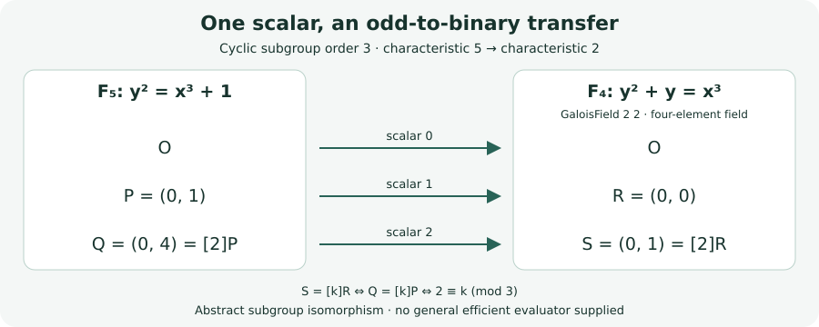
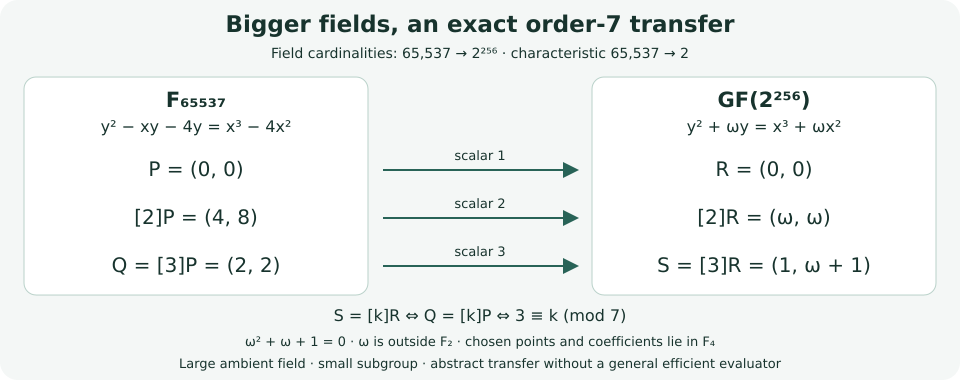
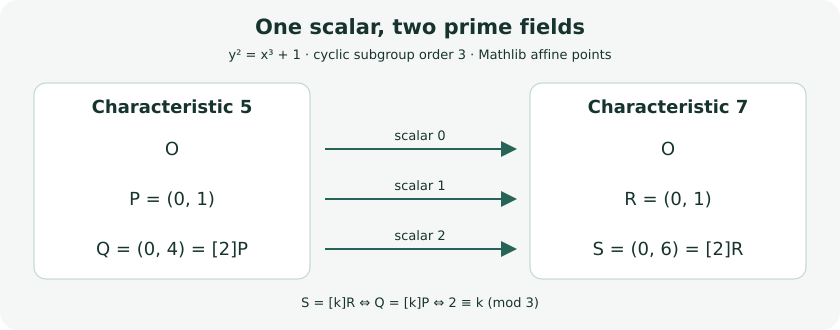

# Worked Lean example: cross-characteristic subgroup transfer

## Concrete cover route to a smaller, solvable target

The clarified request is now addressed by a concrete toy construction from
the order-seven subgroup over `F_65537` to a four-element binary field. The
degree-three covers have equations
`v²-u³v-4v=u⁹-4u⁶` and `v²+ωv=u⁹+ωu⁶`, with map `(u,v)↦(u³,v)`.
The common torsion-marked family supplies the cross-characteristic bridge;
cover then norm contributes multiplication by three. [pcc:unverified]

The resulting target generator is `(1,ω+1)`, and source challenge `(2,2)` maps
to `(ω,ω)`, preserving scalar `3 mod 7`. The seven-element target is solved
by enumeration. The source subgroup is also small; no large-order reduction,
GHS vulnerability, or computational advantage is claimed. [pcc:unverified]

- [Concrete construction and written geometric proof](COVER-CONSTRUCTION.md).
- [Lean module](CoverDecodeExample.lean), [formalization map](COVER-PROOF-MAP.md),
  [report](cover-report.html), [PDF](cover-report.pdf) and [diagram](cover-transfer.svg).
- [Fixed integral lift](CoverIntegralLift.lean): two ring specializations from
  `Z[z]/(z²+z+1)` with parameter `2+65537z`, and nonsingular reduced models.
- [New raw receipts](receipts/cover-20261115T2113Z/), including identity certificates.

Lean checks the fields, elliptic points, cubic affine maps, rank-three cover
algebras and concrete scalar transfer. Genus, Jacobian pull/push and divisor
specialization are covered by the written proof and remain outside the full
Lean formalization. The common seven-section lift is essential; the cover
alone does not change characteristic. [pcc:unverified]

## Earlier field-size examples

The examples cover three field pairs. The third increases both ambient field
sizes and the subgroup order; its order-7 subgroup remains small. [pcc:unverified]

| Example | Source field size | Target field size | Subgroup order |
| --- | --- | --- | --- |
| Prime-to-prime | 5 | 7 | 3 |
| Prime-to-binary | 5 | 4 | 3 |
| [Larger fields](CrossCharacteristicLarger.lean) | 65,537 | `2^256` | 7 |

## Prime-to-prime example

The curve `y² = x³ + 1` over `F_5` and over `F_7` has the order-three
generators `P = (0,1)` and `R = (0,1)`. This example uses Mathlib's existing
`addEquivOfAddOrderOfEq` constructor to obtain the subgroup isomorphism
`Φ([k]P) = [k]R`. [pcc:unverified]

| Scalar modulo 3 | Source over `F_5` | Target over `F_7` |
| --- | --- | --- |
| 0 | `O` | `O` |
| 1 | `P = (0,1)` | `R = (0,1)` |
| 2 | `Q = (0,4)` | `S = (0,6)` |

The module checks the complete table and its exhaustion of the source subgroup.
For every integer `k`, `S = [k]R ↔ Q = [k]P ↔ 2 ≡ k (mod 3)`.
It also checks that no unital field map `F_5 → F_7` exists. [pcc:unverified]

## Transfer into characteristic two

An even-characteristic field has characteristic 2; its finite cardinality is
`2^m`. The additional module [CrossCharacteristicTwo.lean](CrossCharacteristicTwo.lean)
uses the nonsingular model `y² + y = x³` over any characteristic-two field `K`.
It specializes to `F_4 = GaloisField 2 2`, with its cardinality checked in Lean.
The source curve and points over `F_5` are imported unchanged. [pcc:unverified]

| Scalar modulo 3 | Source: `y² = x³ + 1` over `F_5` | Target: `y² + y = x³` over `F_4` |
| --- | --- | --- |
| 0 | `O` | `O` |
| 1 | `P = (0,1)` | `R = (0,0)` |
| 2 | `Q = (0,4)` | `S = (0,1)` |

Both generators have order 3. For every integer `k`, the module checks
`S = [k]R ↔ Q = [k]P ↔ 2 ≡ k (mod 3)`. The binary points already lie in
the prime subfield and remain points over the genuine four-element field.
`ZMod 4` is not used as a field. [pcc:unverified]



Read the [binary report](binary-report.html), its [PDF](binary-report.pdf),
and the [versioned binary receipts](receipts/characteristic-two-20261115/).
The declaration-bound claim is `PCC-20261115-6a7830`; its local kernel check
is separate from the repository's unsigned PCC status. [pcc:unverified]

For a different source and binary target, the cyclic-subgroup constructor
requires equal generator orders. A chosen target curve need not contain a
subgroup of the required order. This example supplies those obligations for
order 3; it supplies no general efficient odd-to-binary point evaluator.
The earlier short equation must not simply be reduced modulo 2: it is singular
there, which is why the binary target has a different Weierstrass model.

## Larger ambient fields and order seven

The [larger module](CrossCharacteristicLarger.lean) uses the following literal
models and points. Here `ω` is a primitive cube root of unity in the binary
field, with `ω²+ω+1=0`; Lean checks that `ω` is outside the prime subfield.
The field cardinalities and exact generator orders are checked. [pcc:unverified]

| Object | Prime-field source | Binary-field target |
| --- | --- | --- |
| Field | `F_65537` | `GaloisField 2 256` |
| Equation | `y²-xy-4y=x³-4x²` | `y²+ωy=x³+ωx²` |
| Generator | `P=(0,0)` | `R=(0,0)` |
| Double | `(4,8)` | `(ω,ω)` |
| Challenge, scalar 3 | `Q=(2,2)` | `S=(1,ω+1)` |
| Generator order | 7 | 7 |

The endpoint is `S=[k]R ↔ Q=[k]P ↔ 3≡k (mod 7)` for every integer `k`.
Mathlib supplies the isomorphism from the concrete equal-order obligations.
The matching-source claim record is `PCC-20261115-53afbe`, unsigned pending
the repository's independent process. [pcc:unverified]



Read the [larger-field proof map](LARGER-PROOF-MAP.md), [report](larger-report.html),
[PDF](larger-report.pdf), and [new versioned receipts](receipts/larger-20261115T2025Z/).

Although the target has `2^256` elements, its curve coefficients and chosen
points lie in the four-element subfield generated by `ω`. The subgroup has
only 7 elements. This is a larger-field formal example, not a large-subgroup
ECDLP instance or a general efficient odd-to-binary evaluator. Increasing the
ambient field size alone does not increase this chosen subgroup's order.



## Read and reproduce

- [Lean source](CrossCharacteristicExample.lean): literal curve and point
  definitions, instance obligations, constructed map and scalar endpoints.
- [Binary Lean source](CrossCharacteristicTwo.lean): characteristic-two model,
  order-three obligations, field-cardinality check and scalar endpoint.
- [Larger Lean source](CrossCharacteristicLarger.lean): a target of cardinality
  `2^256`, a coefficient outside `F_2`, and new order-7 subgroup obligations.
- [Proof map and inheritance table](PROOF-MAP.md): exact hypotheses,
  Mathlib declarations, assembly probe and primary sources.
- [Report](report.html), [PDF](report.pdf) and editable [diagram](transfer.svg).
- [Gate receipts](receipts/) and [focused build output](build.log).

Lean is pinned to 4.24.0; mathlib is pinned to v4.24.0 and the exact
resolved revisions in `lake-manifest.json`. No new dependency is added to
the repository's Rust workspace.

```sh
cd examples/cross_characteristic_ecdlp
lake exe cache get
lake build
lake env lean AxiomAudit.lean
```

From the repository root, check every theorem with the existing gate:

```sh
tools/lean/proof-gate.sh examples/cross_characteristic_ecdlp
```

Mathlib's official alternate cache can be selected with `USE_FRO_CACHE=1`
if its default cache is unavailable. The raw receipts record the service
used in this environment. The gate audits transitive axioms, rather than
inferring proof status from a text scan.

The repository's artifact workflow manages PNGs through the local
`.artifacts.json`; editable SVGs and report PDFs remain in Git. Before
regenerating a report, hydrate the PNGs from the repository root:

```sh
python3 tools/artifacts/artifacts.py pull examples/cross_characteristic_ecdlp
```

Then, from this example directory, render with Pandoc and XeLaTeX (the PNG is
a 300 dpi render of `transfer.svg`):

```sh
pandoc report.html --from=html --pdf-engine=xelatex \
  -V mainfont="DejaVu Sans" -V papersize=a4 -V geometry:margin=17mm \
  -o report.pdf

pandoc binary-report.html --from=html --pdf-engine=xelatex \
  -V mainfont="DejaVu Sans" -V papersize=a4 -V geometry:margin=17mm \
  -o binary-report.pdf

pandoc larger-report.html --from=html --pdf-engine=xelatex \
  -V mainfont="DejaVu Sans" -V papersize=a4 -V geometry:margin=17mm \
  -o larger-report.pdf
```

## Scope

This is an instance of an abstract cyclic-group isomorphism. The Mathlib
constructor uses classical choice of scalar representatives; it does not
supply an efficient evaluator for general encoded curve points. The
transfer is not an algebraic isogeny or a coefficient base change.

The existing problem record
[`prime-field-chained-transfer-no-advantage.md`](../../problems/prime-field-chained-transfer-no-advantage.md)
retains its separate efficient-map obligation. No benchmark, cost estimate,
curve-search result or performance-dashboard row changes here. Existing
performance and curve-graph panels remain unchanged for that reason.

Sources checked (KB unavailable): the runtime has no KB tools and
`scripts/research-kb status` exits 127 for an absent executable. The fallback
review used the existing problem record and the pinned Mathlib primary
sources listed in the proof map. No novelty claim is made.
