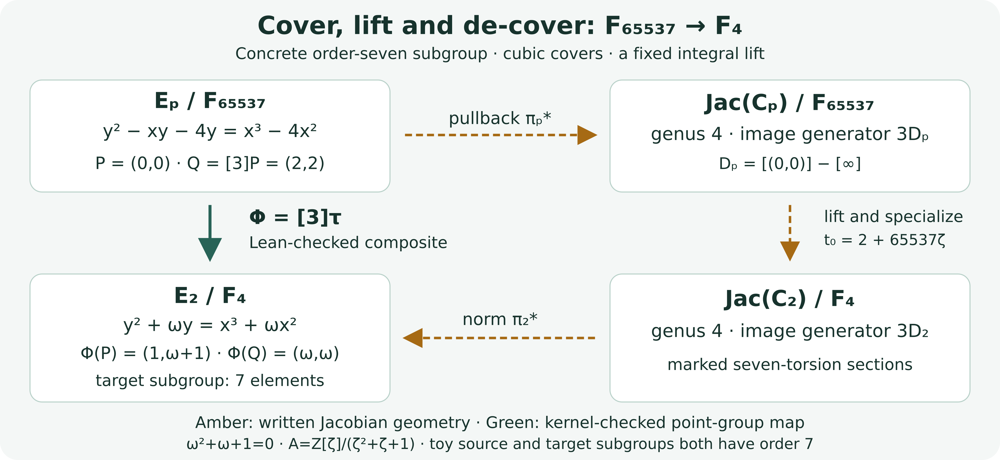

The construction transfers an order-seven subgroup from **a prime field with
65,537 elements** into **a binary field with four elements**, through a cubic
cover, a marked-section lift, and a norm. The target logarithm is recovered by
enumerating seven multiples. The source subgroup also has order seven: this is
a toy existence construction. [pcc:unverified]

{width=100%}

The source and target equations are

\[
E_p:y^2-xy-4y=x^3-4x^2,\qquad E_2:y^2+\omega y=x^3+\omega x^2,
\]

with $\omega^2+\omega+1=0$. The source generator is $P=(0,0)$ and its
challenge is $Q=(2,2)=[3]P$. The target generator is
$G=\Phi(P)=(1,\omega+1)$ and its challenge is $T=\Phi(Q)=(\omega,\omega)$.
For every integer $k$, the Lean endpoint checks

\[
T=[k]G\ \Longleftrightarrow\ Q=[k]P\ \Longleftrightarrow\ k\equiv3\pmod7.
\]

Both the chosen target generator and the source generator have exact order
seven. This is the requested “something weaker” alternative; no GHS
vulnerability or large-prime-order attack is claimed. [pcc:unverified]

\newpage

## The actual cover and the fixed lift

Put $b=t^3-t^2$, $c=t^2-t$. The common elliptic family and its cubic cover are

\[
\mathcal E_t:y^2+(1-c)xy-by=x^3-bx^2,
\qquad
\mathcal C_t:v^2+(1-c)u^3v-bv=u^9-bu^6.
\]

The map is $\pi_t(u,v)=(u^3,v)$. Its affine coordinate algebra is
$R_E[U]/(U^3-x)$, with a basis of length three checked in Lean. At $t=2$ it
gives the source above; at $t=\omega$ it gives the target. Use the fixed
integral model

\[
A=\mathbb Z[\zeta]/(\zeta^2+\zeta+1),\qquad t_0=2+65537\zeta.
\]

Its two ring specializations send $t_0$ to $2$ and $\omega$. The receiving
field on the 65537-side is $\mathbf F_{65537^2}$, but the reduced model and all
seven marked points descend to the original $\mathbf F_{65537}$. Both
specializations and their nonzero discriminants are checked in
`CoverIntegralLift.lean`. [pcc:unverified]

The marked section $(0,0)$ has multiples $(b,bc)$ and $(c,b-c)$ at scalars
two and three. The integer-polynomial relations
$b^2-bc-c^3=0$ and
$(t-1)(b-c-c^2)=2c^2-bc-b+c$, checked in Lean, give
$[2]([3]\mathcal P)=-\mathcal P$. Thus the seven marked sections provide
the cross-characteristic lift on the chosen subgroup. This lift is limited to
those seven sections; its existence does not supply an efficient lift for an
arbitrary large-order subgroup.

On either cubic cover, the ramification indices above $P$, $-P$ and $O$ are
three. Riemann–Hurwitz gives genus four. If $D=[(0,0)]-[\infty]$, then
$\pi^*(P-O)=3D$ and $\pi_*D=P-O$. Lift and specialize the seven multiples of
$3D$ through the fixed model, then apply the target norm. The result is
$\Phi=[3]\tau$, where $\tau([n]P)=[n]R$. Since $3$ is invertible modulo $7$,
the norm retains the subgroup. These genus, Jacobian and specialization steps
are the written geometric proof; the full Jacobian functor is not formalized
in this project. [pcc:unverified]

## Verification and scope

Lean checks the field cardinalities, actual elliptic points, orders, finite-free
cubic cover algebras, affine cover equations, common integral-model ring maps,
the scalar homomorphism and its seven-row table. Raw proof receipts and four
`identity.certificate/v1` records are retained. Claims `PCC-20261115-1148a8`
and `PCC-20261115-97a477` remain unsigned pending the repository's independent
process. [pcc:unverified]

The full seven-row coordinate table, geometric derivation and formalization
map are in [COVER-CONSTRUCTION.md](COVER-CONSTRUCTION.md) and
[COVER-PROOF-MAP.md](COVER-PROOF-MAP.md). Source modules are
[CoverDecodeExample.lean](CoverDecodeExample.lean) and
[CoverIntegralLift.lean](CoverIntegralLift.lean). The pinned environment is
Lean 4.24.0 / mathlib v4.24.0. Run `lake build` and
`lake env lean AxiomAudit.lean`; the unchanged repository proof gate audits the
complete example project. No performance measurement is reported.
