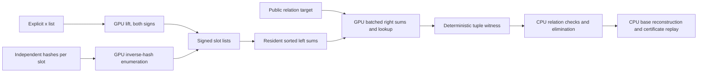

# Explicit bases and signed relation finding on CUDA

The service passed device validation on a RunPod RTX PRO 6000 Blackwell
Server Edition, compiled for `sm_120` with CUDA 13.2.51. Host and CUDA
arithmetic/base/relation tests, bounded reduction/replay, standalone Rust
tests, Clippy, and Compute Sanitizer memcheck passed (zero memory errors).
See [the validation record](VALIDATION.md) for revisions, outcomes and limits;
no end-to-end speedup is established.

The [v11 scaling panel](../../research/explicit_relations_e2e_20261030/reports/run-20261030T1550Z/report.typ)
completed both fixed 62-bit targets with exact 12-byte rows, a wide prefix
index and queried CUB sort scratch. All 12 prescribed executions passed fresh
CPU replay and scalar-corruption rejection. The measured source is
`d44b59149f468357e86186f956ecb7e323f38915`; later source is not an exact replay.
The current 63-bit arithmetic extension and optional negative prefilter are
implemented but still pending GPU validation. See [FIELD63.md](FIELD63.md),
[NEGATIVE-FILTER.md](NEGATIVE-FILTER.md) and the separately frozen
[v15 plan](../../research/explicit_relations_e2e_20261030/FILTER-PANEL.md).

Block normalization now uses a product tree with 765 source-level field
multiplications per 256-lane block, replacing 4608 in the previous dual scan
(both still pay one inversion and the same affine conversions). A matched
RTX PRO 6000 panel retained the old implementation, NVIDIA CUB BlockScan and
an A/A control. See [the complete diagnostic report](../../research/explicit_relations_perf_20261030/RESULTS.md)
for raw timings, exact equality checks and limits: the normalization kernel
had lower observed medians, but no end-to-end speedup is established.

`service.cpp` builds as either a CUDA service or a host reference. The service
stays alive across queries. `paper_driver.rs` plugs it into the repository's
`hashed_ecdl` reduction: the GPU constructs signed hash bases and finds
relations; the CPU collects rows, eliminates them, extracts the scalar and
independently reconstructs the bases and verifies the certificate. The default
CPU oracle remains available through the library.



This is an exact generic meet-in-the-middle backend for the paper's relation
problem. It does not implement the compact Boolean tensor encoder or the
claimed fast tensor contraction algorithm. It therefore makes no
subexponential or measured speed claim. See the
[input contract and source review](../../docs/ecbench/explicit-bases.md).

## Domain and representation

The native CUDA service accepts nonsingular short-Weierstrass curves with
prime `5 <= p < 2^63`, validated by deterministic u64 Miller-Rabin. The wider
source domain is distinct from the validated 62-bit frontier above. Inputs
are canonical `(x,y)` pairs. Infinity is permitted only as a target or sum.
It is a distinct full point key, not a special x value. The service finds
relations in the full curve group and does not assert prime order or cofactor
one. Binary fields and 256-bit fields are outside this service's scope.

The hash-construction mode requires `p < 2^63`, prime `2p <= s <= 4p` with `s`
representable as a u64,
`0 < alpha < s`, `beta < s`, and `0 < tau <= s`. It enumerates
`z = alpha^-1 (t-beta) mod s` for `0 <= t < tau`, discards `z >= 2p`,
and lifts `x=z/2` with y parity `z mod 2`. It never closes signed hash bases
under negation. Every `(slot, point)` remains a distinct matrix column.

The Rust reduction retains its original exhaustive tiny-curve constructor
and 512-column default. The standalone driver now uses an exact order witness:
prime `5 <= p < 2^63`, prime `r < 2^63`, a nonzero on-curve P with `[r]P=O`,
and a unique multiple of r in the integer Hasse interval. Ambiguous large
orders are rejected. Tonelli–Shanks avoids an O(p) root table. There are 2–8
slots; explicit limits allow up to 16384 columns and 2^24 hash candidates.
The driver accepts public affine P/Q and emits an independently replayable
certificate. These are implementation limits, not demonstrated scale claims.

## Implementation choices intended to reduce GPU work

- Reuse the repository's one-word Montgomery field arithmetic.
- Lift each explicit x once and form its other sign by negation.
- Use Jacobian tuple sums and normalize a block of 256 sums with one
  inversion. Zero Z contributes one to the prefix/suffix products, so
  exceptional and padded lanes participate in every barrier.
- Pick a contiguous slot split minimizing `left_rows + right_rows` subject
  to the left table cap. Sort full `(infinity,x,y,tuple_id)` keys on device.
- Keep the left table resident across targets from the same bases. The Rust
  adapter sends bases only when their exact contents change.
- Optional `cuda-cached` builds reuse two contiguous right-side partial-sum
  tables when each fits the explicit chunk bound; otherwise they use direct
  tuple construction. At most `2*chunk_rows*sizeof(Point)` extra storage is
  charged to admission and cold setup. Enable with `ER_QUERY_CACHED`;
  `ER_QUERY_UNCACHED_REFERENCE` overrides it for comparisons. The ordinary
  `cuda` build retains uncached indexed search: the matched v5 52-bit cases
  did not show a timing gain from caching. Both paths preserve exact results.
- Stream right tuples in capped batches. Probe the sorted left table on the
  device; return only witness indices. Large tables use at most 65537 u64
  prefix offsets to restrict full-key binary search to one high-x-bit bucket.
  Index setup and storage count toward cold preparation and memory admission;
  `ER_QUERY_BINARY_REFERENCE` retains the unindexed path. Infinity uses the
  full table. Preserve duplicate sums and select
  the minimum right ID, then minimum matching left ID, deterministically.
- Check tuple products, grid bounds, explicit row caps, a conservative GPU
  allocation reserve, every CUDA error, every returned index and point sum.

These are source-level optimizations, not speed measurements. Sorting and
global-memory traffic may dominate; the scan and register costs need device
profiling. The right search is exponential in the number of slots. The native
service emits visited-row diagnostics to stderr, not a complete operation
ledger or GAE estimate. An empty result is returned only after full search;
limits, CUDA failures and malformed inputs return `ERROR` and terminate.

## Build and correctness checks on the builder

The standalone driver requires Rust 1.88 or later. For the RTX PRO 6000
Blackwell, use CUDA with `sm_120` support:

```sh
make host                  # small C++/Rust reference executables
make test                  # host arithmetic, protocol driver and reduction
make all ARCH=sm_120        # select the actual GPU architecture
make test-cuda ARCH=sm_120   # exercises default and optional cached variants
make cuda-cached ARCH=sm_120 # optional build/explicit-relations-cached service
make cuda-dense-cub ARCH=sm_120 build/paper-driver # large-table configuration used by v11
compute-sanitizer --tool memcheck build/explicit-relations-cuda --self-test
compute-sanitizer --tool racecheck build/explicit-relations-cuda --self-test
compute-sanitizer --tool synccheck build/explicit-relations-cuda --self-test
```

These commands belong on the GPU builder; they are not instructions to build
the root crypto package in a constrained workspace. `cuda-dense-cub` produces
`build/explicit-relations-dense-cub`, which can be passed as `SERVICE` below.
For an exact historical panel, check out its recorded commit and use its
frozen launcher. The newer `cuda-persistent`, `cuda-right-cache` and
`cuda-filter` targets are distinct configurations, not automatic substitutes.

`make syntax` produces no executable. The complete small fixture fields are
97 and 211; their equations are `y²=x³+2x+3` and `y²=x³+7`, respectively. The paper
driver fixture uses the latter's order-199 full group and generator `(3,33)`.
They are public software fixtures, not benchmark results or deployed curves.
Separate boundary fixtures exercise the wider arithmetic domain; those tests
do not by themselves establish a complete recovery at that size.

The C++ test compares every affine target and infinity, validates hashes
against a complete point scan, tests both square-root congruence classes,
zero-y points, duplicate sums across slots, empty lists, work exhaustion and
257-row chunks. The Rust test compares existence against the original
enumeration oracle for every target of the order-199 group, checks repeatable
witnesses and GPU hash inventories, and exercises complete two-/three-slot
recovery and serialized certificate replay.

## Complete bounded paper reduction

```text
paper-driver SERVICE p a b r Px Py Qx Qy m tau seed max_rows chunk_rows [max_columns max_work max_trials]
paper-driver --verify CERTIFICATE
```

`SERVICE` is the path to `build/explicit-relations-cuda` (or the host
reference). The CLI accepts public P and Q, never the target scalar. Capture
stdout as the certificate and stderr as diagnostic logs. `--verify` needs
neither a CUDA device nor a relation-service process. It parses the versioned
certificate and runs the original CPU verifier, including reconstruction of
all bases, membership, each relation, dependency, nonzero extraction
denominator and `[scalar]P=Q`. The receipt counters are execution diagnostics,
not attestations of discarded trial history.

The default reduction caps remain 16 trials and 1,000,000 work rows per
query. Here the work bound is `left_rows + right_rows`, conservatively including
the reusable left side on each query. It is not comparable to the original
oracle's first-`m-1` tuple bound. The independent verifier always uses the
CPU enumeration law; it does not ask the GPU to verify itself.

## Native persistent protocol (version 1)

One command per line, whitespace-separated unsigned decimal or `0x` words;
response lines are flushed. Use a dedicated service process per curve.

| Command | Meaning / response |
| --- | --- |
| `curve p a b max_rows chunk_rows` | Required first; `READY 1`. Caps in `1..2^32`, chunk no larger than cap. Actual allocations remain subject to memory admission. |
| `xs n x0 ...` | Strict distinct x list, `n <= max_rows/2`; `BASE npoints x y ...`, sorted by full coordinates, both signs. A missing lift is an error. |
| `hash s alpha beta tau` | Signed base construction, `tau <= max_rows`; same `BASE` response, possibly empty. |
| `bases m n0 x y ... n1 x y ...` | 2–8 sorted, distinct signed point lists; `PREPARED split left_rows right_rows`. Empty slot lists are allowed and certify no relation. |
| `find inf x y max_work` | For infinity use `1 0 0`; otherwise `0 x y`. `FOUND m i0 ...` or exhaustive `NONE`. |
| `quit` | Exit normally. |

Example protocol input on a public fixture (expected semantics; not an
executed receipt):

```text
curve 211 0 7 100000 257
xs 1 3
hash 431 17 23 160
bases 2 2 3 33 3 178 2 3 33 3 178
find 1 0 0 100000
quit
```

`xs` and `hash` emit inventories; `bases` explicitly selects the slot lists
used by subsequent queries. Hashes from the paper driver automatically take
that path. In ecbench, arbitrary x lists use `explicit-x:xs=...`; its plugin
and CPU cost ledger do not silently invoke this external CUDA service.

## Delivery and evidence boundary

Use the validation record to distinguish source checks from device tests. Record
the commit, source/binary hashes, CUDA/driver/compiler versions and actual GPU.
For EKS, build an image from the resulting `crypto/main` commit, retaining its
digest. Frozen diagnostic panels and the bounded full-recovery ladder are
linked from the validation record and research studies. Their shared RunPod
wall clocks are L0 observations, not certified speedups. The separate `crates/hashed-ecdl-tensor` implementation on main remains
CPU code; this GPU service accelerates the bounded meet-in-the-middle path.
The standalone Cargo manifest resolves that crate because the included
reference module re-exports it, without building the root crypto package.

### Replaying the scaling studies

The frozen `research/explicit_relations_e2e_20261030/run*.sh` instruments must
be run from their recorded source commits. In particular, v5 measured caching
as the candidate default on f6338418572c72e1bf97ad24903cd5efd17cf7da. After its
matched 52-bit rows showed no gain, the normal build selected the uncached
path and the same cache implementation became the explicit `cuda-cached`
option. Do not run historical scripts against a different source revision
and label the result a replay. V5 completed nine recoveries and one timeout;
its exact records remain pinned to that source.

### Exact compact table (opt-in)

`make cuda-compact ARCH=sm_120` builds `build/explicit-relations-compact`
with `ER_COMPACT_ROWS`. It retains an exact x/parity key plus the original
64-bit tuple ID in a 16-byte row, preserving signed points, infinity and the
minimum matching tuple ID. This is exact point compression on a fixed,
validated prime-field curve, not a probabilistic hash. Partial-sum caching
remains disabled in this variant. Admission charges three buffers of the
actual row size; cold execution includes conversion, sorting and indexing.
The matched panel and larger-field limits are frozen in
[`protocol-v7.json`](../../research/explicit_relations_e2e_20261030/protocol-v7.json).
V6 passed GPU preflight but failed its first service header. The corrected v7
panel completed both 58-bit targets and retained two 60-bit timeouts; all
preflight and query sanitizers passed. See the [raw export](../../research/explicit_relations_e2e_20261030/results-v7/export.json).
Both attempts are retained, and shared-host timings remain L0 diagnostics.

### Wider prefix index (opt-in, device validated)

`make cuda-wide-index ARCH=sm_120` builds `build/explicit-relations-wide-index`
with exact compact rows and `ER_WIDE_INDEX`. It permits up to 2^24 buckets
instead of 2^16, still limiting bucket count to one per 32 left rows and
to the field's coordinate bits. The largest offset array costs 128 MiB
plus one u64. Setup and actual storage remain charged to cold execution
and memory admission. Infinity, full keys and lowest duplicate IDs retain
the same semantics. The separately frozen [v8 panel](../../research/explicit_relations_e2e_20261030/protocol-v8.json)
compares both ceilings at 52 bits before probing larger complete recoveries.
The completed panel records 12/12 verified recoveries through both 60-bit
targets, including fresh CPU replay and negative controls. Cold solve times
at 60 bits are 770.270416 and 845.179937 seconds, with all three query
sanitizers passing. See the [complete report](../../research/explicit_relations_e2e_20261030/RESULTS.md)
and [v8 export](../../research/explicit_relations_e2e_20261030/results-v8/export.json).
The default remains the existing index; wider indexing is explicitly selected.

See [checked wider hashing](WIDE-HASH.md), [exact dense rows and queried sort scratch](DENSE-ROWS.md), and the [experimental GPU-resident query](PERSISTENT-QUERY.md) for their distinct validation status.
