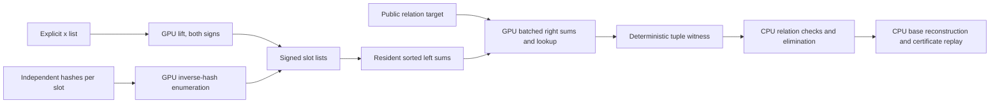

# Explicit bases and signed relation finding on CUDA

Source implementation; **not compiled or run on a GPU in this change**.
The native host implementation passes a syntax-only compiler check. Rust
formatting parses the driver and library additions. Executable correctness
tests and performance checks remain pending.

`service.cpp` builds as either a CUDA service or a host reference. The service
stays alive across queries. `paper_driver.rs` plugs it into the repository's
`hashed_ecdl` reduction: the GPU constructs signed hash bases and finds
relations; the CPU collects rows, eliminates them, extracts the scalar and
independently reconstructs the bases and verifies the certificate. The default
CPU oracle remains available through the library.



This is an exact generic meet-in-the-middle backend for the paper's relation
problem. It does not implement the compact Boolean tensor encoder or the
claimed fast tensor contraction algorithm. It therefore makes no
subexponential or measured speed claim. See the
[input contract and source review](../../docs/ecbench/explicit-bases.md).

## Domain and representation

The native CUDA service accepts nonsingular short-Weierstrass curves with
prime `5 <= p < 2^62`, validated by deterministic u64 Miller-Rabin. Inputs
are canonical `(x,y)` pairs. Infinity is permitted only as a target or sum.
It is a distinct full point key, not a special x value. The service finds
relations in the full curve group and does not assert prime order or cofactor
one. Binary fields and 256-bit fields are outside this service's scope.

The hash-construction mode requires `p < 2^60`, prime `2p <= s <= 4p`,
`0 < alpha < s`, `beta < s`, and `0 < tau <= s`. It enumerates
`z = alpha^-1 (t-beta) mod s` for `0 <= t < tau`, discards `z >= 2p`,
and lifts `x=z/2` with y parity `z mod 2`. It never closes signed hash bases
under negation. Every `(slot, point)` remains a distinct matrix column.

The existing Rust reduction retains its stricter bounds: `p <= 65521`, exact
prime full group cardinality, cofactor one, 2–8 slots, at most 512 dense
columns. This driver supports public nonidentity affine generator/target
inputs and outputs a complete, independently replayable certificate.

## Implementation choices intended to reduce GPU work

- Reuse the repository's one-word Montgomery field arithmetic.
- Lift each explicit x once and form its other sign by negation.
- Use Jacobian tuple sums and normalize a block of 256 sums with one
  inversion. Zero Z contributes one to the prefix/suffix products, so
  exceptional and padded lanes participate in every barrier.
- Pick a contiguous slot split minimizing `left_rows + right_rows` subject
  to the left table cap. Sort full `(infinity,x,y,tuple_id)` keys on device.
- Keep the left table resident across targets from the same bases. The Rust
  adapter sends bases only when their exact contents change.
- Stream right tuples in capped batches. Probe the sorted left table on the
  device; return only witness indices. Preserve duplicate sums and select
  the minimum right ID, then minimum matching left ID, deterministically.
- Check tuple products, grid bounds, explicit row caps, a conservative GPU
  allocation reserve, every CUDA error, every returned index and point sum.

These are source-level optimizations, not speed measurements. Sorting and
global-memory traffic may dominate; the scan and register costs need device
profiling. The right search is exponential in the number of slots. The native
service emits visited-row diagnostics to stderr, not a complete operation
ledger or GAE estimate. An empty result is returned only after full search;
limits, CUDA failures and malformed inputs return `ERROR` and terminate.

## Build and correctness checks on the builder

```sh
make host                  # small C++/Rust reference executables
make test                  # host arithmetic, protocol driver and reduction
make all ARCH=sm_80         # select the actual GPU architecture
make test-cuda ARCH=sm_80
compute-sanitizer --tool memcheck build/explicit-relations-cuda --self-test
compute-sanitizer --tool racecheck build/explicit-relations-cuda --self-test
compute-sanitizer --tool synccheck build/explicit-relations-cuda --self-test
```

`make syntax` produces no executable. The test fixture fields are 97 and
211; their equations are `y²=x³+2x+3` and `y²=x³+7`, respectively. The paper
driver fixture uses the latter's order-199 full group and generator `(3,33)`.
They are public software fixtures, not benchmark results or deployed curves.

The C++ test compares every affine target and infinity, validates hashes
against a complete point scan, tests both square-root congruence classes,
zero-y points, duplicate sums across slots, empty lists, work exhaustion and
257-row chunks. The Rust test compares existence against the original
enumeration oracle for every target of the order-199 group, checks repeatable
witnesses and GPU hash inventories, and exercises complete two-/three-slot
recovery and serialized certificate replay.

## Complete bounded paper reduction

```text
paper-driver SERVICE p a b r Px Py Qx Qy m tau seed max_rows chunk_rows
paper-driver --verify CERTIFICATE
```

`SERVICE` is the path to `build/explicit-relations-cuda` (or the host
reference). The CLI accepts public P and Q, never the target scalar. Capture
stdout as the certificate and stderr as diagnostic logs. `--verify` needs
neither a CUDA device nor a relation-service process. It parses the versioned
certificate and runs the original CPU verifier, including reconstruction of
all bases, membership, each relation, dependency, nonzero extraction
denominator and `[scalar]P=Q`. The receipt counters are execution diagnostics,
not attestations of discarded trial history.

The default reduction caps remain 16 trials and 1,000,000 work rows per
query. Here the work bound is `left_rows + right_rows`, conservatively including
the reusable left side on each query. It is not comparable to the original
oracle's first-`m-1` tuple bound. The independent verifier always uses the
CPU enumeration law; it does not ask the GPU to verify itself.

## Native persistent protocol (version 1)

One command per line, whitespace-separated unsigned decimal or `0x` words;
response lines are flushed. Use a dedicated service process per curve.

| Command | Meaning / response |
| --- | --- |
| `curve p a b max_rows chunk_rows` | Required first; `READY 1`. Caps in `1..2^30`, chunk no larger than cap. |
| `xs n x0 ...` | Strict distinct x list, `n <= max_rows/2`; `BASE npoints x y ...`, sorted by full coordinates, both signs. A missing lift is an error. |
| `hash s alpha beta tau` | Signed base construction, `tau <= max_rows`; same `BASE` response, possibly empty. |
| `bases m n0 x y ... n1 x y ...` | 2–8 sorted, distinct signed point lists; `PREPARED split left_rows right_rows`. Empty slot lists are allowed and certify no relation. |
| `find inf x y max_work` | For infinity use `1 0 0`; otherwise `0 x y`. `FOUND m i0 ...` or exhaustive `NONE`. |
| `quit` | Exit normally. |

Example protocol input on a public fixture (expected semantics; not an
executed receipt):

```text
curve 211 0 7 100000 257
xs 1 3
hash 431 17 23 160
bases 2 2 3 33 3 178 2 3 33 3 178
find 1 0 0 100000
quit
```

`xs` and `hash` emit inventories; `bases` explicitly selects the slot lists
used by subsequent queries. Hashes from the paper driver automatically take
that path. In ecbench, arbitrary x lists use `explicit-x:xs=...`; its plugin
and CPU cost ledger do not silently invoke this external CUDA service.

## Delivery and evidence boundary

Use the validation record to distinguish source checks from device tests. Record
the commit, source/binary hashes, CUDA/driver/compiler versions and actual GPU.
For EKS, build an image from the resulting `crypto/main` commit, retaining its
digest. No benchmark protocol was frozen and no performance comparison was
run. The separate `crates/hashed-ecdl-tensor` implementation on main remains
CPU code; this GPU service accelerates the bounded meet-in-the-middle path.
The standalone Cargo manifest resolves that crate because the included
reference module re-exports it, without building the root crypto package.
