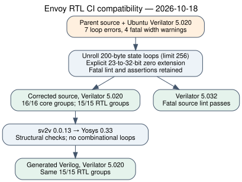

# Envoy RTL CI compatibility follow-up

Run batch: `envoy-fpga-20261018-ci-compat`, extending parent commit
`e6369b99328ab2b6ee301679c133691000c1f31a` on
[PR #2122](https://github.com/aburan28/crypto/pull/2122).

Ubuntu 24.04's Verilator 5.020 rejected the SHAKE array-copy/erase loops and
reported four width warnings at the NTT multiplier inputs. Earlier successful
local validation used 5.032 and did not establish compatibility with 5.020.
Both failing CI jobs and a local reproduction are identified in the
[receipt](../../receipts/2026-10-18-ci-compat/README.md). The new raw archive
and detailed run manifest remain local pending approval for this new upload;
the earlier approved evidence remains available and unchanged.



The Makefile now raises the static unrolling limit to 256, and the NTT uses
explicit zero-extension on each conditional operand. Source fatal `-Wall`,
assertions, randomized initialization, independent oracles and synthesis
structural checks remain enabled. No test, warning category or merge gate is
disabled. The workflow prints versions so its environment is visible.

| Requested follow-up | Evidence and status |
|---|---|
| Reproduce the new module CI failure | Complete: unchanged parent, same 7 errors and 4 warnings under Verilator 5.020 |
| Correct and validate compatibility | Local checks complete: core 16/16, source RTL 15/15, same 15/15 replayed after Yosys 0.33 synthesis |
| Retain compatibility with the original local frontend | Verilator 5.032 fatal source lint passes; full simulation was not repeated with this version |
| Inspect reviews and remaining gates | No submitted reviews or inline threads at the initial snapshot; Bugbot/approval agent neutral due usage limits; new-head CI remains a separate gate |
| Full FPGA crypto/F2 system | Remains partial; this change completes no algorithm controller, F2 deployment or speed measurement |

The validation host was Debian 13, GCC 14.2.0 and OpenSSL 3.5.7. Verilator
5.020 and Yosys 0.33 came from the Ubuntu packages used by the failed CI jobs;
sv2v was 0.0.13. This reproduces the RTL tool versions, not the entire hosted
runner. All tests use public deterministic fixtures, source seed
`0x4650433252544c`, and the existing independent oracles. The second RTL result
is a replay of the same cases, not 30 independent specifications or a formal
equivalence proof. The diagram shows validation stages because no comparable
cryptographic timing samples were measured.

The required root Rust command still failed before tests with 26 errors in
unchanged sources. The separate `parse` job failed on duplicate keys in
existing CodeQL/curve workflows, and `names` failed on existing curve-registry
inputs. None is in this PR's changed paths; those files remain untouched.
Their public job links are in the receipt. Local setup failures from relocating
the Ubuntu packages and invoking actionlint in the wrong directory are
retained locally; the corrected actionlint invocation passed. No remote failure has
been claimed resolved by the local result.

The earlier report, receipt archive and frozen detailed manifest are unchanged.
No optional liboqs/BoringSSL/live-Envoy suites were rerun. The original system
still needs complete hardware algorithms, entropy/key custody, FPC1 dispatch,
F2/AFI integration, physical resource/timing and side-channel validation,
actual device tests and measured CPU/FPGA comparisons. This report makes no
performance, production-readiness or comprehensive scheme-coverage claim.
Existing architecture diagrams, index-calculus scoreboards and timing charts
are unchanged because this compatibility fix adds no result to those plots.

The [summary manifest](../../receipts/2026-10-18-ci-compat/manifest.json)
identifies current project files, aggregate outcomes, tool packages and the
hashes of the local raw archive and frozen detailed manifest. The detailed
manifest identifies the execution-era report snapshot; the summary includes
the subsequent publication wording and PDF changes. Run the same
validation from the module directory with `make test lint-rtl test-rtl
test-rtl-synth`. The independent kernel contracts and algorithm references
remain in [the kernel guide](../../rtl-kernels.md).

Render the [PDF](report.pdf) and diagram here with:

```sh
dot -Tsvg flow.dot -o flow.svg
dot -Tpdf flow.dot -o flow.pdf
mkdir -p /tmp/envoy-ci-report
pdflatex -halt-on-error -interaction=nonstopmode -output-directory=/tmp/envoy-ci-report report.tex
pdflatex -halt-on-error -interaction=nonstopmode -output-directory=/tmp/envoy-ci-report report.tex
cp /tmp/envoy-ci-report/report.pdf report.pdf
```
