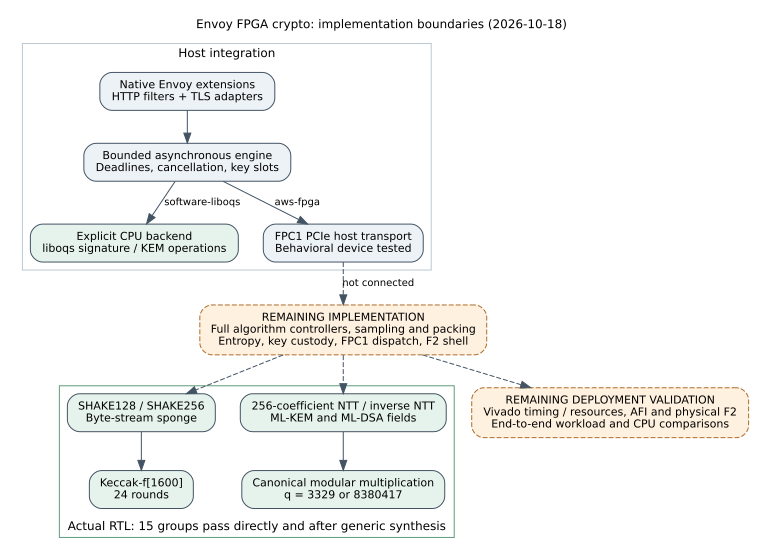

# Envoy FPGA crypto implementation and validation report

Run batch: `envoy-fpga-20261018-rtl-live`. This is a functional implementation
report, with no throughput or CPU/FPGA speed comparison. It extends the source
import in commit `3c81607c87c4b896e78a49eb6b7f252c0131a96e` on PR
[#2122](https://github.com/aburan28/crypto/pull/2122). The
[receipt manifest](../../receipts/2026-10-18/manifest.json) identifies the final
source files and aggregate outcomes. The owner-approved
[raw archive](../../receipts/2026-10-18/runs.tar.xz) and
[detailed run manifest](../../receipts/2026-10-18/run-manifest.json) preserve
the original validation batch exactly. The detailed manifest identifies the
execution-era snapshot; the summary manifest includes the subsequent
documentation and PDF publication updates.



The solid arrows describe implemented connections. Dashed arrows identify
missing implementation or deployment validation. The diagram is explanatory:
the test-group counts are functional outcomes, not comparable performance
samples. Consequently no timing or speedup graph is plotted.

## Requested scope and current evidence

The user's scope remains Envoy offload of classical and post-quantum
cryptographic operations on AWS F2, including ML-DSA, ML-KEM and the broader
signature/KEM catalog. This iteration adds hardware building blocks and checks
the linked Envoy boundary. It does not complete that overall system.

| Requirement | Status and evidence |
|---|---|
| Native host integration and software PQ backend | Existing implementation; 36 core/TLS/PQ groups passed again |
| Linked Envoy and live PQ HTTP requests | Complete within the CPU test scope: minimal executable linked and 5/5 groups passed |
| Hardware Keccak/SHAKE and module-lattice arithmetic | Implemented and functionally verified in source RTL and generic synthesis replay |
| Complete hardware signature/KEM commands | Partial: arithmetic/hash kernels exist; controllers and other algorithm steps remain |
| Classical hardware cryptography | Host interfaces and behavioral tests exist; complete classical RTL is absent |
| All post-quantum schemes | Partial: pinned liboqs catalog provides explicit stateless CPU modes; final FN-DSA, stateful LMS/XMSS and comprehensive FPGA scheme coverage are absent |
| F2 bitstream, device operation and measured acceleration | Not implemented or measured; no Vivado, attached F2 device or AWS identity |

TLS KEM key shares remain BoringSSL CPU work. No key-share offload hook has
been added; the private-key provider's signing callback does not cover KEMs.

## Observations

- Source RTL: fatal Verilator lint passed and 15/15 native C++ groups passed.
- Generic synthesis: sv2v/Yosys completed; structural checks found no problems
  or combinational loops. No runtime division, modulo or latch cells remained.
- The generated Verilog passed the same 15/15 external test groups. This is
  a second representation of the same cases, not 30 independent specifications
  or a formal equivalence proof.
- The 14,953-cell generic hierarchy is not an FPGA utilization measurement.
  Writable arrays were lowered to registers. No clock frequency, DSP/BRAM use,
  placement, power, masking or side-channel result is established.
- The required root Rust library check failed before tests with 26 compilation
  errors in unchanged source files. The extension's 36 functional regression
  groups passed separately.
- The linked Envoy process passed 5/5 HTTP groups: routing, ML-DSA-65 with
  independent BoringSSL verification, contexts and a 256 KiB message,
  ML-KEM-768 interoperability in both directions, rejection and erasure.
  This uses the explicit CPU backend. Actual Envoy TLS/F2 listeners and the
  default full extension selection were not exercised.
- Local actionlint 1.7.7 accepted the new scoped workflow. The workflow runs
  core tests and both RTL representations; it excludes optional linked Envoy,
  BoringSSL and liboqs checks.

All fixtures are public. Native C++ test code uses seed
`0x4650433252544c`; register initialization is randomized with a fixed
simulation seed. The SHAKE oracle is OpenSSL, and the NTT oracles are direct
polynomial evaluation/interpolation and schoolbook negacyclic convolution.
Pointwise/base multiplication in the product tests is C++ oracle code,
not another hardware operation.

## Failures and limits retained

The original object-only Envoy check did not execute registration. It missed
a startup collision because both HTTP factories returned the same generic
`google.protobuf.Struct` configuration type. The filters now return distinct
`FpgaHttp` and `PqHttp` messages from `config.proto`, and their examples use the
new type URLs. This corrects the earlier registration claim: compilation alone
did not verify startup.

The first linked HTTP run passed 2/5 groups because the harness required a
content type on empty acknowledgments. Envoy removes that header on empty
local replies. Correcting the harness to that contract gave 5/5, with no
production filter change; required content types for nonempty data, status,
body, cache control and backend-label checks remain. This failed run is retained.

Early source lint caught width and unused-signal issues. An initial generated
C++ build rejected vendor runtime warnings under this project's strict C++
settings; vendor-generated code now uses its compatible settings while source
RTL retains fatal `-Wall`. Early synthesis replay attempts failed on generated
netlist warnings, one concurrently edited script, and a generated model whose
compilation was killed after excessive memory use. The script is now copied
before execution; byte-addressed SHAKE storage avoids the oversized variable
write-update model. The final source and synthesis replay both pass.

The receipt retains these failures alongside successful logs. Failed attempts
used intermediate working sources, not the final source hash set. The
receipt does not retain those intermediate source snapshots or exact initial
standalone lint commands; it does retain final sources and reproduction
commands. The host was a shared Linux x86-64 workspace with four CPU quota
cores and a 16 GiB
memory ceiling, not an isolated benchmark host. No algorithm runtime,
distribution or speedup was measured; build times are tooling diagnostics.

The existing index-calculus scoreboards, timeline, curve diagrams and
performance-gain charts are unaffected: this change provides no ECDLP finding,
curve identity, index-calculus measurement or performance result to add.
The architecture diagram is new and is kept with its editable Graphviz source
and the [rendered report](report.pdf).

## Reproduction and sources

See [validation commands](../../validation.md),
[RTL contracts and algorithm references](../../rtl-kernels.md), and
[raw receipts](../../receipts/2026-10-18/README.md). The original Oct 17
exhaustive 262-mode and sanitizer results remain historical evidence; they
were not rerun in this iteration.

Render the diagram and PDF from this directory:

```sh
dot -Tsvg architecture.dot -o architecture.svg
dot -Tpdf architecture.dot -o architecture.pdf
mkdir -p /tmp/envoy-report
pdflatex -halt-on-error -interaction=nonstopmode -output-directory=/tmp/envoy-report report.tex
pdflatex -halt-on-error -interaction=nonstopmode -output-directory=/tmp/envoy-report report.tex
cp /tmp/envoy-report/report.pdf report.pdf
```
