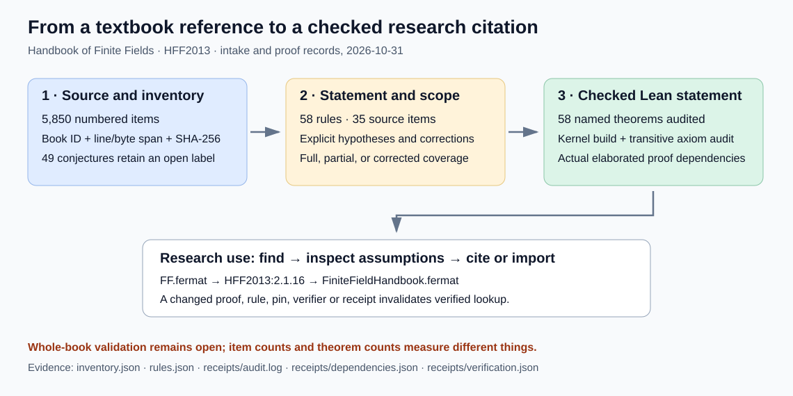

# Handbook intake and formal reference library — 2026-10-31

The supplied text has been ingested into a source-addressed inventory and a
working reference lookup tool. **58 Lean theorems pass kernel compilation
and a transitive axiom audit**, mapped to 35 numbered source items. The
whole-book validation and formalization requirement is **partial**.

## Requirements and actual coverage

| Requested deliverable | Status | Evidence or remaining obligation |
| --- | --- | --- |
| Ingest the supplied textbook | Verified mechanical intake | `source.json`, original text digest, ignored local original and `inventory.json` |
| Find all laws, rules and mathematical content | Partial | 5,850 recognized numbered items; unnumbered prose, tables, exercises and subclaims still need a semantic coverage review |
| Validate everything | Partial | 58 actual formal statements checked; editor corrections attached; the rest retain explicit unreviewed statuses |
| Turn the mathematics into Lean theorems | Partial | `lean/FiniteFieldHandbook.lean`, `rules.json`, printed types, axiom audit; whole-book proof implementation remains open |
| Make statements easy to reference in research | Verified local implementation | `kb search`, `show`, `cite`, proof-consumer examples and stale-receipt tests |
| Design knowledge-base integration | Implemented foundation and documented continuation | Stable source and rule IDs; assumptions; lexical retrieval; actual proof edges; plan to promote shared lemmas into CryptoLean |

The intake found 1,181 theorem labels, 169 propositions, 119 corollaries, 86
lemmas, 986 definitions, 2,808 remarks, 279 examples, 78 algorithms, 50
constructions, 49 conjectures and 45 problems. Those are label counts. An
item may contain many claims, and a remark can contain substantial
mathematics. A definition can be represented as a Lean definition or
structure, with its consequences proved, rather than being asserted true.

The source has 2,907,339 bytes and 67,837 logical lines (67,836 newline
characters). SHA-256:
`860cd68078087e791edce1e8a7f3a1d9315848cfd99e0c9ca2b673527efe8bf7`.
Recognized numbered items run through chapters 2–17; the historical prose
in chapter 1 remains part of the pending semantic review. The inventory
stores each item's exact bytes and line coordinates and a hash of that
span. It retains reference candidates and derived search terms. Source text
stays locally available without committing the complete book.

The full derived inventory remains local under the artifact-store policy.
The artifact tool's access check returned 403; an additional immutable
PutObject attempt returned AccessDenied. `PUBLICATION.json` records the
catalogue's exact identity and the publication gap. No remote object or
artifact manifest is claimed. A fresh checkout can regenerate the inventory
from the original supplied text with the native intake command. The editable
SVG and inspected PDF are committed; PNGs are local previews. Catalogue
publication remains blocked until the authorized store is accessible.

## Sources checked and method

Before implementation, checked the latest dated repository session log,
`tools/lean/README.md`, the repository axiom auditor, and the shared
CryptoLean README and design. The shared pin is Lean 4.35.0 and Mathlib
`cfc55fc58714a59dc06e6e79edc6d1d95140d3c2`; the new project uses that pin.
The design reuses actual Mathlib field, algebra, polynomial, trace, norm,
basis and Galois-group structures. It does not replace them with custom
operation-only abstractions.

Primary external sources checked:

- Editors' book page: <https://people.math.carleton.ca/~daniel/hff/>.
- Editors' errata: <https://people.math.carleton.ca/~daniel/hff/errata.html>.
- Mathlib finite-field documentation:
  <https://leanprover-community.github.io/mathlib4_docs/Mathlib/FieldTheory/Finite/Basic.html>.
- Lean proposition documentation:
  <https://lean-lang.org/doc/reference/latest/The-Type-System/Propositions/>.

Read the supplied source spans for each mapped rule and the corresponding
pinned Mathlib implementations, particularly `FieldTheory/Finite/Basic`,
`GaloisField`, `Trace`, `Extension`, `FieldTheory/Galois/NormalBasis`,
`RingTheory/LittleWedderburn`, `RingTheory/Trace`, `RingTheory/Norm` and
`LinearAlgebra/Lagrange`. Current web documentation guides discovery;
the pinned, compiled source determines the actual theorem signatures.
This work makes no novelty claim for the textbook mathematics.

## Corrections and truth checks

The editors' corrections change substantive hypotheses, including an
irreducibility requirement in Remark 2.1.118 and restrictions in Theorems
3.1.12 and 3.1.32. The catalogue overlays 37 numbered-item editor corrections.
Table-only corrections are outside this first numbered-item extraction.
The corrected first sentence of 2.1.118 now has a faithful checked Lean
theorem, `irreducible_splits_degree_extension`; the remaining paragraph is
not marked covered by that declaration.

The Frobenius sum statement in 2.1.9 is formalized with prime characteristic
explicit. A separate kernel-reduced example in `ZMod 4` verifies that the
formula fails if one extends it to arbitrary composite characteristic:
`(1+1)^4 ≠ 1^4+1^4`. This clarifies a needed hypothesis; the overlay identifies
it as our clarification, not an entry in the editors' correction list.

The foundational proof set includes Wedderburn's theorem, characteristic
and cardinality facts, Fermat and inverse powers, `X^q-X` factorization,
the irreducible-degree divisibility criterion, interpolation with its exact
degree bound and uniqueness, the tower law, trace/norm formulas and
properties, normal-basis existence, cyclic Galois groups, and linearity of
linearized polynomials with an explicit bridge to the exponents in the book.
Partial mappings retain a scope note. In particular, normal-basis existence
does not discharge the primitive-normal-basis claim, and the embedding
criterion does not by itself discharge subfield uniqueness.

## Verification and limits

`verify.sh` records each command and exit status: locked native Rust tests,
`lake build`, the repository's transitive axiom auditor, `#check` and
`#print axioms` for every rule, consumer examples, dependency export, receipt
creation, and exact source regeneration when the local text is supplied.
`receipts/verification.json` binds the relevant sources, pins, checks and
catalogue files. Changes invalidate verified lookup until rerun. Receipts
are local records, without a remote signature or an independent review.

The audit checked 58 named theorems: zero failing and zero compiler-trusted
proofs. The only accepted foundations are `propext`, `Classical.choice`,
and `Quot.sound`. `lean4checker` was not available in the installed
toolchain, so its fresh secondary check remains unavailable. Independent
review of the source-to-statement fidelity also remains pending.

The native tool's tests exercise UTF-8 byte/line spans, duplicate IDs,
bibliography boundaries, mathematical ellipses, construction headings,
conjecture promotion rejection, missing/changed proof receipts, changed
hypotheses, missing pins, arbitrary receipt paths, failed builds, and missing
printed axiom records. Failed Lean translation attempts and their errors
are preserved as `receipts/build-attempt-*.log`.

The required root `cargo test --release --lib` was attempted with a separate
target directory. It failed on an unclosed delimiter in
`src/cryptanalysis/binary_semaev_chain_sat.rs:628`, reported at line 1648.
`git diff --quiet HEAD --` that file returned zero; this intake does not
modify it. The full diagnostic and exit 101 are in `receipts/core-tests.*`.
Standalone catalogue tests and Lean checks are separate verified checks.

No experiment or performance comparison was run. Existing IC and curve
scoreboards and figures were checked for relevance and left unchanged:
this intake adds no curve-specific measurement or new research mechanism.
The diagram reports the catalogue/proof relationship, without treating
source-item counts and theorem counts as comparable completion measures.

## Integration and next work

The canonical path is source ID → reviewed statement and hypotheses → Lean
declaration → exact proof dependencies and receipt → research citation or
Lean import. A document can cite `FF.fermat` and `HFF2013:2.1.16`; executable
proofs should import the declaration so Lean checks its assumptions.
Lexical aliases are discovery aids. Automated applicability checking belongs
at the typed call site. An optional future semantic index should return
these same records and preserve their proof and scope status.

The next batch is the rest of section 2.1, beginning with the irreducible
counting formula (2.1.24), subfield uniqueness (2.1.35), primitive-element
power/count statements (2.1.42/45), and the remaining trace and norm
subclaims (2.1.83/84/88). Each needs a source-fidelity check and an exact
formal statement. Then continue chapter by chapter, classifying conjectures
and algorithm contracts before proof work. Whole-book truth, semantic
coverage and formalization remain tracked in the linked problem record;
no unattended proof job is claimed to be running.

See [the open problem record](../../problems/finite-field-handbook-formalization.md)
and [the reference user guide](README.md).
