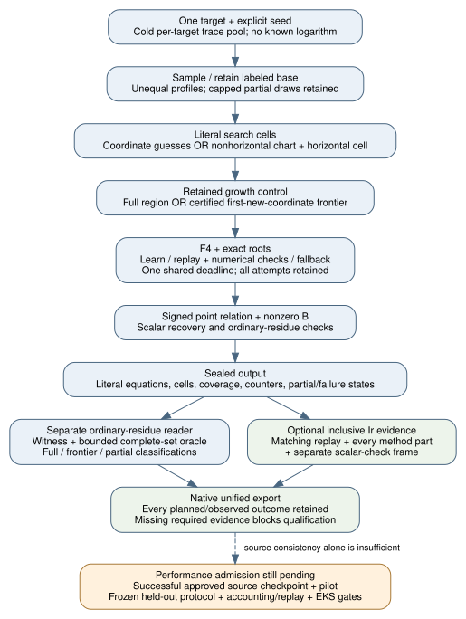

# APS: four lead implementations and an instruction audit

This continuation implements the four proposals from
[the lead report](../aps_leads_20261105/README.md), exposes them under the
new `ic.aps_v3` identity, and extends the separate ordinary-residue reader.
Development observations have producer standing, **unverified**; they are
not benchmark data or a signed PCC verdict [pcc:unverified].

Deliverables: [editable diagram](pipeline.dot), [report PDF](report.pdf),
[proof map](PROOFS.md), [cost contract](ACCOUNTING.md), and [design draft](PROTOCOL.md).

| Requested step | Delivered component | Still required |
| --- | --- | --- |
| 1. Measurement readiness | Explicit lead controls; literal cells/history; separate arithmetic/full-set reader; optional method-plus-scalar Ir reconstruction | Actual profile/metric admission, complete GAE pricing, pilot, fixed analysis and frozen main protocol |
| 2. Approved source checkpoint | Approval preserved; source-only GitHub gate and pinned selection support prepared | Fresh fenced admission, actual existing secret binding and successful standard gate; preparing code is not an upload |
| 3. Baseline measurements | Original comparisons and four-size workload requirement retained in `PROTOCOL.md` | Successful prerequisites and actual EKS pilot/main execution; no performance numbers supplied |
| 4. Implement and compare leads | Native trace pool, two-variable line chart, unequal profiles/arbitrary guesses, retained-base full/frontier controls and separate reader | Admitted measured comparisons; development tests do not establish improvement |

## Implementation

* **Trace reuse:** each target starts with an empty bounded pool. Existing
  native F4 record/replay supplies the candidate basis; numerical input
  reductions and every Buchberger S-pair must reduce to zero. An invalid,
  mismatched or resource-capped candidate falls back to ordinary F4. Learning,
  replay, checking, fallback and retained trace words remain visible.
* **Line chart:** for $y=tx+c$, use $U=t^2$, $V=c/t$ when $t\ne0$.
  The divisor coefficients become $e_1=U$, $e_2=a-2UV$, $e_3=UV^2-b$.
  The chart uses two unknowns; a separate one-variable horizontal cell is
  retained unless the existing propagated-orbit label certificate allows
  omission. Ordinate-zero and zero-denominator cases are refused.
  The existing unpruned line formulation also uses two variables. The
  certified pruned formulation uses a third inverse variable, which this
  chart removes; the protocol distinguishes these two comparisons.
* **Profiles and elimination:** original partition sizes are explicit,
  bounded and may differ. Guess any original coordinate before F4 and restore
  it before relation recovery. No unknown logarithm is supplied to a solver.
* **Growth:** preserve points and labels, append conditional new draws, and
  keep partial sampling failures. `retained_full` and `frontier` share the
  same nested base law. The latter skips old tuples only after a complete,
  non-timeout, non-early-stop traversal without an informative witness.

The implementations are bounded development backends: prime fields up to
65,521, arity three/four, original partition sizes one through four, degree
bound at most 24 and explicit finite attempt/draw/time budgets. Cubic orbit
expansion uses its existing independent certificate. No cap is lifted here.
The existing six encodings and frozen v1/v2 records retain their behavior.

The independent reader validates actual producer records using ordinary
residue affine arithmetic. It checks the partition/guess/chart cell geometry,
literal digests, retained labels/draw totals, trace counter continuity and
complete root sets through finite point combinations. A complete frontier's
expected set is the new product's solutions minus the certified old product's
solutions. A partial report only supports subset checking. This is separate
software, not signed execution or raw-profile authenticity [pcc:unverified].

## Cost and formal boundaries

[ACCOUNTING.md](ACCOUNTING.md) defines optional inclusive Ir evidence and
the excluded work. All operation-cost/execution flags remain honest:
native GAE totals are incomplete; an unkeyed receipt is not execution proof.
The new frame reader does not turn test duration into timing evidence.

[PROOFS.md](PROOFS.md) supplies the mathematical argument and proof map.
The central frontier cover/disjointness statement has a core-only Lean
formalization. Chart lifting into actual finite-field curve relations and
the implementation-to-proof refinement remain open. The previous native
identity records are reused at their original scope, never treated as PCC
solve certificates or full chart-completeness proofs [pcc:unverified].

[PROTOCOL.md](PROTOCOL.md) is a design continuation, **not a freeze**. It
keeps the original baseline comparisons, four held-out size classes,
same-input references, controls, failures and complete cold-cost obligations.
The source checkpoint is approved; local authentication is not bound and the
repository secret path has not yet produced a gate outcome. No
benchmark, runtime pilot, profiler run or EKS experiment was launched.

## Evidence and continuation

[SOURCE_CHECKPOINT.md](SOURCE_CHECKPOINT.md) describes a checkpoint-only
GitHub path using the repository's existing secret reference. It requires a
fresh T10 fence, exact source selection and a bounded upload window. Preparing
that path is not a source upload, a gate pass or a benchmark admission.

`validation/early-boundaries.json` preserves the earlier failed and
superseded development observations under native claim
`PCC-20261106-e8b5a4`, standing **unverified**. It explicitly does not pin a
complete source tree for those earlier commands. Final source-linked
receipts will be additive; no earlier boundary becomes a final full-suite
pass. Raw dependency/build/host logs and the native full ledger stay private.

[Focused checks](validation/focused-checks.json) pin their actual source
boundaries. Native statement `PCC-20261106-cc59ba` records the public lead,
producer/reader and example observations, plus the separate standalone
export boundary. Its standing is **unverified**; the root-library outcome
and later reader-overflow hardening have their own continuation receipts
[pcc:unverified]. Native statement `PCC-20261106-34db73` pins
[completed component checks](validation/completed-components.json), including
the seven-test boundary before the later native-session test. Registry and
optimization-policy repairs have their own subsequent validation; no earlier
pass is transferred to them [pcc:unverified].

The subsequent [final component receipt](validation/final-components.json),
native statement `PCC-20261106-5e324a`, records eight public lead tests,
the existing producer bridges and examples, the repaired registry and
optimization inventory, focused units and strict Rust 1.98/stable lints.
Its standing is **unverified**. The native scratch session is a correctness
check; APS receives a static audit and the rho control alone receives count
replay. The broad library command remains a separate, earlier source
boundary with failures and no final verdict in this receipt [pcc:unverified].
See [CHECKS.md](CHECKS.md) for the exact boundaries and limitations.

The algorithm/reader source-only pin is
[`413a93d6f9940c855200468175174126136bb49c`](https://github.com/isogeny-labs/crypto/commit/413a93d6f9940c855200468175174126136bb49c).
See the [lead cells](https://github.com/isogeny-labs/crypto/blob/413a93d6f9940c855200468175174126136bb49c/src/cryptanalysis/aps_single_relation/leads.rs),
[trace pool](https://github.com/isogeny-labs/crypto/blob/413a93d6f9940c855200468175174126136bb49c/src/cryptanalysis/f4_fp/reuse.rs),
[public producer bridge](https://github.com/isogeny-labs/crypto/blob/413a93d6f9940c855200468175174126136bb49c/tests/aps_cost_leads.rs)
and [inclusive reader](https://github.com/isogeny-labs/crypto/blob/413a93d6f9940c855200468175174126136bb49c/tools/aps-export/src/inclusive.rs).
These links pin source, not an execution or performance verdict.

[HANDOFF.md](HANDOFF.md) tracks the unfinished work. T9/research and
T10/authblocked checkpoint stay open. Passing development tests or a merged
implementation PR does not discharge the baseline/scaling request.

Sources checked: Amadori–Pintore–Sala,
[revised manuscript](https://iris.unitn.it/retrieve/e3835194-60e8-72ef-e053-3705fe0ad821/Amadori%2C%20Pintore%2C%20Sala%20-%20On%20DLP%20for%20prime-field%20EC%20%28rev%29.pdf),
sections 3.1–3.3; the
[previous source map](../aps_leads_20261105/SOURCES.md), existing F4
record/replay, existing unequal-profile sampler and existing native Callgrind
parser. KB unavailable: no loaded KB tool or local indexed runtime/catalog;
the fallback is these primary and repository sources. No novelty claim.

Canonical scoreboard/curve/performance diagrams have no new measured value
to add; they remain unchanged. This study supplies its own implementation
and admission diagram and source-linked report, without a performance plot.

