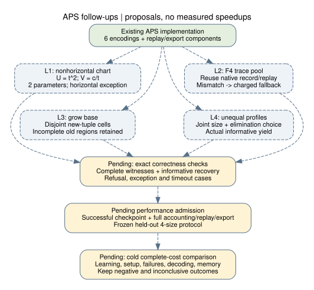

# APS next leads — 2026-11-05

This search proposes four follow-ups to the merged APS implementation: a
nonhorizontal line chart, APS-specific F4 trace reuse, incremental factor-base
frontiers, and unequal partition profiles. They are hypotheses, with explicit
correctness and cost rejection criteria. None has an APS implementation or a
performance result in this study [pcc:unverified].

Producer proposal record: [PCC-20261105-aca921](../../pcc/claims/PCC-20261105-aca921.json).
Identity-record assertion: [PCC-20261105-6d30f5](../../pcc/claims/PCC-20261105-6d30f5.json).
Both have unverified standing. The public change does not include the private
native ledger additions or promote either assertion.

Deliverables: this report, [source review](SOURCES.md),
[editable diagram](leads.dot), [vector diagram](leads.svg),
[report PDF](report.pdf), and [validation scope](CHECKS.md).

## Scope and method

Read the existing APS studies and lead register before the primary literature,
then compare the proposals with the current solver and adapter. The source
snapshot is main `2d33e9c068c0f2b3226893017c8ea48548cc0749`.
The APS, F4, native identity-checker and SHA-256 files used here match that
snapshot's blobs; exact pins are in SOURCES.md [pcc:unverified].

The mathematical domain is a nonsingular short Weierstrass curve
$E: y^2=x^3+ax+b$ over $\mathbb F_p$, $p>3$, with labeled points in an odd
prime-order subgroup. Coordinates in the base are distinct, and their
ordinates are nonzero. No new curve instance, ECDLP run, target set or seed
population was selected. The identity-record field below is a checker field,
not an experimental ECDLP instance.

The review is bounded. In particular, Kudo et al.'s CANS 2018 full text remains
unavailable. These are proposed extensions of this implementation, without a
claim of global novelty.

## L1 — remove the inverse variable from the pruned line chart

**Priority: first algebraic implementation.** The current certified-pruned
line builder has parameters $(t,c,z)$, including $tz-1=0$. The ordinary line
encoding is already implemented; this proposal changes its chart
[pcc:unverified].

For a nonhorizontal line $y=tx+c$, propose

$$U=t^2,\qquad V=c/t,\qquad
H_{U,V}(X)=X^3-U(X+V)^2+aX+b.$$

Require $H_{U,V}\mid F_{\mathcal V}$, where
$F_{\mathcal V}(X)=\prod_{x\in\mathcal V}(X-x)$ is the squarefree base
polynomial. This uses two solver parameters and identifies the global sign
pair $(t,c)$ and $(-t,-c)$ [pcc:unverified].

The conditional lifting argument is the useful part. If a solution of this
divisibility system had $U=0$, every root of its cubic would have ordinate
zero, contradicting the base assumption. At any root $x$ of a valid cubic,
the known lift satisfies $y_x^2=U(x+V)^2$. Since $y_x\ne0$, also $x+V\ne0$;
thus $U$ is a nonzero square and $t=y_x/(x+V)$, $c=tV$ recovers a line.
Conversely, substituting a nonzero slope yields the displayed cubic.
This is a producer derivation; scheme-level behavior and the implementation
are not independently proved [pcc:unverified].

**Exceptional cases.** Horizontal lines are outside this chart. Omit them
only when the existing orbit-and-label certificate establishes that their
relations are uninformative; otherwise retain a separate horizontal chart.
Reject ordinate-zero inputs and keep all base and subgroup checks. A square
root, or the point-based division above, still costs work. Cubic terms such
as $UV^2$ may make elimination worse despite the smaller variable count.

**First check and rejection rule.** Implement behind a separate encoding
choice. Compare complete coordinate-witness and informative-recovery sets
against the existing pruned encoding and exhaustive tiny-field oracle;
cover missing chart, zero-ordinate, repeated-root and refusal cases. Then
compare the full cold pipeline including decoding. Reject any mismatch;
retire the optimization if degree or matrix growth erases the cost saving.

The substitution expansion has record
[IDC1h9e131e5cd24a395f](certificates/line-chart.json). This record evaluates a
polynomial identity over $2^{61}-1$; it does not certify the lifting argument,
all prime fields, or an algorithmic benefit [pcc:unverified].

## L2 — reuse F4 traces across attempts within one APS solve

**Priority: first solver integration.** The core already implements
`f4_record`, `f4_replay` and `trace_mismatch`; APS currently does not call
the tracing functions. Binary `polynomial_reuse` is also prior code.
The new work is the prime-field APS orchestration [pcc:unverified].

Maintain a bounded trace pool keyed by field, encoding, partition-size
profile, variable order and input leading monomials. Learn on one attempt
and replay on later attempts with the same target. Candidate clustering
keys may also include a degree or staircase fingerprint; they must not
require the answer or uncharged pre-solving. A leading-monomial match is
necessary evidence, not a proof of a complete output basis.

Reject mismatched or uncertified replays, fall back to ordinary F4, and
charge both paths. Independently validate complete basis/root coverage when
claiming exhaustion; finding one verified witness does not certify that a
replay found every root. Preserve first-informative termination and account
for batches that continue after the first answer [pcc:unverified].

Demin's July 2026 Groebner.jl paper exposes learn/apply and batched tracing
on other polynomial families. It supports this implementation direction,
but its timings and break-even counts are not APS measurements.

**First check and rejection rule.** Replay exact systems against ordinary F4
and the existing independent replayer, including nongeneric coefficient
specializations and deliberate mismatch controls. A subsequent cost panel
must include learning, failed replay, fallback, cache memory and speculative
batch work. Judge amortization within a single target's actual attempts.
Drop this route if cold learning is not recovered at that horizon.

## L3 — grow a labeled base and search only newly admitted tuples

**Priority: after complete-coverage bookkeeping.** APS normally replaces an
unsuitable base. Propose retaining it, adding independent labeled samples,
and searching the new tuple frontier [pcc:unverified].

For disjoint increments $\Delta_i$ and $T_i=S_i\cup\Delta_i$, the proposed
disjoint cover is

$$\left(\prod_i T_i\right)\setminus\left(\prod_i S_i\right)
=\bigsqcup_{j=1}^{m}
\left(\prod_{i<j}S_i\right)\times\Delta_j\times
\left(\prod_{i>j}T_i\right).$$

A tuple's first new coordinate chooses its unique cell. With singleton
increments each cell fixes one coordinate, creating smaller hybrid problems.
The three-part cardinality expansion is recorded as
[IDC1ha14548fc2b5ce5c3](certificates/frontier-count.json); the set argument
is producer prose [pcc:unverified].

**The trap:** a larger coordinate set weakens the membership constraint.
Appending the old membership equations would exclude new solutions.
Use the disjoint frontier, rather than assuming an old Gröbner basis can be
extended by adding equations. Skip the old region only after a complete
no-informative-witness result; a timeout or partial stream is not such a
certificate. Preserve incomplete regions for later coverage.

**First check and rejection rule.** Check that old coverage plus the frontier
equals a fresh full-base search, including signed recoveries and partially
completed stages. Preserve the sampler's conditional law and count sampling,
all unsuccessful stages, saved coverage and memory. Compare against both
discard-and-resample and one-shot construction of the final base; use an
incremental group-join control. Reject any coverage gap and abandon growth
if unsuccessful early stages cost more than the work retained.

## L4 — optimize unequal partition sizes together with elimination

**Priority: a small, interpretable protocol extension.** The sampler already
accepts a size vector; the public adapter exposes a single `subset_size`.
Add an explicit profile and select the guessed variable jointly with it.
Hybrid solving itself is existing work [pcc:unverified].

At fixed total base size nine, profiles $(3,3,3)$ and $(1,4,4)$ admit 27 and
16 coordinate tuples, respectively. The latter fixes one variable. Under a
rare-event model with yield proportional to the product of part sizes, its
whole-attempt cost would need to fall below $16/27$ of the balanced cost to
improve expected effort. This ratio is a heuristic break-even illustration,
not an exact relation-probability claim [pcc:unverified].

Use fixed total distinct points and a frozen set of profiles, variable orders
and hybrid choices. Repartition identical labeled points when the label
scheme permits it; do not silently change coefficients or informative-yield
populations. A setup-cost floor can defeat the trade even if solving becomes
very cheap.

**First check and rejection rule.** Extend exact-domain replay to unequal
profiles and compare with exhaustive signed enumeration. Then record actual
informative yield and full cold cost, with held-out profiles/instances.
Keep the balanced profile as the control. Stop profiles whose measured yield
loss exceeds their cost reduction; select on training data and evaluate the
frozen choice on held-out data.

## Ideas screened out and remaining dependencies

Fixed guaranteed label weights and their precomputed shifts are already
implemented. Multiplicative cosets and composed low-degree rational/isogeny
maps are established prior work [pcc:unverified]. No new encoding credit is
assigned to the invariants $(t^2,tc,c^2)$ without establishing a useful delta
from the existing unordered cubic representation.

No new experiment, performance/EKS session or timing panel ran. The source
checkpoint still needs secure authentication, and complete accounting,
native replay/export coverage, frozen held-out four-size protocol and run
admission remain prerequisites to any performance launch. Their completion
is separate from this planning deliverable [pcc:unverified].

The index-calculus scoreboard and progress timeline remain unchanged: this
round adds proposed mechanisms and algebra records, not a new verified edge,
curve or measured value. Existing frozen studies and receipts are preserved
[pcc:unverified].

## Execution checklist

- [x] Review repository work and primary sources; record the full-text gap.
- [x] Specify four distinct deltas, assumptions and rejection criteria.
- [x] Ship native identity records, replay receipt, diagram and inspected PDF.
- [ ] Independently establish the chart and frontier completeness claims.
- [ ] Implement each lead in a separately scoped follow-up with correctness checks.
- [ ] Satisfy checkpoint and frozen-protocol prerequisites before cost experiments.
- [ ] Measure held-out complete costs; retain nulls, failures and timeouts.

Planning completion does not complete T9 or the complete-cost research panel.

## Primary references

1. Amadori, Pintore, Sala, *On the discrete logarithm problem for prime-field
   elliptic curves*, revised manuscript (2018), §§3.1–3.2.
   <https://eprint.iacr.org/2017/609>. Author copy and checked sections:
   SOURCES.md.
2. Demin, *Groebner.jl: Fast Gröbner Tracing in Julia* (2026), §§2–4.
   <https://arxiv.org/html/2607.06372v1>.
3. Milne, *Elliptic Curves*, second edition, §I.3, for the chord law and
   ordinate-zero two-torsion exception.
   <https://www.jmilne.org/math/Books/EC2.pdf>.
4. Petit, Kosters, Messeng, *Algebraic approaches for the Elliptic Curve
   Discrete Logarithm Problem over prime fields* (PKC 2016).
   <https://christophe.petit.web.ulb.be/files/16PKC_primeECDLP.pdf>.
5. Kudo et al., *Acceleration of Index Calculus for Solving ECDLP over Prime
   Fields and Its Limitation* (CANS 2018); bibliography/abstract only.
   <https://doi.org/10.1007/978-3-030-00434-7_19>.
