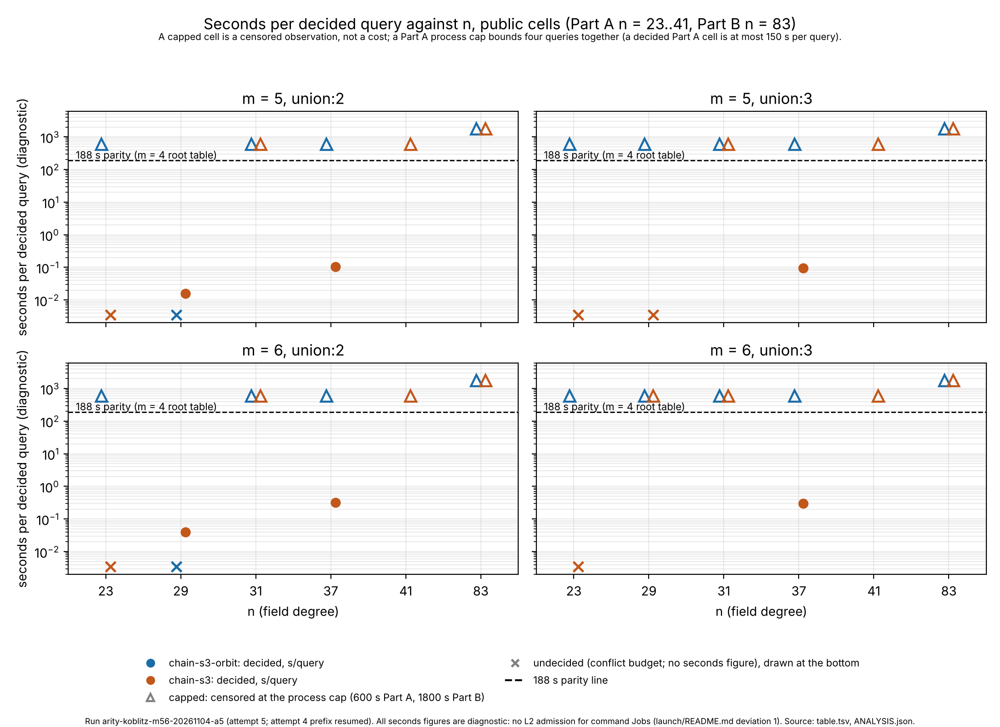
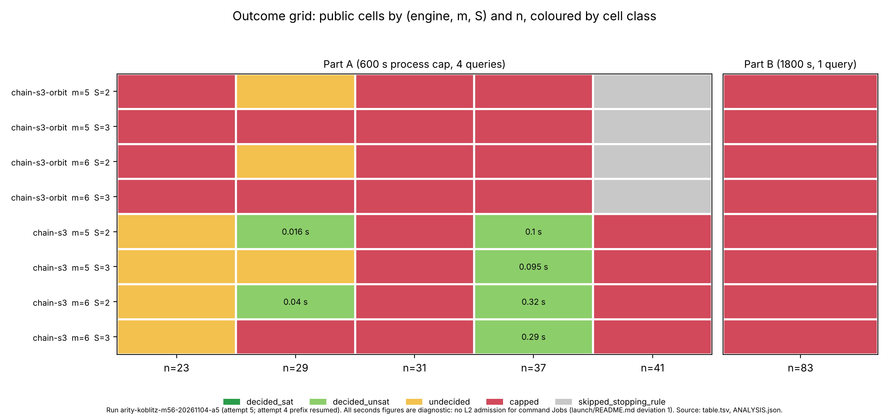
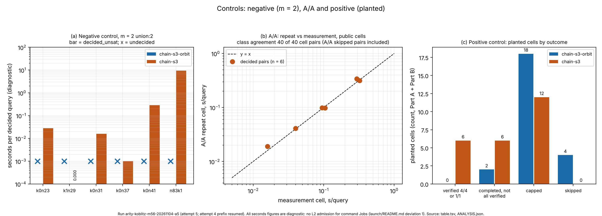

# Koblitz m = 5 and m = 6 chained-S3 study: report

Protocol `KOBLITZ-M5-M6-20261104` (frozen, `../protocol.json`). Run
`arity-koblitz-m56-20261104-a5` (attempt 5, resuming the attempt-4 prefix).
Every number below is read from `../table.tsv`, `../ANALYSIS.json` or
`../analysis.txt` (output of the frozen `../analyze.py`) and is an unverified
assertion: no pcc claim exists for this study [pcc:unverified].

**Every seconds figure in this report is diagnostic.** Command Jobs have no
L2 admission, native replay or A/A admission (launch README deviation 1), so
invalidation rule 6 applies. Decided/capped verdicts and witnesses are exact
computations; the seconds are not admitted timings [pcc:unverified].

**No matched-rho row exists for this study.** No Pollard rho was run here, so
there is no gap to a matched rho to report, and no leaderboard,
`benchmarks/README.md` or end-to-end claim is made (claim K7, out of scope).
The only reference distance is the 188 s m = 4 root-table parity point from
the predecessor sweep, reported below as the distance remaining and not as a
pass or fail [pcc:unverified].

## 1. Question

Can chained-S3 SAT decomposition with a Frobenius-invariant (union) factor
base decide m = 5 and m = 6 relations on Koblitz curves at n = 23, 29, 31, 37
and 41 within a 600 s cell cap, and at n = 83 with the 180 s cap of
`n83_msweep_20261024` lifted tenfold to 1800 s; and what does a decided query
cost? (`protocol.json`, `question`.) [pcc:unverified]

## 2. Design

- **Part A** (family `koblitzA`): curves k0n23, k1n29, k0n31, k0n37, k0n41
  (a = 0 except n = 29, a = 1); m in {5, 6}; factor base union:S with S in
  {2, 3}; both engines, `chain-s3-orbit` and `chain-s3`; 4 public queries per
  cell and 4 planted queries in the matching positive-control cell; 600 s
  process cap per cell, so a decided Part A cell is at most 150 s per query
  and a capped one shows only that four queries together exceeded the cap.
  Stopping rule: once all four public cells of an engine and m at the two
  previous curves are capped or skipped, the next curve is skipped
  (`skipped_stopping_rule`) [pcc:unverified].
- **Part B** (family `liftB`): n83k1 (the pinned a = 1 fixture), m in {5, 6},
  S in {2, 3}, both engines, public and planted, one query per process under
  an 1800 s cap, which is a per-query cap [pcc:unverified].
- **Controls**: negative control m = 2 union:2 at every curve (6 curves, both
  engines); positive control the planted cells; A/A a repeat (`aa`) of every
  Part A public cell [pcc:unverified].
- **Engines**: library `sat_decompose_chained_s3_any_m`; orbit domain on for
  `chain-s3-orbit`, off for `chain-s3`. Limits: max_variables 4000000,
  max_domain_clauses 50000000, max_models 64, conflict_budget 200000. Seed
  8609517, one thread per cell process (`RAYON_NUM_THREADS=1`) [pcc:unverified].
- **Grid**: 148 cells, all present in `table.tsv`: 40 public, 40 planted, 40
  A/A and 10 negative in Part A; 8 public, 8 planted and 2 negative in Part B
  [pcc:unverified].
- **Hosts**: Iso Lab EKS command Job, pool `cpu-l2-spot`, pinned to
  m7i.2xlarge (Intel Xeon Platinum 8488C, per `run-a5/host.txt` and launch
  README deviation 8 and 10). All ten m = 2 controls of Part A ran earlier
  on an AMD EPYC 9R45 host (deviation 8, attempt 4 text: the ten m = 2
  controls decided by conflict budget or in under a second, not by the wall
  cap). The m = 5 and m = 6 cells ran on the Intel host [pcc:unverified].
- **Instrument**: `n83_msweep_cell` built at the frozen commit
  4fa25efc0e2392b2e02e4c84253059ebc7c67e02; binary sha256
  bdf52eee79a68e06eb1f26d74b506dd422f82d3bd2cd36898eba5a07f12ebe1b
  (`run-a5/binary.sha256`); image
  `arity-20261104-frozen-4fa25efc0e23`, digest
  sha256:dd52495564680cb69576321fb1d6b5239d6ab8d9929b3965292040172e644b05.
  The binary hash identifies the artifact that ran, not the source (README,
  "Source identity") [pcc:unverified].

## 3. Execution

- **Attempt 4** (`arity-koblitz-m56-20261104-a4`, pod `da7313ba`,
  m7i.2xlarge): recorded every Part A m = 5 and m = 6 cell (m = 5: 21 complete,
  35 process_cap, 6 skipped_stopping_rule; m = 6: 18, 37, 6) and 3 of 16 Part B
  cells. It ended at `activeDeadlineSeconds` (60900 s, counted from Job
  creation after about 8.9 h Pending), not by Spot loss, killing the in-flight
  cells `liftB n83k1 m5 union-3 chain-s3-orbit public` and
  `liftB n83k1 m6 union-2 chain-s3 public` (first infrastructure attempts)
  [pcc:unverified].
- **Attempt 5** (`arity-koblitz-m56-20261104-a5`, pod uid
  e87cf35a-0101-4dcf-aa58-7b97c448cb46, node
  ip-10-84-100-118.us-east-2.compute.internal): resumed the attempt-4 prefix,
  same m7i.2xlarge host model, Job deadline 64800 s. `run-a5/job.log`: shard m2
  exit 0 at 18:28:24Z, shards m5 and m6 started concurrently at 18:28:24Z, both
  exited 0 at 21:55:44Z on 2026-11-08; `job-exit.json` exit_code 0. The 13
  remaining cells ran fresh, with no CRIU [pcc:unverified].
- **Deviations** (launch README): 1 no L2 admission for command Jobs, so all
  seconds are diagnostic; 2 Koblitz concurrency realised inside one 4-CPU pod
  (m2, then m5 and m6 concurrently); 3 prime-tower cells sequential (not this
  study); 4 executor host replaced by the pod, cell commands reproduced
  verbatim in `job-*.sh`; 5 host type c8a.2xlarge to m8a.2xlarge after Spot
  losses; 6 attempt limit counted per cell (at most 2
  attempts for any cell, against `retries.max_attempts` 3); 7 curated prime-tower resume source (not this study); 8 host type for
  attempt 4 pinned to m7i.2xlarge after m8a.2xlarge was refused; 9 prime tower
  unpinned (Koblitz stays pinned); 10 attempt 5 as a plain command Job, not
  CRIU, because a CRIU dump stops the process tree while the wall-clock caps
  keep running and would bias cells toward `process_cap`; the owner chose this
  on 2026-11-08. `RAYON_NUM_THREADS` in the pod environment is 4
  (`run-a5/env.txt`); the cell command sets 1 per process [pcc:unverified].

- **Director's assessment** (`../ASSESSMENT-a5.md`, 2026-11-08):
  complete-with-deviations (COMPLETE-WITH-DEVIATIONS), recommendation
  proceed_to_analysis, interpretation not assessed. It records one terminal
  record for each of the 148 cells, at most 2 attempts per cell (against
  `retries.max_attempts` 3), every m = 5 and m = 6 cell on the Intel Xeon
  Platinum 8488C, and `analysis.txt`, `table.tsv` and `ANALYSIS.json`
  reproduced by the frozen script (differing only in the printed raw path).
  It also lists open protocol questions P1 to P3 and unnumbered observations
  U1 to U6, which this report does not resolve [pcc:unverified].

## 4. Results per claim

Cell classes, public cells (from `table.tsv`) [pcc:unverified]:

| part | engine | decided_unsat | undecided | capped | skipped |
|---|---|---|---|---|---|
| A (20 cells) | chain-s3-orbit | 0 | 2 | 14 | 4 |
| A (20 cells) | chain-s3 | 6 | 5 | 9 | 0 |
| B (4 cells) | chain-s3-orbit | 0 | 0 | 4 | 0 |
| B (4 cells) | chain-s3 | 0 | 0 | 4 | 0 |

Decided public cells all belong to `chain-s3`: k1n29 m = 5 and m = 6 at S = 2
(0.016 s and 0.040 s per query) and the four k0n37 cells (0.1 s to 0.3 s per
query). All are `decided_unsat`; there is no `decided_sat` public cell
[pcc:unverified].

Verdicts, verbatim from `../analysis.txt` (section "# verdicts") [pcc:unverified]:

```
K1[chain-s3-orbit]: falsified | m=5: capped - s/q, m=6: capped - s/q
K1[chain-s3]: falsified | m=5: undecided - s/q, m=6: undecided - s/q
K2[chain-s3-orbit]: supported_partial | 2/4 tail cells measured, k0n37 S=2: capped, k0n37 S=3: capped; no two decided points for a slope
K2[chain-s3]: falsified | 4/4 tail cells measured, k0n37 S=2: decided_unsat, k0n37 S=3: decided_unsat, k0n41 S=2: capped, k0n41 S=3: capped; S=2 n 29->37: log2-slope 0.379/n
K3[chain-s3-orbit]: falsified | 0/2 completed planted cells recovered every query; cells that capped are unmeasured
K3[chain-s3]: falsified | 6/12 completed planted cells recovered every query; cells that capped are unmeasured
K4[chain-s3-orbit]: supported | m=5 S=2: capped, m=5 S=3: capped, m=6 S=2: capped, m=6 S=3: capped
K4[chain-s3]: supported | m=5 S=2: capped, m=5 S=3: capped, m=6 S=2: capped, m=6 S=3: capped
K5[chain-s3-orbit]: supported | 0 decided public cells at n >= 31 of 16 recorded (vacuous: none decided; capped cells are untested against 188 s)
K5[chain-s3]: falsified | 4 decided public cells at n >= 31 of 16 recorded; under 188 s: k0n37 m=5 S=2 0.1 s (0.00 x parity), k0n37 m=5 S=3 0.1 s (0.00 x parity), k0n37 m=6 S=2 0.3 s (0.00 x parity), k0n37 m=6 S=3 0.3 s (0.00 x parity) [Part A: a decided cell is at most 150 s per query by construction of the 4-trial 600 s cap]
K6[chain-s3-orbit]: not_evaluable_instrument_invalid | K4=supported, K5=supported, K3=falsified
K6[chain-s3]: not_evaluable_instrument_invalid | K4=supported, K5=falsified, K3=falsified
K6 combined: not_evaluable
```

Notes printed by `analysis.txt` after the verdicts [pcc:unverified]:

```
NOTE: K2[chain-s3-orbit]: m=2 negative control undecided at n=37/41; capped cells there are uninformative
NOTE: K4[chain-s3-orbit]: the n = 83 m=2 negative control is undecided at 1800 s; K4 is supported but weak (the engine does not decide even m = 2 there)
```

Rule 4 annotation (main-session decision, not `analyze.py` output; the
verdict lines above are unchanged) [pcc:unverified]:

```
K2[chain-s3-orbit]: supported_partial  (analyze.py)  | under rule 4: not_evaluable for chain-s3-orbit
K4[chain-s3-orbit]: supported          (analyze.py)  | under rule 4: not_evaluable for chain-s3-orbit
```

The chain-s3-orbit m = 2 negative control is undecided at every n (k0n23,
k1n29, k0n31, k0n37, k0n41 and n83k1), so invalidation rule 4 makes that
engine's capped cells not_evaluable for K2 and K4. K2 and K4 need both
engines, so K4 is supported for chain-s3 only and is not established as a
two-engine claim [pcc:unverified].

K3, verbatim from `analysis.txt`: `K3[chain-s3-orbit]: falsified` and
`K3[chain-s3]: falsified`. Invalidation rule 1 is not triggered: no decided
planted cell is proved_unsat or short of witnesses (the 6 decided planted
cells have 4 of 4 verified witnesses). The 8 completed planted cells whose
queries all ended incomplete (6 chain-s3, 2 chain-s3-orbit) show that the
instrument often cannot find a planted relation at m >= 5 within its conflict
budget; undecided public cells there are therefore weak evidence of absence
[pcc:unverified].

Claim by claim, as `analysis.txt` states them [pcc:unverified]:

- **K1** (both engines decide the k0n23 m = 5 and m = 6 union:2 cells inside
  600 s): chain-s3-orbit falsified (capped); chain-s3 falsified (undecided).
- **K2** (seconds grow at least geometrically with n; every m = 6 public cell
  at n = 37 and 41 caps): chain-s3-orbit supported_partial (2 of 4 tail cells
  measured, the n = 41 cells skipped by the stopping rule, no two decided
  points for a slope); chain-s3 falsified (the k0n37 m = 6 cells are
  decided_unsat; S = 2 log2-slope 0.379 per n between n = 29 and 37).
- **K3** (planted relation recovered in every decided planted cell):
  falsified for both engines, 0 of 2 completed planted cells for
  chain-s3-orbit and 6 of 12 for chain-s3; capped planted cells are
  unmeasured. `analysis.txt` reports K6 as not_evaluable_instrument_invalid
  for both engines.
- **K4** (every n = 83 m = 5 and m = 6 public cell stays undecided at 1800 s):
  supported for both engines, all eight cells capped; for chain-s3-orbit the
  note above applies (supported but weak).
- **K5** (no decided public cell at n >= 31 under 188 s per query):
  chain-s3-orbit supported, vacuously, with 0 decided cells; chain-s3
  falsified by the four k0n37 public cells above.
- **K6** (kill criterion): not_evaluable (combined), both engines
  not_evaluable_instrument_invalid.
- **K7** (out of scope): no complete-DLP, IC-versus-rho, leaderboard or
  benchmarks claim is made.

**What the K5[chain-s3] falsification is.** The four k0n37 public cells are
`decided_unsat`: the engine proved UNSAT with 0 relations found, at 0.1 s to
0.3 s per query. These decisions find no relation, so they are not an
index-calculus improvement over the m = 4 parity point. The protocol's K5
wording counts any decided cell, and for Part A it falsifies K5 by
construction (a decided cell is at most 150 s per query); the "falsified"
verdict is therefore a statement about that wording, not about relation
yield [pcc:unverified].

**Distance from the 188 s parity point** (`analysis.txt`, "# decided cells"):
the six decided cells sit at 0.000x to 0.002x of 188 s; they are cells that
proved UNSAT, and the distance carries no relation-finding information.
Capped cells are censored observations and do not locate a cost relative to
188 s. For Part B, the only place a per-query cost above 188 s can be seen,
every cell capped at 1800 s or was undecided, so no per-query figure exists
there [pcc:unverified].

## 5. Controls

- **Negative control (m = 2, union:2)**: chain-s3 decided_unsat at all six
  curves (0.028, 0.000, 0.016, 0.001, 0.286 and 9.455 s per query at k0n23,
  k1n29, k0n31, k0n37, k0n41 and n83k1); chain-s3-orbit undecided at all six.
  `analysis.txt`: the n = 83 chain-s3 figure of 9.45 s per query against the
  n83_msweep record 17.33 s (ratio 0.55; diagnostic, different host)
  [pcc:unverified].
- **A/A**: 0 pairs with disagreement or noise flag. Decided pairs (all
  chain-s3, decided_unsat) have seconds ratios 1.152 and 1.026 (k1n29 m = 5 and
  6, S = 2) and 0.939, 1.036, 0.975 and 1.151 (k0n37) [pcc:unverified].
- **Positive control**: planted cells completed, chain-s3-orbit: 2, all
  queries recovered and verified: 0; chain-s3: 12, all recovered and
  verified: 6. The 6 chain-s3 successes are `decided_sat` with every witness
  re-added (k1n29 m = 5 and 6 S = 2; k0n37 all four). See limitations
  [pcc:unverified].

## 6. Limitations

- **Seconds are diagnostic only** (deviation 1): no L2 admission, replay or
  A/A admission; host speed also differs between the m = 2 controls (EPYC
  9R45) and the m = 5 and m = 6 cells (Intel 8488C) [pcc:unverified].
- **Capped is censored.** A capped Part A cell shows that four queries
  together exceeded 600 s, not a per-query cost above 188 s. A cell skipped by
  the stopping rule is not measured (n = 41 chain-s3-orbit: 4 public, 4
  planted and 4 A/A cells) [pcc:unverified].
- **8 positive-control misses** listed under "# controls" in `analysis.txt`,
  verbatim [pcc:unverified]:

  ```
  POSITIVE CONTROL MISS chain-s3 k0n23 m=5 S=2: class=undecided outcomes={'incomplete': 4} verified=0
  POSITIVE CONTROL MISS chain-s3 k0n23 m=5 S=3: class=undecided outcomes={'incomplete': 4} verified=0
  POSITIVE CONTROL MISS chain-s3-orbit k1n29 m=5 S=2: class=undecided outcomes={'incomplete': 4} verified=0
  POSITIVE CONTROL MISS chain-s3 k1n29 m=5 S=3: class=undecided outcomes={'incomplete': 4} verified=0
  POSITIVE CONTROL MISS chain-s3 k0n23 m=6 S=2: class=undecided outcomes={'incomplete': 4} verified=0
  POSITIVE CONTROL MISS chain-s3 k0n23 m=6 S=3: class=undecided outcomes={'incomplete': 4} verified=0
  POSITIVE CONTROL MISS chain-s3-orbit k1n29 m=6 S=2: class=undecided outcomes={'incomplete': 4} verified=0
  POSITIVE CONTROL MISS chain-s3 n83k1 m=6 S=3: class=undecided outcomes={'incomplete': 1} verified=0
  ```

  The instrument returned `incomplete` on planted targets that exist, so at
  those cells it does not recover a known relation within its conflict
  budget; public verdicts there are not informative, and K3 is falsified for
  both engines [pcc:unverified].
- **chain-s3-orbit at k1n29** (m = 5 and m = 6, S = 2) returns `incomplete`
  with 0 conflicts in 0.0 s in the public, planted and A/A cells (and in the
  m = 2 negative control, table.tsv: undecided, conflicts 0, wall 0.0 s). The
  engine returns without searching; this report does not determine why, and
  the cells are counted undecided, not capped [pcc:unverified].
- **chain-s3-orbit is undecided on every m = 2 negative control**, so its
  capped cells carry little information (analysis.txt notes on K2 and K4)
  [pcc:unverified].
- **Decided cells are UNSAT decisions** (section 4): they find no relation.
  The chain-s3 cost figures are costs of proving a decomposition absent, not
  of collecting relations [pcc:unverified].
- **Build identity**: two frozen-commit builds are not bit-identical
  (README); the artifact that ran is identified by binary sha256 only. The
  attempt-5 card binds a working-tree `job-lib.sh` that is not what ran
  (README, route section) [pcc:unverified].
- **process_cap is a wall-clock event** on a tier without L2 isolation, so
  capped outcomes carry host-speed uncertainty [pcc:unverified].
- **Binary hash differs from the freeze-time smoke binary**: the run binary
  sha256 bdf52eee79a68e06eb1f26d74b506dd422f82d3bd2cd36898eba5a07f12ebe1b
  differs from the freeze-recorded smoke binary 424382e5 (`smoke/binary.sha256`).
  The launch README discusses this and the cause is not investigated
  [pcc:unverified].
- **Mixed hosts for the m = 2 negatives**: 10 ran on AMD EPYC 9R45 and the 2
  n83k1 ones on Xeon 8488C; all m = 5 and m = 6 cells ran on Xeon 8488C
  (`../ASSESSMENT-a5.md`, section c) [pcc:unverified].
- **No matched rho** was run for this study, so there is no matched-rho row,
  no §5a band and no validation-gate evidence directory; nothing here may
  reach the IC leaderboard or `benchmarks/README.md` [pcc:unverified].

## 7. Figures

Built by `make_figures.py` from `../table.tsv` and `../ANALYSIS.json` only
(SVG and PNG at 2x). Capped cells are drawn as triangles at the cap, a
censored observation. Every seconds axis is diagnostic [pcc:unverified].



Figure 1: seconds per decided query against n for each (m, S), with the 188 s
parity line. Run arity-koblitz-m56-20261104-a5. Circles are decided cells
(4 queries per cell in Part A, 1 in Part B), triangles capped, crosses
undecided [pcc:unverified].



Figure 2: outcome grid of public cells by (engine, m, S) and n for Part A and
Part B, coloured by cell class [pcc:unverified].



Figure 3: (a) negative control, (b) A/A repeat against measurement, (c)
planted cells by outcome [pcc:unverified].

## 8. Files

`../protocol.json`, `../analysis.txt`, `../table.tsv`, `../ANALYSIS.json`,
`../raw/`, `../run-a5/`, `../../launch/README.md`; here: `make_figures.py`,
`fig1_seconds_vs_n.{svg,png}`, `fig2_outcome_grid.{svg,png}`,
`fig3_controls.{svg,png}`, `REPORT.md`, `REPORT.pdf` [pcc:unverified].
