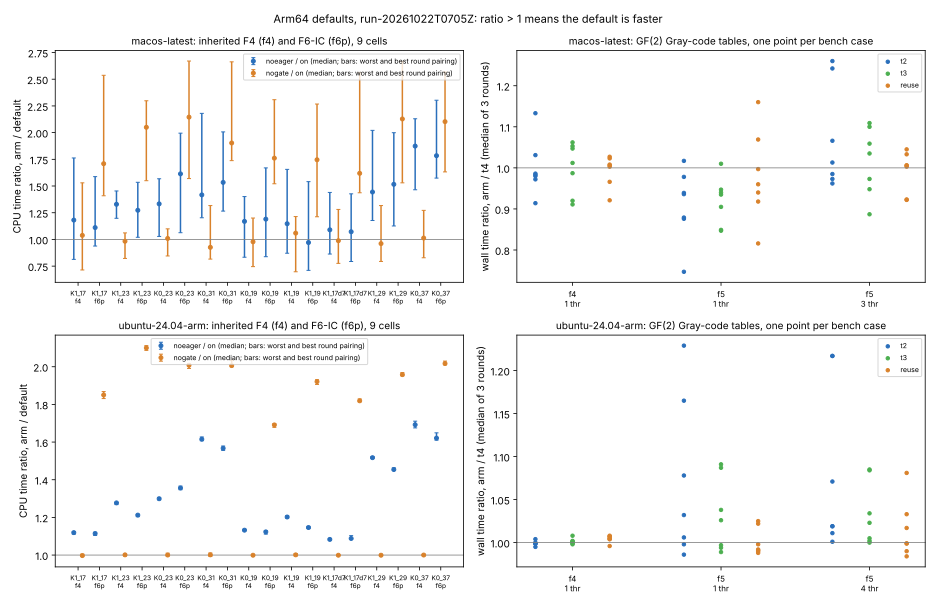

# Arm64 check of the F4/F5 defaults (2026-10-22)

Three defaults had been chosen on x86 only:
- the eager rewrite of kept rows through shift runs, which hosts without BMI2 (every Arm host) have run since #2043;
- the gate-first F6-IC order, measured on aarch64 before only together with the lazy rewrite;
- the GF(2) Gray-code table count (`DEFAULT_TABLES = 4` in `src/cryptanalysis/gf2_elim.rs`) and the opt-in table reuse.

This study measures all three on GitHub's Arm runners, `ubuntu-24.04-arm` (Neoverse-N2) and `macos-latest` (Apple M1, virtual), through the one-off workflow `.github/workflows/arm64-f4-defaults.yml`. On each host one binary runs every arm; the arms differ only by environment, and their order rotates inside every round.

- Scripts: `scripts/run_inh.sh`, `scripts/run_gf2.sh`, `scripts/host.sh`.
- Decision rule: [`scripts/DECISION_RULE.md`](scripts/DECISION_RULE.md), committed before any Arm data.

Run report: [`reports/run-20261022T0705Z/report.pdf`](reports/run-20261022T0705Z/report.pdf), from GitHub Actions run 39732230961.

**Result: every default stays.** Both hosts pass the exactness gate, and nothing needs an Arm-specific value.

- **Exactness.** On both hosts:
  - all 80 targets get the same decision in every arm and round;
  - word counts repeat exactly across rounds and are identical on the two hosts;
  - they equal what the x86 run `research/inherited_f4_eager_runs_20261016` charged;
  - all 21 GF(2) fingerprint keys agree across arms and rounds.
- **Eager rewrite through shift runs.** The lazy rewrite with the bit scatter, Arm's path before #2043, takes more CPU than the default:
  - Linux: 1.08–1.69× (9/9 cells on both engines);
  - macOS: 0.97–1.87× (9/9 cells on `f4`, 8/9 on `f6p`).

  This is the first Arm measurement of the change #2043 made on an x86 proxy.
- **Gate-first F6-IC.** Turning it off costs more CPU on `f6p`:
  - Linux: 1.69–2.10× (9/9 cells);
  - macOS: 1.62–2.15× (9/9 cells).

  The `f4` engine, which has no node oracle, reads 1.00 on Linux and 0.93–1.06 on macOS.
- **GF(2) tables.** No arm meets the rule.
  - Linux: no arm beats `t4` in any group.
  - macOS: `t2` and `t3` are 1.10× and 1.09× faster at 1 thread on F5, but 0.94× and 0.99× at 3 threads. Linux does not reproduce the gain.



**Limits.**
- These are shared, unpinned CI virtual machines, with one run per host.
- The macOS VM reported load averages of 36–50 during the inherited arms. Its round-to-round brackets are wide and span 1 on many cells, even where the median is far from 1. The Linux runner's brackets lie within about ±2 % of the median.
- No index-calculus total or rho comparison is involved. That is why this study has a `benchmarks/20261022-arm64-f4-defaults/` copy but no `benchmarks/README.md` row: the validation gate requires a matched rho reference.

## Reproduce

Change any file under `scripts/` in a PR, or dispatch the workflow (`rounds` input). Download the run's two artifacts, then for each host directory `<run>/<host>/`:

```sh
python3 -I summarize.py <run>/<host>
python3 plot.py <run>
```
