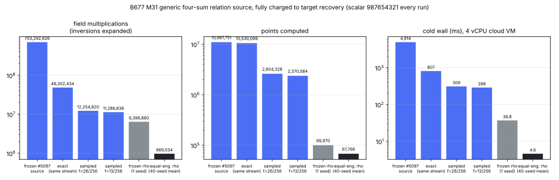

# Cheaper fully charged relation production on the frozen B677 M31 workload

2026-11-25, Claude Code. Development measurements on one shared 4-vCPU cloud VM
(Intel Xeon @ 2.10 GHz), not an isolated EKS host. Unsigned. [pcc:unverified]

## Question

PR #5097 ran a generic signed four-sum relation source on the frozen B677 workload
(p = 2^31 − 1, y² = x³ + 847514846x + 2087444724, prime order 2147446831; 509 Dickson
factor-base points + 168 Y7 large-prime points; public target Q = (976979610, 1228979761)).
It recovered the scalar 987654321 with 10,987,751 counted group additions and 3,367 ms
cold wall, 109.9× its same-target rho control. How much of that cost is avoidable
without changing the workload, and what is left once it is removed?

## What was changed

Two independent changes to the relation source in [`native/cost_v2.rs`](native/cost_v2.rs).
The fixture, query seed, graph/LP elimination and replay are the baseline's own logic.

1. **Arithmetic, same relation stream (`exact` arm).** The baseline pays a full Fermat
   inversion (about 64 field multiplications) for every point it computes. The new arm
   shares one denominator between P_i + P_j and P_i − P_j in the pair table, and between
   R − L and R + L in each probe. It also batch-inverts in blocks of 512 (Montgomery) and
   replaces `HashMap<Point, Vec<usize>>` with a flat open-addressing index. It probes
   exactly the same 10,068,344 complements as the baseline.
2. **Fewer probes per relation (`sample:K` arms).** A four-term signed relation
   {±P_a, ±P_b, ±P_c, ±P_d} = R has three ways to split into two pairs, each found from
   either side. So the baseline finds every relation **six times**: about 4,300 table hits
   for 707 distinct relations. Probing a keyed-hash fraction f = K/256 of the table per
   query finds a given relation with probability about 1 − (1 − f)^6, at cost f. New
   queries (two scalar multiplications each) make up the difference. Every query is a
   fresh public aG + bQ from the baseline's seed sequence. K = 13 and K = 26 were
   measured. The sampling salt is the replicate index.

## Checks

- **Exact arm, 10/10 replicates:** the stored relation rows are byte-identical to the
  baseline's (707 rows, SHA-256 `f1bbab69…`). The per-query LP/projected/factor-base rank
  trajectory is identical, and both recover 987654321. Checked on the full outputs with
  [`tools/compare_exact.py`](tools/compare_exact.py) and re-checked on the stored hashes
  in [`evidence/panel-02/exact_identity.json`](evidence/panel-02/exact_identity.json).
- **Every arm, every run:** each emitted relation is replayed with the original group law
  (`assert_eq!(sum, r)`), and the recovered scalar is checked by d·G = Q. 60 IC runs and
  50 rho runs all recovered 987654321.
- **Baseline and frozen-rho arms** are the PR #5097 sources (`mitm_four.rs`,
  `rho_control.rs`), compiled byte-for-byte through a shim that exposes only the unchanged
  `b677_fixture.rs`. The pinned F4 closure no longer builds on main, and this source never
  uses it.

## Results (panel-02: 10 interleaved replicates; rho mean over 40 seeds)

Medians. Field multiplications count each inversion as its square-and-multiply products,
which is the baseline's own convention. Ratios are geometric means of paired per-replicate
ratios, with 95% bootstrap intervals. Ratios against the 40-seed rho use a ratio of means
with an unpaired bootstrap.

| Arm | queries | probes | points computed | field mults | cold wall (ms) |
| --- | ---: | ---: | ---: | ---: | ---: |
| frozen #5097 source | 11 | 10,068,344 | 10,987,751 | 703,292,626 | 4,914 |
| exact (same stream) | 11 | 10,068,344 | 10,530,099 | 48,302,434 | 807 |
| sampled f = 26/256 | 23 | 2,141,430 | 2,604,328 | 12,254,820 | 309 |
| sampled f = 13/256 | 41 | 1,906,054 | 2,370,584 | 11,286,836 | 288 |
| frozen rho (one seed) | – | – | 99,970 | 6,396,880 | 36.8 |
| equal-engineering rho (40-seed mean) | – | – | 67,766 | 969,034 | 4.6 |

| Reduction against the frozen source | field mults | points | cold wall |
| --- | --- | --- | --- |
| exact | **14.56×** [14.56, 14.56] | 1.04× | **6.03×** [5.69, 6.36] |
| sampled 26 | 56.7× [56.1, 57.3] | 4.16× [4.12, 4.21] | 16.5× [15.7, 17.4] |
| sampled 13 | **62.2×** [61.5, 62.9] | **4.63×** [4.57, 4.68] | **17.2×** [16.5, 18.0] |



## Distance remaining to rho

| Best arm (sampled 13) against | field mults | points | cold wall |
| --- | --- | --- | --- |
| frozen #5097 rho (one Brent seed, Fermat inversion each step) | 1.77× [1.75, 1.79] | 23.8× [23.5, 24.0] | 7.9× [7.5, 8.6] |
| equal-engineering rho ([`native/rho_batched.rs`](native/rho_batched.rs)) | **11.7× [10.9, 12.5]** | **35.0× [30.5, 40.8]** | **62.6× [58.2, 67.5]** |

The frozen rho control understates rho. Given the same field engineering as the new
source, rho needs about 0.97M multiplications and 4.6 ms. It uses Mersenne reduction,
batch inversion across 64 parallel walks and distinguished points, with **no negation
map**, so a tuned negation-map rho would be about √2 faster still. Measured against that
rho, the frozen source sat at about **726×** in multiplications and **1,075×** in wall,
not 110×. After this work the distance is about **12×** in multiplications and **63×** in
wall, a constant-factor gap that remains in favour of rho.

## Why the generic source cannot go much further

PR #5097's pair-table gate puts the cold entry-plus-probe work of this generic source
at Ω(√(Bn)), with an optimistic expectation threshold of **2,503,653** entry/probe units
at B677. The sampled-13 arm uses 915,304 entries + 1,906,054 probes = **2,821,358**, which
is **1.13×** that threshold. The table is already the largest one the 677-point support
allows, so the entry/probe balance cannot move further.

The remaining gap to rho is not overhead in this source; it is the generic source itself.
Further reduction of fully charged relation production on B677 needs a non-enumerative
(algebraic) relation source: the Semaev/RR5 paths, owner priority items 2–4.

## Wall breakdown (sampled 13, median)

Fixture 1.2 ms, pair table 72.8 ms, relation source 178.7 ms over 41 queries, graph +
replay + elimination 31.0 ms, cold total 287.6 ms, peak RSS about 52 MB (baseline: table
532 ms, source 4,344 ms, RSS 127 MB).

## Scope and limits

- Development host only: a shared cloud VM with no core isolation and no hardware counters.
  The EKS admission route for this study is still blocked, as recorded under PR #4974.
  Wall intervals cover run-to-run noise on this host only.
- The probe fraction was chosen after the first development sweep (K ∈ {128, 64, 43, 26,
  13, 6}, single runs), not preregistered. Panel-02 then measured K = 13 and K = 26 with
  fresh salts. Below about 1/10, probes plateau near 1.9M, which is the 6× redundancy
  bound.
- The frozen rho is a single deterministic seed whose 99,970 additions are above its
  expectation. The equal-engineering rho is the comparator that matters and has 40 seeds.
- Same public target and curve throughout. This is a constant-factor result on one fixed
  workload: no exponent claim, no claim about other curves, and no leaderboard change
  until it passes the validation gate.

## Replay

```
cd research/b677_relation_cost_20261125/native && cargo build --release
cd .. && B=native/target/release
python3 tools/run.py out/baseline $B/baseline-mitm 40
python3 tools/run.py out/exact    $B/cost-v2 exact
python3 tools/compare_exact.py out/baseline.json out/exact.json   # must PASS
python3 tools/run.py out/s13      $B/cost-v2 sample:13:1
python3 tools/run.py out/rhob     $B/rho-batched 1
```

Panel driver: the loop in [`evidence/README.md`](evidence/README.md). Summary:
`python3 tools/summarize.py evidence/panel-02`. Figure:
`python3 tools/plot.py evidence/panel-02/summary.json figures/cost_by_arm`.
