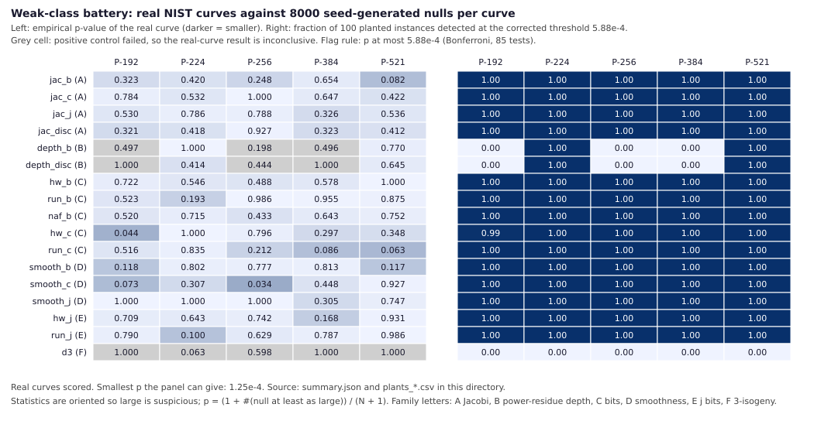

# Status

**One native run; no ECDLP cost measured.** Protocol:
[`PROTOCOL.md`](PROTOCOL.md), frozen in commit `b06037d99` before the real
curves were scored. Run: [`run/`](run/), produced by
`target/release/b_weak_class_battery --real` at that commit (clean tree, rustc
1.97.0, 4 threads, 933 s wall; `run/run.json`). The pre-flight estimate in the
protocol was 35 minutes; the run took 15.6.

This is not an index-calculus measurement. It has no rho ratio, no phase is
priced and no scoreboard row is owed (`AGENTS.md` §7a). It tests hypothesis 1
of [`research/p224_hypothesis_ranking_20261008/`](../p224_hypothesis_ranking_20261008/)
(a weak class recognisable from `(p, a, b)`, found by grinding seeds) with a
wider family of statistics than the single KS test of `b mod q`.



Claim classes (`controlled-experiment` §1): every sentence about a curve below
is **comparative/statistical**. The unit-tested algebra (division polynomial,
Jacobi, NAF identity) is **exact computation**. The label **DERIVED** marks one
consistency argument; **OPEN** marks what is not established.

# Result

**Observation (MEASURED, `run/summary.json`).**

- **No curve × statistic is flagged.** The pre-declared rule is Bonferroni
  over `m = 5 × 17 = 85` tests, `α = 0.05`, flag iff `p ≤ 5.88 × 10^-4`
  (at most 3 of 8000 nulls at or above the curve). The smallest real-curve
  `p` is 0.034 (P-256, `smooth_c`), 57 times the threshold.
- **Positive controls passed in 74 of 85 cells.** In every passing cell at
  least 99 of 100 planted instances were detected at the corrected threshold.
  **11 cells are inconclusive** (grey in the figure): `d3` on all five
  curves, and `depth_b` and `depth_disc` on P-192, P-256 and P-384. Their
  real-curve values are reported but are not evidence either way.
- **Calibration gate passed.** In all 85 cells, 0 to 62 of 1000 held-out null
  draws score `p ≤ 0.05` (gate: at most 70; counts below 30 are ties on
  coarse discrete statistics and are conservative, not a failure). The mean
  number of seeds tried per accepted null draw is 9.6 to 12.1.
- **Two of the 74 conclusive cells have `p ≤ 0.05`** (P-192 `hw_c`, 0.044;
  P-256 `smooth_c`, 0.034). Under a continuous null about 3.7 would be
  expected; the discrete statistics make the count conservative.

## Real-curve empirical p-values

`p = (1 + #{null ≥ x}) / 8001`, upper tail. † marks a cell whose positive
control failed (inconclusive). All 85 rows with values and null intervals are
in the appendix.

| statistic | P-192 | P-224 | P-256 | P-384 | P-521 |
|:--|--:|--:|--:|--:|--:|
| `jac_b` | 0.323 | 0.42 | 0.248 | 0.654 | 0.082 |
| `jac_c` | 0.784 | 0.532 | 1 | 0.647 | 0.422 |
| `jac_j` | 0.53 | 0.786 | 0.788 | 0.326 | 0.536 |
| `jac_disc` | 0.321 | 0.418 | 0.927 | 0.323 | 0.412 |
| `depth_b` | 0.497 † | 1 | 0.198 † | 0.496 † | 0.77 |
| `depth_disc` | 1 † | 0.414 | 0.444 † | 1 † | 0.645 |
| `hw_b` | 0.722 | 0.546 | 0.488 | 0.578 | 1 |
| `run_b` | 0.523 | 0.193 | 0.986 | 0.955 | 0.875 |
| `naf_b` | 0.52 | 0.715 | 0.433 | 0.643 | 0.752 |
| `hw_c` | 0.044 | 1 | 0.796 | 0.297 | 0.348 |
| `run_c` | 0.516 | 0.835 | 0.212 | 0.086 | 0.063 |
| `smooth_b` | 0.118 | 0.802 | 0.777 | 0.813 | 0.117 |
| `smooth_c` | 0.073 | 0.307 | 0.034 | 0.448 | 0.927 |
| `smooth_j` | 1 | 1 | 1 | 0.305 | 0.747 |
| `hw_j` | 0.709 | 0.643 | 0.742 | 0.168 | 0.931 |
| `run_j` | 0.79 | 0.1 | 0.629 | 0.787 | 0.986 |
| `d3` | 1 † | 0.063 † | 0.598 † | 1 † | 1 † |

## Why the 11 cells are inconclusive

These are limits of the detector, not of the curves.

- **`d3`** (rational 3-isogeny kernels): its support under the conditioning
  is `{0, 1, 2, 4}`, and the largest value has about 6% null mass, so no
  value can reach the corrected threshold (the best attainable `p` on any
  curve is 0.055 to 0.077 in the dry run, 0.063 for P-224's value here). On
  P-192 and P-384, `p ≡ 2 mod 3` and `d3` is 0 for every null draw. Predicted
  in the protocol (§4).
- **`depth_b`, `depth_disc`**: the power-residue depth is capped by the
  small-prime part `G` of `p − 1`. P-192 and P-384 have `v₂(p − 1) = 1` and no
  other small factor, so the support is `{0, 1}`; `depth_disc` cannot be
  planted there (`p ≡ 2 mod 3`). **P-256 was not predicted in the protocol:**
  `v₂(p − 1) = 1` there as well, so `G = 2550 = 2·3·5²·17` (`log2 G = 11.32`) and the planted maximum (11.32)
  is reached by 5 of 8000 nulls (`p = 6/8001`), just above the threshold.
  Disclosed here; the rule (inconclusive) was applied as written.

# Observations outside the pre-registered rule

Exploratory, not part of the Bonferroni family, not findings.

1. **`smooth_j` is exactly 0 on P-192, P-224 and P-256.** The integer `j`
   has no prime factor below `2^16` on three of the five curves (P-384: 19.5
   bits; P-521: 6.3 bits). The pre-registered direction for smoothness is the
   upper tail, so these cells are `p = 1`. The null frequency of `smooth_j =
   0` is 0.046 to 0.056 per curve (`run/nulls_*.csv.gz`), so three or more of
   five has probability about `10 × 0.05³ ≈ 1.2 × 10^-3` by hand arithmetic.
   It was noticed after the run, among 17 statistics and both tails, so it
   carries a look-elsewhere factor of at least 3 (three smoothness cells) and
   in fact more. No mechanism is known, and it is not confirmed. A
   confirmation needs a new frozen protocol and an independent set of curves
   generated by the same procedure (for example the other X9.62 and SEC 2
   seeded prime curves).
2. **`d3 = 4` on P-224** (all four 3-division x-coordinates rational, none
   with a rational point). **DERIVED:** with no rational 3-torsion point, this
   says Frobenius acts as the scalar −1 on `E[3]`, i.e. `3` divides the
   conductor of `Z[π]`. The earlier measured P-224 conductor `f = 3`
   (`research/p224_hypothesis_ranking_20261008/run/cm_discriminant.json`)
   predicts exactly this, and P-256 (conductor 1) gives `d3 = 1`. So `d3 = 4`
   is a re-expression of a known fact, not new structure.
3. **Torsion carries no information on these curves.** The curves have prime
   order, so there is no rational 2-torsion or 3-torsion point and no
   rational 2-isogeny. The unit test confirms this for all five curves (the
   conditioning accepts them). A battery that reports "number of rational
   2-/3-torsion points" would report 0 for every real curve and every
   conditioned null.

# Interpretation (labelled, not a finding)

Within these seventeen statistics, on these five curves, nothing is more
extreme than the corrected threshold where the detector demonstrably works.
That narrows hypothesis 1 only to classes that stay inside the null on all
74 conclusive cells. Hypothesis 1's grind scenario was already closed beyond
about 30 bits of selection by the seed provenance work
(`research/nist_seed_provenance_20261016/`); this battery adds no weight to
that and takes none away.

# Method in brief

[`PROTOCOL.md`](PROTOCOL.md) is the specification. In short:

- **Null (negative control).** 8000 draws per curve: random 160-bit seed,
  `c = x962_c_from_seed`, `b` a square root of `−27/c` with a seed-derived
  sign, conditioned on odd order and no rational 3-torsion (cheap necessary
  conditions of the prime order every NIST curve has). The same code scores
  the null, the held-out draws, the plants and the real curves.
- **Statistics.** `jac_*` (Jacobi pattern of `b`, `c`, `j`, `4a³ + 27b²` over
  32 odd primes), `depth_*` (joint power-residue depth), `hw_*`, `run_*`,
  `naf_b` (bit structure and signed-digit weight), `smooth_*` (smoothness
  below `2^16`), `d3` (3-isogeny pattern from the division polynomial). All
  are computed from `(p, a, b)` and `c` without counting points.
- **Positive controls.** 100 constructed instances per cell (Chinese
  remaindering, products of small primes, `r^g`, bit patterns), through the
  same conditioning and statistic code.
- **Multiple testing.** Bonferroni over 85 tests, declared in the protocol.

# Power limits

A null here does not show that no weak class exists.

- The instrument sees a class only if its members move one of the 17
  statistics beyond the top 4 of 8000 null draws. The planted classes show
  what that takes: a quadratic-residue pattern on all 32 primes, a 40-bit run,
  a 24-digit NAF, a fully 2^16-smooth integer, a depth far above the null
  maximum. A subtler bias, for example "slightly more residues than expected
  on the first 12 primes", is not claimed to be visible. No power curve in
  selection bits was measured.
- A class defined by the group order, the trace, the CM field, an isogeny
  degree of 5 or more, or any other function of `b` outside these families is
  invisible. The 3-isogeny statistic has no power at the corrected level.
- The depth statistics have no power on P-192, P-256 and P-384, whose
  `p − 1` has no useful small-prime part.
- The null is conditioned only on odd order and no rational 3-torsion, not on
  prime order itself, and uses a seed-derived sign that the real curves may
  not follow. A statistic correlated with 5-torsion or higher would be
  mis-calibrated, and none of the 17 is.
- The statistics within a curve are dependent. Bonferroni is conservative.
- Five curves, one real instance each: there is no replication on a second
  set of real curves.

# Checklist (`controlled-experiment` §6)

- [x] every published sentence classified (§1 above)
- [x] negative control: seed-generated null, conditioned, 8000 per curve, plus
      1000 held-out draws
- [x] positive control on the same path for every cell; 11 cells failed it and
      are reported inconclusive
- [x] one instrument and identical budgets across arms
- [x] power check `2/(N+1) < α/m`: `2.5 × 10^-4 < 5.9 × 10^-4`; `N + 1 = 8001 ≥ 6800`
- [x] pre-flight runtime estimate (35 min) against actual (15.6 min)
- [x] `PROTOCOL.md` frozen (commit `b06037d99`) before the real run; dry run on
      scratch output with real scoring off
- [x] raw rows committed (`run/*.csv.gz`)
- [x] decision rule and correction applied as written
- [x] verdict wording fixed; scope sentence present
- [ ] superseded claims: none superseded. The predecessor README's "1c:
      statistical probes on `b` are the right kind of test: partly" stays as
      written; this study widens the probes and does not change that status

# Reproduce

```bash
cargo test --release --lib cryptanalysis::b_weak_class_battery
cargo build --release --bin b_weak_class_battery
target/release/b_weak_class_battery --real \
  --out research/b_weak_class_battery_20261022/run
```

The run is deterministic (seed labels are fixed); `run.json` holds the wall
time and differs between runs. The bin writes plain CSV; the committed files
are those CSVs compressed with `gzip -9` (their hashes below include the gzip
header time). SHA-256 of the committed outputs:

```
bcfc0b1eac6845e78b553d6ad51b8060262ceafef4427e0234508f63358fe7c9 summary.json
b651bb9e9973b6dbe7ef807ca8f20c1a476e81872b568126d1f06dafa7500feb battery.svg
3f594b7feff1d872c45a985c49b5ab726e15143f2cff80b25b1b6df002e96a0e holdout_P-192.csv.gz
1d6e84826739566c0091ec3836eaa9b7ea14afb6f22b902176722cfd720c81bb holdout_P-224.csv.gz
e953e92eb2ebba98ccf617d33b0306f0d7945528fbae240868a9eca95f9bbeee holdout_P-256.csv.gz
2674f82f1cd3211a01d2c81e7c3f517acd543eca1ce1663ba180de9ac2713b68 holdout_P-384.csv.gz
1ef7862994c469a628e397be1689247abef96919b29f7997f6b8b12e0be7689e holdout_P-521.csv.gz
18fa62613ecd204b11b997fe09668724e730efa48942db7bb3aef35b6d0bbc7d nulls_P-192.csv.gz
8572ec3d1f6d894842e7af37ae438b4d7493a9336ab3404b007693cceff40415 nulls_P-224.csv.gz
3343e88666628ed11757d049e741f21d4cedb9348378a5d3fcae9050ac032825 nulls_P-256.csv.gz
2566784afb3d19cc42d3be26f26a4fb76748c295bc33ccbb9a5e4723ca41f3c7 nulls_P-384.csv.gz
8aa1bd6d43b02ed8b5f36ef6376be2e94ada117d5669611b88cb1c1a27789058 nulls_P-521.csv.gz
b9e4fc67bd62473f7f6ea296384367bc60d28d6c59c783ace2efd0135b41cde3 plants_P-192.csv.gz
20f1100d9733e2e6e5bc6d51aec8819a768e8fbba7aa97dcb4cf899b89f6ffab plants_P-224.csv.gz
75dfd4eff3cc2b9d47840656b6efd98f4478a12686276a9948bf833db85a62d9 plants_P-256.csv.gz
6b4d49a9f424ae39db688b886c6345ca240faa727555c66278cb07ac5e5735ca plants_P-384.csv.gz
571e779dba55c12f42eb9aa241341445710fedea2412a23ab519029f6ede83ea plants_P-521.csv.gz
```

# Appendix: all 85 cells

Columns: curve, statistic, real value, null median [2.5%, 97.5%], null
maximum, empirical `p`, planted instances detected at the corrected threshold,
held-out null draws with `p ≤ 0.05` (of 1000), verdict (fixed wording; the
nothing-flagged verdict applies to cells whose positive control passed).

| curve | statistic | value | null median [2.5%, 97.5%] | null max | p | plants detected | held-out p ≤ 0.05 | verdict |
|:--|:--|--:|:--|--:|--:|--:|--:|:--|
| P-192 | `jac_b` | 1.06066 | 0.707107 [0.0, 2.12132] | 3.712311 | 0.3231 | 100/100 | 46 | within the null distribution |
| P-192 | `jac_c` | 0.353553 | 0.707107 [0.0, 2.12132] | 3.889087 | 0.7843 | 100/100 | 42 | within the null distribution |
| P-192 | `jac_j` | 0.707107 | 0.707107 [0.0, 2.12132] | 4.065864 | 0.5302 | 100/100 | 28 | within the null distribution |
| P-192 | `jac_disc` | 1.06066 | 0.707107 [0.0, 2.12132] | 3.535534 | 0.321 | 100/100 | 46 | within the null distribution |
| P-192 | `depth_b` | 1.0 | 0.0 [0.0, 1.0] | 1.0 | 0.4971 | 0/100 | 0 | positive control failed: inconclusive |
| P-192 | `depth_disc` | 0.0 | 0.0 [0.0, 0.0] | 0.0 | 1 | 0/100 | 0 | positive control failed: inconclusive |
| P-192 | `hw_b` | 0.433013 | 0.721688 [0.0, 2.165064] | 3.752777 | 0.7219 | 100/100 | 56 | within the null distribution |
| P-192 | `run_b` | 8.0 | 8.0 [5.0, 12.0] | 19.0 | 0.5228 | 100/100 | 42 | within the null distribution |
| P-192 | `naf_b` | 0.795495 | 0.795495 [0.0, 2.12132] | 4.507806 | 0.5197 | 100/100 | 59 | within the null distribution |
| P-192 | `hw_c` | 2.098366 | 0.651217 [0.072357, 2.243081] | 3.97966 | 0.0444 | 99/100 | 35 | within the null distribution |
| P-192 | `run_c` | 8.0 | 8.0 [5.0, 12.0] | 23.0 | 0.5163 | 100/100 | 42 | within the null distribution |
| P-192 | `smooth_b` | 29.594285 | 13.40833 [0.0, 41.806084] | 76.215891 | 0.1182 | 100/100 | 54 | within the null distribution |
| P-192 | `smooth_c` | 33.463855 | 13.266054 [0.0, 42.297326] | 95.467412 | 0.0734 | 100/100 | 53 | within the null distribution |
| P-192 | `smooth_j` | 0.0 | 13.612062 [0.0, 41.474014] | 79.979169 | 1 | 100/100 | 54 | within the null distribution |
| P-192 | `hw_j` | 0.433013 | 0.721688 [0.0, 2.165064] | 4.041452 | 0.7089 | 100/100 | 47 | within the null distribution |
| P-192 | `run_j` | 7.0 | 8.0 [5.0, 12.0] | 21.0 | 0.7903 | 100/100 | 39 | within the null distribution |
| P-192 | `d3` | 0.0 | 0.0 [0.0, 0.0] | 0.0 | 1 | 0/100 | 0 | positive control failed: inconclusive |
| P-224 | `jac_b` | 0.883883 | 0.707107 [0.0, 2.12132] | 4.065864 | 0.4203 | 100/100 | 25 | within the null distribution |
| P-224 | `jac_c` | 0.707107 | 0.707107 [0.0, 2.12132] | 4.242641 | 0.5321 | 100/100 | 48 | within the null distribution |
| P-224 | `jac_j` | 0.353553 | 0.707107 [0.0, 2.298097] | 3.889087 | 0.7862 | 100/100 | 34 | within the null distribution |
| P-224 | `jac_disc` | 0.883883 | 0.707107 [0.0, 2.12132] | 3.889087 | 0.4181 | 100/100 | 27 | within the null distribution |
| P-224 | `depth_b` | 0.0 | 2.0 [0.0, 7.321928] | 14.994353 | 1 | 100/100 | 47 | within the null distribution |
| P-224 | `depth_disc` | 3.321928 | 2.584963 [1.0, 8.087463] | 13.906891 | 0.4139 | 100/100 | 46 | within the null distribution |
| P-224 | `hw_b` | 0.668153 | 0.668153 [0.0, 2.271721] | 3.741657 | 0.5458 | 100/100 | 42 | within the null distribution |
| P-224 | `run_b` | 10.0 | 8.0 [5.0, 13.0] | 20.0 | 0.1931 | 100/100 | 30 | within the null distribution |
| P-224 | `naf_b` | 0.409159 | 0.654654 [0.081832, 2.291288] | 4.091585 | 0.7147 | 100/100 | 34 | within the null distribution |
| P-224 | `hw_c` | 0.066965 | 0.602685 [0.066965, 2.209843] | 3.950932 | 1 | 100/100 | 39 | within the null distribution |
| P-224 | `run_c` | 7.0 | 8.0 [6.0, 13.0] | 21.0 | 0.8351 | 100/100 | 27 | within the null distribution |
| P-224 | `smooth_b` | 4.807355 | 13.476113 [0.0, 42.019111] | 78.058859 | 0.8015 | 100/100 | 49 | within the null distribution |
| P-224 | `smooth_c` | 19.591166 | 13.56403 [0.0, 41.97487] | 71.958417 | 0.3066 | 100/100 | 50 | within the null distribution |
| P-224 | `smooth_j` | 0.0 | 13.331337 [0.0, 40.871857] | 85.274789 | 1 | 100/100 | 55 | within the null distribution |
| P-224 | `hw_j` | 0.534522 | 0.668153 [0.0, 2.13809] | 4.008919 | 0.6432 | 100/100 | 47 | within the null distribution |
| P-224 | `run_j` | 11.0 | 8.0 [6.0, 12.0] | 21.0 | 0.0996 | 100/100 | 50 | within the null distribution |
| P-224 | `d3` | 4.0 | 1.0 [0.0, 4.0] | 4.0 | 0.0627 | 0/100 | 0 | positive control failed: inconclusive |
| P-256 | `jac_b` | 1.237437 | 0.707107 [0.0, 2.12132] | 3.712311 | 0.248 | 100/100 | 43 | within the null distribution |
| P-256 | `jac_c` | 0.0 | 0.707107 [0.0, 2.12132] | 3.358757 | 1 | 100/100 | 40 | within the null distribution |
| P-256 | `jac_j` | 0.353553 | 0.707107 [0.0, 2.12132] | 3.712311 | 0.7877 | 100/100 | 28 | within the null distribution |
| P-256 | `jac_disc` | 0.176777 | 0.707107 [0.0, 2.12132] | 3.712311 | 0.9274 | 100/100 | 37 | within the null distribution |
| P-256 | `depth_b` | 3.321928 | 1.0 [0.0, 6.228819] | 11.316282 | 0.1976 | 0/100 | 42 | positive control failed: inconclusive |
| P-256 | `depth_disc` | 2.584963 | 1.0 [1.0, 6.672425] | 11.316282 | 0.4439 | 0/100 | 39 | positive control failed: inconclusive |
| P-256 | `hw_b` | 0.75 | 0.625 [0.0, 2.25] | 3.875 | 0.4883 | 100/100 | 51 | within the null distribution |
| P-256 | `run_b` | 6.0 | 8.0 [6.0, 13.0] | 22.0 | 0.9855 | 100/100 | 32 | within the null distribution |
| P-256 | `naf_b` | 0.842012 | 0.612372 [0.076547, 2.21985] | 4.056967 | 0.4333 | 100/100 | 58 | within the null distribution |
| P-256 | `hw_c` | 0.313112 | 0.688847 [0.062622, 2.31703] | 3.569478 | 0.7957 | 100/100 | 37 | within the null distribution |
| P-256 | `run_c` | 10.0 | 8.0 [6.0, 13.0] | 22.0 | 0.2125 | 100/100 | 32 | within the null distribution |
| P-256 | `smooth_b` | 5.61471 | 13.420881 [0.0, 42.027406] | 82.108625 | 0.7774 | 100/100 | 38 | within the null distribution |
| P-256 | `smooth_c` | 39.498831 | 13.38869 [0.0, 41.720796] | 79.962971 | 0.0336 | 100/100 | 44 | within the null distribution |
| P-256 | `smooth_j` | 0.0 | 13.273359 [0.0, 42.123963] | 73.9768 | 1 | 100/100 | 57 | within the null distribution |
| P-256 | `hw_j` | 0.375 | 0.625 [0.0, 2.25] | 4.0 | 0.7419 | 100/100 | 50 | within the null distribution |
| P-256 | `run_j` | 8.0 | 8.0 [6.0, 13.0] | 21.0 | 0.6292 | 100/100 | 33 | within the null distribution |
| P-256 | `d3` | 1.0 | 1.0 [0.0, 4.0] | 4.0 | 0.5981 | 0/100 | 0 | positive control failed: inconclusive |
| P-384 | `jac_b` | 0.53033 | 0.707107 [0.0, 2.12132] | 3.535534 | 0.654 | 100/100 | 38 | within the null distribution |
| P-384 | `jac_c` | 0.53033 | 0.707107 [0.0, 2.12132] | 4.065864 | 0.6468 | 100/100 | 37 | within the null distribution |
| P-384 | `jac_j` | 1.06066 | 0.707107 [0.0, 2.12132] | 3.889087 | 0.3261 | 100/100 | 36 | within the null distribution |
| P-384 | `jac_disc` | 1.06066 | 0.707107 [0.0, 2.12132] | 3.535534 | 0.3235 | 100/100 | 46 | within the null distribution |
| P-384 | `depth_b` | 1.0 | 0.0 [0.0, 1.0] | 1.0 | 0.4956 | 0/100 | 0 | positive control failed: inconclusive |
| P-384 | `depth_disc` | 0.0 | 0.0 [0.0, 0.0] | 0.0 | 1 | 0/100 | 0 | positive control failed: inconclusive |
| P-384 | `hw_b` | 0.612372 | 0.714435 [0.0, 2.245366] | 4.184545 | 0.5782 | 100/100 | 45 | within the null distribution |
| P-384 | `run_b` | 7.0 | 9.0 [6.0, 13.0] | 20.0 | 0.9548 | 100/100 | 47 | within the null distribution |
| P-384 | `naf_b` | 0.5625 | 0.75 [0.0, 2.25] | 4.6875 | 0.6433 | 100/100 | 48 | within the null distribution |
| P-384 | `hw_c` | 1.07305 | 0.664269 [0.051098, 2.299393] | 3.627931 | 0.2968 | 100/100 | 36 | within the null distribution |
| P-384 | `run_c` | 12.0 | 9.0 [6.0, 13.0] | 20.0 | 0.0865 | 100/100 | 53 | within the null distribution |
| P-384 | `smooth_b` | 4.643856 | 13.419829 [0.0, 42.630203] | 75.861938 | 0.8128 | 100/100 | 51 | within the null distribution |
| P-384 | `smooth_c` | 14.42213 | 12.953105 [0.0, 41.357992] | 79.080088 | 0.4484 | 100/100 | 62 | within the null distribution |
| P-384 | `smooth_j` | 19.544491 | 13.497353 [0.0, 42.143493] | 80.758487 | 0.3052 | 100/100 | 52 | within the null distribution |
| P-384 | `hw_j` | 1.428869 | 0.714435 [0.0, 2.245366] | 3.878359 | 0.168 | 100/100 | 36 | within the null distribution |
| P-384 | `run_j` | 8.0 | 9.0 [6.0, 13.0] | 22.0 | 0.7874 | 100/100 | 45 | within the null distribution |
| P-384 | `d3` | 0.0 | 0.0 [0.0, 0.0] | 0.0 | 1 | 0/100 | 0 | positive control failed: inconclusive |
| P-521 | `jac_b` | 1.767767 | 0.707107 [0.0, 2.12132] | 4.242641 | 0.082 | 100/100 | 34 | within the null distribution |
| P-521 | `jac_c` | 0.883883 | 0.707107 [0.0, 2.12132] | 4.772971 | 0.4222 | 100/100 | 38 | within the null distribution |
| P-521 | `jac_j` | 0.707107 | 0.707107 [0.0, 2.12132] | 3.889087 | 0.5361 | 100/100 | 39 | within the null distribution |
| P-521 | `jac_disc` | 0.883883 | 0.707107 [0.0, 2.12132] | 4.065864 | 0.4117 | 100/100 | 34 | within the null distribution |
| P-521 | `depth_b` | 1.0 | 1.584963 [0.0, 7.228819] | 14.775713 | 0.7702 | 100/100 | 49 | within the null distribution |
| P-521 | `depth_disc` | 2.584963 | 2.584963 [1.0, 7.228819] | 13.190751 | 0.6454 | 100/100 | 55 | within the null distribution |
| P-521 | `hw_b` | 0.043811 | 0.657162 [0.043811, 2.234351] | 4.074404 | 1 | 100/100 | 45 | within the null distribution |
| P-521 | `run_b` | 8.0 | 9.0 [7.0, 14.0] | 20.0 | 0.8749 | 100/100 | 27 | within the null distribution |
| P-521 | `naf_b` | 0.375599 | 0.697542 [0.053657, 2.199939] | 3.970621 | 0.752 | 100/100 | 45 | within the null distribution |
| P-521 | `hw_c` | 0.964764 | 0.701646 [0.0, 2.192645] | 3.946761 | 0.348 | 100/100 | 52 | within the null distribution |
| P-521 | `run_c` | 13.0 | 9.0 [7.0, 14.0] | 23.0 | 0.0627 | 100/100 | 38 | within the null distribution |
| P-521 | `smooth_b` | 29.175587 | 13.549303 [0.0, 42.646906] | 83.447502 | 0.1174 | 100/100 | 62 | within the null distribution |
| P-521 | `smooth_c` | 1.584963 | 13.332037 [0.0, 42.365653] | 74.937226 | 0.9269 | 100/100 | 48 | within the null distribution |
| P-521 | `smooth_j` | 6.266787 | 13.381678 [0.0, 40.860927] | 83.821369 | 0.7468 | 100/100 | 59 | within the null distribution |
| P-521 | `hw_j` | 0.131432 | 0.657162 [0.043811, 2.321972] | 4.42489 | 0.9308 | 100/100 | 36 | within the null distribution |
| P-521 | `run_j` | 7.0 | 9.0 [7.0, 14.0] | 22.0 | 0.9858 | 100/100 | 35 | within the null distribution |
| P-521 | `d3` | 0.0 | 1.0 [0.0, 4.0] | 4.0 | 1 | 0/100 | 0 | positive control failed: inconclusive |

# Sources

- `research/p224_hypothesis_ranking_20261008/README.md` and `PROTOCOL.md`:
  hypothesis 1, the KS test of `b mod q`, the seed check, the P-224 conductor.
- NIST FIPS 186-4, Appendix D: seeds, `c` and the curve constants; ANSI X9.62
  A.3.3.1 (`x962_c_from_seed`).
- Koblitz and Menezes, [A Riddle Wrapped in an Enigma](https://eprint.iacr.org/2015/1018);
  Bernstein et al., [How to manipulate curve standards](https://eprint.iacr.org/2014/571).
- Code: `src/cryptanalysis/b_weak_class_battery.rs`,
  `src/bin/b_weak_class_battery.rs`.
