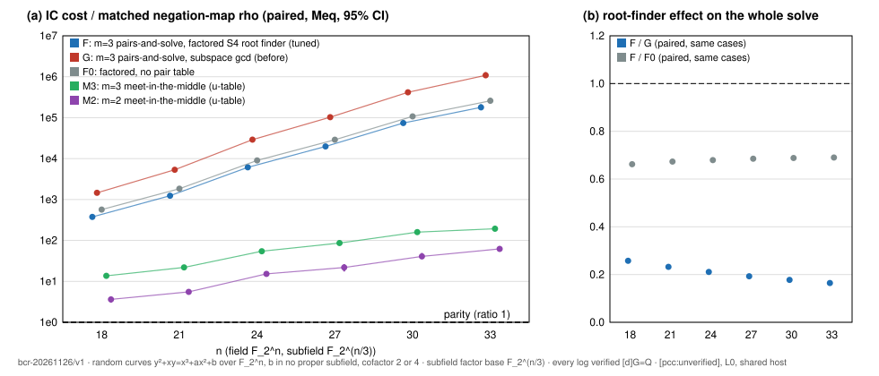

# Binary composite IC with the tuned S4 root finder, against matched rho

**Date:** 2026-11-26. **Study:** `bcr-20261126/v1`. **Status:** `[pcc:unverified]`, L0.
The runs were on one shared 4-vCPU cloud container, not on isolab.

This is not a leaderboard row, a `benchmarks/README.md` row, or a speedup
claim. It measures the remaining gap. Workspace goal: "Binary composite index
calculus to Pollard-rho parity". Tracking PR: isogeny-labs/crypto#5253.

- **Protocol:**
  - [`PROTOCOL.md`](PROTOCOL.md) and [`protocol.json`](protocol.json), frozen
    before data;
  - amendments [`PROTOCOL_A1.md`](PROTOCOL_A1.md) and
    [`PROTOCOL_A2.md`](PROTOCOL_A2.md), each frozen before its own data;
  - hashes in [`SEEDS.sha256`](SEEDS.sha256).
- **Instrument:** [`harness/`](harness/). It is a standalone crate that
  `#[path]`-includes crypto's `semaev_decomp.rs`, `binary_radical_root.rs` and
  `binary_ecc/f2m.rs` unchanged, with counted ports of
  `FactoredSubspaceOracle`, `SubspaceOracle` and the ledger's negation-map rho.
- **Data:**
  - primary: `data/runs_a2.jsonl` (IC) and `data/runs.jsonl` (rho);
  - merged: `data/runs_primary.jsonl` (regenerated by the reproduce commands, not committed);
  - frozen-run IC records and the stopped A1 records are kept beside them.
- **Analysis:** `bcr_harness analyze`. Output is `data/summary.json`, with
  `data/summary_frozen.json` for the frozen run.
- **Figure:** [`figures/gap_to_rho.svg`](figures/gap_to_rho.svg) (also `.png`).
  **PDF:** [`REPORT.pdf`](REPORT.pdf).



## Answer

**Does the tuned root finder move the cold single-target IC cost?** Yes, by
a constant: **3.9× at n = 18 to 6.1× at n = 33**.

- The m = 3 pairs-and-solve arm with the factored S₃·S₃ route and pair table,
  arm F, costs **0.258 → 0.164×** the same arm with the subspace gcd, arm G. The
  ratios are paired on the same cases and the CI widths are below 0.001. The
  gain grows with n because the gcd's per-pair cost grows with n′.
- The ordering holds across the whole §5a band, with F/G from 0.125 to 0.257.
- About a third of the gain is the pair table: F/F0 = 0.66–0.69.

**Does it move the gap to rho?** No. The gap stays very large and keeps
growing.

- F/rho runs from **376× [331, 427]** at n = 18 to **1.8·10⁵×
  [1.6·10⁵, 2.1·10⁵]** at n = 33.
- The fitted slope of log cost against log ℓ is **0.98 [0.97, 0.99]** for F
  and 0.37 for rho. The difference is +0.61 [0.60, 0.63].
- This is what the counting argument frozen in PROTOCOL.md predicts.
  Pairs-and-solve costs about `(3/8)·N·c_rf` whatever the root finder, so
  the root finder scales only `c_rf`.

**Distance to parity.** The cheapest IC arm on these rungs is not a root
finder but the hash meet-in-the-middle **M2**: m = 2, with a u-table of base
pairs probed by x(R). It is still **3.6× [3.0, 4.2] above rho at n = 18,
growing to 62× [54, 73] at n = 33**.

The other arms, measured against M2:

- The tuned root-finder arm F sits 100× (n = 18) to 2,900× (n = 33) above M2.
- The S₃·S₃ factorisation turned into a hash (M3) comes within 3–4× of M2.

No rung reaches parity. Each CI's lower bound is above 1 by at least a factor
of 3.0.

## Main table (A1 + A2, primary)

Cost unit: Meq, priced as follows.

- Field: multiplication, squaring and inversion at its Itoh–Tsujii census
  (all at weight 1).
- Native units: table map, hash probe, product and addition mod ℓ, each 1.
- The whole cold solve is charged: factor base, pair table, target stream,
  root finding, relation replay, linear algebra, and `[d]G = Q`.

Paired ratio: each case's IC cost over the mean of 16 rho runs on the same
`Q`. Values are geometric means over cases with a hierarchical bootstrap 95%
CI (B = 10000).

| n | n′ | log₂ℓ | cases | rho S (Meq/√ℓ) | **F/rho** (tuned) | G/rho (gcd) | F0/rho | M3/rho | **M2/rho** (best IC) | **F/G** |
|---|---|---|---|---|---|---|---|---|---|---|
| 18 | 6 | 16.0 | 12 | 36.9 | 376 [331, 427] | 1,459 [1,285, 1,657] | 568 | 13.7 [11.9, 15.5] | 3.6 [3.0, 4.2] | 0.258 |
| 21 | 7 | 20.0 | 12 | 20.6 | 1,237 [1,152, 1,337] | 5,330 [4,961, 5,767] | 1,838 | 22.0 [20.1, 24.0] | 5.5 [4.9, 6.3] | 0.232 |
| 24 | 8 | 22.0 | 12 | 17.2 | 6,126 [5,569, 6,863] | 29,050 [26,450, 32,550] | 9,018 | 54.4 [49.5, 61.0] | 15.2 [13.3, 17.2] | 0.211 |
| 27 | 9 | 25.5 | 12 | 12.5 | 19,810 [17,630, 22,460] | 102,700 [91,450, 116,400] | 28,910 | 86.5 [76.3, 99.3] | 21.9 [17.4, 26.4] | 0.193 |
| 30 | 10 | 28.0 | 12 | 11.4 | 73,920 [65,620, 84,800] | 416,400 [369,700, 479,200] | 107,400 | 160 [140, 187] | 40.7 [35.7, 49.5] | 0.178 |
| 33 | 11 | 32.0 | 4 | 8.9 | 178,500 [155,500, 212,000] | 1,085,000 [945,800, 1,292,000] | 258,600 | 193 [168, 230] | 62.1 [54.1, 72.5] | 0.164 |

Further notes on the table:

- **CIs.** The F/G CIs have width < 0.001, because both arms run on the same
  relation stream.
- **F/F0** (the pair table's share) is 0.662, 0.673, 0.679, 0.685, 0.688 and
  0.690 for n = 18 to 33.
- **Wall time** (indicative, shared host): F/rho 333× → 1.7·10⁵×, M2/rho
  4.5× → 98×, F/G 0.43–0.49. The wall F/G is less favourable than the count
  because G's wall at n ≥ 27 is scaled from a subset.
- **§5a band.** Over u ∈ {0, 0.1, 1} and s ∈ {1, 0.25}:
  - F/rho: 296–593 (n = 18) and 1.39–2.06·10⁵ (n = 33);
  - M2/rho: 3.0–5.0 and 49–62;
  - F/G: 0.125–0.257.
  - Every arm order stated here holds across the band.

**Exponent fit** (log₂ cost on log₂ ℓ, 64 cases per arm, bootstrap 95% CI):

| arm | slope | minus rho |
|---|---|---|
| rho | 0.368 [0.361, 0.374] | — |
| F | 0.980 [0.970, 0.991] | +0.612 [0.600, 0.625] |
| F0 | 0.976 | +0.608 |
| G | 1.024 [1.013, 1.035] | +0.655 [0.643, 0.668] |
| M3 | 0.646 [0.637, 0.657] | +0.278 [0.267, 0.291] |
| M2 | 0.651 [0.637, 0.665] | +0.283 [0.267, 0.299] |

Rho's slope of 0.37 is pre-asymptotic. Its S falls from 36.9 to 8.9 as the
fixed set-up (jump table and starts by unbatched scalar multiplication) is
amortised. Once S flattens, rho's slope approaches 0.5. The asymptotic gaps
are therefore about +0.48 for F and +0.15 for M2/M3: F and G go as N¹ and the
MITM arms as N^{2/3}. All of these are trends over 6 rungs at n ≤ 33, not
asymptotic exponents.

## What the root finder buys, per unit (op census)

Per u value in stage B, F costs **11.0 m + 3.0 s + 4.0 table maps** at every n.
There are two u per base pair, plus about 0.002–0.03 inversions per u, amortised
by batching.

Per base pair, G costs **113 → 176 m + 23 → 43 s** over n = 18 → 33, growing
with n′, the number of Frobenius squarings mod f. That growth is why F/G falls
with n. Taken per root find, this reproduces REPORT_1C's component result
(0.07–0.22×) inside a full solve.

The solves themselves:

- **F / G / M3.** These consume 176 → 5,470 targets and 37 → 950 relations, against
  30 → 1,029 base points. Every target scans every one of the F²/2 base pairs,
  so the target count times F² is what sets the N¹ cost.
- **M2.** It consumes 2.2·10³ → 2.4·10⁶ targets but costs only one group
  addition (batched) and one probe per target. Its table holds 870 → 1.06·10⁶
  keys. At n = 33 the table and the target stream are each about 10⁷ Meq,
  against rho's 5.8·10⁵.

## Verification

| check | result |
|---|---|
| Recovered logs, primary data | **1344 / 1344 correct**: 320 IC solves (5 arms × 64 cases) and 1024 rho runs, each with `[d]G = Q` checked inside the counted solve and `d = d_true` checked by the evaluator |
| Relations | every relation resolved by the group law (`P₁ ± P₂ (± P₃) = ±R` exactly); 0 unresolved |
| F vs G root sets | identical on every target where G ran (all targets at n ≤ 24; first 256/128/64 at n = 27/30/33): **0 mismatches** |
| Self-test, before every freeze | the counted quartic is proportional to crypto `quartic_in_x3_general` on 2000 inputs; F = G = M3 triple sets on 300 targets per field, consistent with crypto `FactoredSubspaceOracle` / `SubspaceOracle` decisions; group-law associativity; A1+A2 on 36 separate self-test solves |
| Replay | n = 24 and n = 30 case (0, 0) rerun from the frozen manifest: every arm's d, targets, relations, columns, op totals and rho steps **bitwise equal** (`data/replay_a2_compare.txt`); the frozen-protocol n = 24 case also replays bitwise with the amended binary (`data/replay_frozen_compare.txt`) |

## Deviations, kept and reported (negative results included)

1. **Frozen run** (`data/runs.jsonl`, 1344 records, 4 failures). The frozen
   relation-target stream was an r-adding walk, which cycles:
   - M2 consumes more targets than the cycle length, so every M2 case
     repeated targets (`data/dupcheck_frozen_stream.jsonl`). 4 of 64 M2
     solves failed.
   - The frozen M2 successes partly used the cycle itself: a repeated target
     with different `(a, b)` is a rho collision. That is why frozen M2 looks
     cheaper at n ≥ 24 (9.2 → 32.6×) than A2 M2 (15.2 → 62.1×). The frozen
     M2 figures should not be used.
   - The frozen F/G/M3 figures agree with A2 within the CIs: F/rho 435 → 1.8·10⁵,
     F/G 0.258 → 0.164 (`data/summary_frozen.json`,
     `figures/gap_to_rho_frozen.svg`).
2. **A1** (cycle-free target stream) exposed a defect in the frozen linear
   algebra:
   - Wiedemann returned `B^t·g(B)v`, which lies in the image of `B` and so
     only finds dependencies among the first `ncols` rows.
   - 90 of 223 A1 records failed. The run was stopped and the records are kept
     in `data/runs_a1_stopped.jsonl`.
3. **A2** replaced the LA with incremental echelon elimination mod ℓ, stopping
   at the first dependency with Σb ≠ 0. It was frozen before data and is the
   primary run.

Both amendments change shared infrastructure of all IC arms equally. They do
not change any root finder, and the F/G conclusion is the same under all
three runs.

## Not tested, and gaps

- **Koblitz rungs (Frobenius rho).** Not run. At k = 3 a subfield-base point
  on a Koblitz curve lies in E(F_{2^{n′}}), whose order is prime to ℓ, so
  the base projects to O. A Koblitz rung needs a non-subfield base
  (`protocol.json`, "untested").
- **GHS descent** was not run.
- **Rungs.** The panel is k = 3 only, n ≤ 33, and n = 33 has 4 cases.
- **Rho shape.** Rho is the ledger's negation walk, with lanes tuned on
  held-out pilot curves (W = 8, 16, 32, 16, 16, 64). The fixed set-up is
  unbatched for both rho and the IC arms. At small n it dominates rho
  (S = 37 at n = 18), so the small-rung ratios understate the gap rho would
  give with a cheaper set-up.
- **L0 only.** No isolab or EKS run, by the host constraints of this task. No
  `bench.record`, no S3 raw upload and no `.resume/` checkpoint. The raw
  JSONL is in Git, and the largest file is under 1 MB.
- **Curve names.** Curves are named by parameters in `data/curves.jsonl`; no
  ICV1 slugs are registered.
- **research-kb.** The MCP server was not available in this session, so the
  prior-art check is the lab's own notes only (workspace
  `graph-theory-ic-20261121.md` §15–16 and `summation-rootfind-20261124/`).
- **Python.** It was used only for text edits to source files. No measurement,
  analysis or replay comparison ran in Python (the analysis is Rust; the
  replay comparison is `jq`/bash).

## What this means for the goal, and the next step

The root finder is a real engineering gain: a component speedup of 4–6× on
the whole solve of the S4 pairs-and-solve arm, verified. It is aimed at the
wrong loop for parity, though. Any "enumerate m − 1 summands, solve for the
last" relation step is Θ(N), whatever the root finder.

On composite n with k = 3, the only arms here that scale below N are the hash
arms, at N^{2/3}. They sit 3.6–62× above rho and are losing ground. Their
cost is split about evenly between the pair table and the target stream
(about 10⁷ Meq each at n = 33).

**Concrete next step: Gaudry–Diem proper at k = 3.**

- Weil-descend `S₄(x₁, x₂, x₃, x_R) = 0` over `F_{2^n}/F_{2^{n′}}` into 3
  equations in 3 unknowns over `F_{2^{n′}}`.
- Eliminate to one univariate polynomial of degree ≤ 48 (mixed volume
  3!·2³).
- Root-find it in `F_{2^{n′}}`. This is where a fast subfield root finder
  would actually matter.

That gives a per-target cost polynomial in n′ instead of `2^{2n′}`, and with
double large primes an asymptotic `Õ(q′^{4/3}) = N^{4/9}` below rho.

The measurement to make is the per-target constant `C(n′)` of that solver,
priced in this harness's Meq and against this same rho. The question is where
`3·q′·C(n′)` (plus LA) would cross `0.886·√ℓ·(rho Meq per step)`. The
reusable pieces are here: field, curves, targets, relation replay, echelon LA
and matched rho.

## Reproduce

```bash
cd research/binary-composite-rootfind-20261126/harness
CARGO_BUILD_JOBS=1 CARGO_INCREMENTAL=0 cargo build --release
B=$PWD/target/release/bcr_harness
$B selftest 24 8
cd .. && $B run protocol.json data/runs.jsonl 2          # frozen run (its rho records are reused)
$B run protocol_a2.json data/runs_a2.jsonl 2              # primary IC run (A1 + A2)
(cat data/runs_a2.jsonl; jq -c 'select(.arm=="RHO")' data/runs.jsonl) > data/runs_primary.jsonl
$B analyze protocol_a2.json data/runs_primary.jsonl data/summary.json figures/gap_to_rho.svg
$B run data/replay_protocol_a2.json data/replay_a2.jsonl 1 && data/replay_compare.sh data/runs_a2.jsonl data/replay_a2.jsonl
```

The binary hashes and run times are in `data/run_manifest.txt`.
