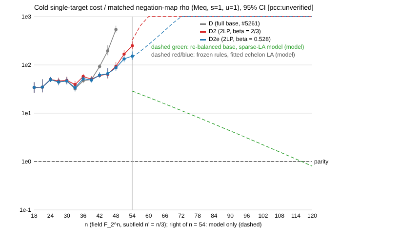

# Double-large-prime Weil descent (arm D2) against matched rho on binary composite fields

2026-11-27 · branch `claude/binary-descent-2lp-20261127` · PR #5291, stacked on PR #5261 (itself on #5253) · study
`b2lp-20261127/v1`. All measured numbers are **[pcc:unverified]**: L0 producer evidence from one shared 4-vCPU / 15 GB
container, no second-host replay, no validation gate, not a leaderboard row. **Single target only**: every solve is one
cold solve of one public Q.

## Result

- **No parity at any rung, n = 18..54.** The whole cold solve with D2 (2LP, small base ⌈4·F^{2/3}⌉) costs
  **34× to 64× matched negation-map rho for n ≤ 45**, then **94× at n = 48, 167× at n = 51 and 250× at n = 54**.
  The secondary rule D2e (base ⌈16·F^{0.528}⌉) is cheaper at the top: 87×, 133×, 152×.
- **Against arm D (#5261) the 2LP graph removes most of D's linear algebra**: D2/D = 0.65 at n = 42, 0.33 at n = 45 and
  **0.17 [0.165, 0.186] at n = 48** (D2e/D 0.16) at the primary price u = 1. **This order is not stable across the §5a
  band**: all of the LA is mod-ℓ work (non-field units), so at u = 0 D2 is 1.6–2.7× D (D2 consumes more targets). D2 vs
  D is therefore *unresolved* under §5a at n ≥ 39; it holds at u ∈ {0.1, 1} only at n = 48 (0.54 and 0.17).
- **The relation phase does what the 2LP model says; the echelon does not.** D2's targets/q′ grows like F^{1/3} as
  predicted (2.75 → 10.5, within 11% of the pre-registered simulation at every predicted rung), its relation phase
  alone falls to **23× rho at n = 54**, and the graph costs ≤ 2.3% everywhere. But the echelon on the cycle-combined rows
  (mean weight 12–14, fill-in to dense) grows like fs^{3.8}, so LA is 71% of D2 at n = 48 and 91% at n = 54, and the
  whole-solve slope on n ≥ 36 is **0.584 [0.575, 0.593]** against rho's 0.495 [0.485, 0.505]. The 2LP exponent 4/3
  (slope 4/9 in ℓ) is **not reached with the echelon**.
- **Crossover with rho (model, not measurement):** with the fitted echelon, neither frozen rule crosses for n′ ≤ 64
  (minimum ≈ 55× at n ≈ 40). Replacing the LA by a sparse-LA model (`3·w̄·fs²`, w̄ = 12, not measured), D2's frozen
  rule crosses at **n′ = 40 (n ≈ 120)** and a base re-balanced at each n′ at **n′ ≈ 38.75 (n ≈ 116)**. A post-freeze
  sensitivity with the 2LP counting shape for targets (p_α → −1) moves this to **n ≈ 160–166**. #5261's "n ≳ 130 before
  constants" sits inside that band. **Only a sparse LA (the parallel lane) can make the 2LP crossover real.**

## What D2 is

`harness/src/main.rs` (`run_d2`) and `harness/src/graph.rs`. Everything else is reused unchanged by `#[path]`: #5253's
field, curves, factor base, A1 relation-target stream, group-law sign resolution, A2 echelon and rho; #5261's
`descent.rs` (Gaudry–Diem k = 3 Weil descent of the symmetric S₄ to a degree-16 U′ over K′ = F_{2^{n′}}, subfield
roots, exact lift).

1. **Small base** = factor-base columns 1..fs (T is column 0 and never appears), `fs = min(F − 1, ⌈θ·F^β⌉)`.
   **Large primes** = every other subfield point that lifts to E(F_{2^n}).
   - D2: β = 2/3 (the k = 3 2LP balance: targets ∝ F²/fs against LA ∝ fs², total ∝ q′^{4/3}), θ = 4.
   - D2e: β = 0.528 = 2/(γ+1), γ = 2.79 (#5261's measured echelon exponent), θ = 16.
   - θ chosen by a pre-registered held-out pilot (`d2pilot-*` curves, n = 30/36/42, 144 records).
2. Each decomposition from the unchanged oracle is resolved into signs by the group law. 0 large primes → LA directly;
   1 → edge to the special vertex SV; 2 → edge; 3 → discarded.
3. **Signed large-prime graph.** Union-find for components, a spanning forest (parent pointers carrying each edge's
   relation) for paths. Classes are ±P and coefficients ±1/±2, so a cycle cancels its large primes over Z/ℓ only if it
   is *balanced*. A component is grounded when it contains SV or one frustrated cycle (kept as its grounding relation).
   An edge yields one small-base relation when it closes a cycle in a grounded component or a balanced cycle anywhere,
   or joins two grounded components; so yields = edges − rank(signed incidence) and nothing is lost (checked in the
   self-test on planted logarithms).
4. Yields are fed, in order, to #5253's A2 echelon, which stops at the first dependency that determines d.
5. All graph work is counted (union-find, parent, re-root and classification steps as `h`; mod-ℓ products, additions
   and inversions as `z`, `za`) in a separate phase `graph`.

## Design

Protocol: [`PROTOCOL.md`](PROTOCOL.md), [`protocol.json`](protocol.json). Part A (pilot rule) was committed before the
pilot (`28290f5d9`); part B (arms, rungs, checks, predictions) before any evaluation data (`4b51bb81a`). Hashes:
[`SEEDS.sha256`](SEEDS.sha256), frozen run binary `6a004a72…`.

- **Cases.** n = 18..48: #5261's 116 cases exactly (4 curves × 3 targets; 2 × 2 at n = 33, 48). New rungs: n = 51
  (2 × 2), n = 54 (2 × 1).
- **References.** D: #5261's records (n ≤ 48). Rho: 16 seeds per target, #5253 (n ≤ 33), #5261 (n = 36..48), this
  study (n = 51, 54; #5253's rho module unchanged, lanes W = 128 / 64 from a held-out pilot over W ∈ {16..256}).
- **Statistics.** Per-case ratios, geometric mean per rung, 95% hierarchical bootstrap (curves, targets, rho seeds),
  B = 10000 (primary) / 2000 (band). Seed policy `isogeny-labs/experiment-seeds/v1`.

## Per-rung results

Full table with all ratios: [`data/summary_table.md`](data/summary_table.md); everything:
[`data/summary.json`](data/summary.json). Meq at s = 1, u = 1. [pcc:unverified]

| n | cases | D2/rho | D2e/rho | D/rho | D2/D | D2e/D | D2/D2e | rho A/A |
|---|---|---|---|---|---|---|---|---|
| 18 | 12 | 34.2 [26.5, 43.7] | 34.2 [26.6, 44.0] | 34.2 [26.6, 43.6] | 1.000 | 1.000 | 1.000 | 1.02 [0.95, 1.10] |
| 21 | 12 | 34.6 [27.1, 50.4] | 34.6 [27.1, 50.5] | 34.6 [27.0, 50.1] | 1.000 | 1.000 | 1.000 | 0.96 [0.91, 1.02] |
| 24 | 12 | 49.9 [44.9, 56.2] | 49.5 [44.7, 55.8] | 49.5 [44.6, 55.8] | 1.008 [1.004, 1.014] | 1.000 | 1.008 | 1.02 [0.87, 1.20] |
| 27 | 12 | 46.5 [40.5, 54.4] | 44.3 [38.0, 52.3] | 44.3 [37.9, 52.5] | 1.049 [1.025, 1.079] | 1.000 | 1.049 | 1.03 [0.89, 1.18] |
| 30 | 12 | 47.7 [40.9, 57.2] | 46.5 [39.6, 55.5] | 46.4 [39.5, 55.7] | 1.029 [1.019, 1.041] | 1.003 | 1.026 | 0.95 [0.82, 1.12] |
| 33 | 4 | 39.2 [34.4, 46.6] | 33.8 [29.3, 40.2] | 32.1 [28.1, 37.9] | 1.223 [1.212, 1.234] | 1.053 | 1.161 | 0.82 [0.71, 0.96] |
| 36 | 12 | 57.5 [50.9, 65.3] | 51.7 [46.4, 58.4] | 47.1 [42.1, 53.3] | 1.220 [1.186, 1.257] | 1.097 | 1.113 | 1.01 [0.84, 1.19] |
| 39 | 12 | 50.7 [45.0, 58.1] | 48.7 [43.3, 55.8] | 49.8 [44.9, 56.3] | 1.018 [0.966, 1.079] | 0.979 [0.924, 1.037] | 1.041 | 1.14 [0.96, 1.35] |
| 42 | 12 | 60.2 [54.7, 67.7] | 61.3 [55.0, 70.9] | 92.6 [84.6, 103.1] | 0.651 [0.620, 0.683] | 0.662 [0.621, 0.712] | 0.982 | 0.97 [0.89, 1.09] |
| 45 | 12 | 64.0 [52.2, 85.0] | 65.8 [54.1, 86.1] | 195 [158, 255] | 0.328 [0.310, 0.344] | 0.337 [0.321, 0.352] | 0.974 | 0.98 [0.84, 1.17] |
| 48 | 4 | 93.6 [77.0, 115.1] | 87.2 [75.0, 103.6] | 541 [454, 647] | 0.173 [0.165, 0.186] | 0.161 [0.149, 0.174] | 1.074 | 0.85 [0.64, 1.13] |
| 51 | 4 | 167 [142, 202] | 133 [114, 162] | — | — | — | 1.256 [1.233, 1.284] | 1.04 [0.97, 1.12] |
| 54 | 2 | 250 [212, 308] | 152 [128, 190] | — | — | — | 1.641 [1.625, 1.658] | 1.26 [1.14, 1.39] |

D (#5261) is not run at n ≥ 51 (echelon on F ≈ 6.5·10⁴ columns needs ≳ 30 GB). At n ≤ 21 the rule saturates (fs = F − 1)
and D2 is D exactly. The n = 33, 48, 51 rows have 4 cases and n = 54 has 2; their CIs understate between-curve spread.
The rho A/A at n = 54 (2 cases) is 1.26 [1.14, 1.39], i.e. rho noise there is about ±25% and that rung's ratios carry it.

**Phase split and census of D2** (means per rung). [pcc:unverified]

| n | fs/F | targets/q′ (pred) | yields | 2LP share | yield weight | relation phase/rho | graph | LA share | wall s |
|---|---|---|---|---|---|---|---|---|---|
| 24 | 102/127 | 2.92 (2.62) | 96 | 0.10 | 3.4 | 49.4 | 0.2% | 0.9% | 0.02 |
| 30 | 257/514 | 2.86 (3.05) | 238 | 0.73 | 10.5 | 44.9 | 2.3% | 3.6% | 0.10 |
| 36 | 650/2067 | 3.88 (3.96) | 616 | 0.65 | 6.9 | 51.0 | 0.3% | 10.9% | 0.57 |
| 42 | 1629/8215 | 5.23 (5.21) | 1580 | 0.79 | 9.2 | 38.4 | 0.2% | 36.0% | 6.1 |
| 45 | 2580/16376 | 6.19 (6.17) | 2519 | 0.83 | 10.6 | 29.6 | 0.1% | 53.7% | 30 |
| 48 | 4084/32616 | 7.44 (7.33) | 4019 | 0.87 | 12.1 | 27.4 [23.6, 32.3] | 0.06% | 70.7% | 119 |
| 51 | 6518/65768 | 8.75 (8.74) | 6448 | 0.90 | 13.9 | 27.7 [23.4, 33.7] | 0.03% | 83.4% | 678 |
| 54 | 10315/130944 | 10.53 (—) | 10247 | 0.92 | 81.2 | 23.4 [19.6, 29.4] | 0.1% | 90.6% | 3435 |

"2LP share" is the share of 2-large-prime rows among the partial relations the graph used. D's relation phase over rho,
for comparison: 35.7, 20.2, 13.2, 10.3 at n = 36, 42, 45, 48. D2's relation phase is 2.7× D's at n = 48 because it
needs 2.7× the targets; the 2LP saving is entirely in the LA.

**The n = 54 yield weight (81, against 14 at n = 51) is a property of this implementation**: the spanning forest is built
by re-rooting the joining component under the endpoint, never re-balancing depth, and at n = 54 the maximum path
reduction grew from ≈ 50 to ≈ 360–650 steps. Longer paths give denser combined rows and a costlier echelon. A
shortest-cycle (BFS-tree) combination would give lighter rows; it was not part of the frozen arm and was not run.

**Slopes** of log₂ cost on log₂ ℓ (bootstrap 95%):

| series | slope |
|---|---|
| rho, all rungs / n ≥ 36 / n ≥ 48 | 0.437 / 0.495 [0.485, 0.505] / 0.452 [0.418, 0.489] |
| D (n ≤ 48, #5261) | 0.511 [0.504, 0.517] |
| D2, all / n ≥ 36 / n ≥ 48 | 0.481 / **0.584 [0.575, 0.593]** / 0.679 [0.652, 0.719] |
| D2e, all / n ≥ 36 / n ≥ 48 | 0.477 / 0.574 [0.565, 0.583] / 0.588 [0.568, 0.619] |
| D2 relation phase, all | 0.425 [0.419, 0.430] |
| D2e relation phase, all | 0.424 [0.418, 0.430] |

**Cost band (§5a).** Non-field units at u = 0, 0.1, 1; squarings at s = 1, 0.25.

- D2 > rho and D2e > rho at every rung across the whole band (lowest: D2/rho 23.3 at n = 54, u = 0).
- D2 vs D: unresolved at every rung from n = 33 on. At u = 1 D2 < D from n = 42; at u = 0.1 only at n = 48 (0.54);
  at u = 0, D2/D = 1.65, 1.90, 2.24, 2.66 at n = 39..48. The LA that D2 saves is all mod-ℓ (non-field) work.
- D2 vs D2e: at u = 1, D2e is cheaper from n = 51 (D2/D2e 1.26 and 1.64 at n = 51, 54); across the band the order is
  unresolved at n ≥ 39.

## Crossover with rho (model, labelled as such)

Frozen projection (`data/summary.json` → `projection`), fitted on all D2/D2e records:

- relation + graph per target: 372 + 255·n′ + 12.8 Meq; targets/F = e^{1.58}·(fs/F)^{−0.653}·F^{−0.024};
  echelon LA = 2^{−13.8}·fs^{3.84}; rho S_top = 7.9 (mean of n = 51, 54); h̄ = 3.38.

| model | first n′ with ratio ≤ 1 | n | minimum ratio |
|---|---|---|---|
| D2 frozen rule, fitted echelon | none (n′ ≤ 64) | — | 55 at n′ = 13.25 |
| D2e frozen rule, fitted echelon | none | — | 56 at n′ = 11 |
| D2 frozen rule, sparse-LA model 3·w̄·fs² | 40.0 | ≈ 120 | 0.037 at n′ = 64 |
| D2e frozen rule, sparse-LA model | 45.75 | ≈ 137 | 0.089 at n′ = 64 |
| base re-balanced per n′, sparse-LA model | 38.75 | ≈ 116 | 0.012 at n′ = 64 |

The straight-line extrapolation of the measured slopes (n ≥ 36 and n ≥ 48) never crosses: D2's slope exceeds rho's.

**Post-freeze sensitivity (not part of the frozen analysis;** `b2lp_harness sensitivity`,
[`data/sensitivity_posthoc.txt`](data/sensitivity_posthoc.txt)). The frozen fit's p_α = −0.65 comes from rungs with
α = fs/F ≥ 0.08 and is optimistic as α → 0. Refitting targets/F = K(c + α)/(1 − (1 − α)³) (the 2LP counting shape,
p_α → −1; K = 0.95, c = 5.0, rms log residual 0.047 over 21 rows): sparse-LA D2 crosses at **n ≈ 166**, re-balanced at
**n ≈ 160**; with the echelon still no crossover (minimum 49× at n ≈ 38).

## Predictions against outcome

Pre-registered in PROTOCOL.md part B.

- **H1 (exactness): held.** Every log correct (D2 122/122, D2e 122/122, D2all 88/88); 366,640 relations group-law
  checked, 0 failures; D2all ≡ D on 88/88 cases (d, targets, relations, columns); D2 and D2e d = D's d on 232/232
  shared cases; 0 unresolved rows; 0 capped solves.
- **H2 (targets ±25% of simulation): held** at every predicted rung (largest deviation +11% at n = 24, −6% at n = 30).
- **H3 (cycle yield): held**, except that yields exceed fs at the saturated rungs n = 18, 21 (repeated rows count as
  yields there, as in D). Yields/fs 0.94–0.993 for n ≥ 24; 2LP share ≥ 0.83 for n ≥ 45; groundings ≤ 2 per solve
  (≤ 0.03% of yields); yield weight 12.1 / 13.9 at n = 48 / 51, but 81 at n = 54 (not predicted; see above).
- **H4 (LA split): held** (LA < 5% for n ≤ 33; 71%, 83%, 91% at n = 48, 51, 54; predicted 72% at n = 48), **except
  graph share < 2% everywhere: missed at n = 30 (2.3%)**, driven by one case with long reductions.
- **H5 (gap): partly falsified.** No parity (held). D2/D in 0.8–1.4 at n ≤ 39 (held, 1.00–1.22), ≤ 0.5 at n = 45
  (0.33) and ≤ 0.3 at n = 48 (0.17) held. **D2/rho ≤ 200 failed at n = 54 (250).**
- **D2e within ±20% of D2: held for n ≤ 48** (max 1.16) and **failed at n = 51, 54** (1.26, 1.64).
- **H6 (exponent): held.** D2 slope n ≥ 36 = 0.584 (predicted 0.59) > rho's 0.495; relation phase 0.425 < rho's 0.437
  over all rungs.
- **H7 (crossover model): held.** No echelon crossover; sparse-LA crossover at n ≈ 116–120 (frozen fit), 160–166
  (sensitivity), bracketing #5261's ≳ 130.

## Verification

- Logs: `[d]G = Q` inside every counted solve and `d = d_true` by the evaluator, 332/332 D2-type solves.
- Every relation fed to the LA (full or cycle-combined) checked exactly in E:
  `Σ e_c·[h]P_c = [a]([h]G) + [b]([h]Q)`, 366,640 checks, 0 failures (uncounted, wall excluded).
- D2all reproduces #5261's D records on 88/88 cases (n = 18..39).
- Graph self-test on planted logarithms (4 graphs, F up to 2000): every yield satisfies the planted logs and the rank
  identity `1LP + 2LP = yields_cycle + yields_join + groundings + tree_edges` holds; 48 selftest solves (n = 24, 30)
  correct ([`data/selftest_prefreeze.log`](data/selftest_prefreeze.log)).
- Replay: n = 30, ci = 0, ti = 0, arm D2 rerun from the frozen manifest, identical in every field but wall times
  ([`data/replay_compare.txt`](data/replay_compare.txt)).

## Deviations (all kept)

1. The n = 57 / 60 rho-lane pilot cells were stopped part-way (255 of 320 records kept; they choose nothing), and the
   prediction simulation stopped after one n = 51 replicate, because the simulated echelon at those sizes takes hours.
   Both are recorded in PROTOCOL.md before part B. n = 57, 60 were not run (resource), as frozen.
2. `run.sh` iterates the rho and main loops over n = 57 too; with no n = 57 rung in `protocol.json` those processes
   exited at once with no records (`data/run_manifest.txt`).
3. Post-freeze code: `pilot-summary`, `predict-summary` and `sensitivity` subcommands were added to `analysis.rs`; the
   frozen `analyze` path is unchanged (the frozen binary `6a004a72…` produced `summary.json`). The sensitivity is
   labelled as post-freeze everywhere it is cited.
4. #5261's `bwd_harness` rebuilt from its branch head hashes to `954ca6bd…`, not its run binary `c704c7b6…` (#5261
   changed only its analysis after its run, its deviation 2); D's records are reused, not rerun.

## Not done

- Measurement infrastructure as #5253/#5261: isolab/L2, bench.record, S3 upload, `.resume/` checkpoint, ICV1 slugs,
  `benchmarks/` copy and VALIDATION.json (no row is proposed for the leaderboard). No Conductor task (not installed).
- research-kb prior-art check: the MCP server is not available in this session; the derivation cites Gaudry 2009 and
  Gaudry–Thomé–Thériault–Diem 2007 from memory.
- Sparse LA (being built in a parallel lane; deliberately not used). It is the binding piece: with it the model
  crosses; with the echelon it does not.
- A depth-controlled or shortest-cycle forest (lighter combined rows; the n = 54 weight jump), single-large-prime
  variant, Koblitz rungs, GHS, n ≥ 57.

## Reproduce

    cd harness && CARGO_BUILD_JOBS=2 cargo build --release   # sha256 in SEEDS.sha256
    cd .. && harness/target/release/b2lp_harness selftest 24 8
    ./run.sh main; ./run.sh rho                              # data/runs_d2.jsonl, data/runs_ext_rho.jsonl
    data/merge.sh && harness/target/release/b2lp_harness analyze protocol.json data/runs_primary.jsonl data/summary.json figures/gap_to_rho.svg
    ./run.sh replay && data/replay_compare.sh
