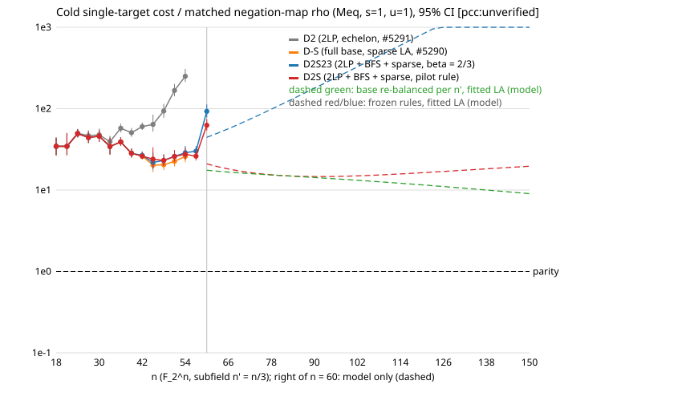

# Arm D2S: 2LP Weil descent with a BFS forest and sparse LA, against matched rho

2026-11-27/28 · branch `claude/binary-descent-2lp-sparse-20261127` · PR #5301, stacked on PR #5291 (with #5290's study
directory copied in) · study `b2lsp-20261127/v1`.

All measured numbers here are **[pcc:unverified]**. They are L0 producer evidence from one shared 4-vCPU / 15 GB
container. There is no second-host replay and no validation gate, and nothing here is a leaderboard row.

**Single target only:** every solve is one cold solve of one public Q. Nothing is amortised across targets.

## Result

- **There is no parity at any rung from n = 18 to n = 60, and D2S never beats D-S.**
  - From n = 45 to n = 57 the whole cold solve with D2S costs **23–28× matched negation-map rho**: 24.0, 23.1, 25.9,
    27.5 and 26.1 at n = 45, 48, 51, 54 and 57.
  - At n = 60 it costs **62.5× [53.8, 74.7]**.
  - At n ≤ 42 the frozen base rule saturates, so D2S has the same relation set as D-S. It equals D-S/rho to within 0.1%.
- **Against D-S (#5290), D2S is 6–18% more expensive at n = 45..54.**
  - D2S/D-S is 1.18, 1.13, 1.15 and 1.06 at n = 45, 48, 51 and 54.
  - This order holds at every point of the §5a band, so D-S is the cheaper arm at these rungs.
  - The 2LP base pays only in the LA. That LA is about 2–14·fs² because the combined rows are heavy, while D-S's LA is
    0.75·F². So the saving does not cover the extra relation phase before n ≈ 54, which is where the held-out pilot
    already put the break-even point.
- **Against D2 (#5291), D2S is 2.3–8.5× cheaper.**
  - D2S/D2 is 0.25 at n = 48, 0.17 at n = 51 and **0.118 [0.117, 0.120] at n = 54**.
  - This order holds across the whole band.
  - It means the sparse LA plus the BFS forest removes most of D2's echelon cost.
- **BFS keeps the combined rows light up to n = 57, but not at n = 60.**
  - Up to n = 57, the mean row weight is 4.3, 5.1, 6.0 and 7.1 (n = 48..57) and the mean cycle length is ≤ 5.4. D2's
    row weight was 81 at n = 54.
  - At n = 60 the mean row weight jumps to 21.4 and the cycles to a mean length of 21.6 (maximum 54). LA/fs² goes from
    14 to 40, and the gap goes from 26× to 62×.
  - The uniform-class simulation predicted a weight of 8.3 there, and it matched the measured census to within 1% at
    n = 54 and 57. At n = 60 the real run has 2.0× the predicted full rows and 0.83× the 1LP edges, so the real
    large-prime graph is no longer the random one. The cause has not been tested; see "Open".
- **The measured slope does not fall below rho's.**
  - On n ≥ 36, D2S's whole-solve slope (log₂ cost on log₂ ℓ) is **0.493 [0.489, 0.496]** against rho's **0.494 [0.489,
    0.499]**. The difference is −0.001 [−0.008, +0.005], which includes 0.
  - On n ≥ 48 the slope is 0.570 against 0.483: steeper than rho, because of n = 60.
  - On n = 36..54 it is 0.466 against 0.496. That is below rho, but D-S alone is 0.453 on the same rungs, so the 2LP
    adds nothing there.
- **Crossover (model, not measurement).**
  - With the frozen rules there is no crossover for n′ ≤ 64 under either LA model.
  - With the base re-optimised at every n′:
    - LA modelled as κ·fs² (κ = 2.86 fitted): the model crosses at **n′ = 45.75 (n ≈ 137)**.
    - LA modelled as the fitted fs^2.58: the model never crosses; its minimum is 6.1× at n′ = 64.
  - The model does not reproduce the n = 60 jump: it gives 21× there against the 62.5× measured. So it is optimistic.

## Arm D2S

Code: `harness/src/main.rs` (`run_d2s`) and `harness/src/bfs.rs`.

Reused unchanged by `#[path]`:

- #5253's field, curves, factor base, A1 relation-target stream, group-law resolution, echelon (cross-check only) and
  rho;
- #5261's `descent.rs`;
- #5291's `graph.rs` (`Comb`, `inv_mod`, and `LpGraph` as an uncounted shadow);
- #5290's `sparse_la.rs`, copied unedited from `92f096c1` with the rest of its study directory.

The solve runs in four steps:

1. **Relation phase.** This is #5291's D2: the same oracle and stream, small base = columns `1..fs`. Rows with 0, 1 or 2
   large primes become a full row, an edge to SV, or an edge; rows with 3 are discarded. The relations are stored, and a
   union-find counts cycle-closing edges, which gives `Y_ub`, an upper bound on the yields.
2. **Stopping rule.** This is #5290's rule, applied to `Y_ub` and fs: the first checkpoint is at `0.70·fs`, then one
   every `⌈fs/256⌉`. At each checkpoint the **BFS forest is rebuilt**: from SV in SV's component, and from the
   union-find root in any other cyclic component. Each non-tree edge is then reduced **deepest column first** along the
   BFS parents, so its cycle has length ≤ depth(u) + depth(w) + 1. Signed-graph grounding works as in #5291. Empty
   combinations are dropped (amendment A1).
3. **Linear algebra.** If the 2-core excess of the yields is ≥ 1, #5290's SGE + Wiedemann runs on fs + 1 columns. If it
   finds no d, collection continues, and the next LA call is counted again.
4. **Counting.** All graph work goes in phase `graph`. Every classification, union-find, BFS or reduction step counts
   as one `h`. Mod-ℓ work follows #5290's convention: ±1 products are free, and they are counted as a sensitivity.

Small-base rules, chosen by the held-out pilot (protocol part A; outcome in PROTOCOL.md):

- **D2S: `fs = min(F − 1, ⌈99.59·F^{0.5}⌉)`.**
  - It is saturated at n ≤ 42.
  - fs/F is 0.78, 0.55, 0.39, 0.28, 0.20 and 0.14 at n = 45..60.
  - The raw OLS exponent was 0.36. Two of the three pilot rungs had their optimum at α = 1, and the frozen clamp moved
    the exponent to β = 0.5.
- **D2S23: β = 2/3 and θ = 17.62.** This is the textbook k = 3 2LP exponent.
- **D2Sall** (control, n ≤ 39): every class small, run on #5290's LA stream.

## Design

The protocol is in [`PROTOCOL.md`](PROTOCOL.md) and [`protocol.json`](protocol.json). It was frozen in stages:

- **Part A** (pilot rule): commit `64de03546`, before the pilot.
- **Amendment A1:** commit `8dab76301`, after a defective first pilot attempt and before its rerun.
- **Part B** (arms, rungs, checks, predictions): commit `78c900597`, before any evaluation data.
- **Data, analysis and figure:** commit `c686d8799`.

Hashes are in [`SEEDS.sha256`](SEEDS.sha256). The run binary is `bdd7f032…`.

**Cases.**

- n = 18..48: #5261's 116 cases.
- n = 51: 4 × 3 cases (#5290's).
- n = 54, 57, 60: 2 × 2 cases each.
- D2S and D2S23 ran on every rung; D2Sall ran on n ≤ 39.

**References** were reused unchanged:

- D-S: #5290, n ≤ 54.
- D2: #5291, n ≤ 54.
- Rho, 16 seeds per target:
  - #5253 for n ≤ 33 and #5261 for n = 36..48.
  - n = 51 at W = 128, the argmin of #5291's wider pilot grid: #5291's 4 cases plus 8 run here. #5290's W = 64
    records are kept as a sensitivity; D2S/rho at n = 51 is 23.4 against them.
  - n = 54 at W = 64: #5290's records.
  - n = 57 and 60 at W = 256: new runs. The lane count at n = 60 came from a held-out pilot.

**Statistics.** Per-case ratios, geometric mean per rung, and a 95% hierarchical bootstrap (curves, targets, rho
seeds) with B = 10000. Seed policy: `isogeny-labs/experiment-seeds/v1`.

## Per-rung results

Full table: [`data/summary_table.md`](data/summary_table.md). Everything else: [`data/summary.json`](data/summary.json).
Costs are in Meq at s = 1, u = 1. [pcc:unverified]

| n | cases | D2S/rho | D2S23/rho | D-S/rho | D2/rho | D2S/D-S | D2S/D2 | rho A/A |
|---|---|---|---|---|---|---|---|---|
| 18 | 12 | 34.6 [26.9, 44.1] | 34.6 | 34.5 | 34.2 | 1.000 | 1.010 | 1.02 |
| 24 | 12 | 49.4 [44.5, 55.7] | 49.4 | 49.4 | 49.9 | 1.000 | 0.990 | 1.02 |
| 30 | 12 | 45.9 [39.1, 54.9] | 45.9 | 45.9 | 47.7 | 1.000 | 0.963 | 0.95 |
| 36 | 12 | 39.0 [34.8, 44.7] | 39.0 | 39.0 | 57.5 | 1.000 | 0.679 [0.666, 0.692] | 1.01 |
| 39 | 12 | 28.3 [25.2, 32.3] | 28.3 | 28.3 | 50.7 | 1.000 | 0.558 [0.549, 0.567] | 1.14 |
| 42 | 12 | 26.1 [23.9, 29.1] | 26.7 | 26.1 | 60.2 | 1.000 | 0.433 [0.423, 0.445] | 0.97 |
| 45 | 12 | 24.0 [18.5, 33.5] | 21.9 [17.9, 28.9] | 20.3 | 64.0 | 1.183 [1.052, 1.670] | 0.374 [0.328, 0.532] | 0.98 |
| 48 | 4 | 23.1 [19.9, 27.4] | 23.1 | 20.4 | 93.6 | 1.131 [1.127, 1.135] | 0.247 [0.234, 0.260] | 0.85 |
| 51 | 12 | 25.9 [22.4, 30.9] | 25.9 | 22.6 | 167 | 1.147 [1.139, 1.154] | 0.174 [0.171, 0.177] | 1.03 |
| 54 | 4 | 27.5 [23.5, 33.0] | 28.7 [24.6, 34.7] | 25.8 | 250 | 1.064 [1.056, 1.074] | 0.118 [0.117, 0.120] | 1.03 |
| 57 | 4 | 26.1 [23.1, 30.0] | 30.1 [26.5, 34.7] | — | — | — | — | 0.88 |
| 60 | 4 | **62.5 [53.8, 74.7]** | 92.7 [78.1, 112.6] | — | — | — | — | 0.74 [0.55, 1.03] |

D-S/rho at n = 51 is 22.6 here, against 20.4 in #5290's report, because the rho reference here is the W = 128 one. The
rows for n = 21, 27 and 33 are in the full table. Rungs with 4 cases understate the spread between curves. The rho A/A
at n = 60 has a lower bound of 0.55, so rho noise at that rung is up to about ±30%.

**Phase split and census of D2S** (means per rung). [pcc:unverified]

| n | fs/F | targets/q′ | rel / graph / LA share | LA/fs² | row weight (max case) | cycle length mean/max | BFS depth | rel/rho | wall s |
|---|---|---|---|---|---|---|---|---|---|
| 45 | 0.78 | 2.80 | 0.50 / 0.004 / 0.49 | 2.3 | 3.5 (3.5) | 2.3 / 6 | 3.9 | 13.4 | 5.5 |
| 48 | 0.55 | 3.06 | 0.49 / 0.006 / 0.51 | 2.9 | 4.3 (4.3) | 2.9 / 8 | 6.3 | 11.3 | 14 |
| 51 | 0.39 | 3.51 | 0.38 / 0.005 / 0.61 | 5.4 | 5.1 (5.1) | 3.6 / 12 | 8.7 | 9.9 | 44 |
| 54 | 0.28 | 4.26 | 0.32 / 0.003 / 0.68 | 9.2 | 6.0 (6.1) | 4.4 / 15 | 12 | 8.7 | 142 |
| 57 | 0.20 | 5.32 | 0.29 / 0.002 / 0.71 | 14.1 | 7.1 (7.1) | 5.4 / 18 | 14 | 7.4 | 414 |
| 60 | 0.14 | 6.79 | 0.16 / 0.002 / 0.84 | 39.9 | 21.4 (25.3) | 21.6 / 54 | 35 | 10.0 | 2235 |

- **Mean LA calls:** 1.0 per solve at every rung n ≥ 48. At n = 45 it is 1.17: one case needed 3 calls because
  Wiedemann found only useless dependencies, behaviour inherited from #5290's LA.
- **The graph phase** is ≤ 0.6% of D2S's cost everywhere, including about 77 BFS rebuilds per solve.
- **D-S's relation phase over rho** is 13.2, 10.3, 7.8 and 5.7 at n = 45..54. D2S's is 1.0–1.5× that.

**Slopes** of log₂ cost on log₂ ℓ (95% bootstrap):

| series | all rungs | n ≥ 36 | n ≥ 48 | n = 36..54 |
|---|---|---|---|---|
| rho | 0.450 | **0.494 [0.489, 0.499]** | 0.483 [0.473, 0.492] | 0.496 [0.488, 0.504] |
| D-S (#5290, n ≤ 54) | 0.413 | 0.453 [0.448, 0.459] | 0.517 | — |
| D2 (#5291, n ≤ 54) | — | 0.584 [0.576, 0.593] | — | — |
| **D2S** | 0.434 | **0.493 [0.489, 0.496]** | 0.570 [0.560, 0.579] | 0.466 [0.460, 0.473] |
| D2S23 | 0.437 | 0.504 [0.500, 0.508] | 0.614 [0.604, 0.624] | — |
| D2S relation phase | 0.386 | 0.398 [0.396, 0.402] | — | — |

The slope differences, D2S minus rho:

- n ≥ 36: −0.001 [−0.008, +0.005];
- n ≥ 48: +0.087 [+0.074, +0.101];
- D2S23 minus rho on n ≥ 36: +0.010 [+0.003, +0.016].

**Cost band (§5a).** Non-field units at u = 0, 0.1 and 1; squarings at s = 1 and 0.25.

- **D2S > rho at every rung and every band point.** The lowest value is 7.4× at n = 57 with u = 0, where the LA is free.
  With ±1 products charged, D2S/rho is 40× at n = 57 and 107× at n = 60.
- **D2S > D-S at every band point at n = 45..54**, so this order is resolved: D2S/D-S ranges from 1.01 to 1.54. At u = 0,
  D2S's larger relation phase is all that is left: 1.09, 1.27 and 1.54 at n = 48, 51 and 54.
- **D2S < D2 at every band point at n ≥ 36**, so this order is resolved too: D2S/D2 ≤ 0.53 at u = 0, and 0.12 at n = 54
  with u = 1.

## Crossover with rho (model, labelled as such)

The fit is in `data/summary.json` → `projection`. It uses all D2S and D2S23 records:

- **targets/F** = 0.839·(5.93 + α)/(1 − (1 − α)³), with α = fs/F (rms log residual 0.024 over 13 unsaturated rows);
- **relation phase + graph** = 352 + 257·n′ + 24.7 Meq per target;
- **LA** = 2^{−6.16}·fs^{2.58} (fitted), or κ·fs² with κ = 2.86;
- **rho** = 7.36·√(2^{3n′}/3.3).

| model | first n′ with ratio ≤ 1 | n | minimum ratio (n′) |
|---|---|---|---|
| D2S frozen rule, fitted LA | none (n′ ≤ 64) | — | 14.6 (30.5) |
| D2S frozen rule, κ·fs² | none | — | 10.9 (24.25) |
| D2S23 frozen rule, κ·fs² | 46.0 | ≈ 138 | 0.15 (64) |
| base re-balanced per n′, fitted LA | none | — | 6.1 (64) |
| base re-balanced per n′, κ·fs² | **45.75** | **≈ 137** | 0.15 (64) |

- The model gives D2S/rho = 21 at n = 60, against the 62.5 measured. It assumes the n ≤ 57 row-weight trend, which
  n = 60 breaks. Every crossover above is therefore conditional on the row weight staying near the uniform-graph
  prediction, which the n = 60 measurement contradicts.
- Straight-line extrapolation of the measured slopes:
  - n ≥ 36: the lines cross only at n ≈ 3800, i.e. the slopes are effectively equal.
  - n ≥ 48: D2S is steeper, so the lines never cross.
  - n = 36..54: they cross at n ≈ 206.

## Predictions against outcome

The predictions were registered in PROTOCOL.md part B.

**Predicted against measured D2S/rho:**

| n | 45 | 48 | 51 | 54 | 57 | 60 |
|---|---|---|---|---|---|---|
| predicted | 21 | 23 | 29 | 29 | 32 | 32 |
| measured | 24.0 | 23.1 | 25.9 | 27.5 | 26.1 | 62.5 |

**Hypotheses:**

- **H1 (exactness): held.**
  - All 368 D2S-type logs are correct: 140 D2S, 140 D2S23 and 88 D2Sall, plus the 256 new rho records.
  - 3,028,274 LA rows were checked by the group law, with 0 failures.
  - 16,089 yield-identity checks against #5291's `LpGraph` found 0 mismatches.
  - The track check (180/180) and the echelon cross-check (180/180) passed at n ≤ 30.
  - D2Sall ≡ D-S bitwise on 88/88 cases. That covers d, targets, relations, LA counters, LA report and LA calls.
  - D2S and D2S23 d equal D-S's d on 132/132 shared cases and D2's d on 122/122.
  - There were 0 unresolved rows and 0 capped solves.
  - The replay matched (see Verification).
- **H2 (row weight ≤ 9, cycle mean ≤ 7, max ≤ 30 up to n = 60): held to n = 57, failed at n = 60** (21.4; 21.6 / 54).
- **H3 (LA/fs² 2–20 at n = 48..57): held** (2.9, 5.4, 9.2, 14.1). At n = 60 it was 39.9, which was not predicted.
- **H4 (no parity; D2S/rho in 15–45 at n ≥ 36; D2S/D-S in the predicted ranges): mostly held.**
  - There was no parity, and D2S never beat D-S.
  - Missed at n = 60: D2S/rho was 62.5.
  - Missed at n = 45: D2S/D-S was 1.18, above the 1.00–1.15 range. That rung includes one case with 3 LA calls.
- **H5 (D2S/D2 ≤ 0.35 at n = 48, ≤ 0.2 at n = 51 and 54): held** (0.247, 0.174, 0.118).
- **H6 (slope on n ≥ 36 in 0.45–0.52, with a difference from rho whose CI includes 0): held.** The slope was 0.493
  and the difference −0.001 [−0.008, +0.005].
- **H7 (no frozen-rule crossover for n ≤ 90; any re-balanced crossover beyond n ≈ 100): held** in the model (n ≈ 137
  with κ·fs², none with the fitted LA). The n = 60 measurement says this model is optimistic.

## Verification

- **Logs:** `[d]G = Q` inside every counted solve, and `d = d_true` checked by the evaluator: 368/368 D2S-type solves
  and 256/256 new rho runs.
- **LA rows:** every row of every LA call (full or cycle-combined) was checked exactly in E:
  `Σ e_c·[h]P_c = [a]([h]G) + [b]([h]Q)`. That is 3,028,274 checks with 0 failures. The checks are uncounted and their
  wall time is excluded.
- **Yield identity:** at every checkpoint, BFS yields + empty combinations = #5291's `LpGraph` yields on the same
  relations. 16,089 checks, 0 mismatches.
- **Sparse kernel cross-checked against the echelon:** at n ≤ 30, the dependency traced back to the input rows
  satisfies `Σ c_j row_j = 0` and gives d. #5253's echelon on the same rows gives the same d. 180/180.
- **D2Sall ≡ D-S** (#5290's records), bitwise: 88/88 cases at n ≤ 39.
- **Replay:** n = 30, ci = 0, ti = 0, arm D2S, rerun from the frozen manifest. It is identical in every field but wall
  times ([`data/replay_compare.txt`](data/replay_compare.txt)).
- **Pre-freeze checks:**
  - planted-log graph self-tests, including a grounding case without SV;
  - cold self-test solves at n = 24 and 30;
  - D2Sall = `bdsl_harness dev` on #5290's self-test instances, 6/6 (`data/selftest_prefreeze*.log`).

## Deviations (all kept)

1. **Amendment A1.** The first pilot attempt (`data/pilot_alpha_v0_defect.jsonl`, 70 records) exposed a cycle
   combination that cancels completely (`0 = 0`). It became a permanent kernel vector, and one held-out case needed
   230 LA calls. Empty combinations are now dropped. The pilot was rerun from scratch, and only the rerun chose the
   rule. `sparse_la.rs` is unchanged.
2. **Container restart.** A restart stopped the n = 60 rho-lane pilot at 43/48 records and both prediction simulations
   before n = 60.
   - The missing W = 512 cell was rerun from the same streams. The 11 records that overlap with the first attempt are
     identical except for wall time.
   - The simulations were resumed at n = 60 only.
   - All of this happened before part B was frozen.
3. **Binaries.** The pilot and the simulations ran binary `90a70114…`. The run binary `bdd7f032…` adds only a guard in
   `analysis.rs`; the solver code is the same.
4. **Inherited LA tail.** Wiedemann sometimes returns only useless dependencies, inherited from #5290. Those records are
   kept as they are: one evaluation case (n = 45, 3 LA calls) and one pilot case (n = 54, α = 0.75, 4 calls).
5. **Python.** Python was used only to write and edit `PROTOCOL.md` and `protocol.json` and the harness sources. One
   interim JSON merge check in Python was discarded and redone with jq and awk. All analysis is in Rust
   (`b2lsp_harness analyze`).
6. **The session log** is dated 2026-11-28, the day the run finished. The work began on 2026-11-27.

## Not done

- **Measurement infrastructure, as for #5253, #5261, #5290 and #5291:**
  - isolab/L2 runs;
  - bench.record;
  - S3 upload;
  - a `.resume/` checkpoint;
  - VALIDATION.json;
  - leaderboard and `benchmarks/` rows;
  - ICV1 slugs;
  - a pcc claim.
- **Conductor** is not installed on this host.
- **research-kb** was not queried in this session, so there is no prior-art check beyond #5291's citations (Gaudry
  2009; Gaudry–Thomé–Thériault–Diem 2007).
- **Not measured:**
  - D-S and D2 at n ≥ 57;
  - block Wiedemann or Lanczos;
  - an SGE tuned for heavy rows;
  - a cycle-length cap;
  - a random (hashed) small base instead of columns `1..fs`;
  - multi-target amortisation, which is excluded by instruction.

## Open

- **The n = 60 jump.**
  - What changes there: 2.0× the full rows and 0.83× the 1LP edges of the uniform simulation, BFS depth 35, and
    cycles of length up to 54.
  - The simulation matched the measured census to within 1% at n = 54 and 57.
  - **Untested hypothesis:** the small base is the first fs columns of the factor-base enumeration, not a random subset,
    and at fs > 2^16 it is correlated with the decomposition structure.
  - The next experiment is D2S with a hashed small base (#5290's `fbsub` key) at n = 57 and 60.
- **The LA constant is now the binding piece.** On heavy combined rows, SGE does little: LA/fs² rises from 3 to 14
  between n = 48 and 57. A 2LP arm can only beat D-S where 2–14·fs² < 0.75·F², and that holds only from about
  n = 54 on.

## Reproduce

    cd harness && CARGO_BUILD_JOBS=3 cargo build --release        # sha256 in SEEDS.sha256
    cd .. && harness/target/release/b2lsp_harness selftest 24 8
    harness/target/release/b2lsp_harness pilot data/pilot_alpha.jsonl 3 42 48 54 && harness/target/release/b2lsp_harness pilot-summary data/pilot_alpha.jsonl
    ./run.sh rho; ./run.sh main; ./run.sh replay && data/replay_compare.sh
    data/merge.sh && harness/target/release/b2lsp_harness analyze protocol.json data/runs_primary.jsonl data/summary.json figures/gap_to_rho.svg
    ./build_pdf.sh
