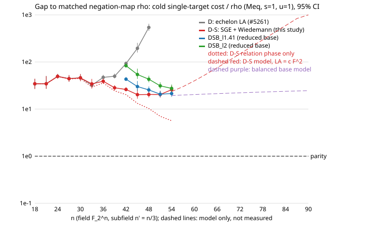

# Sparse linear algebra for arm D (arm D-S): cold single-target solve against matched rho

2026-11-27 · branch `claude/binary-descent-sparse-la-20261127` · PR #5290, stacked on PR #5261 (and #5253) ·
study `bdsl-20261127/v1`.
All measured numbers are **[pcc:unverified]**: L0 producer evidence from one shared 4-vCPU / 15 GB container. There
is no second-host replay and no validation gate, and nothing here is a leaderboard row. **Single target only**: every
solve is one cold solve of one public Q; nothing is amortised across targets.

## Result

- **Replacing only the linear algebra moves the whole cold solve at n = 48 from 541× to 20.4× [17.6, 24.2] matched
  negation-map rho** [pcc:unverified]. D-S/D = 0.038 [0.036, 0.040] there: the whole solve is 26× cheaper, and the
  LA alone is 52× cheaper (DS LA / D LA = 0.019).
- **The gap now sits at about 20× rho from n = 45 to n = 51** (20.3, 20.4, 20.4) and widens again to 25.8×
  [21.9, 31.4] at n = 54, because the sparse LA still grows like F²: its measured exponent in F is 1.98
  [1.93, 2.01] (echelon: 2.85), with LA ≈ 0.75·F² mod-ℓ operations at every rung n ≥ 36. The LA share is 50% at n = 48,
  66% at n = 51 and 78% at n = 54.
- **No parity at any rung** n = 18..54, and none anywhere in the §5a band (the lowest band value is 5.65 at n = 54 with
  mod-ℓ work priced at 0, which is the relation phase alone).
- **Reduced factor base (declared before data):** λ = √2 first pays at n = 54, DSB_l1.41/DS = 0.827 [0.821, 0.831]
  (21.4× rho [18.2, 25.9]), and costs more below (1.65× at n = 42, 1.25× at n = 48, 1.01× at n = 51). λ = 2 is worse
  than λ = √2 everywhere. Across the band this order is unresolved (at u = 0 the reduced base costs 2× more).
- **Crossover (model, not measurement):** with LA = 0.755·F² there is still **no crossover** for the full base. The
  ratio has its minimum, about 18×, near n′ = 16 and then grows. A balanced base levels off at about 19–28× for
  n′ = 18..40 and never crosses. The relation phase alone would cross rho near n′ = 23.5 (n ≈ 70), unchanged from #5261.



## Arm D-S

Code: `harness/src/main.rs` (`run_ds`) and `harness/src/sparse_la.rs`. Protocol:
[`PROTOCOL.md`](PROTOCOL.md) and [`protocol.json`](protocol.json), frozen at commit `46d2a680f` before any evaluation
data. All pre-freeze engineering ran on separate self-test instances.

- **The relation phase is arm D's, unchanged.** #5253's field, curves, factor base, A1 stream and group-law
  resolution, and #5261's `descent.rs`, are included by `#[path]` without edits.
- **Shown bitwise on every case n ≤ 48.** An uncounted copy of #5253's echelon is fed D-S's rows exactly as arm D
  feeds them. It stops at #5261's target with #5261's `(d, targets, relations, columns)` and all seven relation-phase
  counter maps, on **116 of 116** cases.
- **Stopping rule.** At relation counts ⌈0.70F⌉, then every ⌈F/256⌉ more, D-S checks whether the 2-core of the column
  hypergraph has more rows than columns. If it does, the LA runs. If the LA finds only useless dependencies, collection
  goes on, and the LA reruns from scratch and is counted again.
  - D-S never stops before D: relations(D-S) ≥ relations(D) on 116 of 116 cases.
  - It overshoots by 0.2% of the relation phase at n ≥ 36 (DS rel / D rel = 1.002), and by up to 1.5% at n = 18.
- **SGE (structured Gaussian elimination):**
  - singleton removal;
  - min-weight pivoting with cross-multiplication and a column-weight bound of 64;
  - pivots accepted only while the Wiedemann cost model N·(6·nnz + 4N) decreases;
  - every row carries its right-hand side (a, b), so no back-substitution is needed.
- **Excess pruning** to at most 2 surplus rows.
- **Wiedemann mod ℓ** (block size 1, declared before data) on Mᵀ, stacked with k − 1 dense random rows so that its
  kernel is a random line of ker Mᵀ.
- **Measured structure, the same at every rung n ≥ 39:**
  - the 2-core holds 0.64·F rows (the random 3-uniform prediction was 0.635);
  - the Wiedemann remainder has 0.121·F rows of weight 13.0–13.2;
  - one LA call and one Wiedemann attempt per solve at every rung n ≥ 42.

**How mod-ℓ arithmetic is priced** (#5261's convention):

- one product mod ℓ is one `z`, one addition is one `za`, and an inversion is 2·bits(ℓ) `z`, each priced at u Meq
  (u = 1 is the primary key; one `z` = one F_{2^n} multiplication);
- a product by ±1 is a sign change and is not charged, as in #5253's own Wiedemann;
- index bookkeeping is not charged, as D's echelon does not charge its pivot maps;
- both are counted and reported:
  - charging the ±1 products raises the LA from 0.755·F² to 1.33·F², and D-S/rho at n = 48 to 28.2;
  - bookkeeping adds 0.006–0.09·F².
- An indicative timing on this host (best of 7, no PMU) puts one mod-ℓ product at 1.44 F_{2^n} multiplications
  (`data/selftest_prefreeze.log`).

## Per-rung results

Full table: [`data/summary_table.md`](data/summary_table.md). Summary: [`data/summary.json`](data/summary.json).
Ratios are geometric means of per-case ratios with 95% hierarchical bootstrap intervals (B = 10000). Rho is the mean of
16 runs on the same Q.

| n | n′ | cases | DS/rho | DS/D | D/rho (#5261) | DS relation phase / rho | DS LA share | LA/F² | rho A/A |
|---|---|---|---|---|---|---|---|---|---|
| 18 | 6 | 12 | 34.5 [26.8, 44.2] | 1.010 [0.995, 1.038] | 34.2 | 34.4 | 0.2% | 0.59 | 1.020 [0.949, 1.099] |
| 21 | 7 | 12 | 34.4 [26.8, 49.9] | 0.995 [0.990, 1.002] | 34.6 | 34.3 | 0.2% | 0.43 | 0.961 [0.909, 1.017] |
| 24 | 8 | 12 | 49.4 [44.5, 55.8] | 0.997 [0.995, 1.000] | 49.5 | 49.1 | 0.6% | 0.71 | 1.015 [0.853, 1.187] |
| 27 | 9 | 12 | 44.2 [37.9, 52.6] | 0.997 [0.995, 1.001] | 44.3 | 43.5 | 1.4% | 0.81 | 1.026 [0.888, 1.180] |
| 30 | 10 | 12 | 45.9 [39.2, 55.3] | 0.991 [0.987, 0.993] | 46.4 | 44.8 | 2.3% | 0.76 | 0.953 [0.815, 1.118] |
| 33 | 11 | 4 | 34.3 [27.3, 43.7] | 1.068 [0.950, 1.341] | 32.1 | 29.4 | 16% | 3.06 | 0.820 [0.713, 0.962] |
| 36 | 12 | 12 | 39.0 [34.8, 44.4] | 0.828 [0.810, 0.850] | 47.1 | 35.8 | 8.3% | 0.81 | 1.007 [0.841, 1.180] |
| 39 | 13 | 12 | 28.3 [25.3, 32.1] | 0.568 [0.539, 0.604] | 49.8 | 24.4 | 14% | 0.77 | 1.138 [0.969, 1.353] |
| 42 | 14 | 12 | 26.1 [23.9, 29.1] | 0.282 [0.271, 0.295] | 92.6 | 20.3 | 22% | 0.76 | 0.974 [0.885, 1.088] |
| 45 | 15 | 12 | 20.3 [16.6, 26.7] | 0.104 [0.099, 0.107] | 195 | 13.2 | 35% | 0.75 | 0.984 [0.827, 1.179] |
| 48 | 16 | 4 | **20.4 [17.6, 24.2]** | **0.038 [0.036, 0.040]** | 541 | 10.3 | 50% | 0.76 | 0.854 [0.643, 1.134] |
| 51 | 17 | 12 | 20.4 [17.6, 24.4] | — | — | 7.03 | 66% | 0.76 | 1.175 [1.012, 1.411] |
| 54 | 18 | 4 | 25.8 [21.9, 31.4] | — | — | 5.66 | 78% | 0.75 | 1.033 [0.848, 1.257] |

- **D at n = 51 and 54** was not run: its echelon would need about 2 h per case.
- **Rho references:**
  - n ≤ 48: #5253/#5261's rho records, reused unchanged;
  - n = 51 and 54: new runs of the unchanged #5253 binary (sha256 `bf3f431f…`) with W = 64 lanes, the argmin of the
    held-out pilot at n = 51 (`data/pilot_rho_51.jsonl`).
- **Small rungs.** n = 33 has 4 cases. One of them (ci = 0, ti = 0) needed 4 LA calls because three checkpoints
  offered only useless dependencies, so n = 33's LA/F² and DS/D are high.
- **Up to 33 LA calls at n ≤ 24.** Small rungs check every relation, so several LA calls happen there; all are counted.
- **Reduced base, DSB/DS:**

  | n | λ = √2 | λ = 2 |
  |---|---|---|
  | 42 | 1.654 [1.624, 1.684] | 3.193 |
  | 45 | 1.484 | 2.677 |
  | 48 | 1.249 [1.242, 1.255] | 2.107 |
  | 51 | 1.014 [1.007, 1.023] | 1.527 |
  | 54 | 0.827 [0.821, 0.831] | 1.064 [1.056, 1.072] |

  Its relation phase grows about 2× (λ = √2) and 4× (λ = 2), and its LA falls about 2× and 4×, as modelled.

**Slopes** (OLS of log₂ cost, bootstrap within rung):

| Fit | Slope |
|---|---|
| rho, all rungs, against log₂ ℓ | 0.445 [0.443, 0.447] |
| D-S total, all rungs, against log₂ ℓ | 0.413 [0.408, 0.418] |
| D-S total, n ≥ 36, against log₂ ℓ | 0.453 [0.448, 0.459] |
| D-S relation phase, against log₂ ℓ | 0.371 [0.366, 0.376] |
| D total, against log₂ ℓ (#5261) | 0.511 |
| D-S LA, against log₂ F (n ≥ 30) | 1.98 [1.93, 2.01] |
| D LA, against log₂ F (n ≥ 30) | 2.85 [2.83, 2.87] |

**§5a band** (non-field units at u ∈ {0, 0.1, 1}, squarings at s ∈ {1, 0.25}):

- **D-S > rho at every rung and every band point**, for example at n = 48:

  | Band point | DS/rho |
  |---|---|
  | u = 0 | 10.3 |
  | u = 0.1 | 11.3 |
  | u = 1 | 20.4 |
  | s = 0.25, u = 1 | 25.4 |

  At n = 54 the band runs from 5.65 to 34.2.
- **D-S against D is unresolved across the band.**
  - At u = 0 all LA is free for both arms, and D-S pays its 0.2% relation overshoot: DS/D = 1.002.
  - At u = 0.1, D-S is cheaper from n = 36 (0.98) and reaches 0.18 at n = 48.
  - At u = 1, D-S is cheaper from n = 36 and reaches 0.038 at n = 48.
- **DSB against DS is unresolved at every rung.**

## Crossover projection (model, not measurement)

The inputs are fitted to the measured constants, and the model is labelled as such in `summary.json`:

- rho = S·√(2^{3n′}/h), with S = 9.59 from the top rung n = 54;
- the relation phase is 2.76·q′·(394 + 254·n′) Meq;
- the LA is 0.755·F², with F = 0.503·q′.

What the model gives:

- **Full base: no crossover.** LA ∝ q′² outgrows rho ∝ q′^{3/2}. The ratio is 18.4 at n′ = 16, 23.6 at n′ = 18
  (25.8 was measured at n = 54), 40 at n′ = 20 and 149 at n′ = 24.
- **Balanced base**, λ = (LA/rel)^{1/4}: the ratio is 19.4 at n′ = 18 (λ = 1.38; measured with λ = √2: 21.4), 22.2 at
  n′ = 24, 24.6 at n′ = 30 and 28.3 at n′ = 40. It grows like √n′ and does not cross.
- **Relation phase alone:** it crosses at n′ = 23.5.
- **Conclusion: closing the remaining ~20× needs a lower exponent, not cheaper LA.** The LA is now at its F² floor for a
  sparse solver: 0.75·F² mod-ℓ operations against an F³-like dense bound. A double-large-prime variant, another lane,
  would reduce the relation count's exponent. This study did not measure it.

## Hypotheses (frozen) and outcomes

| | Hypothesis | Outcome |
|---|---|---|
| H1 | exactness | **held**: 220/220 logs, shadow 116/116, prefix 116/116, kernel cross-check 60/60 |
| H2 | LA/F² in [0.4, 1.5] at n ≥ 36; exponent 1.8–2.2 | **held**: 0.75–0.81; exponent 1.98 |
| H3 | DS/D in [0.9, 1.1] for n ≤ 30; in [0.02, 0.10] at n = 48 | **held**: 0.991–1.010; 0.038 |
| H4 | DS/rho in [12, 40] at n = 48; within 15% of D/rho for n ≤ 33; no parity | **held**: 20.4; at most +6.8% (n = 33); no parity |
| H5 | LA share at n = 48 in [0.3, 0.7]; DS rel / D rel in [1.0, 1.03] | **held**: 0.50; 1.000–1.015 |
| H6 | model: no full-base crossover; relation phase crosses at n′ ≈ 23–25; balanced floor 10–40× | **held**: none; 23.5; 18–28× |
| H7 | DSB_l1.41/DS < 1 at n ≥ 48 and > 1 at n = 42; λ = 2 worse than √2 | **partly falsified**: 1.25 at n = 48 and 1.01 at n = 51; < 1 only from n = 54. The other two parts held. |

## Verification

- **Logs:** 220 of 220 D-S and D-S-B logs are correct: 132 DS and 88 DSB. Each is checked by [d]G = Q inside the
  counted solve and by d = d_true. The 256 new rho records are all correct. No relation was left unresolved.
- **Same relations as D:** the shadow identity holds on 116 of 116 cases, bitwise, for (d, targets, relations,
  columns) and the seven relation-phase counter maps.
- **Kernel cross-check:**
  - 60 of 60 solves at n ≤ 30 pass the uncounted check: the dependency, tracked back to the input rows, satisfies
    Σ c_j row_j = 0 and Σ c_j (a_j + b_j d) = 0, and its d equals the echelon's d.
  - Pre-freeze self-tests also passed: 40 synthetic planted-log systems per n, and cold solves on separate instances.
    Log: [`data/selftest_prefreeze.log`](data/selftest_prefreeze.log).
- **Replay:** the case n = 39, ci = 0, ti = 0 was rerun from the frozen manifest. All non-wall fields are bitwise equal
  ([`data/replay_compare.txt`](data/replay_compare.txt)).

## Deviations (all kept)

1. **Block size 1** (scalar Wiedemann) instead of block Wiedemann or block Lanczos. This was declared in the protocol
   before data: blocking does not reduce counted operations to leading order.
2. **`run.sh` edited after the freeze.** The `ref` target gained a thread-count argument so the n = 51 and 54 rho
   references could run on 1 thread beside the D-S run on 2. This is orchestration only, and the binaries are
   unchanged. Its hash now differs from `SEEDS.sha256`.
3. **Bad manifest line.** The replay was launched with a dummy `BCR_BIN`, which wrote one line
   `bcr_harness sha256` with an empty hash into `data/run_manifest.txt`.
4. **Freeze split over two commits.** Commit `5917e40c5` carried only the ACTIVE PR number, because the study
   directory was outside the sparse checkout. The freeze is `46d2a680f`.
5. **Rho lanes at the grid edge.** W = 64 won at the grid edge again at n = 51, as at #5261's n = 36..48. n = 54
   reused it without its own pilot, because of the host budget. If more lanes would help rho, the DS/rho ratios at
   n = 51 and 54 are understated, in D-S's favour.
6. **Rho A/A at n = 51** is 1.175 [1.012, 1.411], which excludes 1. Read the n = 51 ratios with that ±18% noise floor.
   n = 33's A/A, from #5253's reused data, is 0.82.

## Not done

- **Measurement infrastructure, as for #5253 and #5261:**
  - isolab/L2 runs;
  - a bench.record;
  - an S3 upload;
  - a `.resume/` checkpoint;
  - VALIDATION.json;
  - leaderboard and `benchmarks/` rows;
  - ICV1 slugs;
  - a pcc claim.
- **Conductor:** not installed on this host.
- **research-kb:** not available in this session, so no prior-art check was made.
- **Other measurements:**
  - D (echelon) at n = 51 and 54;
  - block size > 1;
  - double large prime (another lane);
  - multi-target amortisation, excluded by instruction.

## Reproduce

```
cd harness && CARGO_BUILD_JOBS=2 cargo build --release
BCR_BIN=../binary-composite-rootfind-20261126/harness/target/release/bcr_harness ./run.sh panel
BCR_BIN=… ./run.sh ext; BCR_BIN=… ./run.sh ref 64 1; BCR_BIN=… ./run.sh replay
data/merge.sh && harness/target/release/bdsl_harness analyze protocol.json data/runs_primary.jsonl data/summary.json figures/gap_to_rho.svg
data/replay_compare.sh data/runs_ds.jsonl data/replay_ds.jsonl
./build_pdf.sh
```
