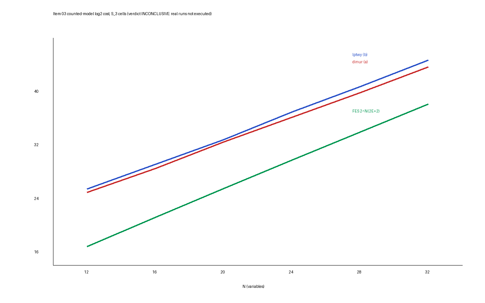

# Item 03: polynomial-method solving on descended Semaev systems

## Verdict

**INCONCLUSIVE** by the frozen rule (level: none reached; this is a loss for
neither side). Reassessment after the repair pass, on every completed receipt
(card 01 and revision cards 02-r2 to 10-r2, all `completed`, 72 commands, all
exit 0, every non-empty stdout and stderr log hash-matches its receipt).
`b03 summarize --dir raw` (instrument sha256 `c4a2a1ac...`, `raw/summary-r2.txt`)
prints `VERDICT: INCONCLUSIVE (level: n/a)`.

Why: the frozen **Sensitivity** control requires the `dinur` count to move by
less than 1% across E = 17, 33, 64. It moved 1.36% (E = 33) and 3.99% (E = 64)
(`raw/card-01-sens.stdout.log`), so the control fails and the frozen text makes
the verdict INCONCLUSIVE whatever the other rows say. The first run's code gated
at 5% and printed SENS OK; that was a code/protocol mismatch, fixed in
Deviation 13 (nothing was loosened). Relaxing the 1% bound is an owner decision.

**Descriptive branch with that one control waived (not the verdict):
TRADES, level exponent over constant.** Every other control passed (below).
At N = 32 both polynomial-method arms cost far more than FES
(`rho_dinur(32) = 0.0213`, `rho_lptwy(32) = 0.0102`, i.e. 46.8x and 97.7x
worse), but their fitted exponent over the six S_3 cells is lower than FES's by
more than the larger jackknife range. Distance remaining: the counted model
first drops below FES on the coarse grid at N = 80 (Dinur) and N = 128 (LPTWY),
and at N = 80 the Dinur working set is 2^71 bits, so no host can run it; with a
2^43-bit memory cap there is no crossover up to N = 400. Arm (e) msolve is
BLOCKED (not installed; no GMP/MPFR/FLINT headers; about 4 GB disk).

No improvement over the index-calculus baseline is measured or claimed. Nothing
here is a speedup, so no leaderboard change and no row for `benchmarks/README.md`
(PDF, SVG and PNG are still copied to `benchmarks/20261018-blindspots-polynomial-method/`).

## Method (frozen in `PROTOCOL.md`)

Unit: counted bit operations of one parity-count or enumeration call (F4:
`touches`). Cells: S_3 family (m = 2, d = 2) at N = 12, 16, 20, 24, 28, 32 with
E = N + 1; S_4 family (m = 3, d = 3) at N = 13, 19, 25, 31. Arms: `dinur`
(best schedule of 1 to 3 levels), `lptwy`, `fes` (real Gray-code full scan),
`f4` (item 05 Boolean F4, grevlex), msolve (BLOCKED). The polynomial-method
arms are counted by a closed-form model of the same control flow, validated
against the real counter; only the core call is charged (no Valiant-Vazirani
multiplier), a lower bound that favours the candidate.

## Numbers

Counted cost, log2 bit operations (descended draws; the cost depends only on
(N, E, d), so there is no sampling interval, and descended and random dense
systems differ by 0.00 in log2). Source `raw/summary-r2.txt`.

| cell | N | FES (real) | dinur | lptwy | rho_dinur | rho_lptwy | F4 touches (geo-mean; range of 8 targets) | F4/FES |
|---|---|---|---|---|---|---|---|---|
| c13-6-2 | 12 | 16.807 | 24.928 | 25.440 | 3.59e-3 | 2.52e-3 | 17.570 [17.415, 17.757] | 1.70 |
| c17-8-2 | 16 | 21.170 | 28.473 | 29.084 | 6.33e-3 | 4.15e-3 | 21.147 [20.693, 21.689] | 0.98 |
| c21-10-2 | 20 | 25.459 | 32.474 | 32.764 | 7.74e-3 | 6.32e-3 | 28.847 [28.835, 28.858] | 10.5 |
| c25-12-2 | 24 | 29.700 | 36.110 | 36.909 | 1.18e-2 | 6.76e-3 | 32.357 [32.333, 32.386] | 6.31 |
| c29-14-2 | 28 | 33.907 | 39.818 | 40.715 | 1.66e-2 | 8.93e-3 | time cap 80 s (2 targets) | n/a |
| c33-16-2 | 32 | 38.087 | 43.637 | 44.698 | 2.14e-2 | 1.02e-2 | time cap 90 s (1 target) | n/a |

`rho_A = bitops(FES)/bitops(A)`; larger is better for A; all are below 1.
FES wall time at N = 32 is about 10.3 s per full scan (mean of 16 scans).

Fitted exponent c in 2^(cN) over the S_3 cells (least squares; the interval is
the leave-one-cell-out jackknife, a stability interval, not a sampling one):

| arm | c | jackknife | local, N 28 to 32 |
|---|---|---|---|
| FES | 1.0632 | [1.0571, 1.0683] | 1.0451 |
| dinur | 0.9372 | [0.9329, 0.9418] | 0.9548 |
| lptwy | 0.9666 | [0.9594, 0.9795] | 0.9959 |
| F4 (4 finished cells) | 1.3016 | [1.2564, 1.4097] | n/a |

S_4 (cubic) cells, log2 cost: F4 touches 14.73, 19.10, 25.99, 30.74 at N = 13,
19, 25, 31 against the FES floor `2^N(2E+2)` (a generous comparator the
incumbent FES cannot meet; it refuses cubic systems) of 17.91, 24.39, 30.76,
37.04: F4 is 9x to 77x below the floor; `dinur` is 2^9.2 to 2^7.3 above it
(`rho_dinur` 1.7e-3 to 6.2e-3). F4 completed all 8 targets on every S_4 cell.

Crossover (counted model, E = N + 1, d = 2, N up to 400): `dinur` below FES from
N = 80 on the grid (N = 64: 71.69 against 71.04, still above), `lptwy` from
N = 128. At N = 400 the model gives FES 409.7, dinur 332.5, lptwy 374.8 (log2).
Working set of `dinur` at N = 80: 2^71.3 bits; with caps of 2^43 or 2^35 bits
there is no crossover (`dinur_first_grid_N_below_fes_mem43 = -1`).

## Exponent statement (level: exponent; made whatever the verdict)

Published-form asymptotic exponent from the instrument's `asym`: 0.6946 for
d = 2 and 0.8115 for d = 3 (positive control 2 reproduced Dinur 0.6943 and
LPTWY 0.8765 within the frozen bands). An index-calculus decomposition with N =
m l beats rho only if c < 1/2 - 1/m: 0 for m = 2, 1/6 for m = 3. Distance
remaining: 0.6946 (m = 2) and 0.6448 (m = 3); index-calculus exponent relative to
rho `2/m + 2c` = 2.389 and 2.290 (above 1 loses). With the fitted S_3 exponents
the same figure is 2.87 (dinur), 2.93 (lptwy), 3.13 (FES). This is the distance
remaining to matched rho as an exponent statement, not a measured improvement.

## Gap to matched rho and the 0 / 0.1 / 1 GAE pricing band (AGENTS.md 5a)

This item is a solver-stage cost study in one unit (bit operations) for every
arm; it prices no group operation and contains no rho arm, so there is no
cross-method row to price at 0, 0.1 and 1 GAE and no ranking between a solver
arm and rho is made. The ordering among the solver arms is the same at any
price because all arms share the unit. The only gap to rho is the exponent
distance above.

## Controls

* Selftest: SELFTEST OK (189 counted-model == real-counter checks; 126 parity
  checks equal to brute force, 48 odd; with t = 1 the check fails on 29 of 60,
  so it can fail).
* Positive control 1 (algorithm sees parity): passed. 8856 real calls on hashed
  systems (cells c17-8-2, c7-2-3, and c13-6-2 over 26 seeds), 710 with odd true
  parity against 400 required, 0 wrong, 0 skipped; the real counter equals the
  counted model on 8856 of 8856 calls.
* Positive control 2 (published exponents): passed (Dinur d = 2 0.69455, d = 3
  0.81149, LPTWY 0.87625).
* Negative control: dinur, lptwy, exh and t11 model rows are identical between
  descended and random dense systems (largest log2 difference 0.00); FES scan
  costs differ by under 0.01%.
* Sensitivity: **failed** (above). FES ratio responds correctly (1.888 against
  1.889 at E = 33; 3.610 against 3.611 at E = 64).
* Affine relations: every descended draw has exactly one affine combination of
  the equations with no quadratic monomial (linear rank 1, no constant), and
  no random dense system has one. No arm exploits it; its value as a one-bit
  reduction of N before solving was not measured here, so it is an observation,
  not a result.

## Deviations

Frozen Deviations 1 to 12 stand (no crate linkage, counted model above N = 16,
S_4 grid, msolve BLOCKED, core call only, FES floor on cubic cells, and so on).
Repair-pass Deviations 13 to 15 (sensitivity gate fixed from 5% to the frozen
1%; descriptive waived-branch line in `summarize`; card 01 not re-run, outputs
proven byte-identical by `smoke-r2.sh`). Added in this assessment:
the revision-card relays were not stored verbatim (below).

## Caveats

* Host: shared 4-vCPU container, isolation L0; wall times are descriptive only
  and F4's time caps are wall-clock caps (cards ran one at a time).
* Toy scale: N <= 32. The crossover rows come from the counted model beyond the
  real runs and are extrapolations, with no memory-feasible crossover.
* F4 hit its time cap at N = 28 (80 s, targets 0 and 1) and N = 32 (90 s,
  target 0), so F4's exponent rests on four cells (N = 12 to 24) and the F4 fit
  is a stability range, not a sampling interval.
* Costs of `dinur` and `lptwy` are lower bounds (one parity-count call; the
  Valiant-Vazirani and variable-fixing multipliers are not applied).
* **Relays.** The executor texts for cards 02-r2 to 10-r2 contained
  transcription errors against the receipts or omitted lines: card 04-r2 (field
  `new_elims`, an `elim` value of 8930.6 in one record, a stray repeated stderr
  line), card 05-r2 (`new_elims`, duplicated record), card 06-r2 (stderr tail
  replaced by "see receipt"), cards 09-r2 and 10-r2 (JSON bodies omitted).
  The disk logs have none of these. Assessment therefore read the disk logs;
  `check-relay` was run on stored excerpts (`raw/relay-r2-1.txt` to
  `relay-r2-9.txt`, header lines only) and reports every card as not verbatim.
  The first-run relays `raw/relay-1.txt` to `relay-9.txt` are untouched.

## Files

`graph.svg`, `graph.png`, `REPORT.pdf` (source `REPORT.typ`), `raw/summary-r2.txt`,
`raw/receipt-card-*.json`, `raw/card-*-r2-*.log`, `PROTOCOL.md`.

## First run (superseded)

Kept as recorded. Its numbers stand as card 01 outputs; its verdict was
superseded by the repair pass above.

### First-run verdict

**INCONCLUSIVE** (level: not reached; the frozen rule's controls and real runs
did not execute). `b03 summarize` on the recorded outputs prints
"a control did not pass or is missing: INCONCLUSIVE" and
"VERDICT: INCONCLUSIVE (level: n/a)" (`raw/summary-partial.txt`). Arm (e)
msolve remains BLOCKED (not installed). This is not a loss and not a win: only
card 01 ran. Cards 02 to 09 were refused by `task_card.py` before any command
started (see Deviations), so no real FES, real `dinur`/`lptwy`, positive
control 1, negative control cross-check, or F4 run exists.

