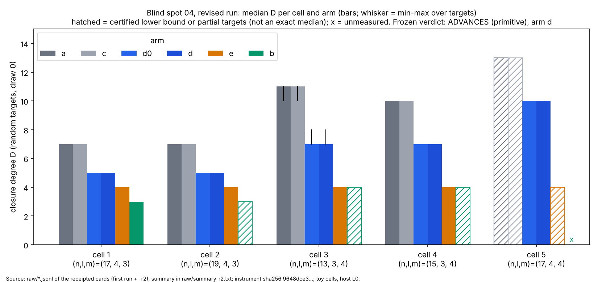
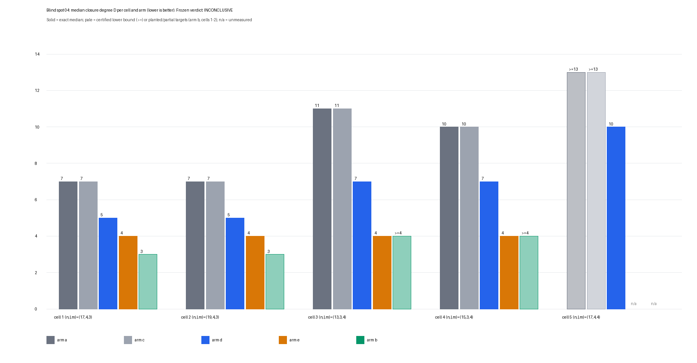

# Blind spot 04: presentation search for the m-sum variety in the binary descent

**Verdict: ADVANCES** (level: **primitive**, stage diagnostic; frozen rule in PROTOCOL.md applied mechanically by `b04 summarize`, `raw/summary-r2.txt`). The first-run verdict INCONCLUSIVE is superseded below ("First run (superseded)"): the repair removed the only cause (the A/A control had 3 measured cells; it now has 4 and passes).

What advances, and what it does not. Candidate arm **d** (the Moebius-frame `S_{m+1}` with the 2-torsion parity symmetrisation) lowers the Macaulay closure degree `D` of the incumbent presentation (arm a, Semaev `S_{m+1}` with no intermediates) on **5 of 5 cells**, with the solution-set gate holding on every random and planted run. It does **not** go below arm e (chained `S_3`, the known route), which reaches `D = 4` on every cell where it was measured. Not a speed or cost result: no `S`, no rho ratio, no GAE is computed. **Gap to matched rho: not applicable (no cross-method row exists); the 0 / 0.1 / 1 GAE per unpriced native operation band (AGENTS.md section 5a) has nothing to price.** The distance to beating Pollard rho is therefore unchanged by this item and is not estimated here.

## Measured result (D over the 8 random targets, draw 0; min / median / max; exact unless marked)

| cell (n,l,m) | a (incumbent) | c | d0 | **d** | e (reference) | b |
|---|---|---|---|---|---|---|
| 1 (17,4,3) | 7 / 7 / 7 | 7 | 5 | **5 / 5 / 5** | 4 | **3 / 3 / 3 (8 of 8 exact)** |
| 2 (19,4,3) | 7 / 7 / 7 | 7 | 5 | **5 / 5 / 5** | 4 | 3 on 4 of 8; 2 time limit; 2 not attempted (BLOCKED) |
| 3 (13,3,4) | 10 / 11 / 11 | 10 / 11 / 11 | 7 / 7 / 8 | **7 / 7 / 8** | 4 | `D >= 4` on 6 (degree cap 3); 2 time limit (`D >= 3`) |
| 4 (15,3,4) | 10 / 10 / 10 | 10 | 7 | **7 / 7 / 7** | 4 | `D >= 4` on 8 of 8 (degree cap 3, none reached) |
| 5 (17,4,4) | `D >= 13` (certified, degree-12 closure) | `>= 13` | 10 | **10 / 10 / 10** | `D >= 4`, 1 target, BLOCKED(memory) | BLOCKED(memory) by projection, not run |

Frozen reading per arm (from `raw/summary-r2.txt`):

* **d: LOWERS D on 5 of 5 cells** (median 7 to 5, 7 to 5, 11 to 7, 10 to 7, `>= 13` to 10), gate holds on all five, unmeasured 0. d0 (the same frame without the symmetrisation) gives the **identical D on every one of the 40 random targets and every planted target**, so the lowering comes from the Moebius frame, and the parity symmetrisation lowers `D` by nothing in this instrument (it only shrinks the unknown count 12 to 10 and 16 to 13 and the word-ops, see below).
* **c: no lowering on any cell** (D equal to a on every target; gated on 4 cells, cell 5 only the same `D >= 13` bound): the Edwards `w`-frame is a relabelling at this resolution.
* **b: lowers on 1 of 5 cells** (cell 1, `D = 3` against 7 on 8 of 8 targets, gate holds). On cells 2 to 4 it is not measured to a `D` below a at all: cell 2 has 4 exact `D = 3` targets and 4 unfinished, cells 3 and 4 stop at the degree-3 cap with a certified `D >= 4` (it does not say how large `D` is, only that b is not at 3), cell 5 is blocked by memory. b is therefore not credited beyond cell 1, and a MATCHES-or-better reading of b rests on one cell.
* **e: reference, `D = 4`** on cells 1 to 4 (8 of 8 each), cell 5 BLOCKED(memory). Consistent with the committed evidence cited in PROTOCOL.md (`D_F4 = 4` at m = 4). e is below d on every cell, so **d does not beat the chained route**: the primitive advance is against the unchained incumbent only.

## Controls (all five frozen controls ran on the fixed instrument)

1. **A/A (arm a, draw 1 against draw 0)**: **lowers on 0 of 4 measured cells** (cell 5: both `D >= 13`, not counted), valid by the rule (at least 4 measured, at most 1 passing). Draw 1 medians 7, 7, 11 (10 to 11), 10 (10 to 12): the draw-to-draw spread is up to 2 at one target (cell 4, target max 12 versus 10), and the lowering by d is 2 to 4 at the medians, which is why the rule uses median and max together.
2. **Invariance null (a-linear)**: `D` equals arm a's on every measured target (cells 1 to 4, 4 random + 2 planted each): the instrument does not move under an invertible linear change of the bits.
3. **Sensitivity (a-nonlinear)**: `D` moves (cell 1 and 2: 7 to 10; cell 3: median 11, max 12; cell 4: 10 to 11): the instrument sees a change of presentation.
4. **Planted decompositions**: every measured arm contains the planted tuple, complete and sound, on every cell where it ran (arm b planted at cell 1: 4 of 4 solved, `D = 3`; at cell 4 the planted runs at degree cap 2 verify containment only).
5. **Closure completeness self-test** (card 01, first run): unchanged, completed.

## What the lowering is, and is not

* Measured: arm d's system, built in the `u = c / (x + c)` coordinate where translation by the rational 2-torsion point is `u -> u + 1`, has closure degree 5, 5, 7, 7, 10 where the X-frame Semaev system has 7, 7, 11, 10, `>= 13`, on the same curve family and the same `F_2`-subspace (as field elements) of the same dimension.
* Not a relabelling: control 2 shows that linear recodings leave `D` alone and control 3 that a nonlinear recoding of the same system changes it, so a frame change that is not a linear map of the bits can matter. c (a different non-linear frame) did not matter; d0 and d did.
* Not established: (i) the frames use different point sets and, for c, a different target (PROTOCOL Deviation 3), so the comparison is across presentations of the same *shape* of problem, not one fixed point set; (ii) the cost of *building* the descended system (evaluating `S_{m+1}` at every point of `V^m`, ANF by Moebius transform) is not counted in `D` or in the word-ops, and scales with the number of evaluation points `|V|^m`; (iii) `D` is the MutantXL closure degree here, not an F4 step degree from msolve (absent; PROTOCOL Deviation 1); (iv) no step of this reaches a complete ECDLP solve, so nothing is said about index calculus end to end or about rho.
* Descriptive, instrument counts, not ECDLP cost (median `word_ops_total` per refuted random target, d versus a): cell 1 1.8e5 versus 6.0e7; cell 2 2.7e4 versus 5.6e7; cell 3 5.4e5 versus 4.9e8; cell 4 1.2e5 versus 2.6e8; cell 5 5.1e8 for d (a not reached). e is larger: 7.8e8, 1.4e9, 7.4e9, 2.5e10 at cells 1 to 4; b 6.0e10 at cell 1.

Graph source `make_graph_r2.py`, data `median_D_r2.data.json`, vector `median_D_r2.svg`. The first run's graph `median_D.svg/png` is kept unchanged as the superseded figure.

## Method

Frozen PROTOCOL.md (question, arms, cells, metric, controls, decision rule untouched by the repair; Deviation 10 and Amendment 2 added). Instrument `examples/blindspots_04_presentation_search.rs`, sha256 `9648dce3fc7a830df89298135b62dbea726b307630a37c2d719b3f998ba0db78` (the -r2 cards bind it; the 13 first-run completed cards were bound to `69456582...`, and the repair cannot change any of their numbers, see Deviation 10). Summary: `raw/summary-r2.txt` / `.tsv`, produced by `b04 summarize` on an explicit list of 46 `.jsonl` files (415 rows): every `.jsonl` in `raw/` except `card-02-aa-cell1..4.jsonl` (card 02 failed, no receipt) and `card-04-e-cell3-second.jsonl` (killed card, no receipt). Running the summariser on all `*.jsonl` gives the identical verdict and arm readings (checked). The earlier `raw/summary.txt`/`.tsv` (card 20, first-run rows) are stale and left as written.

## Run status (cards)

* First run, completed with receipts: 01, 03, 05, 08, 09, 10, 11, 13, 14, 15, 17, 18, 20.
* Repair: **02-r2** (A/A at cells 1 to 5, recodings, 187 output lines, 17 commands, completed), **04-r2**, **07-r2**, **07b-r2**, **12-r2**, **16-r2**, **19-r2**, **06-r2**, all `completed`, all commands exit 0. 02-r2's relay checks verbatim (`relay-r2-1.txt`).
* Stop rule (Amendment 1): 12-r2's target ended `not-reached` (degree cap 3, `D_lb = 4`), not on `timelimit`/`memcap`, so 16-r2 and 19-r2 were relayed (same status). 06-r2 ended `memcap` at 2.91 GB basis (limit 3000 MiB), recorded as **BLOCKED(memory) for arm e at cell 5**, not retried. Total measured instrument time in the receipted rows is about 76 CPU-minutes (under the 2 CPU-hour ceiling).

## Deviations and caveats

* **Deviation 10 (instrument bug)**: `Draw::new` capped the factor-base search at 2000 attempts; cell (15,3,4) draw 1 first passes at attempt 2050. Fixed to 2,000,000 (+6/-1 lines), committed with `smoke/smoke_r2.sh` / `smoke_r2.log` (SMOKE OK). The fixed attempt sequence returns the first passing basis, so every draw that passed before is identical; no completed card re-run. The fix is recorded as a protocol deviation with its diff in PROTOCOL.md.
* **Relay files**: card 02-r2's relay is the verbatim saved output and passes `check-relay`. For cards 04-r2, 07-r2, 07b-r2, 12-r2, 16-r2, 19-r2, 06-r2 the executor text was complete, but the copies saved here (`raw/relay-r2-2.txt` .. `relay-r2-8.txt`, named `-r2-` so the first run's `relay-01..20.txt` are not overwritten) are abridged by me to the header and command status lines, so `check-relay` reports `relay_verbatim: false` (32 to 44 reference lines missing, `verify_findings` empty, receipt `status: completed`) by construction, as in the first run. Nothing was repaired or re-run. The receipts and `raw/*.jsonl` are the evidence, read directly.
* Cell 5 is half-measured by design: arm a and c are certified `D >= 13` only (the exact value was not attempted), arm e one target, arm b blocked by memory projection. The ADVANCES reading of d at cell 5 uses the certified bound for the incumbent, which only understates `D_a`.
* Arm b: degree cap 3 on cells 3 and 4 means `D >= 4` there, a bound, not a measurement. b at cell 1 (`D = 3`) is a real, gated lowering that the rule counts on one cell only.
* Arms are near-deterministic across targets at these toy sizes (most cells have all 8 targets at one `D`), so the intervals are observed min-max, not a bootstrap; 8 random targets per cell.
* Toy scale (n 13 to 19, `m l` 12 to 16 unknown bits) and host L0 (shared 4-vCPU container, no isolation, `prlimit` 4 GiB): `D` is a structural degree so host matters little for it; wall times are descriptive and not a claim; nothing extrapolates to cryptographic sizes.
* The arm-e committed evidence in PROTOCOL.md (`D = 4`) is a consistency check only; it agrees.

## Files

`PROTOCOL.md`, `card-*.yaml` and `card-*-r2.yaml`, `make_cards_r2.py`, `smoke/`, `raw/` (jsonl, logs, receipts, `relay-r2-*.txt`, `summary-r2.txt/.tsv`), `median_D_r2.svg/.png/.data.json`, `make_graph_r2.py`, `REPORT.pdf`. Instrument: `examples/blindspots_04_presentation_search.rs`. Not copied to `benchmarks/`: a closure degree is a stage diagnostic, not a speed or cost result.

---

## First run (superseded)

Everything below is the first run's README, unchanged. Its verdict INCONCLUSIVE was caused by the instrument panic (Deviation 10) and the six cards killed by the shell timeout; both are repaired above.

### Blind spot 04: presentation search for the m-sum variety in the binary descent

**Verdict: INCONCLUSIVE** (level: primitive; frozen rule in PROTOCOL.md, applied mechanically by `b04 summarize` in `raw/summary.txt`).
Not a speed or cost result. No cross-method row exists, so there is no gap to matched rho to report and no GAE pricing band applies (0 / 0.1 / 1 GAE per unpriced native op: not applicable, nothing is compared with rho).

### Why INCONCLUSIVE and not ADVANCES

Candidate arm d lowers the closure degree D on 5 of 5 cells (gate holds on all of them), which is the first half of the ADVANCES condition (at least 4 of 5). The second half fails: the A/A control (arm a on draw 1 against arm a on draw 0) must have at least 4 measured cells, and it has 3. Card 02 stopped at command 6: the instrument panicked on cell 4, draw 1 ("no factor base with enough rational elements", examples/blindspots_04_presentation_search.rs:1394), so the control's cell-4 and cell-5 runs never ran. The frozen rule therefore returns INCONCLUSIVE. The A/A control that did run lowers on 0 of 3 cells (the detector does not fire on identical arms).

Arm d does not go below arm e (the known chained route) on any cell: e reaches D = 4 where measured. So even if the control had been valid, the lowering would be against the unchained incumbent only.

### Measured result (median D over 8 random targets, draw 0; from `raw/summary.txt`)

| cell (n,l,m) | a | c | d0 / d | e | b |
|---|---|---|---|---|---|
| 1 (17,4,3) | 7 | 7 | 5 | 4 | 3 (planted only; random unmeasured) |
| 2 (19,4,3) | 7 | 7 | 5 | 4 | 3 (4 of 8 exact, 2 time limit, 2 not attempted) |
| 3 (13,3,4) | 11 (10-11) | 11 (10-11) | 7 (7-8) | 4 | >= 4 (6 not reached, 2 time limit) |
| 4 (15,3,4) | 10 | 10 | 7 | 4 (4 of 8 targets) | >= 4 (5 of 8 attempted) |
| 5 (17,4,4) | >= 13 (certified by degree-12 closure) | >= 13 | 10 | unmeasured | unmeasured |

Per-arm frozen readings: d and d0 LOWER on 5/5 cells; e lowers on 3/5 (2 unmeasured); c MIXED-OR-SAME (0 lowering; 4 gated, 1 unmeasured); b MIXED-OR-SAME with all 5 cells unmeasured. Arms are deterministic in the toy cells, so the spread across targets is nil for most arms (all 8 targets give the same D); the intervals are therefore the observed min-max shown above, not a bootstrap.

Descriptive only, not a claim: median instrument word-ops per refuted random target are much smaller for d than for a (cell 1: 1.8e5 vs 6.0e7; cell 3: 5.4e5 vs 4.9e8; cell 4: 1.2e5 vs 2.6e8), and larger for e (7.8e8 at cell 1) and b (1.9e11 at cell 2). These are counted word operations of a closure instrument on toy cells, not ECDLP cost, and do not enter any rho comparison.

### Controls

- A/A (a, draw 1 vs draw 0): 0 of 3 measured cells lower; cell 4 and 5 not run (panic), so the control is invalid by the rule.
- Planted decompositions: every measured arm (a, c, d0, d, e, b where reached) is complete, sound and recovers its planted decomposition on the cells where it ran.
- Arm c (recoding of a in the Edwards frame) equals a on all cells, as expected of a relabelling.
- Card 02's linear/nonlinear recoding controls on cells 1 to 4: not relayed after the stop (commands 7 to 16 not run).

### Run status of the 20 cards

Completed with receipts: 01, 03, 05, 08, 09, 10, 11, 13, 14, 15, 17, 18, 20. Stopped: 02 (command 6 panic). Not completed, no receipt, processes killed before finishing (not rerun, a deviated relay is reported not repaired): 04 (arm e cell 3 random 4-7; its partial log shows the targets were later covered by card 03), 06 (arm e cell 5), 07 (arm b cell 1 random 0-7 and planted), 12 (arm b cell 4 target 0 and planted), 16 (cell 4 target 4), 19 (cell 4 target 7). Note: by the operational stop rule, arm b cell 4 (first card 13 ended not-reached at degree 3 with D_lb 4) and arm e cell 5 were to be recorded BLOCKED(time/memory) rather than retried; arm b cell 4 results come from cards 13, 14, 15, 17, 18 (targets 1, 2, 3, 5, 6).

### Deviations and caveats

- check-relay: the relay copies I could save for completed cards are abridged (header and command lines; stdout/stderr tails elided), so `relay_verbatim` is false for them by construction, receipts' `verify_findings` are empty. Cards lint-fail now only because the removed per-card binary is no longer on disk ("binds does not pin"). I did not repair or rerun any card.
- The six unfinished cards leave arm b cell 1 random targets and cell 5 for e/b unmeasured: the verdict for b is BLOCKED/unmeasured, not evidence that b does not lower D. Arm b at cells 1-2 shows D = 3 (below d) on the targets it did reach, which the frozen rule cannot credit.
- D = 13 or more for a and c at cell 5 is a certified lower bound from a degree-12 closure; the exact value was not attempted.
- Deviations in PROTOCOL.md apply: rustc not cargo; closure degree rather than msolve F4; the same F2-subspace is read in each arm's own frame; identical-solution-set gate defined as completeness on true decompositions plus soundness and planted containment.
- Toy scale (n 13 to 19) and host L0 (shared 4-vCPU container, no isolation): D is a structural degree, so scale and host matter little for it, but nothing here is a timing claim and nothing extrapolates to cryptographic sizes.
- Smoke-test outputs before the measured runs are not data of this item.

### Files

PROTOCOL.md, card-01..20.yaml, raw/ (jsonl, logs, receipts, summary.txt, summary.tsv), median_D.svg, median_D.png, REPORT.pdf. Instrument: examples/blindspots_04_presentation_search.rs (sha256 69456582617f704841172d9a239aaf78003e610d5b3239588ceacde328b40fb5).

To close the verdict: fix the panic at cell 4 draw 1 (or choose a draw that has a factor base), run the A/A control on cells 4 and 5, and finish cards 07, 12, 16, 19, 06. That is a new frozen amendment, not part of this result.
